

# UNIVERSIDAD PERUANA DE CIENCIAS APLICADAS

### Ingeniería de Software

### Ciclo Académico: 2026-20

### Código: 1ASI0729

### Curso: Desarrollo de Aplicaciones Open Source

### NRC: 7760

### Docente: Juan Antonio Flores Moroco

# Informe de Trabajo Final

### Startup: AIpaca

### Producto: Rumbo

### Integrantes

| Apellidos y Nombres | Código de Alumno |
|---|---|
| Díaz Ramírez, Alejandro | U202423084 |
| Geronimo Puma, Kevin Joel | U202423163 |
| Lino Quispe, Leonardo Miguel | U202422298 |
| Meza Soza, Alexandra Yamile | U20241b451 |

### NOVIEMBRE - 2026

---

## Registro de Versiones del Informe

| Versión | Fecha | Autor(es) | Descripción de cambios |
| :---: | :---: | :--- | :--- |
| 0.1 | 09/09/2026 | Lino Quispe, Leonardo Miguel | Creación de la estructura base del informe en Markdown y configuración inicial del repositorio. |
| 0.2 | 11/09/2026 | Díaz Ramírez, Alejandro / Meza Soza, Alexandra Yamile | Actualización de integrantes y desarrollo preliminar de los capítulos I y II para AV1. |
| 0.3 | 15/09/2026 | Geronimo Puma, Kevin Joel / Pareja Caceres, Diana | Ajuste del Capítulo I para reforzar propuesta de valor, modelo de negocio y escalabilidad. |
| 0.4 | 17/09/2026 | Lino Quispe, Leonardo Miguel / Díaz Ramírez, Alejandro | Sincronización del Capítulo I a partir de retroalimentación recibida y consolidación de Lean UX. |
| 0.5 | 17/09/2026 | Meza Soza, Alexandra Yamile / Pareja Caceres, Diana | Alineación de la identidad Startup / Producto Rumbo y refinamiento de alcance y restricciones según feedback docente. |
| 1.0 | 18/09/2026 | Geronimo Puma, Kevin Joel / Lino Quispe, Leonardo Miguel | Consolidación y entrega oficial del hito AV1 (Landing Page pública, Capítulos I al IV y Sprint 1). |
| 1.1 | 24/09/2026 | Díaz Ramírez, Alejandro / Pareja Caceres, Diana | Rediseño y refinamiento de Bounded Contexts y modelo de dominio atendiendo correcciones del profesor para la planificación del Sprint 2. |
| 1.2 | 29/09/2026 | Lino Quispe, Leonardo Miguel / Meza Soza, Alexandra Yamile | Configuración base de la aplicación web en Angular con estructura DDD y Angular Material para soportar los módulos de cada contexto. |
| 1.3 | 01/10/2026 | Díaz Ramírez, Alejandro / Geronimo Puma, Kevin Joel | Rediseño y optimización de la Landing Page pública (mejoras visuales, responsive design y llamada a la acción) según feedback docente. |
| 1.4 | 02/10/2026 | Pareja Caceres, Diana / Lino Quispe, Leonardo Miguel | Definición y reparto del alcance individual del Sprint 2 (1 Bounded Context con CRUD por integrante) e integración de endpoints en MockAPI. |
| 1.5 | 03/10/2026 | Meza Soza, Alexandra Yamile / Pareja Caceres, Diana | Implementación de vistas y lógica de formularios reactivos para las operaciones CRUD en los módulos de vehículos y perfiles asignados. |
| 1.6 | 04/10/2026 | Díaz Ramírez, Alejandro / Geronimo Puma, Kevin Joel | Desarrollo de componentes y servicios CRUD para los módulos de rutas y subscripciones; resolución de validaciones y estados de error. |
| 1.7 | 05/10/2026 | Lino Quispe, Leonardo Miguel / Meza Soza, Alexandra Yamile | Integración y pruebas de flujo completo de los 5 Bounded Contexts desarrollados, configuración de entorno y despliegue del frontend en producción. |
| 2.0 | 06/10/2026 | Díaz Ramírez, Alejandro / Geronimo Puma, Kevin Joel / Lino Quispe, Leonardo Miguel / Meza Soza, Alexandra Yamile / Pareja Caceres, Diana | Consolidación y entrega final TB1: frontend desplegado con CRUD operativo en 5 Bounded Contexts (1 por integrante), cierre de Sprint 2 y levantamiento integral de observaciones del profesor. |
| 2.1 | 20/10/2026 | Equipo AIpaca — actualización documental | Revisión de los ocho Database Diagrams del Capítulo IV; sincronización de assets y estructura de documentación de Sprint 3, Validation Interviews y videos de AV2 conforme al Final Project Statement. |
| 2.2 | 02/11/2026 | Actualización asistida, pendiente de revisión del equipo | Ajuste del Sprint 3 a la distribución actual de cuatro integrantes; registro de backlog Jira, contratos Routes y estado de evidencias técnicas disponibles. |
| 2.3 | 10/11/2026 | Lino Quispe, Leonardo Miguel — consolidación documental para revisión grupal | Actualización del Sprint 3, Jira, Routes, Billing, Profiles, Notifications, APIs y riesgos de integración. |
| 2.4 | 10/11/2026 | Equipo AIpaca — integración documental | Incorporación de cinco capturas reales de Swagger UI y una de pgAdmin/PostgreSQL; supresión de marcadores sin imagen, tablas vacías y enlaces no proporcionados. Registro de liberación de frontend y backend a main. |
| 2.5 | 12/11/2026 | Meza soza, Alexandra Yamile / Geronimo Puma, Kevin Joel | Completar toda la documentación del Sprint 3 y las entrevistas de validación |

---

## Project Report Collaboration Insights

**Organización:** https://github.com/AIpaca-OS  
**Project Report:** https://github.com/AIpaca-OS/project-report  
**Landing Page:** https://github.com/AIpaca-OS/landing-page  
**Frontend Web Application:** https://github.com/AIpaca-OS/frontend-web-application  
**Web Services:** https://github.com/AIpaca-OS/web-services

### AV1

La colaboración se verificó directamente a partir del historial de commits, ramas y Pull Requests de los repositorios de la organización. Las siguientes evidencias consolidan el estado disponible al cierre de esta actualización y mantienen enlaces hacia GitHub para su validación.

**Team Collaboration Commits**

La siguiente evidencia corresponde al resumen de actividad disponible en GitHub Pulse para el Project Report.

  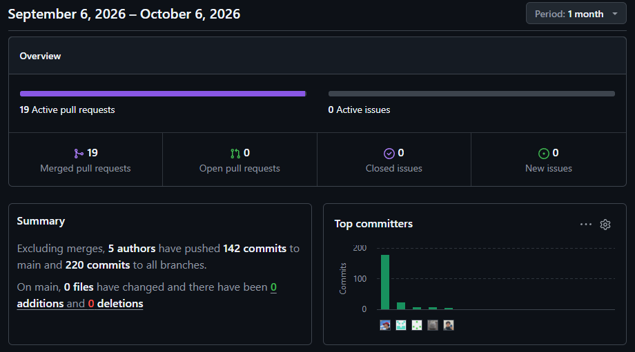

**Historial verificable:** https://github.com/AIpaca-OS/project-report/commits/develop/  
**Landing Page:** https://github.com/AIpaca-OS/landing-page/commits/main/

**Team Collaboration Network**

Las siguientes capturas corresponden al Network Graph y permiten revisar visualmente la evolución e integración de las ramas del trabajo colaborativo.

  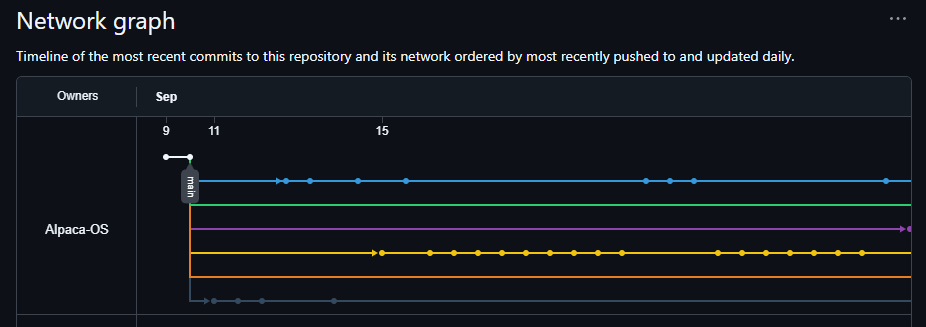  
  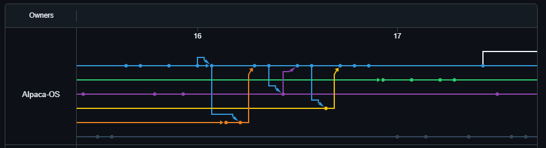  
  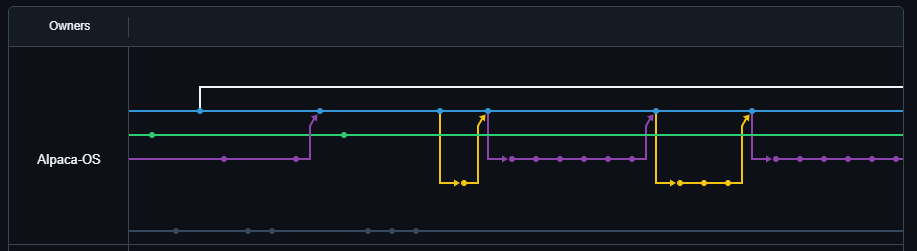  
  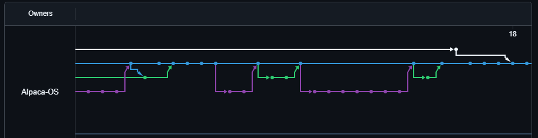  
  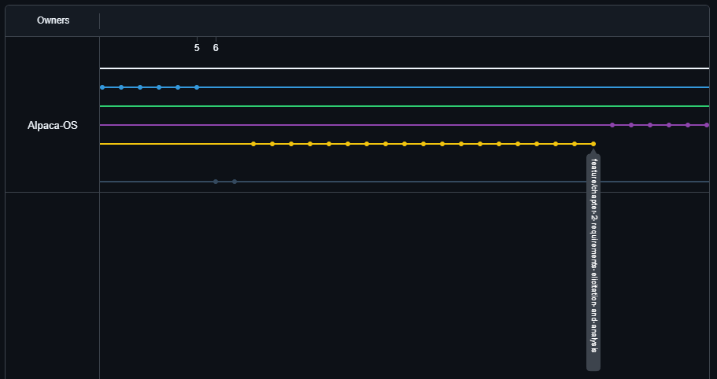  
  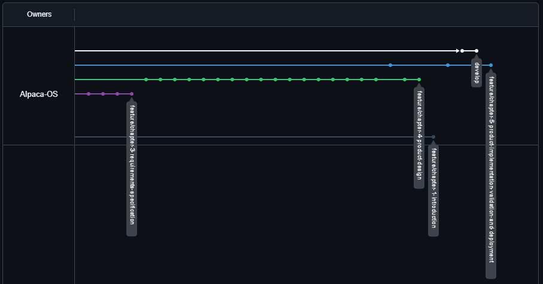

**Branches:** https://github.com/AIpaca-OS/project-report/branches  
**Network:** https://github.com/AIpaca-OS/project-report/network

La evidencia muestra trabajo mediante ramas por capítulo y consolidaciones sucesivas hacia `develop`. Se registran Pull Requests asociados a Requirements Elicitation, Requirements Specification, Product Design, Product Implementation y consolidación de AV1.

**Contributors / Pull Requests**

La evidencia de Pull Requests se mantiene mediante los enlaces verificables de GitHub, evitando referencias a archivos de imagen que ya no existen en el repositorio.

A la fecha de esta actualización, el Project Report registra **25 Pull Requests cerrados**, de los cuales **22 fueron integrados** y **3 fueron cerrados sin merge**. Entre los creadores de Pull Requests figuran `linolw`, `AlexandraYMS` y `DianaParejaCaceres`; el historial de commits también evidencia contribuciones de `aleedr` y `qebim18`.

**Contributors:** https://github.com/AIpaca-OS/project-report/graphs/contributors  
**Pull Requests:** https://github.com/AIpaca-OS/project-report/pulls?q=is%3Apr+is%3Aclosed

### AV2

Para AV2, el informe incorpora la revisión del diseño de persistencia y la organización de la documentación correspondiente al Sprint 3. Los ocho diagramas nuevos fueron integrados en el apartado 4.8, se actualizaron sus explicaciones y se sustituyeron los assets anteriores. En paralelo, el Capítulo V fue alineado con la estructura y los formatos del Final Project Statement, manteniendo separados los registros del trabajo realizado y las evidencias que corresponden a nuevas implementaciones.

La colaboración documental puede revisarse directamente en las ramas del informe y en los siguientes commits:

- [Actualización de los ocho diagramas y su redacción](https://github.com/AIpaca-OS/project-report/commit/3f54fc8dc33a7be44600b8aef3a6ed479df48c7a).
- [Eliminación de versiones gráficas sustituidas en Chapter 4](https://github.com/AIpaca-OS/project-report/commit/06d0970db2e320cbdf165f73f1a3f31e460acf2b).
- [Sincronización de recursos en la rama de Chapter 5](https://github.com/AIpaca-OS/project-report/commit/bcdaada5fd87dc7893ea8182f8002244a4bf0222).
- [Documentación de Sprint 3, entrevistas y About-the-Product](https://github.com/AIpaca-OS/project-report/commit/0d77f42d9c134269c60fad8dfc9509d1cb39a5d5).

Los analíticos de Contributors, Network y Pull Requests sirven para verificar la participación individual y el proceso de integración. Las capturas de AV2 se incorporan a esta sección con el periodo de consulta identificado.

<!-- AV2: incorporar imágenes de los analíticos y verificar la participación de cada integrante en el Project Report. -->

---

# Contenido

## Tabla de Contenidos

- [Student Outcome](#student-outcome)
- [Capítulo I: Introducción](#capítulo-i-introducción)
  - [1.1. Startup Profile](#11-startup-profile)
    - [1.1.1. Descripción de la Startup](#111-descripción-de-la-startup)
    - [1.1.2. Perfiles de integrantes del equipo](#112-perfiles-de-integrantes-del-equipo)
  - [1.2. Solution Profile](#12-solution-profile)
    - [1.2.1. Antecedentes y problemática](#121-antecedentes-y-problemática)
    - [1.2.2. Lean UX Process](#122-lean-ux-process)
      - [1.2.2.1. Lean UX Problem Statement](#1221-lean-ux-problem-statement)
      - [1.2.2.2. Lean UX Assumptions](#1222-lean-ux-assumptions)
      - [1.2.2.3. Lean UX Hypothesis Statements](#1223-lean-ux-hypothesis-statements)
      - [1.2.2.4. Lean UX Canvas](#1224-lean-ux-canvas)
  - [1.3. Segmentos objetivo](#13-segmentos-objetivo)
- [Capítulo II: Requirements Elicitation & Analysis](#capítulo-ii-requirements-elicitation--analysis)
  - [2.1. Competidores](#21-competidores)
  - [2.2. Entrevistas](#22-entrevistas)
  - [2.3. Needfinding](#23-needfinding)
  - [2.4. Big Picture Event Storming](#24-big-picture-event-storming)
  - [2.5. Ubiquitous Language](#25-ubiquitous-language)
- [Capítulo III: Requirements Specification](#capítulo-iii-requirements-specification)
- [Capítulo IV: Product Design](#capítulo-iv-product-design)
  - [4.8. Database Design](#48-database-design)
    - [4.8.1. Database Diagrams](#481-database-diagrams)
- [Capítulo V: Product Implementation, Validation & Deployment](#capítulo-v-product-implementation-validation--deployment)
  - [5.2. Landing Page, Services & Applications Implementation](#52-landing-page-services--applications-implementation)
    - [5.2.3. Sprint 3](#523-sprint-3)
      - [5.2.3.1. Sprint Planning 3](#5231-sprint-planning-3)
      - [5.2.3.2. Aspect Leaders and Collaborators](#5232-aspect-leaders-and-collaborators)
      - [5.2.3.3. Sprint Backlog 3](#5233-sprint-backlog-3)
      - [5.2.3.4. Development Evidence for Sprint Review](#5234-development-evidence-for-sprint-review)
      - [5.2.3.5. Execution Evidence for Sprint Review](#5235-execution-evidence-for-sprint-review)
      - [5.2.3.6. Services Documentation Evidence for Sprint Review](#5236-services-documentation-evidence-for-sprint-review)
      - [5.2.3.7. Software Deployment Evidence for Sprint Review](#5237-software-deployment-evidence-for-sprint-review)
      - [5.2.3.8. Team Collaboration Insights during Sprint](#5238-team-collaboration-insights-during-sprint)
  - [5.3. Validation Interviews](#53-validation-interviews)
    - [5.3.1. Diseño de Entrevistas](#531-diseño-de-entrevistas)
    - [5.3.2. Registro de Entrevistas](#532-registro-de-entrevistas)
    - [5.3.3. Evaluaciones según heurísticas](#533-evaluaciones-según-heurísticas)
  - [5.4. Video About-the-Product](#54-video-about-the-product)
- [Conclusiones](#conclusiones)
  - [Conclusiones y recomendaciones](#conclusiones-y-recomendaciones)
  - [Video About-the-Team](#video-about-the-team)
- [Bibliografía](#bibliografía)
- [Anexos](#anexos)

---

# Student Outcome

El curso contribuye al cumplimiento del **ABET – EAC – Student Outcome 3: Capacidad de comunicarse efectivamente con un rango de audiencias**.

En el siguiente cuadro se describen las acciones realizadas y los enunciados de conclusiones por parte del grupo, que permiten sustentar el haber alcanzado el logro del ABET – EAC – Student Outcome 3.

| Criterio específico | Acciones realizadas | Conclusiones |
|---|---|---|
| **Comunica oralmente con efectividad a diferentes rangos de audiencia.** | **Díaz Ramírez, Alejandro** • **AV1:** Realizó entrevistas de Needfinding dirigidas a conductores de movilidad escolar, adaptando el lenguaje técnico hacia términos coloquiales de transporte diario. • **TB1:** Expuso en video la navegación de la interfaz de usuario de perfiles y sustentó las decisiones de diseño tomadas para la interacción entre tutores y estudiantes. • **AV2:** Explicó los flujos implementados para la gestión de estudiantes y sus relaciones con tutores, el tratamiento responsable de los datos de menores y las decisiones relacionadas con la autorización de usuarios.  **Geronimo Puma, Kevin Joel** • **AV1:** Condujo entrevistas con padres de familia, enfocándose en la empatía y la resolución de preocupaciones sobre la seguridad en el traslado escolar. • **TB1:** Sustentó ante cámara la lógica del flujo de suscripciones y facturación emulada en la Frontend Web Application. • **AV2:** Presentó el funcionamiento del módulo de Subscriptions & Billing, explicando las decisiones de negocio implementadas y su integración con Spring Boot.  **Lino Quispe, Leonardo Miguel** • **AV1:** Lideró la exposición de la propuesta de valor y arquitectura de información de la Landing Page ante el docente y el equipo. • **TB1:** Explicó de manera estructurada en la sustentación síncrona el flujo de trabajo colaborativo en GitFlow y la organización de rutas escolares. • **AV2:** Explicó las decisiones de implementación de rutas, paradas, horarios, asignaciones y publicación, así como la integración entre Angular y Spring Boot y las dificultades de autorización encontradas.  **Meza Soza, Alexandra Yamile** • **AV1:** Participó activamente en la exposición de requisitos del usuario y arquetipos User Persona durante las revisiones internas del equipo. • **TB1:** Realizó la demostración guiada del módulo de alertas y configuración de notificaciones durante la grabación de la entrega. • **AV2:** Explicó el flujo de comunicación de incidencias y retrasos, el funcionamiento de los servicios de notificaciones y los resultados obtenidos durante su integración.  **Pareja Caceres, Diana** • **AV1:** Presentó la síntesis de competidores directos e indirectos y sustentó las ventajas diferenciales del producto durante la retrospectiva del Sprint 1. • **TB1:** Expuso la demostración funcional del Bounded Context de gestión de vehículos y credenciales, explicando el consumo de servicios REST en la nube y el uso de Signals para la reactividad. | **Conclusión grupal AV1:** El equipo demostró adaptabilidad comunicativa al interactuar con perfiles contrastantes (padres de familia y transportistas escolares), logrando extraer necesidades críticas sin inducir respuestas técnicas complejas.  **Conclusión grupal TB1:** Durante la sustentación y demostración de software, el equipo articuló con claridad técnica el funcionamiento de la aplicación ante el docente, relacionando cada vista con los objetivos de negocio y demostrando fluidez en la argumentación de la arquitectura elegida.  **Conclusión grupal AV2:** El equipo comunicó las decisiones técnicas y funcionalidades implementadas durante el Sprint 3 mediante testimonios audiovisuales, explicando sus responsabilidades individuales y los desafíos de integración entre los bounded contexts. |
| **Comunica por escrito con efectividad a diferentes rangos de audiencia.** | **Díaz Ramírez, Alejandro** • **AV1:** Redactó la caracterización del segmento objetivo y el análisis competitivo en el Capítulo II. • **TB1:** Documentó los contratos de datos y especificaciones funcionales para el Bounded Context de Profiles & Relationship Management. • **AV2:** Participó en el desarrollo de la documentación técnica relacionada con Profiles & Relationship Management, la gestión de estudiantes y sus relaciones con tutores, así como las dependencias de autorización y gestión de vehículos.  **Geronimo Puma, Kevin Joel** • **AV1:** Elaboró los artefactos de Needfinding (User Personas y Empathy Maps) empleando redacción centrada en el usuario. • **TB1:** Redactó la documentación de tareas y casos de uso emulados para el Bounded Context de Subscriptions & Billing en el Capítulo V. • **AV2:** Documentó los cambios correspondientes al contexto de Subscriptions & Billing, incluyendo la estructura de planes y suscripciones, los servicios backend y sus contratos REST.  **Lino Quispe, Leonardo Miguel** • **AV1:** Estructuró y redactó las directrices de configuración de software, políticas de ramas en GitFlow y la introducción formal del informe. • **TB1:** Consolidó la trazabilidad de tareas en el Sprint Backlog 2 y documentó la configuración general del entorno Angular CLI y temas Material. • **AV2:** Documentó la gestión de rutas, paradas, horarios, asignaciones y publicación, además de las especificaciones de los servicios REST y sus dependencias con Profiles.  **Meza Soza, Alexandra Yamile** • **AV1:** Redactó los escenarios de aceptación en formato Gherkin (Given-When-Then) para las User Stories del Sprint 1. • **TB1:** Elaboró la documentación técnica de las interfaces de alerta, detallando las reglas de validación en el informe colaborativo. • **AV2:** Elaboró la documentación técnica de los endpoints de los bounded contexts de Incidents & Delays Management y Notifications Management, incluyendo sus métodos HTTP, parámetros, ejemplos de solicitudes y respuestas y explicaciones funcionales. También documentó la evidencia del despliegue del backend y su conexión con PostgreSQL en Render.  **Pareja Caceres, Diana** • **AV1:** Documentó el análisis del entorno y los antecedentes de la problemática del transporte escolar en Lima en la sección Solution Profile. • **TB1:** Redactó íntegramente la documentación de infraestructura para Vehicle & Credential Management, detallando las llamadas HTTP a MockAPI, los modelos de dominio y las convenciones de Conventional Commits en el informe. | **Conclusión grupal AV1:** Se logró una especificación técnica rigurosa en Markdown, manteniendo uniformidad estilística y precisión en la definición de criterios de aceptación comprobables mediante Gherkin.  **Conclusión grupal TB1:** El equipo consolidó una redacción técnica clara y trazable en el Capítulo V, alineando sin ambigüedades los términos del negocio (Ubiquitous Language) con los artefactos de código fuente, endpoints REST y commits en GitHub.  **Conclusión grupal AV2:** El equipo fortaleció la documentación técnica del producto mediante la especificación de contratos REST, ejemplos de solicitudes y respuestas y evidencias del despliegue. La coordinación entre bounded contexts permitió mantener la trazabilidad de los cambios y comunicar las decisiones de integración.</td> |

---

# Capítulo I: Introducción

## 1.1. Startup Profile

### 1.1.1. Descripción de la Startup

**AIpaca** es una startup tecnológica peruana orientada al desarrollo de soluciones digitales para mejorar la coordinación de servicios cotidianos. Su producto inicial es **Rumbo**, una plataforma enfocada en la coordinación del transporte escolar entre padres o tutores y conductores de movilidad escolar.

Rumbo busca centralizar información sobre el estado del traslado, los principales hitos de la ruta, retrasos e incidencias, de modo que las familias puedan comprender rápidamente qué ocurre durante el recorrido y los conductores puedan comunicar eventos relevantes sin repetir la misma información de manera individual.

La solución se plantea inicialmente para Lima y Callao. No reemplaza las obligaciones de seguridad, autorización y operación de los prestadores del servicio; busca complementar la experiencia con información organizada, accesible y oportuna.

### 1.1.2. Perfiles de integrantes del equipo

<table>
  <thead>
    <tr><th>Foto</th><th>Apellidos y nombres</th><th>Código</th><th>Carrera</th><th>Habilidades</th></tr>
  </thead>
  <tbody>
    <tr><td align="center"></td><td>Diaz Ramirez, Alejandro</td><td>U202423084</td><td>Ingeniería de Software</td><td>Estudiante de Ingeniería de Software de 5.º ciclo, con una base sólida en Python y C++, así como experiencia en prototipado rápido con React Native, lo que me permite aportar en el desarrollo técnico del proyecto, especialmente en la lógica del sistema, la estructuración del código y el procesamiento de datos. También agregar que he trabajado en entornos colaborativos bajo marcos de trabajo ágiles, gestionando proyectos y equipos con Scrum para asegurar entregas eficientes y de calidad.</td></tr>
    <tr><td align="center"></td><td>Geronimo Puma, Kevin Joel</td><td>U202423163</td><td>Ingeniería de Software</td><td>Estudiante de Ingeniería de Software de 5.º ciclo, con una base sólida en Python y C++. Mi perfil me permite aportar en el desarrollo técnico del proyecto, destacando por mi facilidad para la arquitectura de software y el diseño de bases de datos, además de la lógica del sistema, la estructuración del código y el procesamiento de datos. Asimismo, tengo experiencia trabajando en entornos colaborativos bajo marcos de trabajo ágiles, asegurando siempre entregas eficientes y de calidad.</td></tr>
    <tr><td align="center"></td><td>Lino Quispe, Leonardo Miguel</td><td>U202422298</td><td>Ingeniería de Software</td><td>Soy estudiante de Ingeniería de Software del 5.º ciclo en la UPC. Tengo conocimientos en programación en C++ y Python, y experiencia desarrollando proyectos académicos donde analizo y organizo soluciones tecnológicas. Me gusta enfocarme en aprender de forma práctica y en construir soluciones que sean claras, funcionales y aplicadas a problemas reales.</td></tr>
    <tr><td align="center"></td><td>Meza Soza, Alexandra Yamile</td><td>U20241b451</td><td>Ingeniería de Software</td><td>Soy estudiante de Ingeniería de Software del 6.º ciclo en la UPC. Cuento con conocimientos en el desarrollo de sistemas utilizando los lenguajes Python y C++. Me caracterizo por aprendizaje rápido, criterio para filtrar información relevante y trabajo colaborativo. En el equipo aporto investigación aplicada y prototipos técnicos que conectan los hallazgos con funcionalidades del producto.</td></tr>
    <tr><td align="center"></td><td>Pareja Caceres, Diana</td><td>U202422589</td><td>Ingeniería de Software</td><td>Soy estudiante de Ingeniería de Software en la UPC. He trabajado en análisis competitivo, elaboración de User Personas, organización de información, lineamientos visuales, diagramas de arquitectura C4 y modelado DDD. Estos conocimientos me permiten aportar al equipo en la documentación, el análisis del producto y la estructuración de artefactos de diseño y arquitectura.</td></tr>
  </tbody>
</table>

## 1.2. Solution Profile

El **Solution Profile** presenta una descripción general de **Rumbo**, producto desarrollado por AIpaca. Aborda el contexto en el que opera el transporte escolar en Lima y Callao, los problemas detectados en la coordinación entre familias y conductores y las suposiciones estratégicas que guían el desarrollo de la solución. Esta sección conecta el problema identificado con una propuesta de valor concreta y sirve como base para el diseño, la validación y el desarrollo posterior del producto.

### 1.2.1. Antecedentes y problemática

El transporte escolar constituye un servicio formal y regulado en Lima y Callao. En enero de 2026, la Autoridad de Transporte Urbano para Lima y Callao informó que **3758 vehículos se encontraban habilitados para prestar el servicio de transporte de estudiantes** y recordó que los padres pueden verificar digitalmente si el vehículo y el conductor están autorizados (Infobae, 2026). Esta cifra confirma que existe un ecosistema amplio de familias, conductores y operadores que realizan traslados escolares de manera recurrente.

En esta sección se analiza el contexto en el que surge la problemática principal, considerando sus factores sociales, tecnológicos y operativos. Se utiliza la técnica de las **5 W y 2 H** para responder de forma estructurada qué ocurre, quiénes están involucrados, cuándo y dónde sucede, por qué ocurre, cómo se abordará y cuál es una magnitud referencial de la oportunidad y del esfuerzo inicial requerido.

#### Técnica de las 5 W's + 2 H's

**What (¿Qué?) — ¿Cuál es el problema?**  
La coordinación diaria entre padres y conductores sigue dependiendo en gran medida de mensajes y llamadas individuales. Los mecanismos oficiales permiten verificar si un vehículo y un conductor se encuentran autorizados, pero no resuelven la pregunta de qué está pasando durante la ruta. Los padres no cuentan con una vista única donde consultar si el menor ya fue recogido, si la movilidad está retrasada, si llegó al colegio o si ocurrió un imprevisto. Esa información se transmite de forma dispersa y buena parte de ella recae sobre el conductor, que debe responder consultas similares a varias familias mientras cumple su recorrido.

**When (¿Cuándo?) — ¿Cuándo ocurre?**  
El problema ocurre durante los días de clase, principalmente antes del recojo, durante el traslado y al momento de la llegada o entrega. La incertidumbre se intensifica cuando los horarios escolares coinciden con las horas de mayor congestión y un retraso de pocos minutos puede convertirse en una espera prolongada (El Comercio, 2026).

**Where (¿Dónde?) — ¿Dónde surge?**  
El problema se presenta principalmente en Lima Metropolitana y el Callao, en las rutas que conectan hogares, puntos de recojo y centros educativos. El TomTom Traffic Index 2025 reportó para Lima un nivel de congestión de **69,3 %** y alrededor de **195 horas anuales perdidas** en tráfico de hora punta. En 2026, reportes basados en datos de TomTom continuaron mostrando velocidades muy reducidas durante la hora punta matinal (Energiminas, 2026).

**Who (¿Quiénes?) — ¿Quiénes son los afectados?**  
- **Padres y tutores**, que necesitan saber en qué etapa se encuentra el traslado de sus hijos y actualmente dependen con frecuencia de preguntar directamente al conductor.  
- **Conductores de movilidad escolar**, que deben cumplir su ruta en medio del tráfico y, al mismo tiempo, comunicar recojos, retrasos o incidencias a varias familias.

**Why (¿Por qué?) — ¿Por qué ocurre y por qué importa?**  
- **Comunicación fragmentada en canales generales:** la coordinación suele realizarse mediante mensajería instantánea y llamadas. Según ERESTEL 2025, WhatsApp se mantiene como una de las plataformas de comunicación más utilizadas en el país (Expreso, 2026), pero un chat general no fue diseñado para registrar hitos de una ruta.  
- **Alta variabilidad de los tiempos de viaje:** la congestión de Lima hace que la hora estimada de llegada cambie constantemente.  
- **Carga operativa del conductor:** responder consultas durante la ruta compite con su prioridad de conducir de forma segura.  
- **Ausencia de un registro estructurado:** recojos, entregas e incidencias no siempre quedan documentados de manera ordenada.  
- **Verificación sin visibilidad en ruta:** las herramientas oficiales permiten comprobar la formalidad del servicio, pero no muestran el estado de cada traslado.

**How (¿Cómo?) — ¿Cómo se abordará?**  
AIpaca propone Rumbo, una plataforma web responsive orientada al uso móvil que centraliza el estado de cada traslado. Esta decisión es coherente con la alta conectividad de Lima Metropolitana: durante el cuarto trimestre de 2025, el INEI reportó **98,4 % de hogares con telefonía móvil** y **90,3 % de la población de 6 años a más utilizando Internet** (INEI, 2026).

Para los padres y tutores, la plataforma permitirá consultar el estado actual del viaje, revisar una línea de tiempo con los hitos del recorrido y recibir notificaciones ante recojos, llegadas, retrasos o incidencias. Para los conductores, permitirá consultar la ruta y los estudiantes asignados, confirmar recojos y entregas mediante interacciones breves y registrar una incidencia una sola vez para las familias correspondientes.

La información de cada menor deberá estar disponible únicamente para usuarios autorizados. El producto considerará el marco peruano de protección de datos personales y los principios de privacidad y control de acceso aplicables al tratamiento de información relacionada con menores (Escobedo, 2024).

**How much (¿Cuánto?) — ¿Qué magnitud tiene y qué esfuerzo inicial requiere?**  
La ATU reportó **3758 vehículos escolares habilitados en Lima y Callao**, lo que permite identificar un mercado formal y recurrente. Como referencia del mercado, Comparabien (2025) señala que el precio mensual por estudiante de una movilidad escolar puede variar aproximadamente entre S/ 150 y S/ 300 según distancia y servicios adicionales.

Como estimación referencial elaborada por el equipo, el desarrollo de un primer producto funcional puede involucrar costos de diseño UX/UI y prototipado, frontend web responsive con Angular, backend y API REST con Spring Boot, base de datos, integración de servicios, infraestructura en la nube, seguridad, cumplimiento normativo, marketing, piloto y soporte. Tomando como referencia el cálculo realizado para la propuesta académica, el rango total inicial se estima entre **S/ 23 300 y S/ 36 500**. Este monto es una hipótesis de planificación y no representa una cotización validada de mercado.

#### Objetivos y restricciones iniciales

**Objetivo general:** Diseñar una solución digital que mejore la coordinación del transporte escolar entre padres/tutores y conductores, centralizando los principales eventos del traslado y reduciendo la dependencia de llamadas y mensajes individuales.

**Objetivos específicos:**
- Permitir que los padres comprendan rápidamente el estado del traslado y los principales hitos del recorrido.
- Permitir que los conductores registren recojos, entregas, retrasos e incidencias mediante interacciones breves y seguras.
- Mantener un historial estructurado de eventos del viaje para facilitar consultas posteriores.
- Validar durante el proyecto qué funcionalidades generan mayor valor antes de ampliar el alcance tecnológico.

**Restricciones iniciales:**
- El alcance de validación de AV1 se concentra en padres/tutores y conductores de movilidad escolar de Lima y Callao.
- La interacción del conductor debe diseñarse para realizarse únicamente cuando sea seguro hacerlo y sin incentivar el uso del dispositivo mientras conduce.
- El acceso a información de menores debe limitarse a usuarios autorizados y considerar la normativa de protección de datos personales.
- Para AV1, la implementación se concentra en la primera versión desplegada del Landing Page; Angular y Spring Boot se desarrollarán progresivamente en los siguientes Sprints.
- GPS en tiempo real, ETA dinámico, geofencing, IoT y cámaras inteligentes forman parte de capacidades posteriores y no constituyen requisitos del MVP de AV1.

### 1.2.2. Lean UX Process

El proceso Lean UX adoptado por AIpaca para Rumbo busca reducir el riesgo de construir funcionalidades que no aporten valor mediante la validación continua de supuestos. El enfoque se organiza en cuatro componentes: definición del problema, formulación de assumptions, creación de hypothesis statements y síntesis en el Lean UX Canvas.

#### 1.2.2.1. Lean UX Problem Statement

El estado actual de la coordinación del transporte escolar en Lima y Callao se ha centrado principalmente en verificar la formalidad del servicio y en la comunicación directa entre padres o tutores y conductores mediante mensajería instantánea y llamadas. Esto genera incertidumbre sobre recojos, llegadas y retrasos, así como consultas repetitivas que interrumpen al conductor durante la ruta.

Lo que los productos y servicios existentes no resuelven completamente es una vista única y estructurada, restringida por permisos, donde se registren los hitos de cada traslado —recojos, entregas, retrasos e incidencias— y se notifique únicamente a los tutores autorizados.

Rumbo abordará esta brecha mediante una plataforma web responsive en la que los conductores confirmen hitos con interacciones breves y los padres consulten el estado actual, la línea de tiempo del viaje y las notificaciones relevantes.

El segmento inicial estará compuesto por conductores de movilidad escolar que operan en Lima y Callao y por los padres o tutores que utilizan sus servicios.

Se considerará una señal inicial de éxito reducir en **60 %** las consultas de padres sobre el estado de la ruta y lograr que al menos **80 %** de los recojos y entregas de una ruta quede confirmado dentro de Rumbo durante un piloto controlado. Estas cifras son objetivos de validación y no resultados ya demostrados.

- **Domain:** transporte escolar, movilidad urbana y coordinación digital entre familias y prestadores de servicio.
- **Customer Segments:** padres, madres y tutores de estudiantes que usan movilidad escolar; conductores de movilidad escolar que realizan rutas recurrentes.
- **Pain Points — Padres/Tutores:** incertidumbre sobre el estado del traslado, falta de avisos oportunos e información dispersa entre chats y llamadas.
- **Pain Points — Conductores:** consultas repetitivas, necesidad de comunicar el mismo evento a varias familias y ausencia de un registro ordenado de recojos, entregas e incidencias.
- **Gap:** falta de una solución de uso extendido en Lima y Callao que combine en una sola experiencia el estado del traslado, confirmaciones, incidencias y notificaciones dirigidas a usuarios autorizados. Este supuesto deberá contrastarse con el análisis competitivo.
- **Vision/Strategy:** consolidar a AIpaca como una startup referente en coordinación digital de servicios familiares, iniciando con Rumbo como solución para transporte escolar y priorizando claridad, privacidad, seguridad y escalabilidad.
- **Initial Segment:** conductores de movilidad escolar de Lima y Callao y padres o tutores que utilizan sus servicios y dispositivos móviles con acceso a Internet.

#### 1.2.2.2. Lean UX Assumptions

Los siguientes supuestos representan las creencias iniciales del equipo sobre el modelo de negocio, los usuarios y la viabilidad de Rumbo. Serán contrastados mediante entrevistas, prototipos y pruebas durante las iteraciones del proceso Lean UX.

##### Business Assumptions

1. Creemos que los padres y tutores necesitan conocer el estado del traslado escolar de sus hijos para reducir su incertidumbre durante la ruta.
2. Creemos que una plataforma web responsive con estados, hitos, notificaciones e incidencias puede satisfacer esta necesidad mejor que la mensajería de uso general.
3. Creemos que los usuarios iniciales serán padres/tutores y conductores de movilidad escolar en Lima y Callao, mientras que el cliente pagador inicial puede ser el conductor u operador mediante una suscripción SaaS.
4. Creemos que el valor más importante para los padres es la tranquilidad de saber qué ocurre en la ruta sin tener que preguntar y, para los conductores, la reducción de mensajes repetitivos.
5. Creemos que un modelo SaaS con acceso asociado al servicio para padres/tutores y una suscripción mensual para conductores u operadores puede sostener el crecimiento inicial del producto.
6. Creemos que la ventaja competitiva inicial de Rumbo será una experiencia enfocada en hitos resumidos y eventos comprensibles; el seguimiento continuo por GPS podrá evaluarse posteriormente como una capacidad complementaria y no como la única fuente de valor.
7. Creemos que los conductores adoptarán la plataforma solo si registrar un evento toma pocos segundos y no interfiere con la conducción.
8. Creemos que los mayores riesgos son la desconfianza sobre el manejo de datos de menores y la resistencia a cambiar hábitos de coordinación, y que estos riesgos pueden reducirse mediante permisos estrictos por rol, políticas claras de privacidad y pilotos controlados.
9. Creemos que el costo de una eventual suscripción para conductores u operadores debe ser proporcional al valor que aporta en reducción de coordinación manual y gestión de rutas.

##### Business Outcome Assumptions

1. Reducir en 60 % los mensajes y llamadas de padres y tutores al conductor para consultar el estado de la ruta.
2. Lograr que al menos el 70 % de los padres y tutores activos consulte Rumbo en tres o más días de clases por semana.
3. Lograr que al menos el 80 % de los recojos y entregas de cada ruta quede confirmado dentro de Rumbo.
4. Lograr que al menos el 90 % de los retrasos e incidencias se comunique a las familias mediante Rumbo y no mediante mensajes individuales.
5. Mantener por debajo del 20 % la proporción de padres y tutores que desactiva las notificaciones durante el primer mes de uso.
6. Lograr que al menos el 60 % de los conductores que participen en el piloto continúe usando Rumbo después del primer mes.

##### User Assumptions

**Padres, madres y tutores**
1. Creemos que los padres y tutores trabajan o realizan otras actividades durante el horario de traslado y consultan el celular solo en momentos breves.
2. Creemos que hoy coordinan con el conductor principalmente mediante WhatsApp y llamadas telefónicas.
3. Creemos que sus momentos de mayor incertidumbre son antes del recojo, durante los retrasos por tráfico y al esperar la confirmación de llegada.
4. Creemos que prefieren recibir información resumida en estados e hitos antes que revisar conversaciones dispersas.
5. Creemos que solo confiarán en una plataforma si la información de su hijo es visible únicamente para usuarios autorizados.

**Conductores de movilidad escolar**
6. Creemos que los conductores realizan rutas recurrentes en las que atienden a varias familias y paradas por jornada.
7. Creemos que reciben consultas repetidas de distintas familias sobre un mismo evento de la ruta.
8. Creemos que organizan su lista de estudiantes y paradas de manera informal, de memoria, en papel o en chats.
9. Creemos que solo pueden interactuar con el celular de forma segura cuando el vehículo está detenido.
10. Creemos que valoran ofrecer una imagen más profesional y ordenada ante las familias.

##### Feature Assumptions

1. Creemos que una vista de estado actual del viaje permitirá a los padres y tutores entender en pocos segundos en qué etapa está el traslado.
2. Creemos que una línea de tiempo del trayecto dará más claridad sobre lo ocurrido durante el recorrido que una secuencia de mensajes de chat.
3. Creemos que la confirmación de recojo y entrega con una sola acción permitirá a los conductores registrar los hitos sin afectar su flujo de trabajo.
4. Creemos que un registro de incidencias con categorías predefinidas permitirá comunicar imprevistos con suficiente contexto y en poco tiempo.
5. Creemos que las notificaciones limitadas a eventos relevantes mantendrán informados a los padres sin saturarlos.
6. Creemos que una vista de ruta con los estudiantes asignados y el orden de paradas facilitará la organización diaria del conductor.

##### User Outcome and Benefit Assumptions

1. Los padres y tutores conocerán en pocos segundos la etapa actual del traslado sin contactar al conductor.
2. Los padres y tutores comprenderán lo ocurrido durante el recorrido sin revisar conversaciones dispersas.
3. Los conductores dejarán constancia de cada recojo y entrega en segundos, con el vehículo detenido.
4. Los conductores informarán un imprevisto a todas las familias afectadas mediante un único registro.
5. Los padres y tutores podrán anticiparse a retrasos sin recibir avisos innecesarios.
6. Los conductores organizarán su jornada con la lista de estudiantes y el orden de paradas en un solo lugar.

#### 1.2.2.3. Lean UX Hypothesis Statements

Se formula un Hypothesis Statement por cada Feature Assumption siguiendo la estructura: *Creemos que lograremos [resultado de negocio] si [persona] obtiene [beneficio] con [funcionalidad].*

**Hipótesis 1 — Estado actual del viaje**  
Creemos que lograremos reducir en 60 % los mensajes y llamadas al conductor para consultar el estado de la ruta si los padres y tutores conocen en pocos segundos la etapa actual del traslado con una vista de estado actual del viaje.

**Hipótesis 2 — Línea de tiempo del trayecto**  
Creemos que lograremos que al menos el 70 % de los padres y tutores activos consulte Rumbo en tres o más días de clases por semana si comprenden lo ocurrido durante el recorrido sin revisar conversaciones dispersas con una línea de tiempo del trayecto.

**Hipótesis 3 — Confirmación de recojo y entrega**  
Creemos que lograremos que al menos el 80 % de los recojos y entregas de cada ruta quede confirmado en Rumbo si los conductores dejan constancia de cada hito en segundos con la confirmación de recojo y entrega en una sola acción.

**Hipótesis 4 — Registro de incidencias**  
Creemos que lograremos que al menos el 90 % de los retrasos e incidencias se comunique mediante Rumbo si los conductores informan un imprevisto a todas las familias afectadas mediante un único registro con categorías predefinidas.

**Hipótesis 5 — Centro de notificaciones**  
Creemos que lograremos mantener por debajo del 20 % la proporción de padres y tutores que desactiva las notificaciones durante el primer mes si se anticipan a los retrasos sin recibir avisos innecesarios mediante notificaciones limitadas a eventos relevantes.

**Hipótesis 6 — Vista de ruta del conductor**  
Creemos que lograremos que al menos el 60 % de los conductores del piloto continúe usando Rumbo después del primer mes si organizan su jornada con la lista de estudiantes y el orden de paradas en un solo lugar mediante una vista de ruta con estudiantes asignados.

#### 1.2.2.4. Lean UX Canvas

El **Lean UX Canvas** sintetiza el problema de negocio, los segmentos objetivo, las soluciones preliminares, los resultados esperados y los principales aprendizajes que AIpaca necesita validar con Rumbo antes de ampliar el alcance del producto.

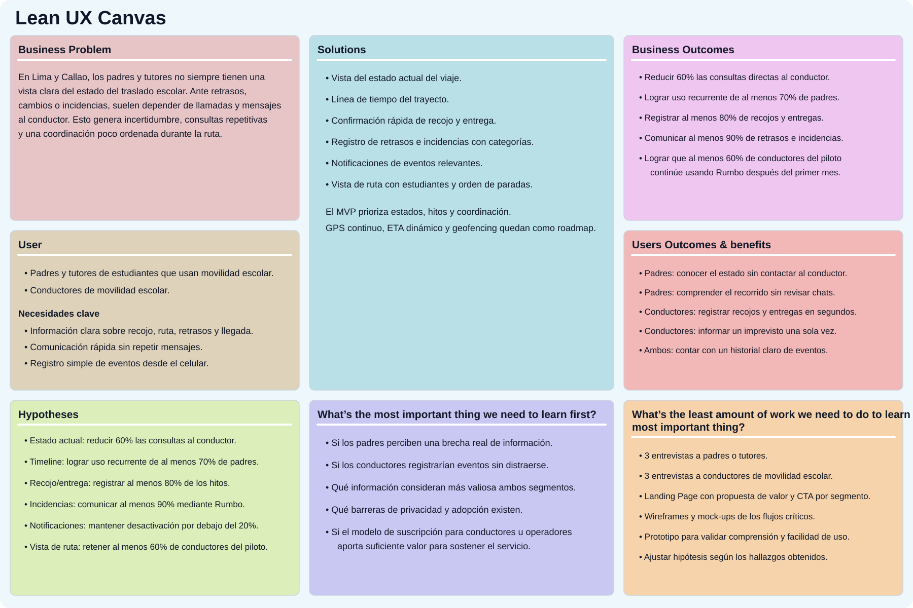

## 1.3. Segmentos objetivo

En esta sección se identifican y describen los dos segmentos de usuarios hacia los cuales se dirige Rumbo. Estos segmentos sirven como referencia para el diseño de funcionalidades, las entrevistas de Needfinding y la comunicación del producto.

### Padres y tutores

**Descripción:** Padres, madres o tutores responsables de menores que utilizan servicios de movilidad escolar en Lima y Callao. Este segmento busca disminuir la incertidumbre durante los recorridos y acceder a información clara sobre recojo, traslado, retrasos, llegada e incidencias.

**Características demográficas y comportamiento:**
- Adultos responsables de menores en edad escolar que contratan o utilizan servicios de movilidad escolar.
- Utilizan principalmente el teléfono móvil para comunicarse y consultar información cotidiana.
- Valoran la inmediatez, claridad y facilidad de uso por encima de interfaces complejas.
- Requieren información relevante, pero no necesariamente una secuencia continua de mensajes.
- La confianza en la plataforma depende de la privacidad y del control sobre quién puede consultar información del menor.

**Sustento estadístico:**
- La ATU reportó **3758 vehículos habilitados para transporte escolar en Lima y Callao** en enero de 2026, evidenciando un mercado formal y recurrente de familias usuarias del servicio (Infobae, 2026).
- El INEI informó que **98,4 % de los hogares de Lima Metropolitana contaba con telefonía móvil** y **90,3 % de la población de 6 años a más utilizaba Internet** durante el cuarto trimestre de 2025 (INEI, 2026), lo que respalda una experiencia web orientada principalmente al uso móvil.

### Conductores de movilidad escolar

**Descripción:** Conductores que realizan rutas programadas para el traslado de estudiantes entre hogares, puntos de recojo y centros educativos. Este segmento necesita organizar el recorrido y comunicar a las familias los principales eventos de la ruta de forma rápida y consistente.

**Características demográficas y comportamiento:**
- Prestadores de un servicio regulado que operan vehículos autorizados para transporte de estudiantes.
- Trabajan con rutas, horarios, puntos de recojo y varios estudiantes durante una misma jornada.
- Necesitan reducir acciones digitales mientras conducen, por lo que las interacciones deben ser breves y ejecutarse únicamente cuando sea seguro hacerlo.
- Requieren comunicar retrasos, incidencias, recojos y entregas sin repetir la misma información individualmente.
- Valoran herramientas que simplifiquen la coordinación sin reemplazar sus responsabilidades operativas y de seguridad.

**Sustento estadístico:**
- La ATU reportó **3758 vehículos escolares habilitados en Lima y Callao** (Infobae, 2026), lo que permite identificar un grupo concreto de operadores y conductores dentro del mercado formal.
- Lima registró **69,3 % de congestión promedio durante 2025** y aproximadamente **195 horas anuales perdidas en tráfico de hora punta** (TomTom, 2026). Este contexto sustenta la necesidad de gestionar retrasos y comunicar variaciones de tiempo de manera ordenada.

**Escalabilidad comercial:** Los dos segmentos anteriores se mantienen como foco de validación de AV1. A medida que Rumbo crezca, asociaciones, cooperativas de transporte escolar e instituciones educativas pueden incorporarse como clientes organizacionales mediante planes que agrupen varias rutas, vehículos y usuarios.

**Evolución tecnológica:** El transporte escolar se plantea como el primer caso de uso de una plataforma más amplia de coordinación y seguridad desarrollada por AIpaca. En etapas posteriores podrían evaluarse zonas seguras y geofencing, integraciones con cámaras inteligentes o dispositivos IoT autorizados, detección automática de eventos y alertas asociadas a entradas, salidas o desvíos. Estas funcionalidades forman parte del roadmap y no son requisito del MVP actual.

---

---

# Capítulo II: Requirements Elicitation & Analysis

## 2.1. Competidores

### 2.1.1. Análisis competitivo

El análisis competitivo se desarrolla mediante el **Competitive Analysis Landscape** indicado en el Final Project Statement. Se compara a **Rumbo** con dos soluciones especializadas en transporte escolar —**SchoolBusTracker** y **Bus esCool**— y con un sustituto informal compuesto por herramientas de uso general como **WhatsApp y Waze**. El objetivo es reconocer diferencias reales entre las alternativas, identificar fortalezas y debilidades y analizar las oportunidades y amenazas particulares de cada una, evitando asumir funcionalidades o condiciones comerciales que no hayan sido verificadas.

<table>
  <thead>
    <tr><th colspan="6">Competitive Analysis Landscape</th></tr>
  </thead>
  <tbody>
    <tr>
      <th colspan="2">¿Por qué llevar a cabo este análisis?</th>
      <td colspan="4">Identificar cómo puede Rumbo diferenciarse frente a soluciones especializadas de transporte escolar y frente a los canales informales que actualmente pueden utilizar padres/tutores y conductores, considerando producto, mercado, canales y factores SWOT.</td>
    </tr>
    <tr>
      <th colspan="2">Competidores / Startup</th>
      <th>
         
        AIpaca / Rumbo
      </th>
      <th>
         
        SchoolBusTracker
      </th>
      <th>
         
        Bus esCool
      </th>
      <th>
         
         
        Canales informales (WhatsApp + Waze)
      </th>
    </tr>
    <tr>
      <th rowspan="2">Perfil</th>
      <th>Overview</th>
      <td><strong>Rumbo</strong>, producto de la startup <strong>AIpaca</strong>, es una plataforma web responsive orientada a la coordinación del transporte escolar entre padres/tutores y conductores. El alcance actual prioriza estados e hitos del viaje, rutas, estudiantes, retrasos, incidencias y notificaciones.</td>
      <td>Suite especializada de transporte escolar dirigida principalmente a instituciones educativas. Incluye aplicaciones para padres y conductores y un panel administrativo para gestionar y supervisar el servicio.</td>
      <td>Plataforma de monitoreo y control de rutas escolares que conecta a colegios, padres de familia, coordinadores de transporte, monitores y conductores.</td>
      <td>Combinación de aplicaciones de mensajería, llamadas, navegación y ubicación que pueden utilizarse para coordinar el servicio, pero que no conforman por sí mismas un sistema especializado de transporte escolar.</td>
    </tr>
    <tr>
      <th>Ventaja competitiva / ¿Qué valor ofrece a los clientes?</th>
      <td>Experiencia enfocada inicialmente en padres/tutores y conductores, con información estructurada del traslado y un historial de eventos que reduce la dependencia de consultas repetitivas.</td>
      <td>Oferta madura e integrada: seguimiento en tiempo real, registro de subida y bajada, alertas, reservas, pagos, administración y reportes dentro de una misma suite.</td>
      <td>Seguimiento en tiempo real, avisos sobre imprevistos, control de inasistencias, información de abordaje y herramientas específicas para la operación de rutas escolares.</td>
      <td>Familiaridad de uso, amplia presencia en los teléfonos de los usuarios y posibilidad de comunicarse o consultar navegación sin adoptar inicialmente una plataforma adicional.</td>
    </tr>
    <tr>
      <th rowspan="2">Perfil de Marketing</th>
      <th>Mercado objetivo</th>
      <td>Padres/tutores y conductores de movilidad escolar de Lima y Callao.</td>
      <td>Colegios y organizaciones que administran transporte escolar, junto con padres, estudiantes y conductores que utilizan el servicio.</td>
      <td>Colegios, padres de familia, coordinadores de transporte, monitores y conductores vinculados a rutas escolares.</td>
      <td>Mercado general de usuarios de mensajería y navegación; dentro del problema de Rumbo actúan como herramientas sustitutas para familias y conductores.</td>
    </tr>
    <tr>
      <th>Estrategias de marketing</th>
      <td>Propuesta centrada en simplificar la coordinación entre los dos segmentos iniciales y reducir la comunicación manual mediante una experiencia web responsive.</td>
      <td>Comercialización orientada a instituciones mediante demostraciones, paquetes de servicio y posibilidades de personalización de la experiencia para cada organización.</td>
      <td>Adopción vinculada a instituciones y operadores de transporte, con una propuesta multirrol y un plan de prueba piloto comunicado desde su sitio oficial.</td>
      <td>No existe una estrategia única de transporte escolar: la adopción deriva principalmente de la presencia y utilidad general de cada aplicación.</td>
    </tr>
    <tr>
      <th rowspan="3">Perfil de Producto</th>
      <th>Productos &amp; Servicios</th>
      <td>Gestión de rutas, paradas y estudiantes; programación del traslado; estados e hitos del viaje; confirmaciones de recojo y entrega; retrasos, incidencias, notificaciones e historial.</td>
      <td>Parent App, Driver App y Admin Panel; seguimiento de rutas, registro de abordaje y descenso, alertas, reservas, pagos, gestión administrativa y reportes.</td>
      <td>Ubicación de la ruta en tiempo real, notificaciones de imprevistos y proximidad, gestión de inasistencias, información de abordaje, herramientas para conductor/monitor y panel de coordinación con reportes.</td>
      <td>Chats, llamadas, envío de mensajes, ubicación compartida y navegación. La información queda repartida entre herramientas y conversaciones diferentes.</td>
    </tr>
    <tr>
      <th>Precios &amp; Costos</th>
      <td>El modelo SaaS constituye una hipótesis del proyecto; el precio y las condiciones comerciales todavía requieren validación.</td>
      <td>Dispone de paquetes comerciales para instituciones. En este análisis no se asigna un precio concreto porque no se ha verificado uno aplicable de manera general.</td>
      <td>Servicio comercial para instituciones y usuarios vinculados a la ruta. En las fuentes consultadas no se verificó un precio público general aplicable a todos los clientes.</td>
      <td>No requieren una licencia específica de transporte escolar; el usuario puede tener costos asociados a conectividad o a las condiciones generales de cada servicio.</td>
    </tr>
    <tr>
      <th>Canales de distribución (Web y/o Móvil)</th>
      <td>Landing Page y Frontend Web Application responsive.</td>
      <td>Aplicaciones móviles para usuarios y plataforma/panel de administración.</td>
      <td>Aplicaciones móviles para los participantes de la ruta y plataforma web para coordinación.</td>
      <td>Principalmente aplicaciones móviles; algunos servicios también disponen de acceso web.</td>
    </tr>
    <tr>
      <th rowspan="4">Análisis SWOT</th>
      <th>Fortalezas</th>
      <td>Enfoque concreto en los dos segmentos iniciales de Rumbo; estructura de eventos del viaje; experiencia responsive; el valor del MVP no depende de GPS continuo, ETA dinámico o geofencing.</td>
      <td>Suite especializada consolidada, múltiples aplicaciones por rol, seguimiento en tiempo real, registro de pasajeros, administración, reportes, reservas y pagos.</td>
      <td>Especialización en rutas escolares, ubicación en tiempo real, notificaciones de eventos, gestión de inasistencias y coordinación entre varios roles.</td>
      <td>Alta familiaridad, disponibilidad inmediata y flexibilidad para mensajería, llamadas, navegación y ubicación compartida.</td>
    </tr>
    <tr>
      <th>Debilidades</th>
      <td>Producto nuevo y sin base instalada; varias capacidades todavía deben implementarse y validarse; el MVP actual no contempla como requisito GPS continuo, ETA dinámico ni geofencing.</td>
      <td>Su propuesta está orientada principalmente a instituciones y operaciones de transporte organizadas, por lo que puede resultar más amplia que las necesidades iniciales de una relación directa conductor–familia.</td>
      <td>La propuesta articula colegio, coordinadores, monitores y conductores, por lo que su adopción está fuertemente vinculada a una operación institucional o de ruta ya organizada.</td>
      <td>Información fragmentada, historial difícil de estructurar, ausencia de un ciclo de vida propio del viaje y necesidad de repetir comunicaciones manualmente.</td>
    </tr>
    <tr>
      <th>Oportunidades</th>
      <td>Atender la coordinación digital entre familias y conductores de movilidad escolar en Lima y Callao con una solución enfocada, accesible desde navegador y adaptada al contexto local.</td>
      <td>Ampliar su presencia a nuevos mercados e instituciones y aprovechar su suite existente para organizaciones que buscan digitalizar integralmente la gestión del transporte escolar.</td>
      <td>Extender alianzas con colegios y operadores de transporte escolar en más mercados latinoamericanos y aprovechar su experiencia de monitoreo y comunicación multirrol.</td>
      <td>Mantenerse como alternativa sustituta debido a la baja fricción de adopción y a que los usuarios ya conocen estas herramientas, incorporando además nuevas capacidades generales de comunicación y navegación.</td>
    </tr>
    <tr>
      <th>Amenazas</th>
      <td>Hábitos arraigados de coordinación mediante mensajería y llamadas; presencia de plataformas especializadas ya operativas; exigencias de confianza y privacidad por tratar información relacionada con menores.</td>
      <td>Competidores locales más ligeros o adaptados a mercados específicos; barreras de adopción para operadores pequeños; sustitución parcial mediante herramientas generalistas de comunicación y navegación.</td>
      <td>Entrada de soluciones con onboarding más simple para conductores independientes; competencia de suites internacionales y permanencia de canales informales ya adoptados.</td>
      <td>Las plataformas especializadas pueden reemplazar parte de su uso en transporte escolar al ofrecer permisos por rol, trazabilidad, estados del viaje, notificaciones estructuradas y reportes.</td>
    </tr>
  </tbody>
</table>

**Fuentes consultadas para contrastar las capacidades de los competidores:**  
- SchoolBusTracker: https://www.schoolbustrackerapp.com/  
- Bus esCool: https://busescool.com/  
- WhatsApp Brand Resources: https://www.meta.com/brand/resources/whatsapp/whatsapp-brand/  
- Waze: https://www.waze.com/

### 2.1.2. Estrategias y tácticas frente a competidores

Para organizar las estrategias y tácticas preliminares de **Rumbo** frente a la competencia, se emplean las matrices **FODA** y **CAME**. La matriz FODA resume la situación interna de la startup y el contexto externo identificado en el Competitive Analysis Landscape. A partir de ello, la matriz CAME plantea acciones para **Corregir debilidades, Afrontar amenazas, Mantener fortalezas y Explotar oportunidades**.

#### Matriz FODA

<table>
  <thead>
    <tr>
      <th>Interno / Externo</th>
      <th>Positivo</th>
      <th>Negativo</th>
    </tr>
  </thead>
  <tbody>
    <tr>
      <th>Interno</th>
      <td>
        <strong>Fortalezas (F)</strong>  
        • Enfoque específico en los dos segmentos objetivo del proyecto: padres/tutores y conductores de movilidad escolar.  
        • Centralización de estados del traslado, hitos, retrasos, incidencias y notificaciones dentro de un mismo flujo de información.  
        • Web Application responsive planteada para funcionar con los dispositivos de los usuarios y sin requerir hardware propietario para las funcionalidades del MVP.
      </td>
      <td>
        <strong>Debilidades (D)</strong>  
        • Producto nuevo, sin una base instalada ni confianza consolidada frente a soluciones que ya operan en el mercado.  
        • El alcance actual no contempla todavía GPS continuo, ETA dinámico ni geofencing, mientras que competidores especializados ya ofrecen capacidades de seguimiento en tiempo real.  
        • El valor de la coordinación depende de que conductores y familias adopten y utilicen de manera consistente la plataforma.
      </td>
    </tr>
    <tr>
      <th>Externo</th>
      <td>
        <strong>Oportunidades (O)</strong>  
        • Los canales informales como mensajería, llamadas y ubicación compartida no estructuran el ciclo del traslado escolar ni consolidan un historial único de eventos.  
        • Las soluciones especializadas analizadas presentan una fuerte orientación a colegios, administradores y operaciones de transporte, lo que permite a Rumbo enfocarse en una experiencia directa para padres/tutores y conductores.  
        • La necesidad de reducir incertidumbre, mensajes repetitivos y falta de trazabilidad durante el traslado abre espacio para una solución centrada en estados e hitos claramente registrados.
      </td>
      <td>
        <strong>Amenazas (A)</strong>  
        • SchoolBusTracker y Bus esCool ya ofrecen funciones especializadas de seguimiento, notificaciones y gestión del transporte escolar.  
        • WhatsApp, llamadas y herramientas de navegación cuentan con alta familiaridad y pueden seguir siendo suficientes para usuarios que no perciban un beneficio adicional al cambiar de herramienta.  
        • Las expectativas de los usuarios pueden estar influenciadas por competidores que ya ofrecen localización en tiempo real y otras capacidades que Rumbo ha dejado fuera del alcance actual.
      </td>
    </tr>
  </tbody>
</table>

#### Matriz CAME

| Estrategia | Tácticas preliminares de Rumbo |
|---|---|
| **C — Corregir Debilidades** | Validar progresivamente el MVP con ambos segmentos objetivo para mejorar usabilidad y confianza. Mantener claramente delimitado el alcance actual y evaluar GPS continuo, ETA dinámico y geofencing únicamente como evolución posterior si la validación demuestra su necesidad. Reforzar onboarding, autorizaciones y manejo de información de menores para reducir barreras de adopción. |
| **A — Afrontar Amenazas** | Diferenciarse de las soluciones especializadas mediante una experiencia más acotada a la coordinación directa entre conductor y familia. Frente a WhatsApp, llamadas y navegación, demostrar el valor de disponer de estados, hitos, retrasos e incidencias en un registro estructurado. Evitar competir mediante funcionalidades que todavía no están implementadas y sostener la propuesta sobre capacidades verificables del producto. |
| **M — Mantener Fortalezas** | Conservar el enfoque en los dos segmentos definidos, la estructura cronológica de eventos del viaje y la centralización de información relevante. Mantener una experiencia responsive y consistente entre las vistas destinadas a conductores y padres/tutores. Preservar las reglas de autorización y privacidad previstas por el proyecto. |
| **E — Explotar Oportunidades** | Orientar la adopción hacia casos donde la coordinación actual depende de mensajes o llamadas repetitivas. Posicionar a Rumbo como una alternativa estructurada para registrar y consultar el estado del traslado sin requerir una plataforma completa de administración de flotas. Priorizar en la experiencia las funcionalidades que cubren directamente los vacíos detectados: hitos del viaje, retrasos, incidencias, notificaciones y trazabilidad. |

## 2.2. Entrevistas

Se realizaron entrevistas semiestructuradas para comprender hábitos, procesos actuales, frustraciones, motivaciones, necesidades, herramientas utilizadas y barreras de adopción de los segmentos objetivo. La información obtenida sirve como base para el análisis posterior y para la construcción de los artefactos de Needfinding.

### 2.2.1. Diseño de entrevistas

#### Preguntas dirigidas al primer segmento — Padres y tutores

1. ¿Podría indicarnos su edad, el distrito donde reside y la edad y grado escolar de su(s) hijo(s) que utilizan el transporte escolar?
2. Actualmente, ¿cómo se organiza con el recojo y retorno de sus hijos? ¿Sale a esperarlos, confía en el horario del conductor o utiliza alguna aplicación?
3. ¿Qué aplicaciones móviles utiliza con mayor frecuencia en su día a día (por ejemplo, WhatsApp, Waze, redes sociales, aplicaciones del colegio)?
4. Descríbanos su experiencia actual con el servicio de transporte escolar. ¿Qué es lo que más le preocupa o le genera incertidumbre durante el viaje de sus hijos?
5. ¿Cuántas veces al día suele comunicarse con el conductor para preguntar por la ubicación o el estado del viaje de sus hijos?
6. ¿Ha tenido experiencias donde el conductor llegó tarde, no pasó por su hijo o hubo confusión con los horarios? ¿Cómo manejó esa situación?
7. ¿Qué opina sobre la seguridad vial y el uso del celular por parte del conductor? ¿Le genera preocupación saber que el conductor podría distraerse al atender llamadas o mensajes de los padres?
8. Si existiera una aplicación que le mostrara en un mapa la ubicación exacta del vehículo en tiempo real y le notificara automáticamente cuando está cerca de su casa, sin que el conductor tenga que llamarle, ¿cómo cambiaría su rutina matutina?
9. Además de la ubicación, ¿qué otra información le gustaría recibir, como la confirmación de que su hijo abordó el vehículo o llegó al colegio?
10. ¿Estaría dispuesto a pagar una suscripción mensual por un servicio que le brinde esta tranquilidad y seguridad? ¿Cuánto consideraría justo pagar?
11. ¿Qué característica de la aplicación sería la más importante para usted para sentirse tranquilo al confiar el transporte de su hijo a un conductor registrado en nuestra plataforma?

#### Preguntas dirigidas al segundo segmento — Conductores de movilidad escolar

1. ¿Cuál es tu nombre completo, edad, ocupación, distrito de residencia y cuántos años de experiencia tienes realizando transporte escolar?
2. ¿Cuántos estudiantes y rutas manejas normalmente durante una jornada de trabajo?
3. ¿Qué dispositivo, navegador y aplicaciones o canales digitales utilizas con mayor frecuencia para organizar tu trabajo y comunicarte con las familias?
4. Cuéntame cómo organizas actualmente los estudiantes, horarios, puntos de recojo y cambios que pueden surgir antes de una ruta.
5. ¿Cómo confirmas actualmente que un estudiante fue recogido o entregado y cómo comunicas esos eventos a sus familiares?
6. ¿Qué situaciones imprevistas o retrasos ocurren con mayor frecuencia durante una ruta y cómo los comunicas a las familias?
7. ¿Qué información te piden los padres con mayor frecuencia y qué parte de esa comunicación te quita más tiempo o se vuelve repetitiva?
8. ¿En qué momentos sería seguro y realista registrar información en un sistema sin distraerte de la conducción, y qué acciones digitales serían poco prácticas durante tu jornada?
9. ¿Qué información te sería útil conservar como historial de una ruta para resolver posteriormente dudas o reclamos?
10. ¿Qué datos consideras privados o que no deberían mostrarse libremente dentro de una plataforma de movilidad escolar?
11. ¿Qué tendría que ofrecer una herramienta digital para que la utilices de manera recurrente y qué barreras podrían impedir que la adoptes?
12. Si pudieras mejorar una sola parte de la coordinación con padres y tutores, ¿cuál sería y por qué?

### 2.2.2. Registro de entrevistas

Para cada entrevista se registra el nombre completo, edad, distrito, segmento, captura, URL de la evidencia en video, timing de inicio, duración y un resumen descriptivo. Se cuenta con seis entrevistas: tres del segmento Padres/Tutores y tres del segmento Conductores de movilidad escolar.

| # | Entrevistado | Edad | Distrito | Segmento | Duración | Referencia |
| -: | ----------- | ---: | -------- | -------- | :-----   | ---------- |
|  1 | Gabriela Salazar | 32 | Miraflores | Padre/Tutor | 07:19 | [Entrevista 1](#entrevista-1--gabriela-salazar) |
|  2 | Alejandro Choquehuanca | 34 | Surco | Padre/Tutor | 05:10 | [Entrevista 2](#entrevista-2--alejandro-choquehuanca)  |
|  3 | Eduardo Osorio | 34 | Magdalena | Padre/Tutor | 03:26 | [Entrevista 3](#entrevista-3--eduardo-osorio) |
|  4 | Gabriel Alexandro Sosa Guevara | 20 | Los Olivos | Conductor | 09:51 | [Entrevista 4](#entrevista-4--gabriel-alexandro-sosa-guevara) |
|  5 | Brayan Solorzano Pineda | 25 | Pueblo Libre | Conductor | 09:05 | [Entrevista 5](#entrevista-5--brayan-solorzano-pineda) |
|  6 | Vilma Hoyos Martinez | 56 | San Miguel | Conductor | 18:14 | [Entrevista 6](#entrevista-6--vilma-hoyos-martinez) |

#### Entrevista 1 — Gabriela Salazar

* **Edad:** 32 años.
* **Ocupación / segmento:** Padre / Tutor.
* **Distrito:** Miraflores.
* **Duración:** 07:19.
* **Timing de inicio:** 00:00.
* **Video:** [Ver video](https://upcedupe-my.sharepoint.com/:v:/g/personal/u202422589_upc_edu_pe/IQD1AXwvDziBQJNjfqVNiPQWAeYMA26BAQOBC1tyKe_D9nw?nav=eyJyZWZlcnJhbEluZm8iOnsicmVmZXJyYWxBcHBQbGF0Zm9ybSI6IldlYiIsInJlZmVycmFsTW9kZSI6InZpZXciLCJyZWZlcnJhbEFwcFBsYXRmb3JtIjoiV2ViIiwicmVmZXJyYWxNb2RlIjoidmlldyIsInJlZmVycmFsVmlldyI6IlNoYXJlRGlhbG9nLUxpbmsiLCJyZWZlcnJhbEFwcCI6IlN0cmVhbVdlYkFwcCJ9fQ%3D%3D&e=VWo0MB).

**Resumen:** Gabriela Salazar tiene 32 años y pertenece al segmento de padres/tutores. Durante la entrevista se abordaron sus experiencias relacionadas con el transporte escolar de su sobrino de 8 años, especialmente los problemas ocasionados por retrasos mecánicos que no son comunicados oportunamente. Asimismo, destacó la importancia de evitar que el conductor manipule el celular mientras conduce, indicando que debería utilizarlo únicamente cuando se encuentre estacionado. Entre las funcionalidades de mayor interés se encuentra el rastreo en vivo de la movilidad. Respecto a la disposición de pago, considera viable un rango de S/ 15 a S/ 25 mensuales, siempre que pueda acceder previamente a un periodo de prueba gratuito.

#### Entrevista 2 — Alejandro Choquehuanca

* **Edad:** 34 años.
* **Ocupación / segmento:** Padre / Tutor.
* **Distrito:** Surco.
* **Duración:** 05:10.
* **Timing de inicio:** 00:00.
* **Video:** [Ver video](https://upcedupe-my.sharepoint.com/:v:/g/personal/u202422589_upc_edu_pe/IQCneF6uJQneSbuVfMMPEvfKAdcXTo1sHeUy-SGF28JiP3g?nav=eyJyZWZlcnJhbEluZm8iOnsicmVmZXJyYWxBcHBQbGF0Zm9ybSI6IldlYiIsInJlZmVycmFsTW9kZSI6InZpZXciLCJyZWZlcnJhbFZpZXciOiJTaGFyZURpYWxvZy1MaW5rIiwicmVmZXJyYWxBcHAiOiJTdHJlYW1XZWJBcHAifX0%3D&e=f5sdCh).

**Resumen:** Alejandro tiene 34 años y pertenece al segmento de padres/tutores. Durante la entrevista se abordaron sus principales preocupaciones como padre de un niño de 6 años que utiliza transporte escolar en Surco. Entre sus preocupaciones se encuentra la distracción del conductor ocasionada por las llamadas de otros padres durante el trayecto. También manifestó interés en contar con un mapa en tiempo real que permita conocer la ubicación de la movilidad y reducir el tiempo de espera en la calle. Asimismo, considera importante recibir alertas cuando el estudiante ingresa al colegio y contar con mecanismos de verificación de la situación legal del conductor. Respecto a la disposición de pago, considera viable una suscripción mensual de S/ 15 a S/ 25.

#### Entrevista 3 — Eduardo Osorio

* **Edad:** 34 años.
* **Ocupación / segmento:** Padre / Tutor.
* **Distrito:** Magdalena.
* **Duración:** 03:26.
* **Timing de inicio:** 00:00.
* **Video:** [Ver video](https://upcedupe-my.sharepoint.com/:v:/g/personal/u202422589_upc_edu_pe/IQDjMXK3n4smQaWYxZ2qTvKkAShiPN2nP5lMf1iIen8ONyA?nav=eyJyZWZlcnJhbEluZm8iOnsicmVmZXJyYWxBcHBQbGF0Zm9ybSI6IldlYiIsInJlZmVycmFsTW9kZSI6IlNoYXJlRGlhbG9nLUxpbmsiLCJyZWZlcnJhbEFwcCI6IlN0cmVhbVdlYkFwcCJ9fQ%3D%3D&e=HlhpOR).

**Resumen:** Eduardo tiene 34 años y pertenece al segmento de padres/tutores. Durante la entrevista se abordaron sus principales preocupaciones respecto al transporte escolar de su hijo de 4 años, quien se encuentra en inicial. Entre sus principales problemas se encuentra la ansiedad generada por la falta de visibilidad del trayecto, especialmente cuando ocurren averías imprevistas durante el recorrido. Manifestó interés en recibir alertas automáticas relacionadas con el abordaje del menor, incluyendo la confirmación de que viaje con el cinturón de seguridad puesto y que sea entregado correctamente a la profesora. Asimismo, considera valioso contar con información que le permita evitar la espera en la vereda. Respecto a la disposición de pago, acepta un rango de S/ 15 a S/ 25 mensuales.

#### Entrevista 4 — Gabriel Alexandro Sosa Guevara

- **Edad:** 20 años.
- **Ocupación / segmento:** Conductor de movilidad escolar.
- **Experiencia en el rubro:** 2 años.
- **Distrito:** Los Olivos.
- **Duración:** 09:51.
- **Timing de inicio:** 00:00.
- **Video:** [Conductor 1.mp4](https://upcedupe-my.sharepoint.com/:v:/g/personal/u202422298_upc_edu_pe/IQC8MugJp8RuRYBv6-JB1JqxAa7zKfdSDfWOW6lMscwFzxg?nav=eyJyZWZlcnJhbEluZm8iOnsicmVmZXJyYWxBcHBQbGF0Zm9ybSI6IldlYiIsInJlZmVycmFsTW9kZSI6InZpZXciLCJyZWZlcnJhbFZpZXciOiJNeUZpbGVzTGlua0NvcHkifX0&e=MUf4ft).

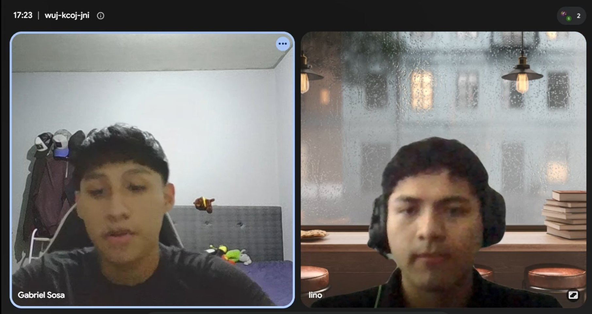

**Resumen:** Gabriel cuenta con 2 años de experiencia realizando transporte escolar. Utiliza diariamente su teléfono para trabajar y principalmente usa WhatsApp para comunicarse con las familias y Google Maps para organizar sus rutas. Comenta que uno de los problemas que presenta es tener la información fragmentada en distintos chats, lo que hace poco práctico buscar entre conversaciones para verificar si un estudiante será recogido o consultar la dirección de un punto de llegada alternativo. Además, menciona que es repetitivo responder diariamente las preguntas de los padres sobre cuánto falta para que llegue su hijo, si la movilidad se encuentra cerca o si el estudiante se encuentra bien, ya que esto puede distraerlo mientras conduce. También considera que, en caso de utilizar una aplicación, esta debería ser fácil y rápida de utilizar para no quitarle tiempo durante la conducción. Entre las funcionalidades que considera útiles se encuentran una lista de alumnos, el orden de recojo y la posibilidad de registrar rápidamente cuándo recoge o entrega a un estudiante. Asimismo, le gustaría que los padres puedan visualizar el estado de la ruta y su ubicación para mantenerse informados sin necesidad de comunicarse constantemente con él.

#### Entrevista 5 — Brayan Solorzano Pineda

- **Edad:** 25 años.
- **Ocupación / segmento:** Conductor de movilidad escolar.
- **Experiencia en el rubro:** 5 años.
- **Distrito:** Pueblo Libre.
- **Duración:** 09:05.
- **Timing de inicio:** 00:00.
- **Video:** [Conductor 2.mp4](https://upcedupe-my.sharepoint.com/:v:/g/personal/u202422298_upc_edu_pe/IQDViGOQ_7GOQYDKI1MqVAXNAacWQv3o8bRMqBJbKkhsKp8?nav=eyJyZWZlcnJhbEluZm8iOnsicmVmZXJyYWxBcHBQbGF0Zm9ybSI6IldlYiIsInJlZmVycmFsTW9kZSI6InZpZXciLCJyZWZlcnJhbFZpZXciOiJNeUZpbGVzTGlua0NvcHkifX0&e=6tRx0m).

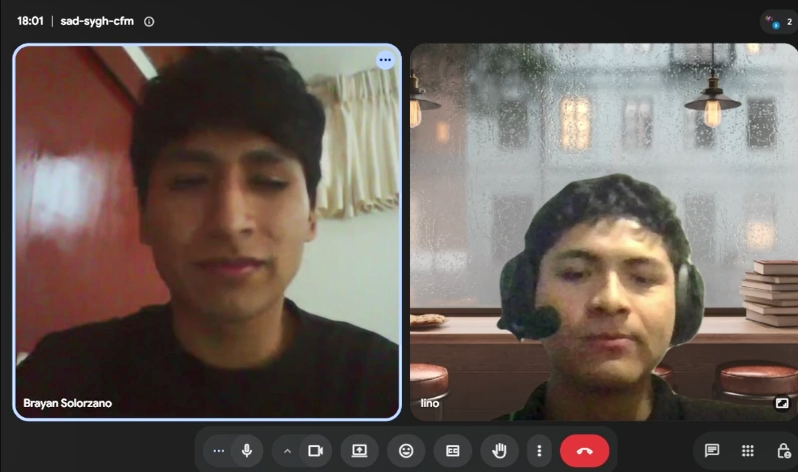

**Resumen:** Brayan cuenta con 5 años de experiencia en el rubro. Comenzó trabajando en transporte personal, pero luego se trasladó al rubro del transporte escolar. Utiliza un grupo de WhatsApp para enviar avisos a los padres; sin embargo, los tutores prefieren escribirle por privado. Además, utiliza Waze para evitar el tráfico y el calendario de su teléfono para recordar horarios especiales. Ha tenido problemas para recordar cambios en las rutas debido a modificaciones en el recojo de un alumno, especialmente porque varios padres le escriben. Diariamente, los padres también le preguntan si ya se encuentra cerca o si los niños ya llegaron a la escuela, lo cual considera repetitivo. Comenta que durante la conducción no utilizaría una aplicación. Sin embargo, le sería útil contar con un registro del inicio del recorrido, la hora de recojo de cada alumno y la hora de llegada a la escuela. También considera útil registrar cuando un alumno no será recogido. En general, considera que una aplicación debería ayudarlo a organizar los cambios y permitir que los padres puedan seguir la ruta sin necesidad de preguntarle constantemente. No utilizaría una aplicación que lo obligue a realizar muchas acciones manualmente o que tenga un costo muy elevado. Como característica adicional, le gustaría que pudiera utilizarse en zonas donde existe poca señal.

#### Entrevista 6 — Vilma Hoyos Martinez

- **Edad:** 56 años.
- **Ocupación / segmento:** Conductor de movilidad escolar.
- **Experiencia en el rubro:** 25 años.
- **Distrito:** San Miguel.
- **Duración:** 18:14.
- **Timing de inicio:** 00:06.
- **Video:** [Conductor 3.mp4](https://upcedupe-my.sharepoint.com/:v:/g/personal/u20241b451_upc_edu_pe/IQAarNiMmGEZT73ZVhSkpNMNAVFqyptTBINEQvTJU6AW7BY?nav=eyJyZWZlcnJhbEluZm8iOnsicmVmZXJyYWxBcHAiOiJTdHJlYW1XZWJBcHAiLCJyZWZlcnJhbFZpZXciOiJTaGFyZURpYWxvZy1MaW5rIiwicmVmZXJyYWxBcHBQbGF0Zm9ybSI6IldlYiIsInJlZmVycmFsTW9kZSI6InZpZXcifX0%3D&e=asjxgo).

**Resumen:** Vilma cuenta con 25 años de experiencia en el rubro de la movilidad escolar. Empezó llevando a estudiantes del colegio San Toribio, en el Rímac, hace 10 años y actualmente está a cargo de 26 niños en San Miguel, a quienes lleva a los colegios Claretiano y Los Rosales. La señora Vilma cuenta con un ayudante, quien utiliza la aplicación WhatsApp para comunicarse con las familias, coordinar horarios, llamar para avisar que deben bajar, informar si el niño asistirá, si necesita esperar y compartir su ubicación en tiempo real. Ha presentado problemas con la puntualidad de los niños y con la coordinación con los padres respecto a si los niños serán recogidos o no. Comenta que tiene conocimientos casi nulos en tecnología. Los padres le han recomendado utilizar algunas aplicaciones para poder realizar un mejor seguimiento del recorrido de sus hijos, pero menciona que no sabe cómo utilizarlas y, por ese motivo, no las implementa.

### 2.2.3. Análisis de entrevistas

El análisis se realizó por separado para los dos segmentos objetivo, utilizando las seis entrevistas registradas como fuente. Se distinguen características objetivas —edad, distrito, experiencia, herramientas y rutinas— y características subjetivas —preocupaciones, motivaciones, expectativas y barreras de adopción—. Los porcentajes indicados corresponden a la proporción observada dentro de cada grupo de tres entrevistados.

#### Segmento 1 — Padres y tutores

**Características objetivas**

- **Edad:** los tres entrevistados tienen entre **32 y 34 años**.
- **Rol de cuidado:** el **66,7 %** corresponde a padres de familia y el **33,3 %** a un tutor responsable.
- **Edad de los menores:** el **100 %** tiene a su cargo niños de entre **4 y 8 años** que utilizan movilidad escolar.
- **Herramientas digitales:** el **100 %** utiliza WhatsApp y aplicaciones de mapas o navegación como parte de su vida cotidiana.
- **Contacto con el conductor:** el **100 %** indicó que se comunica con el conductor cuando necesita confirmar el estado del recorrido o cuando se presenta una demora relevante.

**Características subjetivas**

- **Incertidumbre durante el traslado:** el **100 %** manifestó necesidad de contar con mayor visibilidad del estado del recorrido para reducir llamadas o mensajes al conductor.
- **Confirmación de recojo y entrega:** el **100 %** considera importante saber cuándo el menor fue recogido y cuándo llegó o fue entregado de forma segura.
- **Seguridad y distracción del conductor:** el **100 %** manifestó preocupación por el uso del teléfono durante la conducción; las interacciones del conductor deberían realizarse únicamente cuando sea seguro.
- **Avisos e incidencias:** el **100 %** valora recibir información oportuna cuando ocurre un retraso, avería o situación imprevista.
- **Disposición económica:** el **100 %** consideró aceptable un rango referencial de **S/ 15 a S/ 25 mensuales** para un servicio que aporte seguimiento y seguridad. Una de las tres personas entrevistadas (**33,3 %**) señaló que preferiría probar el servicio antes de asumir el pago.

#### Segmento 2 — Conductores de movilidad escolar

**Características objetivas**

- **Edad:** Gabriel Alexandro Sosa Guevara tiene 20 años, Brayan Solorzano Pineda 25 años y Vilma Hoyos Martinez 56 años. La edad promedio es de **33,67 años**.
- **Experiencia:** declararon **2, 5 y 25 años** de experiencia respectivamente, con un promedio de **10,67 años**.
- **Distritos:** los entrevistados residen en **Los Olivos, Pueblo Libre y San Miguel**.
- **Canal de coordinación:** en los tres casos (**100 %**) WhatsApp forma parte de la coordinación cotidiana con las familias, ya sea utilizado directamente por el conductor o por un ayudante.
- **Apoyo de herramientas digitales:** dos de los tres entrevistados (**66,7 %**) mencionaron de forma explícita aplicaciones de mapas o navegación para organizar o facilitar el recorrido.

**Características subjetivas**

- **Sobrecarga de comunicación:** el **100 %** describió problemas asociados a mensajes, llamadas, cambios de último momento o información dispersa durante la coordinación del servicio.
- **Necesidad de interacción simple:** los tres casos evidencian barreras de adopción que obligan a que la solución sea sencilla: rapidez de uso, pocas acciones manuales, conectividad limitada o poca familiaridad tecnológica.
- **Trazabilidad del servicio:** los conductores valoran disponer de información organizada sobre estudiantes, cambios, recojos, entregas, ausencias y eventos del recorrido para evitar depender de múltiples conversaciones.
- **Seguridad durante la conducción:** las interacciones digitales deben reducirse al mínimo mientras el vehículo está en movimiento; las acciones operativas se plantean para momentos seguros o con el vehículo detenido.
- **Comunicación de retrasos e incidencias:** el segmento necesita comunicar novedades a varias familias sin repetir el mismo mensaje de forma individual.

#### Hallazgos comunes entre segmentos

| Variable | Padres/Tutores | Conductores |
|---|---:|---:|
| WhatsApp como canal relevante de coordinación | 100 % | 100 % |
| Necesidad de conocer o comunicar el estado del traslado | 100 % | 100 % |
| Confirmación de recojo/entrega como información relevante | 100 % | 100 % |
| Interés en avisos sobre retrasos o incidencias | 100 % | 100 % |
| Preocupación por evitar distracciones durante la conducción | 100 % | 100 % |
| Existencia de barreras de adopción o confianza | 33,3 % con énfasis explícito en prueba previa | 100 % con énfasis en simplicidad, conectividad o familiaridad tecnológica |

Los resultados muestran una coincidencia central: las familias necesitan visibilidad y tranquilidad, mientras que los conductores necesitan reducir la comunicación repetitiva y mantener la atención en la conducción. Esta convergencia sustenta la priorización de estados e hitos del viaje, confirmaciones, retrasos, incidencias, notificaciones y un historial estructurado del traslado.

## 2.3. Needfinding

### 2.3.1. User Personas

En esta sección se presentan las User Personas correspondientes a los dos segmentos objetivo: **Padres/Tutores y Conductores**. Los arquetipos se construyeron a partir de los patrones identificados en las entrevistas y se contrastaron con los hallazgos del análisis competitivo para representar características, necesidades, comportamientos, objetivos, frustraciones, herramientas y barreras relevantes de cada segmento.

#### Segmento — Padres y tutores

#### Segmento — Conductores

### 2.3.2. User Task Matrix

En esta sección se presenta la matriz de tareas de usuario (**User Task Matrix**), considerando al User Persona del segmento **Padre/Tutor (Gabriela Morales)** y al User Persona del segmento **Conductor de Movilidad Escolar**. Las tareas corresponden a actividades que los segmentos realizan para cumplir sus objetivos independientemente de la existencia de Rumbo.

<table>
  <thead>
    <tr>
      <th rowspan="2">User Tasks</th>
      <th colspan="2">User Persona: Padre / Tutor (Gabriela Morales)</th>
      <th colspan="2">User Persona: Conductor de Movilidad Escolar</th>
    </tr>
    <tr>
      <th>Frecuencia</th>
      <th>Importancia</th>
      <th>Frecuencia</th>
      <th>Importancia</th>
    </tr>
  </thead>
  <tbody>
    <tr><td>Alistar y preparar al escolar antes de la salida</td><td>Diaria (Alta)</td><td>Alta</td><td>No aplica</td><td>No aplica</td></tr>
    <tr><td>Esperar en la acera/puerta al vehículo de movilidad</td><td>Diaria (Alta)</td><td>Alta</td><td>No aplica</td><td>No aplica</td></tr>
    <tr><td>Consultar el estado y avance del vehículo en ruta</td><td>Diaria (Alta)</td><td>Alta</td><td>No aplica</td><td>No aplica</td></tr>
    <tr><td>Planificar y organizar la lista de paradas del recorrido</td><td>No aplica</td><td>No aplica</td><td>Diaria (Alta)</td><td>Alta</td></tr>
    <tr><td>Confirmar la subida del escolar a la unidad</td><td>Diaria (Alta)</td><td>Alta</td><td>Diaria (Alta)</td><td>Alta</td></tr>
    <tr><td>Verificar el uso del cinturón y medidas de seguridad del menor</td><td>Ocasional (Media)</td><td>Media</td><td>Diaria (Alta)</td><td>Alta</td></tr>
    <tr><td>Conducir y monitorear el flujo vehicular en horas punta</td><td>No aplica</td><td>No aplica</td><td>Diaria (Alta)</td><td>Alta</td></tr>
    <tr><td>Comunicar retrasos generados por congestión vehicular</td><td>Semanal (Media)</td><td>Alta</td><td>Semanal (Media)</td><td>Alta</td></tr>
    <tr><td>Informar incidencias mecánicas o emergencias imprevistas</td><td>Ocasional (Baja)</td><td>Alta</td><td>Ocasional (Baja)</td><td>Alta</td></tr>
    <tr><td>Confirmar la entrega del escolar en la puerta del colegio</td><td>Diaria (Alta)</td><td>Alta</td><td>Diaria (Alta)</td><td>Alta</td></tr>
    <tr><td>Coordinar el retorno del menor hacia el hogar</td><td>Diaria (Alta)</td><td>Media</td><td>Diaria (Alta)</td><td>Media</td></tr>
    <tr><td>Gestionar el pago mensual del servicio de transporte</td><td>Mensual (Baja)</td><td>Media</td><td>Mensual (Baja)</td><td>Media</td></tr>
  </tbody>
</table>

#### Análisis comparativo de la matriz de tareas

1. **Tareas de mayor frecuencia e importancia crítica (Coincidencias):**
   * **Confirmación de recojo y entrega escolar:** Tanto para el padre/tutor como para el conductor, confirmar el momento exacto en que el menor ingresa a la unidad y llega a salvo al centro educativo es una tarea diaria de máxima importancia. Para la familia representa tranquilidad emocional, mientras que para el conductor constituye el cumplimiento de su deber de custodia.
   * **Gestión de demoras por congestión:** Lima presenta un nivel de congestión de **69,3 %** según el TomTom Traffic Index 2025 (TomTom, 2026); por ello, la tarea de informar demoras tiene una frecuencia recurrente (semanal) y una importancia crítica (Alta) para ambos segmentos, porque una comunicación oportuna reduce la incertidumbre de las familias y la sobrecarga de consultas al conductor.

2. **Principales diferencias operativas entre segmentos:**
   * **Foco de atención en ruta:** Mientras el padre/tutor tiene una necesidad pasiva pero continua de consultar dónde está la movilidad para no salir a la acera a ciegas, el conductor debe mantener el 100% de su atención sobre el volante y el entorno vial, por lo que cualquier tarea que le exija distraer la vista representa un peligro potencial.
   * **Planificación previa:** El conductor asume la responsabilidad logística de trazar el orden óptimo de recojo y desembarque antes de arrancar el motor, una tarea ajena al padre de familia, quien únicamente se enfoca en el punto de parada correspondiente a su hogar o colegio.

3. **Oportunidad para el diseño de la solución:**
   El análisis evidencia que las tareas de *confirmar subida/bajada* y *avisar retrasos* son de alta fricción en la actualidad (se realizan mediante llamadas o mensajes manuales mientras se conduce). La solución debe automatizar y simplificar estas tareas al mínimo contacto operativo para proteger la seguridad del menor.

### 2.3.3. User Journey Mapping

En esta sección se presentan los **User Journey Maps** correspondientes a los dos segmentos objetivo: **Padres/Tutores y Conductores**. Estos mapas representan el recorrido actual de cada usuario durante el servicio de movilidad escolar, desde el inicio hasta el final de su experiencia.

Se presentan las versiones **As-Is**, que permiten analizar cómo se desarrolla actualmente el proceso sin la intervención de nuestra solución. A través de las diferentes etapas, actividades, puntos de contacto y dificultades identificadas, se busca comprender la experiencia de cada User Persona y detectar oportunidades de mejora.

#### Segmento — Padres y tutores

El journey de los padres de familia durante las mañanas inicia con la preparación en casa, donde alistan al menor con una sensación inicial de serenidad, aunque experimentan la falta de visibilidad sobre el inicio de la ruta. Al pasar a la espera en la acera, se vive un estado de vigilancia mientras aguardan a la intemperie la llegada de la movilidad, lo que da paso a la etapa de retraso e incertidumbre: al cumplirse más de quince minutos de demora sin respuesta del conductor debido a que va manejando, la ansiedad y el miedo a llegar tarde se apoderan del tutor. Posteriormente, durante el abordaje y despacho, la subida se realiza de forma apresurada y sin la certeza de las medidas de seguridad, generando temor. Finalmente, en el trayecto y llegada, los padres experimentan angustia e incertidumbre total hasta recibir la confirmación de que el menor ha ingresado sin novedades al colegio.

#### Segmento — Conductores

El recorrido diario del conductor comienza antes del viaje, cuando revisa mensajes de WhatsApp para confirmar asistencias, cambios de horario y puntos de recojo. Durante el trayecto de ida aumenta la tensión, porque las consultas sobre demoras o ubicación llegan mientras debe mantener la atención en la conducción. Al finalizar la ida y preparar el retorno, revisa nuevamente conversaciones fragmentadas para identificar cambios y ausencias. En el colegio verifica a los estudiantes que retornarán y atiende posibles modificaciones de último momento. Durante el viaje de regreso repite el proceso de entrega mientras necesita conservar información suficiente para responder ante incidencias o dudas posteriores. Finalmente, la jornada termina con la confirmación de las entregas y la comunicación con las familias. Este recorrido evidencia una carga de coordinación repetitiva y dispersa que debe reducirse sin introducir nuevas distracciones durante la conducción.

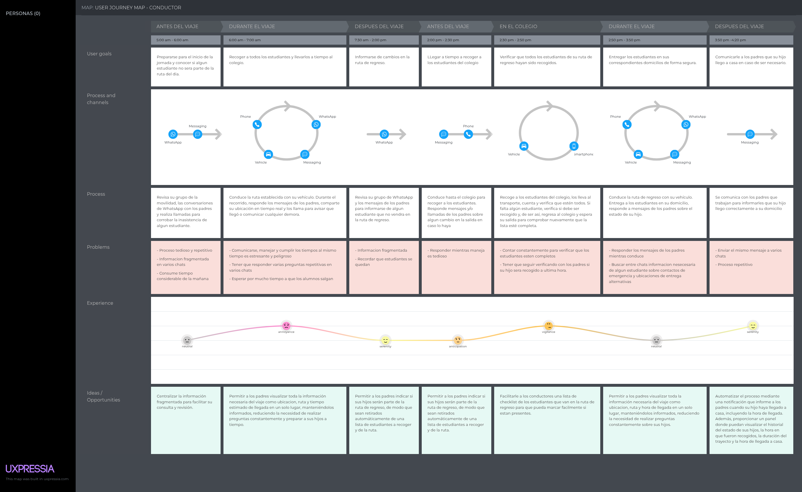

### 2.3.4. Empathy Mapping

En esta sección se presentan los **Empathy Maps** elaborados para cada uno de los User Personas: **Parent/Guardian y Driver**. El equipo partió de los hallazgos de las entrevistas y colocó a cada arquetipo en el centro del análisis para organizar observaciones sobre qué necesita hacer, qué dice, qué ve, qué escucha, qué hace, qué piensa y qué siente. A partir de estas observaciones se identificaron sus principales **Pains** y **Gains**, procurando que cada elemento conserve trazabilidad con la información obtenida de los segmentos y no con supuestos nuevos del equipo.

#### Segmento — Padres y tutores

#### Segmento — Conductores

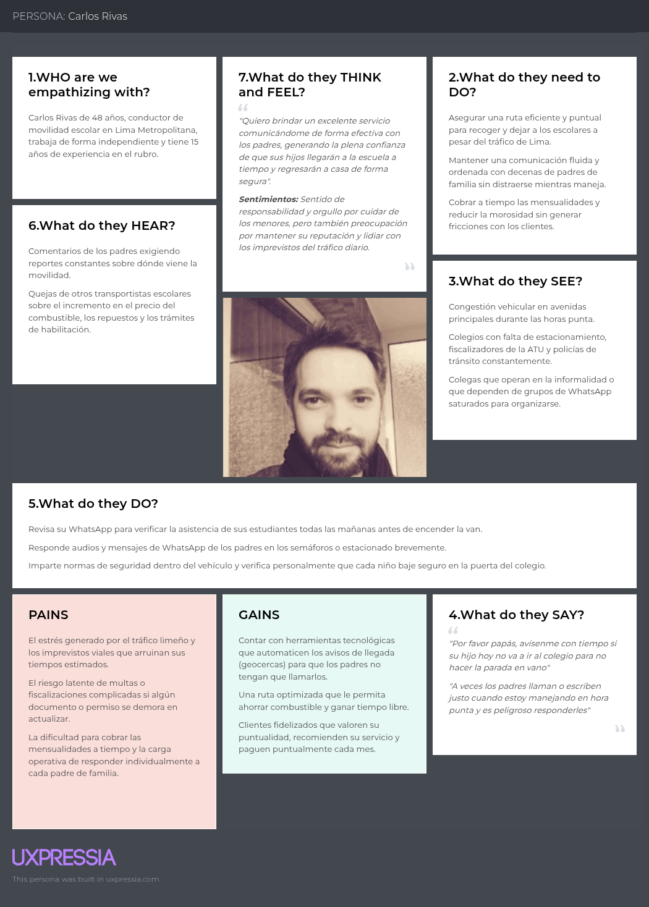

## 2.4. Big Picture Event Storming

El equipo realizó una sesión colaborativa de **Big Picture Event Storming** para comprender el dominio de la movilidad escolar de manera integral. El objetivo fue identificar los eventos significativos del negocio, ordenarlos según sus relaciones, detectar riesgos y reglas relevantes y obtener una primera delimitación de las responsabilidades que posteriormente serán refinadas en el diseño DDD.

### Resumen del proceso realizado

**1. Exploración del dominio.**  
Se inició recorriendo de extremo a extremo las actividades de los dos segmentos objetivo: registro y configuración inicial, administración de estudiantes y vehículos, planificación de rutas, ejecución del traslado, gestión de retrasos e incidencias, notificaciones y habilitación comercial del servicio.

**2. Identificación de Domain Events.**  
El equipo registró hechos significativos en tiempo pasado, entre ellos *Account Registered*, *Student Registered*, *Vehicle Registered*, *Route Published*, *Trip Scheduled*, *Trip Started*, *Student Picked Up*, *Incident Registered*, *Notification Sent* y *Subscription Activated*. Estos eventos permiten observar qué cambios relevantes ocurren en el dominio sin confundirlos con pantallas o detalles técnicos.

**3. Ordenamiento y relación de eventos.**  
Los eventos se organizaron siguiendo el flujo del negocio. Una cuenta habilita la gestión de perfiles; los vehículos y credenciales permiten configurar rutas; las rutas publicadas originan viajes programados; los viajes ejecutados producen hitos, retrasos o incidencias; y estos eventos pueden generar notificaciones para los tutores autorizados.

**4. Identificación de reglas, vistas y hotspots.**  
Durante la revisión se registraron reglas como validar la capacidad del vehículo, excluir ausencias del recojo planificado y notificar únicamente a tutores autorizados. También se identificaron riesgos como credenciales inválidas, direcciones no localizables, sobrecapacidad, pérdida de conectividad, destinatarios incorrectos y fallos del proveedor de pago. Las vistas de consulta representan información necesaria para entender el estado del dominio, como *Current Trip Status*, *Trip Timeline* y *Notification Inbox*.

**5. Delimitación preliminar de Bounded Contexts.**  
El análisis permitió organizar el dominio objetivo de Rumbo en ocho contextos preliminares. Esta delimitación representa el alcance pensado para la evolución del producto durante el Trabajo Final; no implica que todos los contextos deban implementarse en el mismo Sprint.

| Bounded Context | Responsabilidad principal |
|---|---|
| **Identity & Access Management** | Gestionar cuentas, autenticación, verificación de correo y recuperación de acceso. |
| **Profiles & Relationship Management** | Gestionar estudiantes, tutores y las relaciones de autorización entre ellos. |
| **Vehicle & Credential Management** | Gestionar vehículos, credenciales declaradas y su estado de verificación. |
| **Route & Trip Planning** | Gestionar rutas, paradas, horarios, asignaciones, ausencias y programación de viajes. |
| **Trip Execution & Monitoring** | Registrar el inicio y desarrollo del viaje, recojos, entregas, etapas, estado y línea de tiempo. |
| **Incident & Delay Management** | Gestionar retrasos, incidencias, actualizaciones, resolución y confirmación de conocimiento. |
| **Notification Management** | Gestionar generación, envío, lectura, fallos de entrega y preferencias de notificación. |
| **Subscriptions & Billing** | Representar el flujo comercial de planes, suscripción, pago y comprobantes previsto para la evolución del producto. |

### Captura consolidada y resultado

La siguiente captura reúne el resultado del proceso. Los elementos están expresados en inglés para mantener consistencia con el lenguaje utilizado en los artefactos de dominio y con el Ubiquitous Language del proyecto.

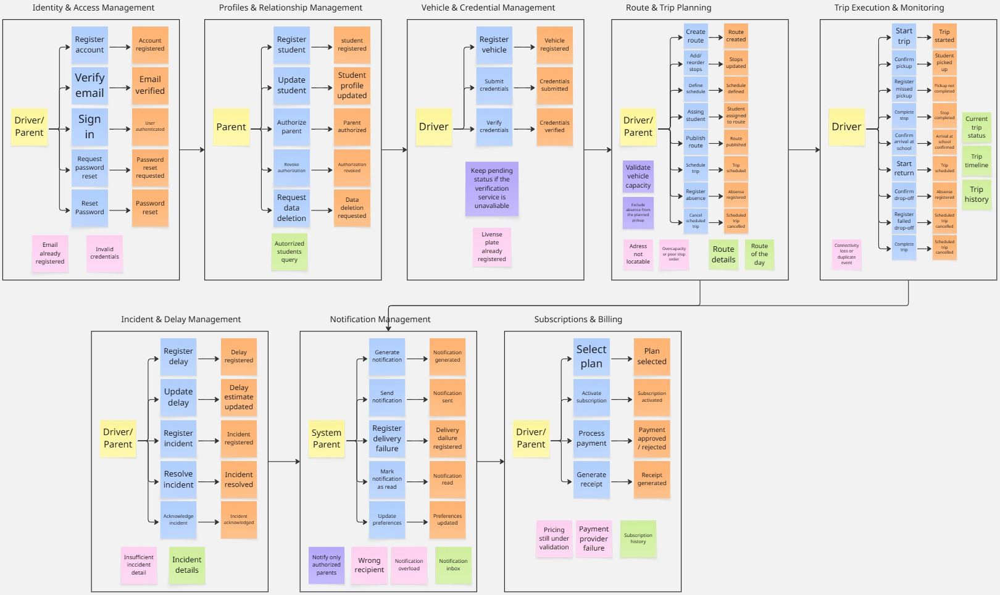

El Big Picture muestra que el núcleo operativo de Rumbo se concentra en la planificación y ejecución del traslado, mientras que identidad, perfiles, vehículos, incidencias, notificaciones y suscripción aportan capacidades relacionadas. Los hotspots registrados permiten anticipar riesgos que deberán considerarse en los siguientes artefactos de diseño y en las decisiones de implementación.

## 2.5. Ubiquitous Language

En esta sección se mantiene el glosario compartido del dominio de movilidad escolar utilizado por el equipo y los stakeholders. Los términos se expresan en inglés y, cuando resulta útil, se incluye su equivalente en español entre paréntesis. Las definiciones describen conceptos del negocio y evitan términos puramente técnicos de ingeniería de software.

| Término | Definición |
|---|---|
| **Account (Cuenta)** | Registro que permite a un conductor o padre/tutor acceder a las capacidades que le corresponden dentro de Rumbo. |
| **Email Verification (Verificación de correo)** | Confirmación de que el correo asociado a una cuenta pertenece al usuario que realizó el registro. |
| **Student (Estudiante)** | Menor que utiliza el servicio de movilidad escolar para trasladarse entre su punto de recojo y el centro educativo. |
| **Parent/Guardian (Padre/Tutor)** | Persona responsable del estudiante y autorizada para consultar información relacionada con sus traslados. |
| **Guardian Authorization (Autorización de tutor)** | Relación que determina qué tutor puede acceder a la información de un estudiante. |
| **Driver (Conductor)** | Persona encargada de conducir la movilidad escolar y ejecutar los traslados asociados a sus rutas. |
| **Vehicle (Vehículo)** | Unidad utilizada por el conductor para realizar el traslado de los estudiantes. |
| **Credential (Credencial)** | Documento o dato declarado por el conductor para respaldar la información de su servicio y vehículo. |
| **Route (Ruta)** | Configuración del recorrido que agrupa paradas, orden de atención, horario y estudiantes asignados. |
| **Stop (Parada)** | Punto definido dentro de una ruta en el que se recoge o entrega a uno o más estudiantes. |
| **Route Schedule (Horario de ruta)** | Días y horas en los que una ruta está prevista para operar. |
| **Student Assignment (Asignación de estudiante)** | Relación que vincula a un estudiante autorizado con una ruta y una parada determinada. |
| **Student Absence (Ausencia de estudiante)** | Registro que indica que un estudiante no utilizará un viaje previsto para una jornada determinada. |
| **Trip (Viaje)** | Ejecución concreta de una ruta en una fecha y turno determinados. |
| **Trip Status (Estado del viaje)** | Estado operativo de un viaje, por ejemplo **scheduled**, **in progress**, **completed** o **cancelled**. |
| **Pickup (Recojo)** | Hito que registra el resultado del recojo de un estudiante en una parada. |
| **Drop-off (Entrega)** | Hito que registra el resultado de la entrega de un estudiante en su destino autorizado. |
| **Trip Timeline (Línea de tiempo del viaje)** | Registro cronológico de los principales eventos ocurridos durante un viaje. |
| **Delay (Retraso)** | Demora registrada que afecta el desarrollo previsto del viaje y que puede requerir una actualización a las familias. |
| **Incident (Incidencia)** | Situación inesperada ocurrida durante el servicio que requiere ser registrada, comunicada y, cuando corresponda, resuelta. |
| **Incident Acknowledgement (Confirmación de incidencia)** | Registro mediante el cual un tutor confirma que tomó conocimiento de una incidencia comunicada. |
| **Notification (Notificación)** | Aviso generado a partir de un evento relevante y dirigido únicamente a usuarios autorizados. |
| **Notification Preference (Preferencia de notificación)** | Configuración mediante la cual un tutor define qué tipos de avisos configurables desea recibir. |
| **Subscription (Suscripción)** | Habilitación comercial asociada a un conductor y a un plan determinado. |
| **Plan (Plan)** | Conjunto de condiciones o capacidades comerciales previstas para una suscripción. |
| **Payment (Pago)** | Operación comercial asociada a la activación o continuidad de una suscripción. |
| **Receipt (Comprobante)** | Constancia generada como resultado de una operación de pago registrada. |

---

# Capítulo III: Requirements Specification

## 3.1. User Stories

Por indicación del docente, los **Epics** y las **User Stories** de Rumbo se presentan en cuadros separados, manteniendo sus relaciones mediante el Epic ID correspondiente. Los criterios de aceptación siguen la estructura Gherkin (Given-When-Then), se redactan en tiempo presente y tercera persona. Las Technical Stories corresponden a capacidades del RESTful API y utilizan el rol Developer.

#### Epics

| Epic / Story Id | Título | Descripción | Criterios de Aceptación | Relacionado con (Epic ID) |
|---|---|---|---|---|
| EP01 | Identidad, perfiles y autorización | Registro de conductores, padres y estudiantes, acceso al sistema según rol, y control sobre qué tutores pueden consultar la información de cada menor, incluida la solicitud de supresión de sus datos. | — | — |
| EP02 | Suscripción del conductor | Activación y vigencia del plan que habilita al conductor el uso de las funcionalidades de Rumbo. | — | — |
| EP03 | Planificación de rutas y viajes | Creación de rutas con sus paradas, orden y horario, asignación de estudiantes autorizados, publicación de la ruta y programación de los viajes de cada jornada, incluyendo ausencias y cancelaciones. | — | — |
| EP04 | Ejecución del traslado | Registro de los hitos del recorrido por parte del conductor: inicio del viaje, recojos, llegada al centro educativo, retorno, entregas y cierre del traslado. | — | — |
| EP05 | Visibilidad, incidencias y comunicación | Consulta del estado y la línea de tiempo por parte de los tutores autorizados, y comunicación de retrasos, incidencias y notificaciones sobre los eventos relevantes de la ruta. | — | — |
| EP06 | Landing Page e información pública | Contenido público que presenta la propuesta de valor de Rumbo, los beneficios por segmento, los documentos legales y los accesos a la aplicación web. | — | — |
| EP07 | RESTful API e integraciones | Capacidades técnicas del RESTful API, incluyendo autenticación, documentación, internacionalización e integración con servicios externos requeridos por Rumbo. | — | — |

#### User Stories

| Epic / Story Id | Título | Descripción | Criterios de Aceptación | Relacionado con (Epic ID) |
|---|---|---|---|---|
| US01 | Registrar cuenta de conductor | Como conductor, quiero crear mi cuenta para iniciar la configuración de mi servicio en Rumbo. | **Escenario 1: Registro exitoso** Given que no existe una cuenta asociada al correo indicado When el conductor completa los datos obligatorios y confirma el registro Then el sistema crea la cuenta con rol de conductor y solicita la verificación del correo  **Escenario 2: Correo ya registrado** Given que existe una cuenta asociada al correo indicado When el conductor intenta registrarse con ese correo Then el sistema rechaza el registro e indica que puede iniciar sesión o recuperar su acceso  **Escenario 3: Datos obligatorios incompletos** Given una solicitud de registro con datos obligatorios faltantes When el conductor confirma el registro Then el sistema informa qué datos obligatorios debe completar y no crea la cuenta | EP01 |
| US02 | Registrar vehículo y credenciales del servicio | Como conductor, quiero registrar mi vehículo y las credenciales que acreditan mi servicio para que las familias conozcan la información declarada de mi movilidad. | **Escenario 1: Registro de vehículo y credenciales** Given un conductor con cuenta activa When registra la placa, la capacidad del vehículo y los documentos requeridos Then el sistema asocia el vehículo al conductor y deja las credenciales en estado pendiente de verificación  **Escenario 2: Placa ya registrada** Given que la placa indicada pertenece a un vehículo activo de otro conductor When el conductor intenta registrarla Then el sistema rechaza el registro e informa que la placa ya se encuentra asociada  **Escenario 3: Verificación de credenciales** Given credenciales enviadas y un servicio de verificación disponible When el sistema obtiene una respuesta del servicio Then registra el resultado junto con su fuente y fecha de consulta  **Escenario 4: Servicio de verificación no disponible** Given credenciales enviadas y el servicio de verificación fuera de operación When el sistema intenta la consulta Then mantiene las credenciales como pendientes y no las declara verificadas | EP01 |
| US03 | Registrar cuenta de padre o tutor | Como padre o tutor, quiero crear mi cuenta para acceder a la información autorizada de los traslados de mis hijos. | **Escenario 1: Registro exitoso** Given que no existe una cuenta asociada al correo indicado When el tutor completa los datos obligatorios y confirma el registro Then el sistema crea la cuenta con rol de padre o tutor y solicita la verificación del correo  **Escenario 2: Correo ya registrado** Given que existe una cuenta asociada al correo indicado When el tutor intenta registrarse con ese correo Then el sistema rechaza el registro e indica que puede iniciar sesión o recuperar su acceso | EP01 |
| US04 | Iniciar sesión según rol | Como usuario registrado, quiero iniciar sesión con mis credenciales para acceder a las funcionalidades correspondientes a mi rol. | **Escenario 1: Acceso válido** Given una cuenta activa con credenciales correctas When el usuario inicia sesión Then el sistema le otorga acceso a las funcionalidades permitidas para su rol  **Escenario 2: Credenciales inválidas** Given credenciales incorrectas When el usuario intenta iniciar sesión Then el sistema rechaza el acceso sin revelar cuál de los datos es incorrecto  **Escenario 3: Cuenta sin verificar** Given una cuenta cuyo correo no ha sido verificado When el usuario intenta iniciar sesión Then el sistema informa que debe completar la verificación antes de continuar | EP01 |
| US05 | Recuperar acceso a la cuenta | Como usuario registrado, quiero restablecer mi contraseña para recuperar el acceso en caso de olvido. | **Escenario 1: Solicitud válida** Given un correo asociado a una cuenta activa When el usuario solicita recuperar su acceso Then el sistema envía un enlace temporal para establecer una nueva contraseña  **Escenario 2: Enlace expirado o utilizado** Given un enlace de recuperación vencido o ya usado When el usuario intenta acceder con él Then el sistema lo rechaza y solicita generar una nueva petición  **Escenario 3: Correo no registrado** Given un correo que no corresponde a ninguna cuenta When se solicita la recuperación Then el sistema responde de forma uniforme sin revelar si el correo existe | EP01 |
| US06 | Registrar estudiante y vincularse como tutor | Como padre o tutor, quiero registrar a mi hijo y quedar vinculado como su tutor para poder consultar la información de sus traslados. | **Escenario 1: Registro y vinculación** Given un tutor autenticado When registra los datos obligatorios del estudiante Then el sistema crea el perfil del estudiante y establece la autorización del tutor sobre él  **Escenario 2: Actualización de datos** Given un estudiante ya registrado When el tutor modifica un dato permitido Then el sistema actualiza la información y conserva la relación con sus viajes anteriores  **Escenario 3: Datos obligatorios incompletos** Given un registro con datos faltantes When el tutor confirma la operación Then el sistema indica qué datos debe completar y no crea el perfil | EP01 |
| US07 | Autorizar o revocar a otro tutor | Como padre o tutor, quiero autorizar o retirar el acceso de otro tutor sobre mi hijo para controlar quién puede consultar su información. | **Escenario 1: Autorización de un tutor adicional** Given un tutor con autorización vigente sobre un estudiante When autoriza a otra persona registrada como tutor de ese estudiante Then el sistema crea la nueva autorización y la habilita para consultar la información del menor  **Escenario 2: Revocación** Given una autorización vigente sobre un estudiante When el tutor responsable la revoca Then el sistema retira el acceso y la persona deja de recibir notificaciones sobre ese estudiante  **Escenario 3: Persona no registrada** Given que la persona indicada no cuenta con una cuenta en Rumbo When se intenta autorizarla Then el sistema informa que debe registrarse previamente  **Escenario 4: Consulta sin autorización** Given un usuario sin autorización vigente sobre un estudiante When intenta consultar su información Then el sistema rechaza la operación | EP01 |
| US08 | Solicitar la supresión de datos del estudiante | Como padre o tutor, quiero solicitar la eliminación de los datos personales de mi hijo para ejercer el control sobre su información. | **Escenario 1: Solicitud registrada** Given un tutor con autorización vigente sobre un estudiante When envía una solicitud de supresión de datos Then el sistema registra la solicitud con su fecha y la deriva al procedimiento de atención correspondiente  **Escenario 2: Estudiante con viajes en curso** Given un estudiante asignado a un viaje que aún no finaliza When se registra la solicitud Then el sistema la conserva como pendiente hasta el cierre del viaje e informa esta condición al tutor | EP01 |
| US09 | Activar la suscripción del conductor | Como conductor, quiero activar una suscripción para habilitar las funcionalidades incluidas en mi plan. | **Escenario 1: Activación válida** Given un conductor con cuenta activa y un plan disponible When el conductor confirma la activación de la suscripción Then el sistema registra el plan y su periodo de vigencia y habilita las funcionalidades correspondientes  **Escenario 2: Suscripción ya activa** Given un conductor con una suscripción vigente al mismo plan When solicita activarla nuevamente Then el sistema conserva la suscripción vigente y evita generar una activación duplicada | EP02 |
| US10 | Crear una ruta con sus paradas | Como conductor, quiero crear una ruta con sus paradas en el orden en que las recorro para organizar mi servicio. | **Escenario 1: Creación de la ruta** Given un conductor con cuenta activa y un vehículo registrado When registra el nombre, el turno y los datos obligatorios de la ruta Then el sistema crea la ruta en estado configurable  **Escenario 2: Incorporación de paradas** Given una ruta en estado configurable When el conductor agrega una parada con una dirección válida Then el sistema la incorpora al recorrido y le asigna la siguiente posición disponible  **Escenario 3: Reordenamiento de paradas** Given una ruta con dos o más paradas When el conductor modifica el orden del recorrido Then el sistema conserva la nueva secuencia para los viajes que se generen a partir de esa ruta  **Escenario 4: Dirección no localizable** Given una dirección que el servicio de mapas no puede ubicar When el conductor intenta agregar la parada Then el sistema informa la situación y permite corregir la dirección antes de guardarla | EP03 |
| US11 | Definir el horario de la ruta | Como conductor, quiero establecer los días y horarios de una ruta para que sus viajes se programen de forma recurrente. | **Escenario 1: Horario válido** Given una ruta en estado configurable When el conductor define los días de servicio y las horas correspondientes Then el sistema guarda el horario y lo asocia a la ruta  **Escenario 2: Horario incompleto** Given una ruta con datos de horario incompletos When el conductor intenta confirmar la programación Then el sistema rechaza la operación e indica qué información obligatoria falta | EP03 |
| US12 | Asignar estudiantes a una ruta | Como conductor, quiero asignar a los estudiantes autorizados a una ruta y a su parada para incluirlos en los recorridos. | **Escenario 1: Asignación autorizada** Given un estudiante registrado, una ruta existente y una vinculación autorizada When el conductor asigna al estudiante a una parada de la ruta Then el sistema registra la asignación y lo incluye en los viajes que se generen para esa ruta  **Escenario 2: Estudiante sin autorización** Given un estudiante cuya vinculación no está autorizada When el conductor intenta asignarlo a una ruta Then el sistema rechaza la operación y no crea la asignación  **Escenario 3: Asignación duplicada** Given un estudiante ya asignado a la misma ruta y turno When el conductor intenta asignarlo nuevamente Then el sistema conserva una sola asignación | EP03 |
| US13 | Publicar una ruta | Como conductor, quiero publicar una ruta configurada para habilitar la programación de sus viajes y su visibilidad para los tutores autorizados. | **Escenario 1: Publicación exitosa** Given una ruta con al menos una parada, un horario definido y un estudiante asignado When el conductor la publica Then el sistema cambia su estado a publicada y habilita la generación de viajes  **Escenario 2: Configuración incompleta** Given una ruta sin horario definido o sin paradas When el conductor intenta publicarla Then el sistema impide la publicación e indica qué configuración falta  **Escenario 3: Visibilidad para los tutores** Given una ruta publicada When un tutor autorizado consulta el servicio de su hijo Then puede conocer la ruta, su horario y el conductor responsable | EP03 |
| US14 | Modificar una ruta publicada | Como conductor, quiero actualizar una ruta publicada para mantenerla alineada con mi operación real. | **Escenario 1: Modificación aplicada** Given una ruta publicada When el conductor modifica una parada, su orden o su horario Then el sistema guarda el cambio para los viajes que se generen posteriormente  **Escenario 2: Viaje en curso** Given un viaje activo generado a partir de la ruta When el conductor modifica la configuración de la ruta Then el viaje en curso conserva la configuración con la que fue iniciado | EP03 |
| US15 | Programar el viaje de la jornada | Como conductor, quiero contar con el viaje del día y la lista de estudiantes prevista para saber a quiénes debo recoger. | **Escenario 1: Programación del viaje** Given una ruta publicada con horario vigente When corresponde un día de servicio según su horario Then el sistema programa el viaje para esa fecha y turno  **Escenario 2: Generación de la lista** Given un viaje programado When el conductor consulta la lista antes de iniciar el recorrido Then el sistema presenta a los estudiantes asignados en el orden de sus paradas, excluyendo las ausencias registradas  **Escenario 3: Ruta sin estudiantes activos** Given una ruta publicada cuyos estudiantes reportaron ausencia para la fecha When se programa el viaje Then el sistema lo informa al conductor para que decida si realiza el recorrido | EP03 |
| US16 | Reportar la ausencia del estudiante | Como padre o tutor, quiero informar que mi hijo no usará la movilidad para evitar una parada innecesaria. | **Escenario 1: Ausencia antes del inicio** Given un viaje programado que aún no ha iniciado When el tutor reporta la ausencia del estudiante para esa jornada Then el sistema actualiza la lista del viaje y excluye su recojo  **Escenario 2: Ausencia durante el recorrido** Given un viaje iniciado cuya parada del estudiante aún no ha sido atendida When el tutor reporta la ausencia Then el sistema actualiza la lista del viaje y comunica el cambio al conductor  **Escenario 3: Parada ya atendida** Given que la parada correspondiente al estudiante ya fue completada When el tutor intenta reportar la ausencia para ese viaje Then el sistema rechaza el cambio para esa jornada | EP03 |
| US17 | Cancelar un viaje | Como conductor, quiero cancelar un viaje que no se realizará para que las familias no esperen un servicio inexistente. | **Escenario 1: Cancelación antes del inicio** Given un viaje programado que aún no ha iniciado When el conductor lo cancela indicando el motivo Then el sistema registra la cancelación e informa a los tutores de los estudiantes asignados  **Escenario 2: Cancelación con el viaje en curso** Given un viaje iniciado que no puede continuar When el conductor lo cancela indicando el motivo Then el sistema conserva los hitos ya registrados, cierra el viaje como cancelado e informa a los tutores  **Escenario 3: Viaje completado** Given un viaje que ya fue completado When se intenta cancelarlo Then el sistema rechaza la operación | EP03 |
| US18 | Iniciar el viaje | Como conductor, quiero iniciar el recorrido para que los tutores sepan que la ruta está en ejecución. | **Escenario 1: Inicio del recorrido** Given un viaje programado para la jornada When el conductor confirma el inicio Then el sistema registra la hora de inicio y cambia el estado del viaje a en ejecución  **Escenario 2: Viaje ya iniciado** Given un viaje que ya se encuentra en ejecución When se intenta iniciarlo nuevamente Then el sistema mantiene el estado vigente y no registra un segundo inicio | EP04 |
| US19 | Registrar los hitos de una parada | Como conductor, quiero confirmar los recojos de cada parada en pocos segundos para dejar constancia sin afectar mi recorrido. | **Escenario 1: Recojo confirmado** Given un viaje en ejecución y un estudiante previsto en una parada When el conductor confirma el recojo Then el sistema registra el hito con fecha y hora y actualiza el estado del estudiante  **Escenario 2: Recojo no realizado** Given un estudiante previsto que no aborda la movilidad When el conductor registra el recojo como no realizado Then el sistema conserva el resultado sin marcar al estudiante como recogido  **Escenario 3: Parada completada** Given una parada cuyos estudiantes previstos tienen un resultado registrado When el conductor confirma el cierre de la parada Then el sistema marca la parada como completada y continúa con la siguiente etapa del recorrido | EP04 |
| US20 | Confirmar la llegada al colegio e iniciar el retorno | Como conductor, quiero confirmar la llegada al centro educativo y dar inicio al retorno para diferenciar ambas etapas del servicio. | **Escenario 1: Llegada al colegio** Given un viaje de ida en ejecución When el conductor confirma la llegada al centro educativo Then el sistema registra el hito e informa a los tutores de los estudiantes a bordo  **Escenario 2: Inicio del retorno** Given una llegada al colegio confirmada y un retorno previsto When el conductor inicia el recorrido de vuelta Then el sistema registra el inicio del retorno y conserva el historial de la etapa de ida  **Escenario 3: Servicio sin retorno** Given un viaje configurado únicamente como ida When se confirma la llegada al colegio Then el sistema habilita el cierre del viaje sin requerir un retorno | EP04 |
| US21 | Confirmar la entrega del estudiante | Como conductor, quiero confirmar la entrega de cada estudiante para cerrar su traslado y avisar a su tutor. | **Escenario 1: Entrega confirmada** Given un estudiante a bordo y el vehículo detenido en su punto de entrega When el conductor confirma la entrega Then el sistema registra el hito con destino, fecha y hora e informa a los tutores autorizados  **Escenario 2: Entrega no concretada** Given un punto de entrega donde no se presenta una persona autorizada When el conductor registra la entrega como no concretada indicando el motivo Then el sistema conserva al estudiante como no entregado e informa a sus tutores de inmediato  **Escenario 3: Entrega posterior** Given una entrega registrada como no concretada When la entrega se concreta más adelante durante el mismo viaje Then el sistema registra el nuevo hito conservando el intento anterior | EP04 |
| US22 | Completar el viaje | Como conductor, quiero cerrar el viaje para consolidar su resultado y dejarlo disponible como historial. | **Escenario 1: Cierre del viaje** Given un viaje cuyos estudiantes cuentan con un resultado registrado When el conductor confirma el cierre del recorrido Then el sistema registra la hora de término, consolida la línea de tiempo y archiva el viaje en el historial  **Escenario 2: Hitos pendientes** Given un viaje con estudiantes sin resultado registrado When el conductor intenta cerrarlo Then el sistema advierte qué hitos se encuentran pendientes antes de permitir el cierre  **Escenario 3: Consulta posterior** Given un viaje archivado When un tutor autorizado consulta ese traslado Then el sistema presenta los hitos registrados conservando su orden cronológico | EP04 |
| US23 | Registrar un retraso | Como conductor, quiero registrar un retraso y su causa para informar con un solo registro a todas las familias afectadas. | **Escenario 1: Retraso registrado** Given un viaje en ejecución y el vehículo detenido When el conductor registra una demora indicando su causa y magnitud estimada Then el sistema incorpora el retraso al viaje e informa a los tutores de los estudiantes pendientes de atención  **Escenario 2: Actualización del retraso** Given un retraso previamente informado When el conductor actualiza su estimación Then el sistema conserva el registro anterior y comunica la información vigente  **Escenario 3: Estudiantes ya atendidos** Given un retraso registrado When se determinan los destinatarios del aviso Then el sistema excluye a los tutores cuyos estudiantes ya fueron entregados | EP05 |
| US24 | Registrar una incidencia | Como conductor, quiero registrar una incidencia para comunicar un imprevisto con contexto suficiente y sin repetir el mensaje a cada familia. | **Escenario 1: Incidencia registrada** Given un viaje en ejecución y el vehículo detenido When el conductor selecciona una categoría de incidencia y agrega una observación Then el sistema la incorpora al viaje con fecha y hora e informa a los tutores correspondientes  **Escenario 2: Incidencia que afecta a un estudiante** Given una incidencia asociada a un estudiante en particular When el conductor la registra Then el sistema la comunica únicamente a los tutores autorizados de ese estudiante  **Escenario 3: Categoría no indicada** Given un registro de incidencia sin categoría seleccionada When el conductor intenta guardarla Then el sistema solicita completar la categoría antes de registrarla | EP05 |
| US25 | Resolver una incidencia | Como conductor, quiero marcar una incidencia como resuelta para informar que la situación fue normalizada. | **Escenario 1: Resolución registrada** Given una incidencia abierta When el conductor registra su resolución indicando el desenlace Then el sistema actualiza su estado e informa a los tutores que fueron notificados originalmente  **Escenario 2: Resolución posterior al viaje** Given una incidencia abierta de un viaje ya completado When el conductor la resuelve Then el sistema conserva la resolución dentro del historial de ese viaje  **Escenario 3: Incidencia ya resuelta** Given una incidencia con resolución registrada When se intenta resolverla nuevamente Then el sistema mantiene la resolución original | EP05 |
| US26 | Consultar el estado actual del traslado | Como padre o tutor, quiero conocer en pocos segundos la etapa del traslado para evitar preguntarle al conductor. | **Escenario 1: Viaje en ejecución** Given un viaje activo asociado a un estudiante sobre el que el tutor tiene autorización When el tutor consulta su estado Then el sistema presenta la etapa actual del recorrido y el último hito confirmado con su hora  **Escenario 2: Viaje aún no iniciado** Given un viaje programado que no ha comenzado When el tutor lo consulta Then el sistema informa que el recorrido aún no ha iniciado y su horario previsto  **Escenario 3: Retraso vigente** Given un viaje con un retraso registrado When el tutor consulta su estado Then el sistema presenta el retraso junto con la etapa actual del recorrido  **Escenario 4: Sin viajes para la fecha** Given una fecha sin viajes programados para el estudiante When el tutor consulta su estado Then el sistema informa que no existe un traslado previsto para esa fecha | EP05 |
| US27 | Consultar la línea de tiempo del trayecto | Como padre o tutor, quiero revisar los hitos ocurridos durante el recorrido para entender qué pasó sin revisar conversaciones. | **Escenario 1: Viaje en curso** Given un viaje activo con hitos registrados When el tutor consulta su línea de tiempo Then el sistema presenta los hitos en orden cronológico con su fecha y hora  **Escenario 2: Viaje finalizado** Given un viaje completado When el tutor consulta su detalle Then el sistema presenta los hitos del traslado, incluidos los retrasos e incidencias registrados  **Escenario 3: Alcance de la información** Given un viaje con varios estudiantes a bordo When el tutor consulta la línea de tiempo Then el sistema presenta los hitos generales de la ruta y únicamente los específicos de sus propios estudiantes  **Escenario 4: Consulta del historial** Given viajes archivados de fechas anteriores When el tutor selecciona una fecha Then el sistema presenta la línea de tiempo correspondiente a ese traslado | EP05 |
| US28 | Recibir avisos de los eventos relevantes | Como padre o tutor, quiero recibir avisos solo cuando ocurre un evento relevante para mantenerme informado sin revisar la plataforma constantemente. | **Escenario 1: Aviso generado y entregado** Given un evento notificable de un viaje sobre el que el tutor tiene autorización When el sistema procesa el evento Then genera el aviso, lo envía por el canal configurado y registra su envío  **Escenario 2: Fallo de entrega** Given un aviso cuyo envío es rechazado por el proveedor de mensajería When el sistema recibe el resultado Then registra el fallo, conserva el aviso disponible en la plataforma y no lo considera entregado  **Escenario 3: Destinatarios autorizados** Given un evento asociado a un estudiante When se determinan los destinatarios Then el sistema envía el aviso únicamente a los tutores con autorización vigente sobre ese estudiante  **Escenario 4: Aviso leído** Given un aviso recibido y pendiente de revisión When el tutor lo consulta Then el sistema registra su lectura y lo distingue de los avisos no revisados | EP05 |
| US29 | Configurar las preferencias de notificación | Como padre o tutor, quiero elegir qué avisos recibir para no ser saturado con información que no necesito. | **Escenario 1: Preferencia actualizada** Given un tutor autenticado y un tipo de aviso configurable When modifica su preferencia de notificación Then el sistema guarda la configuración para los siguientes eventos aplicables  **Escenario 2: Aviso desactivado** Given un tipo de aviso desactivado por el tutor When ocurre un evento asociado a ese tipo de aviso Then el sistema respeta la preferencia guardada y no envía ese aviso al tutor | EP05 |
| US30 | Confirmar el conocimiento de una incidencia | Como padre o tutor, quiero confirmar que tomé conocimiento de una incidencia para que el conductor sepa que fui informado. | **Escenario 1: Confirmación registrada** Given una incidencia comunicada al tutor When este confirma haber tomado conocimiento Then el sistema registra la confirmación con su fecha y la pone a disposición del conductor  **Escenario 2: Incidencia sin confirmar** Given una incidencia comunicada y no confirmada When el conductor consulta su estado Then el sistema indica qué tutores aún no han confirmado su conocimiento | EP05 |
| US31 | Conocer la propuesta de valor de Rumbo | Como visitante, quiero comprender qué es Rumbo y qué problema resuelve para decidir si me resulta relevante. | **Escenario 1: Propuesta de valor visible** Given un visitante que accede al sitio público When revisa su contenido principal Then encuentra una explicación del producto y del beneficio que ofrece  **Escenario 2: Funcionamiento del servicio** Given un visitante interesado When continúa revisando el contenido Then encuentra una explicación resumida de cómo opera Rumbo durante un traslado  **Escenario 3: Consulta desde un dispositivo móvil** Given un visitante que accede desde un dispositivo móvil When consulta el contenido público Then puede acceder al contenido y navegarlo correctamente | EP06 |
| US32 | Identificar los beneficios de mi segmento e ingresar a Rumbo | Como visitante, quiero conocer los beneficios correspondientes a mi perfil e ingresar a la experiencia que me corresponde para comenzar a utilizar Rumbo según mis necesidades. | **Escenario 1: Beneficios para padres y tutores** Given un visitante del segmento de padres o tutores When revisa el contenido dirigido a su perfil Then encuentra beneficios relacionados con la visibilidad del traslado y los avisos  **Escenario 2: Beneficios para conductores** Given un visitante del segmento de conductores When revisa el contenido dirigido a su perfil Then encuentra beneficios relacionados con la organización de su ruta y la reducción de mensajes repetitivos  **Escenario 3: Ingreso a la experiencia correspondiente** Given un visitante que se identifica con uno de los dos segmentos When solicita acceder a la experiencia correspondiente Then el sistema lo dirige al acceso o registro asociado a ese perfil | EP06 |
| US33 | Consultar el contenido en inglés o español | Como visitante, quiero consultar el contenido en un idioma disponible para comprenderlo con facilidad. | **Escenario 1: Idioma predeterminado** Given un visitante que ingresa por primera vez When se presenta el contenido público Then este se muestra en inglés como idioma predeterminado  **Escenario 2: Cambio de idioma** Given un visitante que selecciona español latinoamericano When continúa navegando Then el contenido se presenta en es_419 y la preferencia se conserva durante la sesión  **Escenario 3: Contenido sin traducción disponible** Given un contenido sin traducción en el idioma seleccionado When el visitante accede a él Then se presenta en el idioma predeterminado sin interrumpir la navegación | EP06 |
| US34 | Consultar los documentos legales del servicio | Como visitante, quiero conocer los términos de servicio y la política de privacidad para entender cómo se trata la información. | **Escenario 1: Documentos accesibles** Given un visitante en cualquier sección del sitio público When busca la información legal Then encuentra los términos de servicio y la política de privacidad  **Escenario 2: Tratamiento de datos de menores** Given un visitante que consulta la política de privacidad When revisa su contenido Then encuentra la descripción del tratamiento de los datos de los estudiantes y los derechos que puede ejercer  **Escenario 3: Acceso desde la aplicación** Given un usuario autenticado When busca la información legal Then accede a los mismos documentos publicados en el sitio público | EP06 |
| US35 | Resolver dudas antes de usar Rumbo | Como visitante, quiero resolver mis dudas o comunicarme con el equipo para decidir si utilizo el servicio. | **Escenario 1: Consulta enviada** Given un visitante que completa los datos obligatorios con información válida When envía su consulta Then el sistema confirma que la solicitud fue registrada  **Escenario 2: Datos incompletos** Given una solicitud de contacto con datos obligatorios faltantes When el visitante intenta enviarla Then el sistema indica qué información debe completar  **Escenario 3: Preguntas frecuentes por segmento** Given un visitante con dudas sobre el servicio When revisa las preguntas frecuentes de su segmento Then encuentra respuestas sobre privacidad, funcionamiento y requisitos de uso | EP06 |
| TS01 | Endpoints del RESTful API para viajes y hitos | Como Developer, quiero exponer endpoints REST para la gestión de viajes y sus hitos, de modo que la aplicación web pueda registrar y consultar el estado del traslado. | **Escenario 1: Registro de un hito** Given una solicitud autenticada con un payload válido When se invoca POST sobre el recurso de hitos del viaje Then el servicio persiste el evento y responde con 201 y la representación del recurso creado  **Escenario 2: Payload inválido** Given una solicitud con datos que no cumplen el esquema When se invoca el endpoint Then el servicio responde con 400 y el detalle de los campos rechazados  **Escenario 3: Consulta del estado** Given un viaje existente y una solicitud autorizada When se invoca GET sobre el recurso del viaje Then el servicio responde con 200 y el estado vigente con su último hito  **Escenario 4: Recurso inexistente** Given un identificador de viaje que no existe When se invoca el endpoint Then el servicio responde con 404 | EP07 |
| TS02 | Autenticación y autorización con JWT y RBAC | Como Developer, quiero proteger el RESTful API mediante tokens y control de acceso por rol para que cada usuario acceda únicamente a los recursos autorizados. | **Escenario 1: Emisión del token** Given credenciales válidas When se invoca el endpoint de autenticación Then el servicio responde con 200 y un token que contiene el rol del usuario  **Escenario 2: Solicitud sin token** Given una solicitud a un recurso protegido sin credenciales When el servicio la procesa Then responde con 401  **Escenario 3: Rol sin permisos suficientes** Given un token válido cuyo rol no permite la operación When se invoca el recurso Then el servicio responde con 403  **Escenario 4: Token expirado** Given un token vencido When se invoca un recurso protegido Then el servicio responde con 401 e indica que la sesión debe renovarse | EP07 |
| TS03 | Integración con el servicio de notificaciones | Como Developer, quiero integrar un proveedor de mensajería para distribuir los avisos generados por los eventos del viaje. | **Escenario 1: Envío exitoso** Given un aviso pendiente y un destinatario con canal válido When el backend delega el envío al proveedor Then registra el resultado exitoso junto con su identificador de seguimiento  **Escenario 2: Error del proveedor** Given un proveedor que devuelve un error de entrega When el backend procesa la respuesta Then registra el fallo y mantiene el aviso disponible para consulta  **Escenario 3: Reintento controlado** Given un fallo temporal de entrega When el backend reintenta el envío dentro del límite configurado Then evita duplicar el aviso para el mismo destinatario y evento | EP07 |
| TS04 | Integración con servicio de mapas para direcciones de paradas | Como Developer, quiero integrar un servicio externo de mapas para validar y normalizar las direcciones de las paradas de una ruta. | **Escenario 1: Dirección válida** Given una dirección proporcionada por el conductor When el backend consulta el servicio externo Then obtiene la ubicación normalizada y la asocia a la parada  **Escenario 2: Dirección no localizable** Given una dirección que el servicio no puede resolver When el backend procesa la respuesta Then devuelve un resultado que permite al usuario corregir la dirección  **Escenario 3: Servicio no disponible** Given una falla del proveedor externo When el backend realiza la consulta Then responde indicando que la validación no está disponible sin bloquear el registro de la ruta | EP07 |
| TS05 | Integración con el servicio de verificación de credenciales | Como Developer, quiero integrar el servicio público de consulta de habilitación para respaldar la verificación de credenciales del conductor. | **Escenario 1: Consulta exitosa** Given una solicitud con los datos requeridos When el backend consulta el servicio externo Then registra la respuesta obtenida junto con su fuente y fecha de consulta  **Escenario 2: Servicio no disponible** Given un servicio externo fuera de operación When el backend intenta la consulta Then conserva el estado pendiente y no declara la credencial como verificada  **Escenario 3: Resultado negativo** Given una consulta cuyo resultado indica que la credencial no se encuentra habilitada When el backend registra la respuesta Then el estado de la credencial refleja ese resultado sin inferir información adicional | EP07 |
| TS06 | Documentación del RESTful API con OpenAPI | Como Developer, quiero documentar los endpoints mediante OpenAPI para facilitar su comprensión y prueba por parte del equipo. | **Escenario 1: Documentación disponible** Given el backend en ejecución When se accede a la documentación publicada Then se presentan los endpoints, sus parámetros y los esquemas de datos  **Escenario 2: Detalle de un endpoint** Given un endpoint documentado When se revisa su definición Then se presentan sus códigos de respuesta y ejemplos de request y response  **Escenario 3: Sincronía con la implementación** Given un endpoint modificado When se genera la documentación Then esta refleja la definición vigente del servicio | EP07 |
| TS07 | Internacionalización del RESTful API | Como Developer, quiero localizar los mensajes del API para en_US y es_419 manteniendo el inglés como idioma predeterminado. | **Escenario 1: Sin preferencia de idioma** Given una solicitud que no declara un idioma When el servicio genera un mensaje de validación o error Then lo devuelve en en_US  **Escenario 2: Preferencia soportada** Given una solicitud que declara es_419 When existe traducción disponible Then el servicio devuelve el mensaje en español latinoamericano conservando la estructura del response  **Escenario 3: Preferencia no soportada** Given una solicitud que declara un idioma no contemplado When el servicio genera el mensaje Then utiliza en_US sin rechazar la solicitud | EP07 |
| TS08 | Persistencia consistente del estado y eventos del viaje | Como Developer, quiero persistir el estado del viaje y sus eventos de forma consistente para evitar información parcial durante las operaciones del RESTful API. | **Escenario 1: Operación confirmada** Given una solicitud válida que modifica el estado de un viaje When el servicio completa la operación Then persiste el estado y el evento asociado dentro de la misma transacción y responde con un resultado exitoso  **Escenario 2: Operación fallida** Given una operación que falla durante la persistencia When la transacción se revierte Then el servicio no conserva información parcial y responde con el error correspondiente  **Escenario 3: Consulta del historial** Given un viaje existente y una solicitud autorizada When se consulta su historial de eventos Then el servicio responde con la secuencia registrada y sus fechas | EP07 |

## 3.2. Impact Mapping

El **Impact Mapping de Rumbo** fue elaborado en UXPressia a partir de los Business Goals definidos en el Lean UX Process y de los dos User Personas identificados en el Needfinding: **Gabriela Morales**, representante del segmento de padres/tutores, y **Carlos Rivas**, representante del segmento de conductores.

El mapa relaciona los objetivos de negocio con los cambios de comportamiento esperados en cada persona, los entregables que pueden provocar dichos impactos y las User Stories que permiten implementarlos. Para padres/tutores, el enfoque se centra en reducir la necesidad de contactar al conductor, facilitar la consulta del estado del traslado y mantener notificaciones relevantes. Para conductores, se busca registrar los principales hitos del viaje, comunicar retrasos e incidencias de forma estructurada y organizar la operación diaria del servicio.

  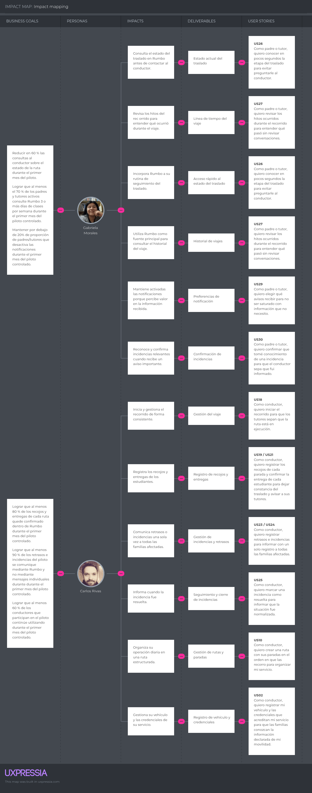

## 3.3. Product Backlog

El **Product Backlog de Rumbo** organiza y prioriza las User Stories según su valor para el negocio y el orden de implementación definido por el equipo. Las historias de la Landing Page se mantienen al inicio porque corresponden al primer Sprint. A continuación se ubican las funcionalidades de negocio y los CRUD del Frontend Web Application; las historias de cuenta, acceso y autorización se mantienen hacia la parte final del bloque funcional, mientras que las Technical Stories del RESTful API se reservan para etapas posteriores del proyecto.

Las estimaciones utilizan únicamente la escala de Story Points **1, 2, 3, 5 y 8**, conforme al Statement. El Sprint 1 reúne las historias US31–US35 y suma **8 Story Points**. La selección definitiva de historias para  se realizará desde este backlog según los CRUD que se implementen en Angular con JSON Server y la capacidad acordada por el equipo.

**Product Backlog público (Trello):** https://trello.com/b/dd4dejIV/product-backlog

  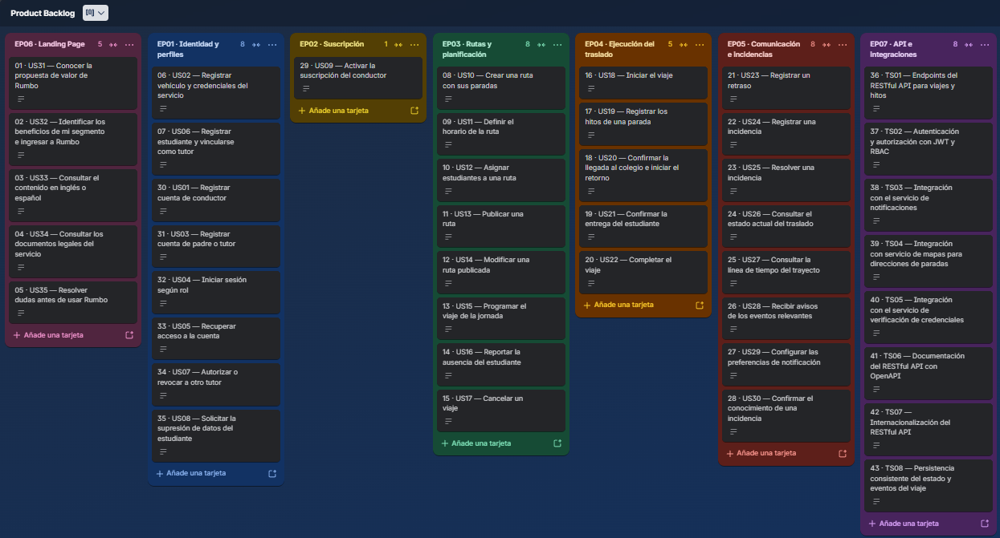

| # Orden | User Story Id | Título | Descripción | Story Points (1 / 2 / 3 / 5 / 8) |
|---:|---|---|---|---:|
| 1 | US31 | Conocer la propuesta de valor de Rumbo | Como visitante, quiero comprender qué es Rumbo y qué problema resuelve para decidir si me resulta relevante. | 2 |
| 2 | US32 | Identificar los beneficios de mi segmento e ingresar a Rumbo | Como visitante, quiero conocer los beneficios correspondientes a mi perfil e ingresar a la experiencia que me corresponde para comenzar a utilizar Rumbo según mis necesidades. | 2 |
| 3 | US33 | Consultar el contenido en inglés o español | Como visitante, quiero consultar el contenido en un idioma disponible para comprenderlo con facilidad. | 1 |
| 4 | US34 | Consultar los documentos legales del servicio | Como visitante, quiero conocer los términos de servicio y la política de privacidad para entender cómo se trata la información. | 1 |
| 5 | US35 | Resolver dudas antes de usar Rumbo | Como visitante, quiero resolver mis dudas o comunicarme con el equipo para decidir si utilizo el servicio. | 2 |
| 6 | US02 | Registrar vehículo y credenciales del servicio | Como conductor, quiero registrar mi vehículo y las credenciales que acreditan mi servicio para que las familias conozcan la información declarada de mi movilidad. | 5 |
| 7 | US06 | Registrar estudiante y vincularse como tutor | Como padre o tutor, quiero registrar a mi hijo y quedar vinculado como su tutor para poder consultar la información de sus traslados. | 5 |
| 8 | US10 | Crear una ruta con sus paradas | Como conductor, quiero crear una ruta con sus paradas en el orden en que las recorro para organizar mi servicio. | 8 |
| 9 | US11 | Definir el horario de la ruta | Como conductor, quiero establecer los días y horarios de una ruta para que sus viajes se programen de forma recurrente. | 3 |
| 10 | US12 | Asignar estudiantes a una ruta | Como conductor, quiero asignar a los estudiantes autorizados a una ruta y a su parada para incluirlos en los recorridos. | 5 |
| 11 | US13 | Publicar una ruta | Como conductor, quiero publicar una ruta configurada para habilitar la programación de sus viajes y su visibilidad para los tutores autorizados. | 3 |
| 12 | US14 | Modificar una ruta publicada | Como conductor, quiero actualizar una ruta publicada para mantenerla alineada con mi operación real. | 5 |
| 13 | US15 | Programar el viaje de la jornada | Como conductor, quiero contar con el viaje del día y la lista de estudiantes prevista para saber a quiénes debo recoger. | 5 |
| 14 | US16 | Reportar la ausencia del estudiante | Como padre o tutor, quiero informar que mi hijo no usará la movilidad para evitar una parada innecesaria. | 5 |
| 15 | US17 | Cancelar un viaje | Como conductor, quiero cancelar un viaje que no se realizará para que las familias no esperen un servicio inexistente. | 3 |
| 16 | US18 | Iniciar el viaje | Como conductor, quiero iniciar el recorrido para que los tutores sepan que la ruta está en ejecución. | 3 |
| 17 | US19 | Registrar los hitos de una parada | Como conductor, quiero confirmar los recojos de cada parada en pocos segundos para dejar constancia sin afectar mi recorrido. | 8 |
| 18 | US20 | Confirmar la llegada al colegio e iniciar el retorno | Como conductor, quiero confirmar la llegada al centro educativo y dar inicio al retorno para diferenciar ambas etapas del servicio. | 3 |
| 19 | US21 | Confirmar la entrega del estudiante | Como conductor, quiero confirmar la entrega de cada estudiante para cerrar su traslado y avisar a su tutor. | 5 |
| 20 | US22 | Completar el viaje | Como conductor, quiero cerrar el viaje para consolidar su resultado y dejarlo disponible como historial. | 3 |
| 21 | US23 | Registrar un retraso | Como conductor, quiero registrar un retraso y su causa para informar con un solo registro a todas las familias afectadas. | 5 |
| 22 | US24 | Registrar una incidencia | Como conductor, quiero registrar una incidencia para comunicar un imprevisto con contexto suficiente y sin repetir el mensaje a cada familia. | 5 |
| 23 | US25 | Resolver una incidencia | Como conductor, quiero marcar una incidencia como resuelta para informar que la situación fue normalizada. | 3 |
| 24 | US26 | Consultar el estado actual del traslado | Como padre o tutor, quiero conocer en pocos segundos la etapa del traslado para evitar preguntarle al conductor. | 5 |
| 25 | US27 | Consultar la línea de tiempo del trayecto | Como padre o tutor, quiero revisar los hitos ocurridos durante el recorrido para entender qué pasó sin revisar conversaciones. | 5 |
| 26 | US28 | Recibir avisos de los eventos relevantes | Como padre o tutor, quiero recibir avisos solo cuando ocurre un evento relevante para mantenerme informado sin revisar la plataforma constantemente. | 8 |
| 27 | US29 | Configurar las preferencias de notificación | Como padre o tutor, quiero elegir qué avisos recibir para no ser saturado con información que no necesito. | 3 |
| 28 | US30 | Confirmar el conocimiento de una incidencia | Como padre o tutor, quiero confirmar que tomé conocimiento de una incidencia para que el conductor sepa que fui informado. | 2 |
| 29 | US09 | Activar la suscripción del conductor | Como conductor, quiero activar una suscripción para habilitar las funcionalidades incluidas en mi plan. | 8 |
| 30 | US01 | Registrar cuenta de conductor | Como conductor, quiero crear mi cuenta para iniciar la configuración de mi servicio en Rumbo. | 3 |
| 31 | US03 | Registrar cuenta de padre o tutor | Como padre o tutor, quiero crear mi cuenta para acceder a la información autorizada de los traslados de mis hijos. | 3 |
| 32 | US04 | Iniciar sesión según rol | Como usuario registrado, quiero iniciar sesión con mis credenciales para acceder a las funcionalidades correspondientes a mi rol. | 3 |
| 33 | US05 | Recuperar acceso a la cuenta | Como usuario registrado, quiero restablecer mi contraseña para recuperar el acceso en caso de olvido. | 3 |
| 34 | US07 | Autorizar o revocar a otro tutor | Como padre o tutor, quiero autorizar o retirar el acceso de otro tutor sobre mi hijo para controlar quién puede consultar su información. | 5 |
| 35 | US08 | Solicitar la supresión de datos del estudiante | Como padre o tutor, quiero solicitar la eliminación de los datos personales de mi hijo para ejercer el control sobre su información. | 5 |
| 36 | TS01 | Endpoints del RESTful API para viajes y hitos | Como Developer, quiero exponer endpoints REST para la gestión de viajes y sus hitos, de modo que la aplicación web pueda registrar y consultar el estado del traslado. | 8 |
| 37 | TS02 | Autenticación y autorización con JWT y RBAC | Como Developer, quiero proteger el RESTful API mediante tokens y control de acceso por rol para que cada usuario acceda únicamente a los recursos autorizados. | 5 |
| 38 | TS03 | Integración con el servicio de notificaciones | Como Developer, quiero integrar un proveedor de mensajería para distribuir los avisos generados por los eventos del viaje. | 5 |
| 39 | TS04 | Integración con servicio de mapas para direcciones de paradas | Como Developer, quiero integrar un servicio externo de mapas para validar y normalizar las direcciones de las paradas de una ruta. | 5 |
| 40 | TS05 | Integración con el servicio de verificación de credenciales | Como Developer, quiero integrar el servicio público de consulta de habilitación para respaldar la verificación de credenciales del conductor. | 5 |
| 41 | TS06 | Documentación del RESTful API con OpenAPI | Como Developer, quiero documentar los endpoints mediante OpenAPI para facilitar su comprensión y prueba por parte del equipo. | 2 |
| 42 | TS07 | Internacionalización del RESTful API | Como Developer, quiero localizar los mensajes del API para en_US y es_419 manteniendo el inglés como idioma predeterminado. | 3 |
| 43 | TS08 | Persistencia consistente del estado y eventos del viaje | Como Developer, quiero persistir el estado del viaje y sus eventos de forma consistente para evitar información parcial durante las operaciones del RESTful API. | 5 |

---

# Capítulo IV: Product Design

## 4.1. Style Guidelines

Las **Style Guidelines de Rumbo** constituyen la referencia visual común para el Landing Page y la Web Application. Su objetivo es mantener consistencia entre los productos digitales mediante un conjunto compartido de decisiones de branding, tipografía, color, espaciado, tono de comunicación, componentes, responsive design, accesibilidad e internacionalización.

La propuesta toma como referencia principios de **Material Design** y los adapta a la identidad de Rumbo. Las decisiones se orientan a transmitir tranquilidad, confianza y claridad, considerando que el producto acompaña actividades relacionadas con el traslado escolar y debe ser comprensible tanto para padres/tutores como para conductores.

### 4.1.1. General Style Guidelines

#### Branding

La identidad visual de **Rumbo** busca proyectar una imagen cercana, segura y confiable. Se evita una apariencia excesivamente tecnológica o alarmista y se priorizan superficies claras, jerarquías simples y una paleta basada en verdes, tonos crema y colores de apoyo suaves.

  
  
<em>Logotipo principal de Rumbo.</em>

El logotipo se utiliza como identificador principal de la marca y debe conservar proporciones, legibilidad y espacio libre alrededor de su contorno. No debe deformarse, rotarse ni colocarse sobre fondos que reduzcan su contraste.

#### Color Palette

La paleta de colores de Rumbo organiza los tonos principales, secundarios y neutros que se utilizarán de manera consistente en el Landing Page y la Web Application. Los verdes refuerzan la identidad visual y las acciones relevantes; los tonos crema y arena ayudan a reducir la carga visual y aportar calidez; y el azul oscuro se reserva para texto, contraste y elementos de alta legibilidad.

  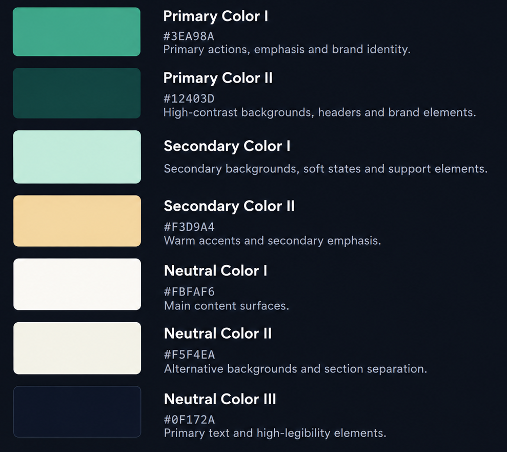
  
<em>Paleta de colores de Rumbo.</em>

#### Typography

Rumbo emplea las familias tipográficas **Outfit** y **Roboto**. La combinación permite diferenciar los contenidos de alta jerarquía de los elementos funcionales y textos de lectura continua.

| Typeface | Aplicación |
|---|---|
| **Outfit** | Títulos principales, encabezados de sección y mensajes de alto impacto. |
| **Roboto** | Párrafos, navegación, botones, etiquetas, formularios y contenido complementario. |

**Outfit** refuerza la personalidad visual en mensajes destacados, mientras que **Roboto** favorece la lectura rápida en componentes funcionales. La jerarquía debe apoyarse también en tamaño, peso y espaciado, evitando depender únicamente del color.

#### Spacing and Shapes

El sistema de espaciado utiliza una escala basada en múltiplos de **4 px**, lo que permite mantener alineación y ritmo visual entre componentes.

| Token | Tamaño | Uso |
|---|---:|---|
| spacing-xs | 4 px | Separación mínima entre elementos estrechamente relacionados. |
| spacing-s | 8 px | Iconos, etiquetas y espacios internos pequeños. |
| spacing-m | 12 px | Padding de controles compactos. |
| spacing-l | 16 px | Separación estándar y margen lateral base en mobile. |
| spacing-xl | 24 px | Padding de tarjetas y agrupaciones principales. |
| spacing-xxl | 32 px | Separación entre bloques importantes en desktop. |
| spacing-3xl | 48 px | Separación estructural entre secciones. |

Las superficies, tarjetas y controles utilizan bordes redondeados de forma consistente con los mock-ups del producto. La forma nunca debe reducir la claridad de los estados interactivos o de los límites entre elementos.

#### Tone of Voice

El tono de Rumbo debe transmitir confianza y tranquilidad, especialmente porque el producto trabaja con información asociada al traslado de menores.

| Dimensión | Posicionamiento | Justificación |
|---|---|---|
| Divertido – Serio | **Serio con cercanía** | La información operativa requiere claridad y responsabilidad. |
| Formal – Casual | **Moderadamente casual** | Se utiliza lenguaje directo y comprensible, evitando tecnicismos innecesarios. |
| Respetuoso – Irreverente | **Respetuoso** | Las comunicaciones deben preservar la confianza entre familias y conductores. |
| Entusiasta – Sereno | **Sereno y positivo** | El producto busca reducir incertidumbre, no generar alarma. |

Los mensajes deben ser breves, accionables y consistentes. En retrasos o incidencias se prioriza información factual y clara; en contenido comercial se comunica el beneficio sin exagerar capacidades que no formen parte del alcance real del producto.

### 4.1.2. Web Style Guidelines

Las interfaces web de Rumbo trasladan las decisiones anteriores a experiencias responsive para Desktop y Mobile Web Browser. La organización visual utiliza contenedores claros, jerarquía tipográfica, tarjetas, botones y estados interactivos consistentes con Material Design y con la identidad establecida.

#### Responsive Layout

En Desktop se aprovecha el espacio horizontal para agrupar información relacionada y facilitar la comparación visual. En tamaños menores, los contenidos se reorganizan en una sola columna o en grupos verticales, conservando el orden de lectura y las acciones principales.

El layout evita anchos rígidos que provoquen desplazamiento horizontal. Los márgenes y separaciones emplean la escala de spacing definida en la sección anterior.

#### Visual Hierarchy

La jerarquía se establece mediante tamaño tipográfico, peso, contraste y espaciado. Los títulos principales utilizan **Outfit**, mientras que contenidos funcionales y de lectura continua utilizan **Roboto**. Las acciones principales se diferencian mediante el verde **#3EA98A**, y el texto se mantiene principalmente sobre superficies claras para preservar legibilidad.

#### Buttons and Call-to-Action

| Tipo | Uso |
|---|---|
| **Primary Button** | Acción principal de una vista o bloque. |
| **Secondary Button** | Acción complementaria que no debe competir visualmente con la principal. |
| **Text Action** | Navegación contextual o acciones de menor prioridad. |

Las etiquetas utilizan verbos o expresiones breves y deben describir el resultado esperado de la acción. Los estados **default, hover, focus, active y disabled** deben distinguirse visualmente; el estado no puede depender exclusivamente del color.

#### Cards and Content Containers

Las tarjetas agrupan información relacionada como beneficios, pasos, estado del traslado, estudiantes o notificaciones. Mantienen superficies claras, padding consistente y una jerarquía interna predecible entre título, contenido, estado y acción.

#### Accessibility and Inclusive Design

Rumbo adopta un enfoque de diseño inclusivo mediante:

- contraste suficiente entre texto y fondo;
- indicadores visibles de focus;
- navegación mediante teclado;
- uso de HTML semántico;
- texto alternativo para imágenes informativas;
- áreas de interacción suficientemente amplias;
- mensajes comprensibles que no dependan solo del color;
- atributos **ARIA** cuando la semántica nativa no sea suficiente.

#### Internationalization

La experiencia contempla **English (en_US)** y **Latin American Spanish (es_419)**, con **English como idioma predeterminado**, de acuerdo con los lineamientos del proyecto. La estructura de los componentes debe tolerar variaciones de longitud entre traducciones sin romper el layout.

  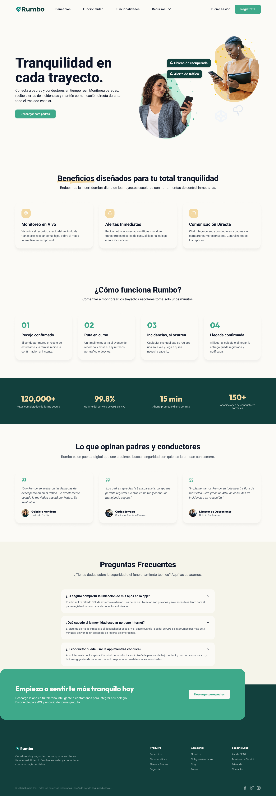
  
<em>Aplicación de las Web Style Guidelines en el Landing Page para Desktop Web Browser.</em>

### 4.1.3. Mobile Style Guidelines

La versión para **Mobile Web Browser** conserva el mismo Design System y prioriza legibilidad, interacción táctil y navegación sencilla. No se define una identidad distinta para mobile; se adapta la misma jerarquía visual a un espacio reducido.

Las principales decisiones son:

- disposición predominantemente vertical;
- margen lateral base de **16 px**;
- reducción de columnas y agrupación de contenido en tarjetas apiladas;
- acciones principales visibles sin competir con acciones secundarias;
- controles táctiles con áreas de interacción amplias;
- textos y estados legibles sin depender de zoom;
- navegación simplificada y orden de lectura consistente;
- conservación de a11y e i18n en los mismos términos que la experiencia Desktop.

Cuando un componente cambia de disposición entre Desktop y Mobile, debe conservar la misma función, etiqueta y prioridad. La adaptación responsive no debe introducir una ruta de navegación diferente para realizar la misma tarea.

  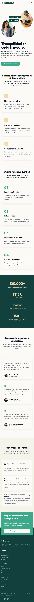
  
<em>Aplicación de las Mobile Style Guidelines en el Landing Page para Mobile Web Browser.</em>

## 4.2. Information Architecture

La arquitectura de información de Rumbo define cómo se organizan, etiquetan y conectan los contenidos del Landing Page y de la Web Application. Las decisiones se basan en los User Personas, User Stories e Impact Mapping previamente definidos.

En el Landing Page se utiliza una estructura informativa progresiva: primero se comunica la propuesta de valor, después se presentan beneficios y funcionamiento y, finalmente, se ofrecen acciones de acceso o contacto. En la Web Application la organización cambia según la audiencia: los padres/tutores consultan información del traslado y los conductores administran y registran elementos operativos de su servicio.

### 4.2.1. Organization Systems

Rumbo combina sistemas de organización jerárquicos, secuenciales, cronológicos y por audiencia de acuerdo con la naturaleza de cada contenido.

| Producto / contenido | Sistema | Aplicación |
|---|---|---|
| Landing Page | Jerárquico | Propuesta de valor → beneficios → funcionamiento → funcionalidades → recursos → acción final. |
| How it works | Secuencial | Explica el servicio siguiendo el orden lógico de sus principales etapas. |
| Web Application | Por audiencia | Se diferencian las tareas de Parent/Guardian y Driver. |
| Parent/Guardian Dashboard | Jerárquico | Se prioriza el estado actual del traslado y luego la información complementaria autorizada. |
| Trip Timeline | Cronológico | Los eventos se presentan según su momento de ocurrencia. |
| Driver route management | Jerárquico y orientado a tareas | La ruta, estudiantes y acciones operativas relevantes se presentan según prioridad. |
| Notifications | Cronológico | Los avisos se ordenan por fecha y hora. |

La organización evita duplicar una misma responsabilidad en diferentes áreas. Por ejemplo, los datos de estudiantes y tutores pertenecen a sus funciones de perfil, mientras que rutas, ejecución, incidencias y notificaciones mantienen estructuras diferenciadas.

### 4.2.2. Labeling Systems

El sistema de etiquetado utiliza palabras breves y consistentes con el Ubiquitous Language del proyecto. Debido a que el idioma predeterminado es **en_US**, las etiquetas principales se definen en inglés y cuentan con equivalente **es_419**.

| English (en_US) | Spanish (es_419) | Asociación |
|---|---|---|
| Benefits | Beneficios | Landing Page |
| How it works | Cómo funciona | Landing Page |
| Features | Funcionalidades | Landing Page |
| Resources | Recursos | Landing Page |
| Sign in | Iniciar sesión | Acceso |
| Sign up | Registrarse | Registro |
| Dashboard | Panel principal | Parent/Guardian |
| Trip Status | Estado del traslado | Consulta de viaje |
| Trip Detail | Detalle del traslado | Consulta ampliada |
| Timeline | Línea de tiempo | Eventos del viaje |
| Notifications | Notificaciones | Avisos relevantes |
| Routes | Rutas | Gestión del conductor |
| Students | Estudiantes | Gestión y asignación |
| Confirm Pickup | Confirmar recojo | Ejecución del viaje |
| Confirm Drop-off | Confirmar entrega | Ejecución del viaje |
| Report Delay | Reportar retraso | Gestión de retrasos |
| Report Incident | Reportar incidencia | Gestión de incidencias |
| Terms of Service | Términos del servicio | Información legal |
| Privacy | Privacidad | Tratamiento de datos |

La misma etiqueta debe representar la misma acción en navegación, botones, formularios, mensajes y documentación, evitando sinónimos que puedan confundir al usuario.

### 4.2.3. SEO Tags and Meta Tags

Las principales páginas incluyen como mínimo **Title, Description, Keywords y Author**. Los valores se redactan en inglés debido a que **en_US** es el idioma predeterminado.

#### Landing Page

| Elemento | Valor |
|---|---|
| **Title** | Rumbo - School Transport Coordination and Trip Information |
| **Meta Description** | Rumbo helps families and school transport drivers coordinate routes, trip events, delays and notifications in one place. |
| **Meta Keywords** | school transport, school routes, trip status, parents, drivers, incidents, notifications |
| **Meta Author** | AIpaca OS |

#### Web Application – Sign In

| Elemento | Valor |
|---|---|
| **Title** | Sign In - Rumbo |
| **Meta Description** | Access Rumbo to manage or consult authorized school transport information. |
| **Meta Keywords** | Rumbo sign in, school transport, parents, drivers |
| **Meta Author** | AIpaca OS |

#### Web Application – Parent/Guardian Dashboard

| Elemento | Valor |
|---|---|
| **Title** | Parent Dashboard - Rumbo |
| **Meta Description** | Consult the current trip status, timeline and notifications associated with an authorized student. |
| **Meta Keywords** | school trip status, parent dashboard, trip timeline, school transport notifications |
| **Meta Author** | AIpaca OS |

#### Web Application – Driver Routes

| Elemento | Valor |
|---|---|
| **Title** | Routes - Rumbo |
| **Meta Description** | Manage school transport routes, students, trip events, delays and incidents in Rumbo. |
| **Meta Keywords** | school route, driver, students, pickup, drop-off, delay, incident |
| **Meta Author** | AIpaca OS |

### 4.2.4. Searching Systems

El alcance actual no incorpora un buscador global porque las User Stories priorizadas presentan información contextual y acotada para cada usuario. Incluir búsqueda sin un requisito que la sustente agregaría complejidad sin valor validado.

| Vista / contenido | Búsqueda o filtro actual | Presentación |
|---|---|---|
| Landing Page | No requiere búsqueda | Navegación directa mediante secciones y enlaces. |
| Parent/Guardian Dashboard | No requiere búsqueda global | Muestra información directamente asociada al usuario autorizado. |
| Trip Timeline | Orden cronológico | Los eventos se muestran dentro del viaje consultado. |
| Driver Routes | Acceso contextual a las rutas del conductor | Las rutas disponibles se presentan como lista o tarjetas. |
| Student List | Listado asociado a una ruta | Los estudiantes se muestran dentro del contexto de la ruta seleccionada. |
| Notifications | Orden cronológico | Los avisos se presentan desde el más reciente al más antiguo. |

Si en una iteración posterior el volumen de rutas, estudiantes, viajes históricos o notificaciones justifica mecanismos de búsqueda o filtrado, éstos deberán incorporarse mediante User Stories específicas antes de agregarse al producto.

### 4.2.5. Navigation Systems

Rumbo utiliza navegación global y contextual en el Landing Page y navegación orientada a tareas en la Web Application. La estructura busca que cada persona llegue a su objetivo mediante rutas cortas y predecibles.

#### Landing Page Navigation

El header permite recorrer las principales secciones del contenido:

**Home → Benefits → How it works → Features → Resources**

Las acciones de acceso se presentan de forma independiente: **Sign in** y **Sign up**.

El footer complementa la navegación con información de la startup, contacto y documentos legales.

#### Parent/Guardian Navigation

Después de autenticarse, el usuario accede a su panel principal y desde allí consulta el traslado y las notificaciones correspondientes a los estudiantes sobre los que mantiene autorización.

Ruta principal: **Sign In → Dashboard → Trip Detail → Trip Timeline**

Ruta complementaria: **Dashboard → Notifications**

La navegación prioriza primero el estado actual y después el detalle histórico o complementario.

#### Driver Navigation

El conductor accede a las funciones operativas del servicio de acuerdo con el contexto de la ruta y el viaje.

Ruta de planificación: **Sign In → Routes → Route Detail → Students / Schedule**

Ruta de ejecución: **Active Trip → Student List → Pickup / Drop-off**

Rutas de excepción: **Active Trip → Report Delay** y **Active Trip → Report Incident**.

Después de registrar un evento, la navegación retorna al contexto del viaje activo para evitar recorridos innecesarios.

La estructura anterior resume la arquitectura de navegación, pero no sustituye los Wireflows y User Flows exigidos en la sección 4.4, los cuales deben elaborarse posteriormente con las herramientas indicadas.

## 4.3. Landing Page UI Design

La propuesta de UI del Landing Page traduce las decisiones de Style Guidelines e Information Architecture a una experiencia responsive para visitantes. La jerarquía visual conduce desde la propuesta de valor hacia beneficios, funcionamiento, funcionalidades y acciones finales, conservando la identidad de Rumbo y diferenciando claramente contenido informativo de elementos interactivos.

La adaptación Desktop/Mobile mantiene el mismo orden semántico, las mismas etiquetas y el mismo Design System. En pantallas pequeñas los bloques se apilan y la navegación se simplifica sin alterar la prioridad del contenido. El diseño considera legibilidad, contraste, navegación por teclado, textos alternativos y áreas de interacción adecuadas como parte del enfoque inclusivo.

### 4.3.1. Landing Page Wireframe

Los wireframes fueron elaborados para **Desktop Web Browser** y **Mobile Web Browser** con el objetivo de validar estructura, jerarquía y organización antes de aplicar estilos finales.

En Desktop, la distribución aprovecha el ancho disponible para organizar contenidos relacionados y facilitar la exploración progresiva. En Mobile, los mismos bloques se reorganizan verticalmente y preservan el orden lógico de lectura. En ambos casos, la ubicación de las acciones principales responde a la arquitectura de información descrita previamente.

  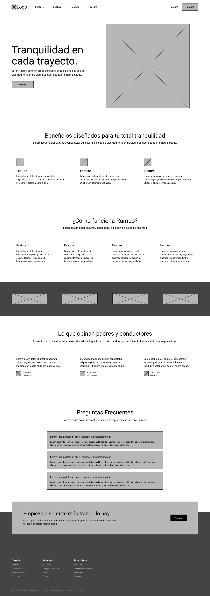
  
<em>Wireframe del Landing Page para Desktop Web Browser.</em>

  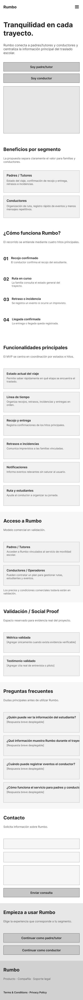
  
<em>Wireframe del Landing Page para Mobile Web Browser.</em>

Los wireframes priorizan una lectura clara, agrupaciones comprensibles y navegación predecible. El enfoque inclusivo se refleja en la ausencia de dependencias exclusivas del color, la estructura lineal de contenido en mobile y la reserva de espacios suficientemente amplios para controles interactivos.

### 4.3.2. Landing Page Mock-up

Los mock-ups aplican el Design System definido en 4.1 sobre la estructura validada en los wireframes. Se utiliza la paleta verde, crema y arena de Rumbo, junto con **Outfit** para títulos y **Roboto** para contenidos funcionales y de lectura continua.

El Desktop Mock-up conserva una jerarquía amplia y permite presentar agrupaciones de contenido en más de una columna cuando existe espacio suficiente. El Mobile Mock-up transforma esas agrupaciones en bloques verticales, manteniendo las mismas asociaciones, etiquetas y prioridad de acciones.

  
  
<em>Mock-up del Landing Page para Desktop Web Browser.</em>

  
  
<em>Mock-up del Landing Page para Mobile Web Browser.</em>

La propuesta conserva consistencia con la arquitectura de información y con los principios de diseño inclusivo: contraste suficiente, jerarquía tipográfica, textos comprensibles, acciones claramente diferenciadas y adaptación responsive sin pérdida de contenido o funcionalidad.

## 4.4. Web Applications UX/UI Design

El diseño de la Web Application considera dos experiencias principales: **padres/tutores** y **conductores**. En ambos casos se prioriza la información del trayecto, pero las acciones disponibles cambian según el rol. Los padres consultan; los conductores registran eventos de la ruta con la menor cantidad posible de pasos.

### 4.4.1. Web Applications Wireframes

Los wireframes se definieron a partir de las tareas centrales de cada segmento.

| Rol | Vista | Contenido principal |
|---|---|---|
| Padre/Tutor | Sign In | Correo, contraseña y recuperación de acceso. |
| Padre/Tutor | Dashboard | Estado actual, estudiante, conductor, vehículo y ETA. |
| Padre/Tutor | Trip Detail | Mapa o progreso de ruta y datos del trayecto. |
| Padre/Tutor | Trip Timeline | Recojo, retrasos, incidencias y llegada en orden cronológico. |
| Padre/Tutor | Notifications | Avisos relevantes asociados al estudiante. |
| Conductor | Sign In | Acceso seguro al panel de ruta. |
| Conductor | Assigned Route | Ruta activa, horario, paradas y estudiantes asignados. |
| Conductor | Student List | Estado de recojo o entrega de cada estudiante. |
| Conductor | Register Event | Confirmación rápida de recojo, llegada o entrega. |
| Conductor | Report Incident | Tipo de incidencia, descripción breve y registro del evento. |

La prioridad del wireframe es que la vista principal responda rápidamente a dos preguntas: **“¿qué está pasando en el trayecto?”** para la familia y **“¿qué debo registrar ahora?”** para el conductor.

### 4.4.2. Web Applications Wireflow Diagrams

Los Wireflow Diagrams de Rumbo representan los principales recorridos de interacción de la Web Application a partir de los **User Goals** de los segmentos **Parent** y **Driver**. Cada flujo conecta estados de interfaz consecutivos para evidenciar cómo una persona avanza desde una vista inicial hasta completar una meta concreta.

Los wireflows mantienen trazabilidad con los User Stories, la Information Architecture y los mock-ups definidos para la aplicación. Para evitar diagramas redundantes, se agrupan las acciones relacionadas bajo siete User Goals representativos del alcance funcional.

#### User Goal 1 — Access parent dashboard

**User Persona:** Parent  
**User Goal:** Acceder al panel principal y visualizar la información del traslado escolar actual.  
**Explicación del flujo:** El Parent selecciona su experiencia en la pantalla de acceso, ingresa sus credenciales y, después de autenticarse correctamente, accede al Panel principal con la información más reciente del viaje activo.

  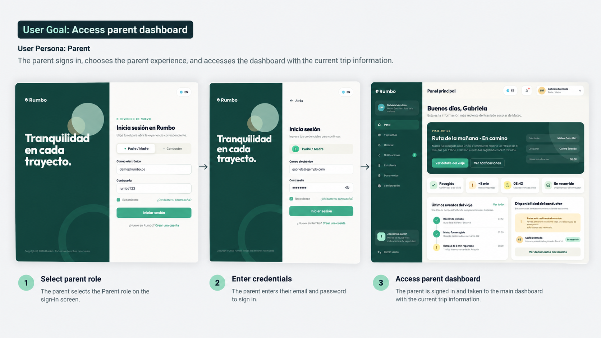

#### User Goal 2 — Consult current trip status

**User Persona:** Parent  
**User Goal:** Consultar el estado actual del traslado y revisar la secuencia de eventos del viaje.  
**Explicación del flujo:** Desde el Panel principal, el Parent abre el detalle del viaje activo y puede profundizar en la línea de tiempo para comprender los eventos registrados durante el recorrido.

  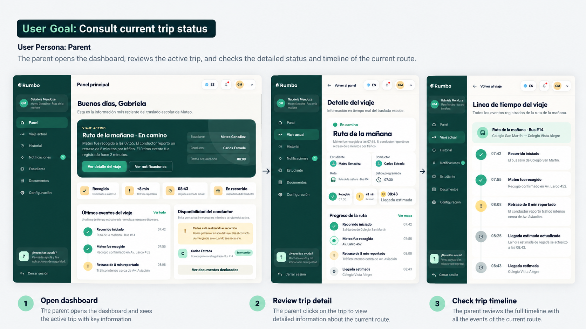

#### User Goal 3 — Review important notifications

**User Persona:** Parent  
**User Goal:** Revisar avisos relevantes asociados al traslado escolar.  
**Explicación del flujo:** El Parent accede desde el Panel principal al centro de notificaciones, revisa las actualizaciones recientes y abre el detalle de un aviso relevante para conocer su contexto y estado.

  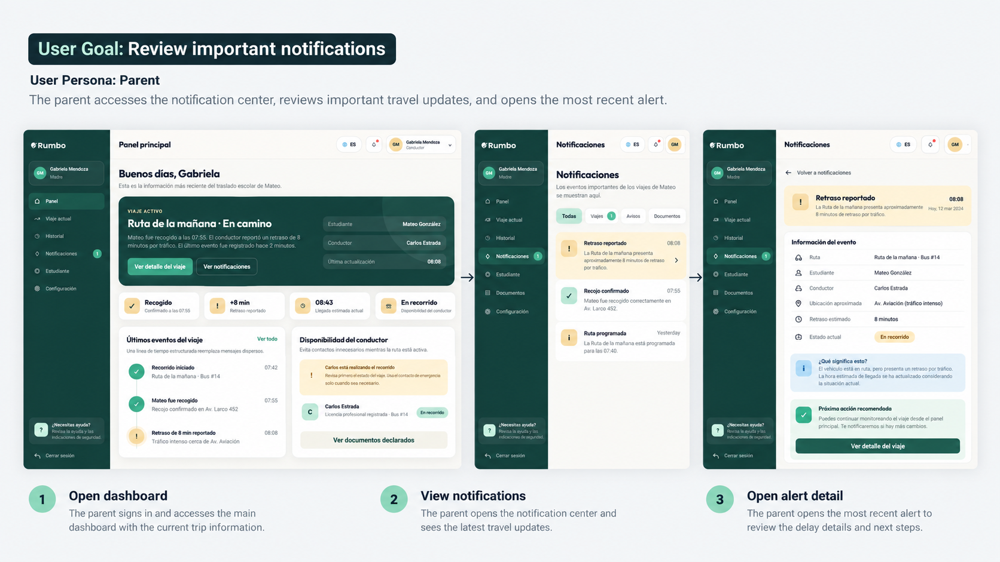

#### User Goal 4 — Start and execute a route

**User Persona:** Driver  
**User Goal:** Iniciar la ruta asignada y continuar con la ejecución del recorrido.  
**Explicación del flujo:** El Driver abre su ruta asignada, inicia el recorrido y accede a la lista de estudiantes para continuar registrando los hitos operativos de recojo y entrega.

  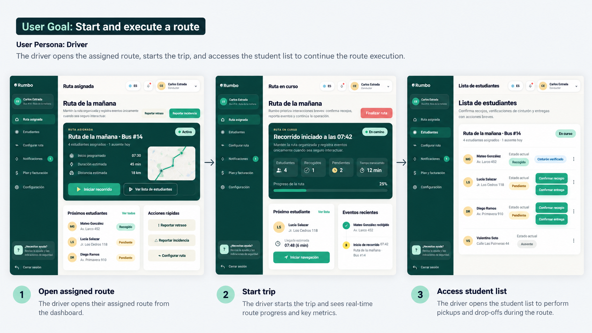

#### User Goal 5 — Configure route and stops

**User Persona:** Driver  
**User Goal:** Configurar la ruta, el orden de las paradas y las vinculaciones necesarias para el servicio.  
**Explicación del flujo:** El Driver parte de la ruta asignada, ingresa a la configuración, ajusta el orden de paradas y guarda los cambios para que la planificación quede disponible en los siguientes recorridos.

  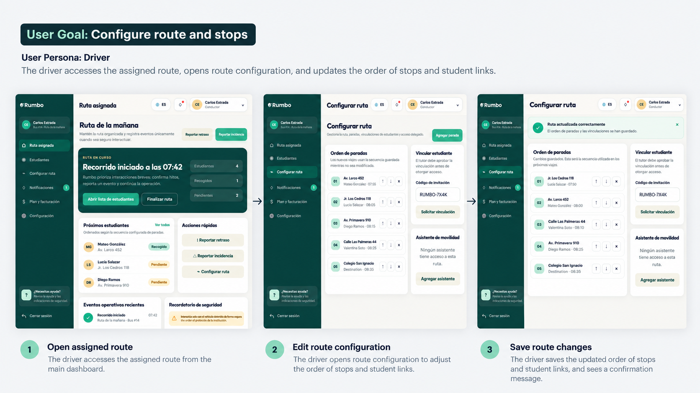

#### User Goal 6 — Monitor operational notifications

**User Persona:** Driver  
**User Goal:** Revisar notificaciones operativas relacionadas con la ruta.  
**Explicación del flujo:** Desde la ruta asignada, el Driver accede al centro de notificaciones, consulta las actualizaciones recientes y marca los avisos revisados para mantener control sobre los eventos informados.

  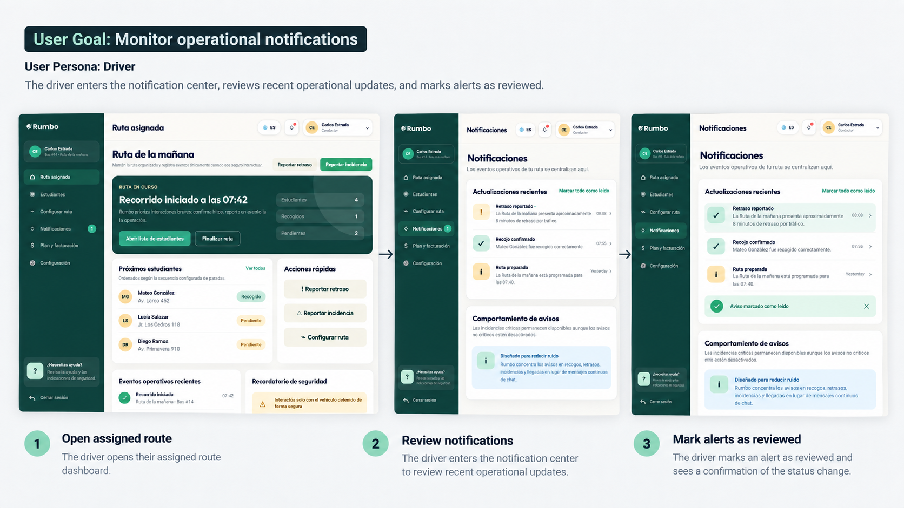

#### User Goal 7 — Manage account and billing

**User Persona:** Driver  
**User Goal:** Consultar la configuración de la cuenta y el estado de la suscripción.  
**Explicación del flujo:** El Driver accede a Configuración para revisar su información de perfil y vehículo y, desde las opciones de cuenta, consulta el resumen de Plan y facturación correspondiente al servicio.

  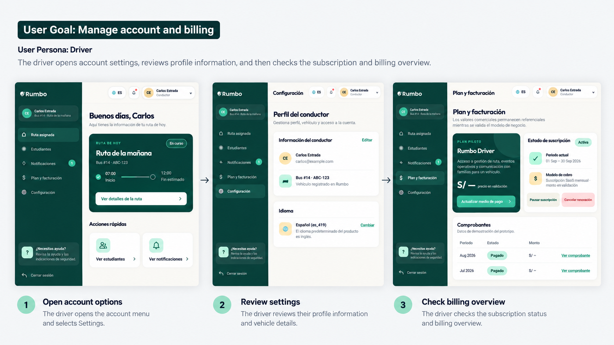

### 4.4.3. Web Applications Mock-ups

Los mock-ups de la Web Application de **Rumbo** aplican el Design System definido previamente y muestran cómo se materializan las principales funcionalidades para los segmentos **Parent** y **Driver**. Las vistas mantienen una estructura consistente de navegación lateral, tarjetas, estados, acciones principales, tipografía y paleta visual. A continuación se presenta cada pantalla junto con una breve descripción de su propósito dentro de la experiencia.

#### Sign In

La pantalla de inicio de sesión funciona como punto de acceso común a la Web Application. Permite seleccionar la experiencia correspondiente, ingresar las credenciales y acceder a las funcionalidades asociadas al rol del usuario.

  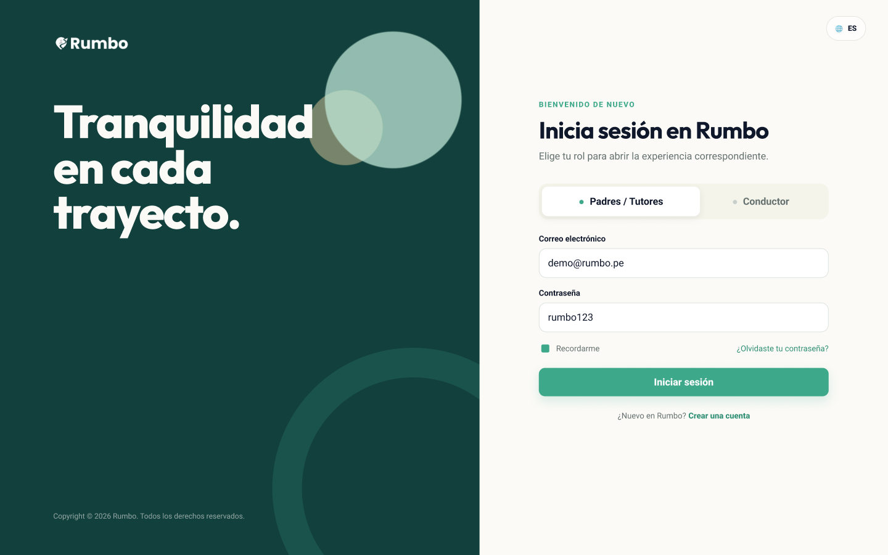

#### Driver — Assigned Route

La vista **Ruta asignada** concentra la información operativa principal del Driver. Presenta el estado del recorrido, los estudiantes asociados y accesos rápidos para reportar retrasos, incidencias o continuar con las acciones de la ruta.

  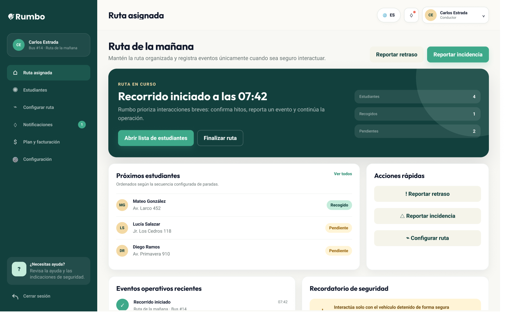

#### Driver — Student List

La **Lista de estudiantes** permite al Driver revisar los estudiantes asociados a la ruta y registrar acciones breves como confirmar recojo o entrega. Los estados visuales permiten distinguir rápidamente estudiantes recogidos, pendientes o ausentes.

  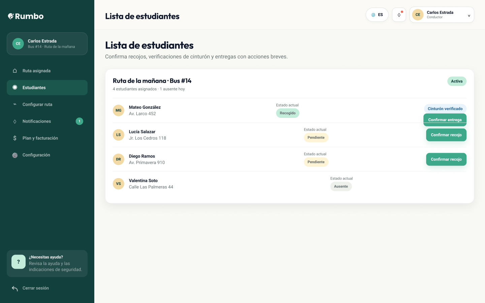

#### Driver — Route Configuration

La pantalla **Configurar ruta** permite administrar el orden de las paradas y las vinculaciones relacionadas con el servicio. La organización en bloques mantiene separadas las tareas de planificación de las acciones propias de la ejecución del viaje.

  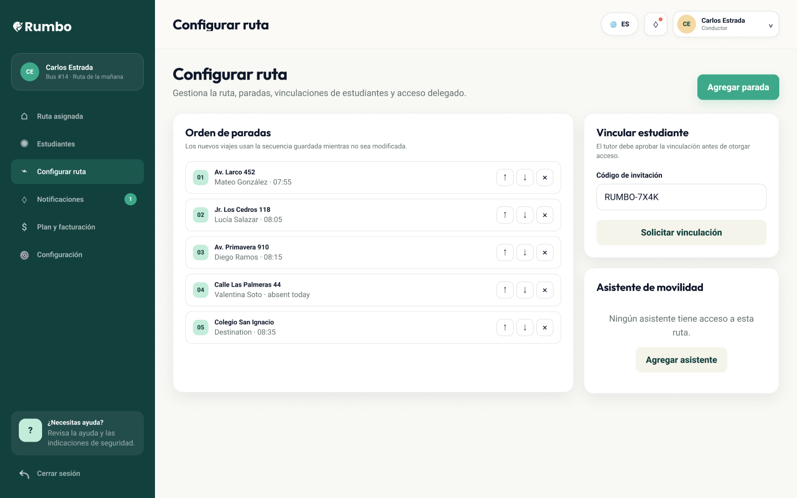

#### Driver — Notifications

El centro de **Notificaciones** reúne los principales eventos operativos asociados a la ruta. La vista prioriza retrasos, confirmaciones y actualizaciones recientes para que el Driver pueda revisar información relevante sin depender de mensajes dispersos.

  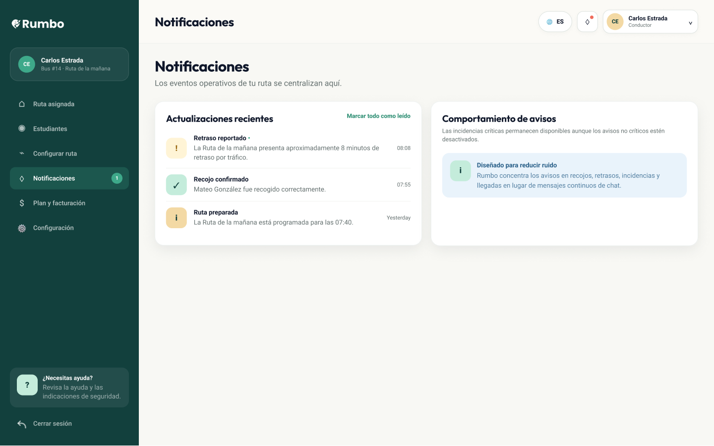

#### Driver — Plan and Billing

La vista **Plan y facturación** presenta el estado de la suscripción, el periodo actual, los comprobantes disponibles y las acciones relacionadas con la gestión del plan. Esta pantalla concentra la información comercial sin mezclarla con las tareas operativas de la ruta.

  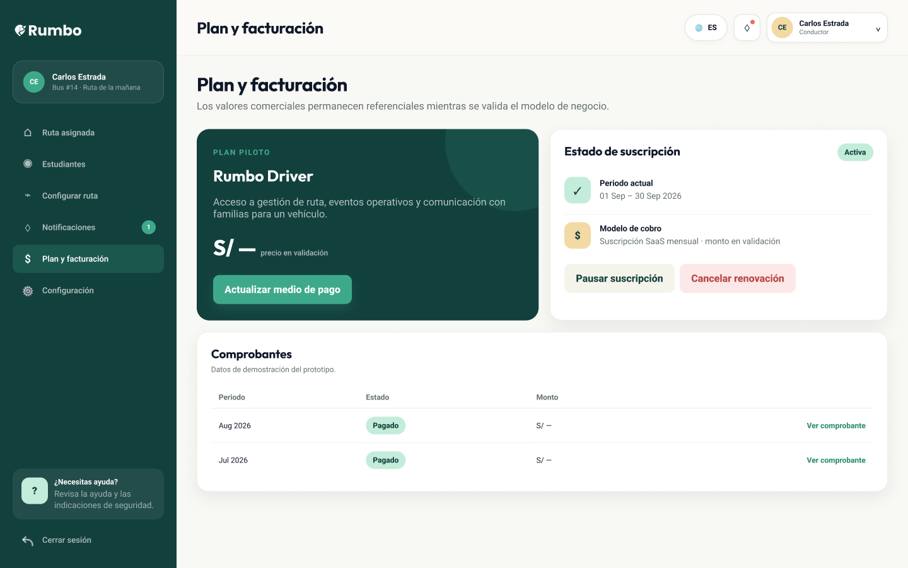

#### Driver — Settings

La sección **Configuración** permite al Driver revisar su información personal, los datos del vehículo y las preferencias de idioma. La vista utiliza la misma jerarquía de tarjetas que el resto de la aplicación para mantener consistencia visual.

  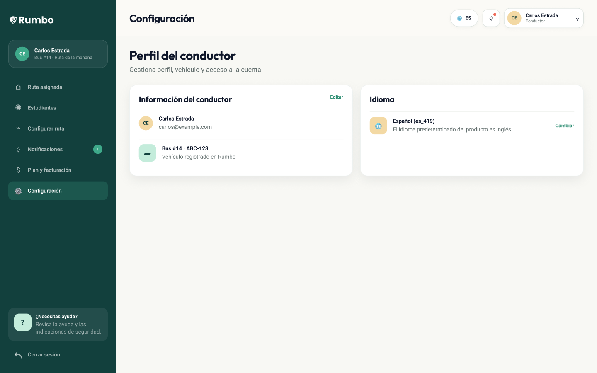

#### Parent — Dashboard

El **Panel principal** del Parent resume la información más reciente del traslado escolar. Presenta el estado del viaje activo, los últimos eventos registrados, el Driver asociado y accesos directos al detalle del viaje y a las notificaciones.

  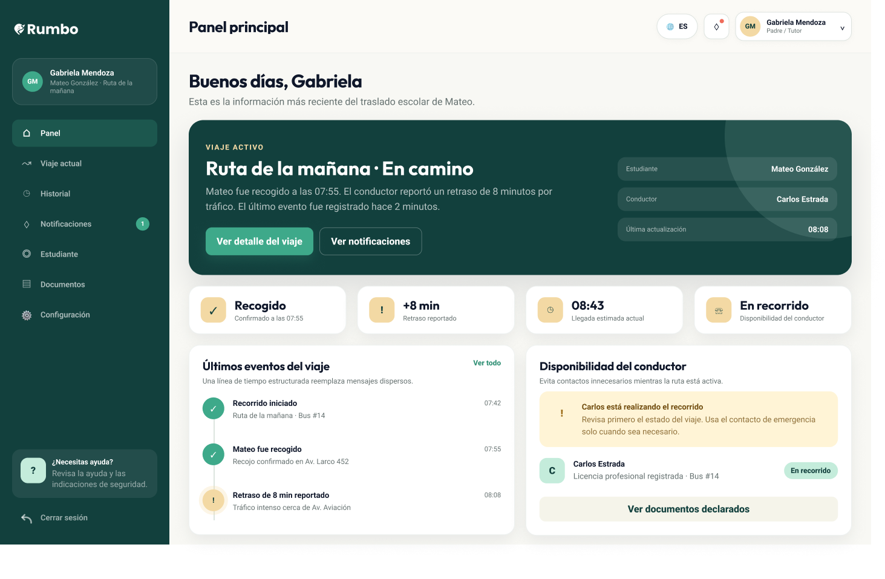

#### Parent — Current Trip

La vista **Viaje actual** amplía el estado del recorrido y organiza los principales eventos en una línea de tiempo. Su objetivo es permitir que el Parent comprenda rápidamente qué ha ocurrido durante el viaje y cuál es el estado registrado más reciente.

  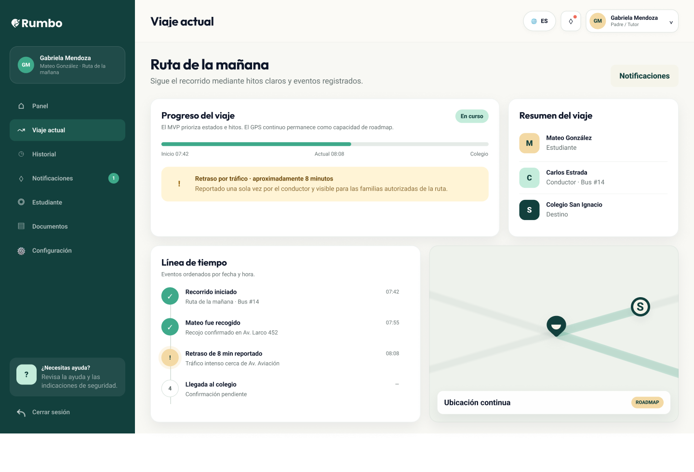

#### Parent — Trip History

El **Historial de viajes** permite consultar recorridos anteriores y revisar información resumida como fecha, conductor, número de eventos y estado del viaje. La presentación tabular facilita comparar registros sin sobrecargar la vista principal.

  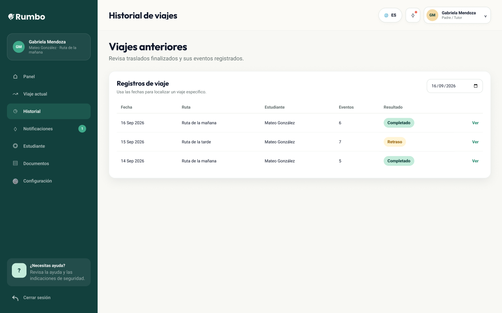

#### Parent — Notifications

La sección **Notificaciones** centraliza los avisos relacionados con el traslado del estudiante. Los eventos recientes se presentan de forma cronológica y con indicadores visuales para diferenciar confirmaciones, retrasos y actualizaciones operativas.

  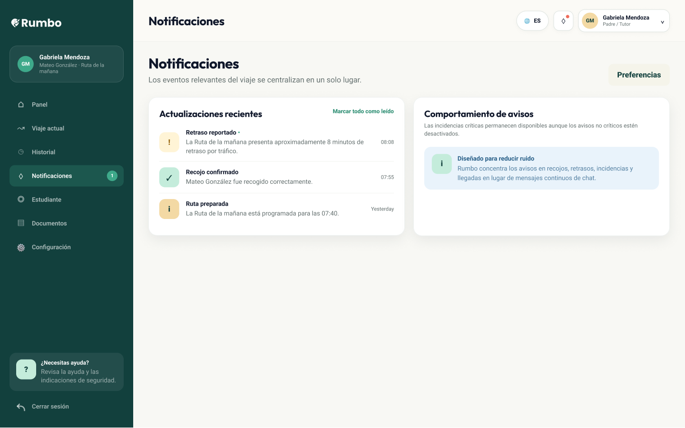

#### Parent — Student Profile

El **Perfil del estudiante** presenta los datos principales del estudiante y la información necesaria para comprender su asociación con el servicio. La vista también permite acceder a información complementaria relacionada con el traslado.

  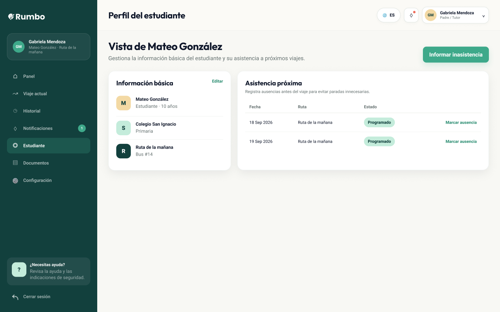

#### Parent — Driver and Vehicle Documents

La vista **Documentos del conductor y vehículo** permite al Parent consultar la información declarada del servicio, como licencia, registro del vehículo y seguro. Esta información se presenta como referencia dentro de la experiencia y evita mezclar documentos con el seguimiento operativo del viaje.

  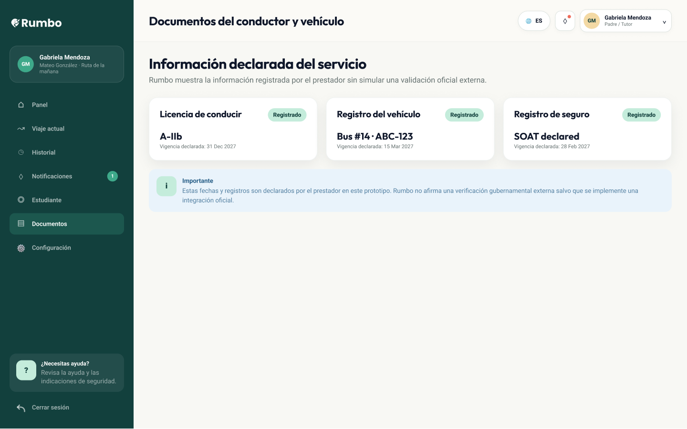

#### Parent — Settings

La sección **Configuración** del Parent reúne preferencias de notificaciones e información de la cuenta. Los controles permiten activar o desactivar avisos sin alterar el resto de la experiencia y mantienen visible la configuración de idioma del producto.

  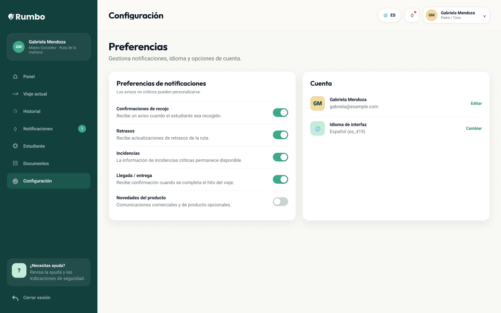

### 4.4.4. Web Applications User Flow Diagrams

Los **User Flow Diagrams** de Rumbo representan las rutas esperadas para completar los principales objetivos de los segmentos **Parent** y **Driver**. A diferencia de los Wireflows, estos diagramas incorporan los mock-ups finales de las vistas y muestran tanto el **happy path** como rutas alternativas relevantes, manteniendo consistencia con los User Goals definidos previamente.

#### User Flow 1 — Access Parent Dashboard

**User Persona:** Parent  
**User Goal:** Access the main dashboard and review the latest school trip information.  
**Flow Description:** The Parent selects the Parent experience, signs in successfully, and reaches the main dashboard with the active trip overview. If the credentials are invalid, the system shows an error and allows a new attempt.

  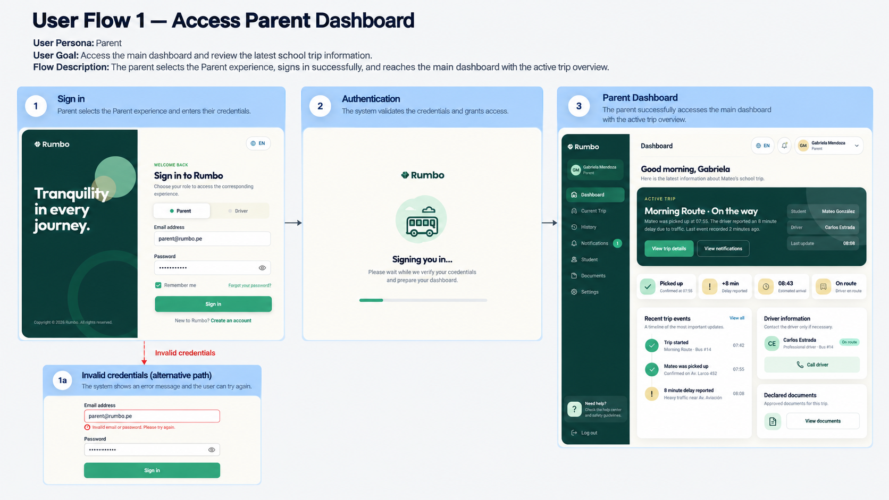

#### User Flow 2 — Consult Current Trip Status

**User Persona:** Parent  
**User Goal:** Consult the current trip status and review the trip timeline.  
**Flow Description:** The Parent opens the dashboard, accesses the current trip detail, and reviews the chronological sequence of route events. The alternative path represents the case in which the trip has already been completed.

  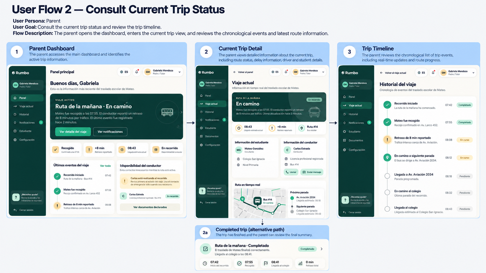

#### User Flow 3 — Review Important Notifications

**User Persona:** Parent  
**User Goal:** Review relevant notifications related to the school trip.  
**Flow Description:** The Parent accesses the notification center, reviews recent alerts, and opens the detail of a relevant event. When there are no unread notifications, the interface displays an informative empty state.

  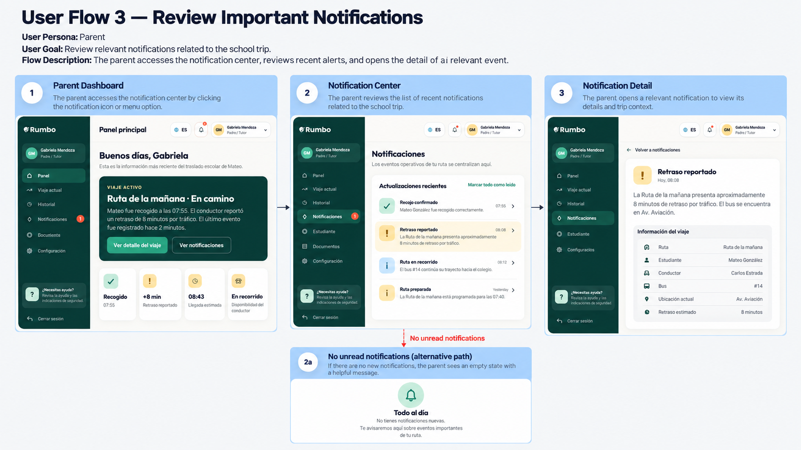

#### User Flow 4 — Start and Execute a Route

**User Persona:** Driver  
**User Goal:** Start the assigned route and continue the execution of the trip.  
**Flow Description:** The Driver opens the assigned route, starts the trip, and continues the route through the student list to register operational milestones. The alternative path covers the reporting of a delay while the route remains active.

  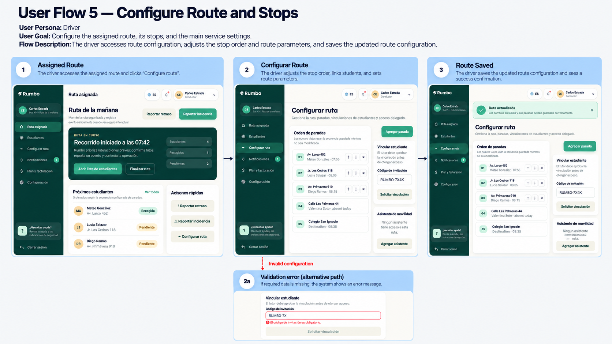

#### User Flow 5 — Configure Route and Stops

**User Persona:** Driver  
**User Goal:** Configure the assigned route, its stops, and the main service settings.  
**Flow Description:** The Driver accesses the route configuration, adjusts the stop order and student links, and saves the updated configuration. If required information is missing or invalid, the system shows a validation error before allowing the operation to continue.

  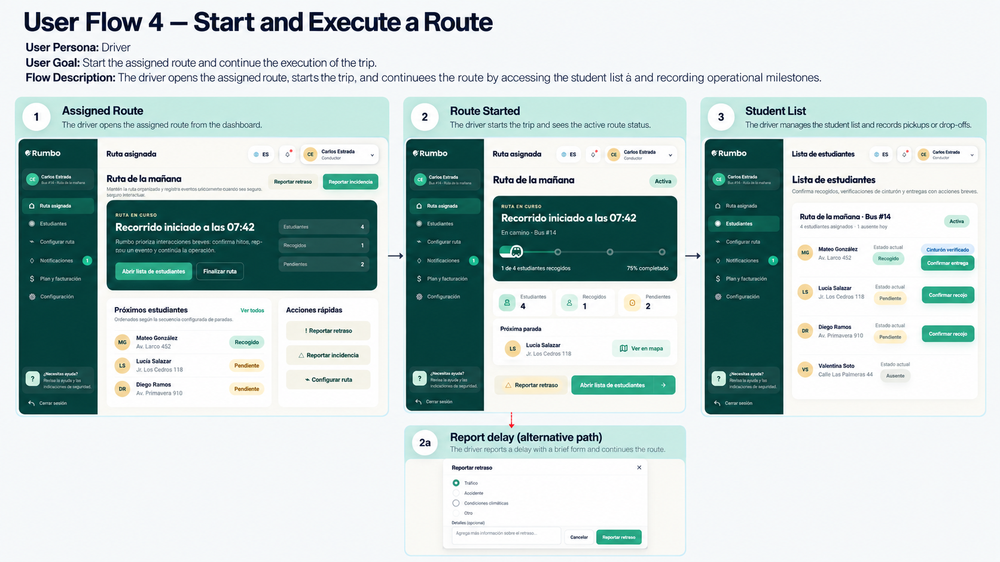

#### User Flow 6 — Monitor Operational Notifications

**User Persona:** Driver  
**User Goal:** Review operational notifications associated with the route.  
**Flow Description:** The Driver opens the notification center, reviews the latest operational updates, opens an alert and marks it as reviewed when appropriate. If there are no recent updates, the system presents an empty state instead of an unnecessary list.

  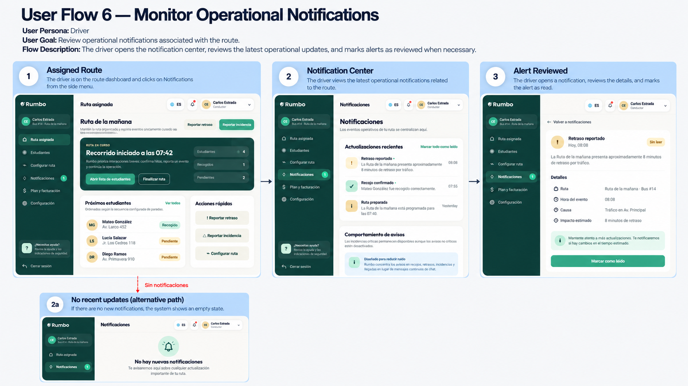

#### User Flow 7 — Manage Account and Billing

**User Persona:** Driver  
**User Goal:** Review profile settings and subscription information.  
**Flow Description:** The Driver accesses the account settings, reviews profile and vehicle information, and then checks the subscription and billing overview. The alternative path illustrates a paused subscription state that can later be reactivated.

  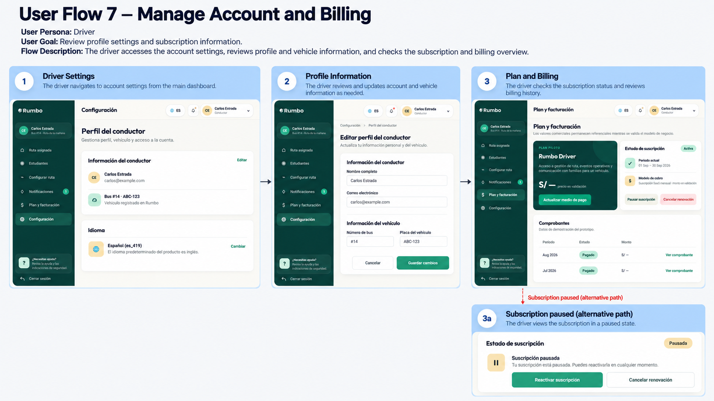

## 4.5. Web Applications Prototyping

El prototipo de la Web Application de **Rumbo** integra los principales mock-ups de los segmentos **Parent** y **Driver** en una navegación coherente con los Wireflows y User Flow Diagrams definidos previamente. La propuesta permite validar la continuidad entre pantallas, la ubicación de las acciones principales y la consistencia del sistema de navegación antes de la implementación final.

  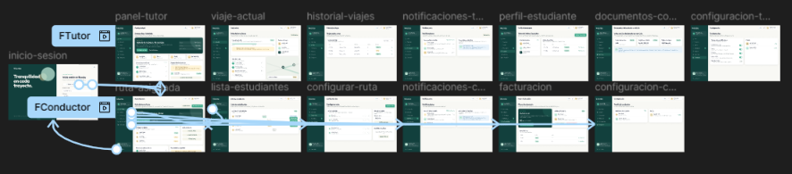

## 4.6. Domain-Driven Software Architecture

### 4.6.1. Design-Level Event Storming

El **Design-Level Event Storming** de Rumbo refina el Big Picture Event Storming desarrollado previamente y organiza el dominio con mayor nivel de detalle. En esta etapa se identifican **Actors, Commands, Aggregates, Domain Events, Business Policies, Read Models y Hotspots**, manteniendo trazabilidad con los User Stories y con el Ubiquitous Language del proyecto.

El artefacto colaborativo de **Design-Level Event Storming** se mantiene en **Miro**, donde el equipo organiza visualmente los elementos del dominio y su relación por Bounded Context. Como respaldo dentro del Project Report se incorporan las exportaciones de los **ocho Bounded Contexts** definidos para Rumbo.

**Miro — Design-Level Event Storming:** https://miro.com/app/board/uXjVHr48KA8=/?share_link_id=942564800097

| Bounded Context | Responsabilidad principal |
|---|---|
| **Identity & Access Management** | Gestionar cuentas, autenticación, verificación de correo y recuperación de acceso. |
| **Profiles & Relationship Management** | Gestionar perfiles de Parent, Driver y Student, además de las relaciones de autorización sobre cada estudiante. |
| **Vehicle & Credential Management** | Gestionar vehículos, credenciales declaradas y el estado registrado de su verificación. |
| **Route & Trip Planning** | Gestionar rutas, paradas, horarios, asignaciones, ausencias, publicación y programación de viajes. |
| **Trip Execution & Monitoring** | Registrar el inicio y desarrollo del viaje, recojos, entregas, etapas, estado y línea de tiempo. |
| **Incident & Delay Management** | Gestionar retrasos, incidencias, actualizaciones, resolución y confirmación de conocimiento. |
| **Notification Management** | Gestionar generación, distribución, lectura, fallos de entrega y preferencias de notificación. |
| **Subscriptions & Billing** | Gestionar la activación y el estado de la suscripción del Driver y la información del plan asociada. |

#### Evidencia visual del Design-Level Event Storming

A continuación se presentan las exportaciones visuales correspondientes a los **ocho Bounded Contexts** definidos para Rumbo.

**Identity & Access Management**

  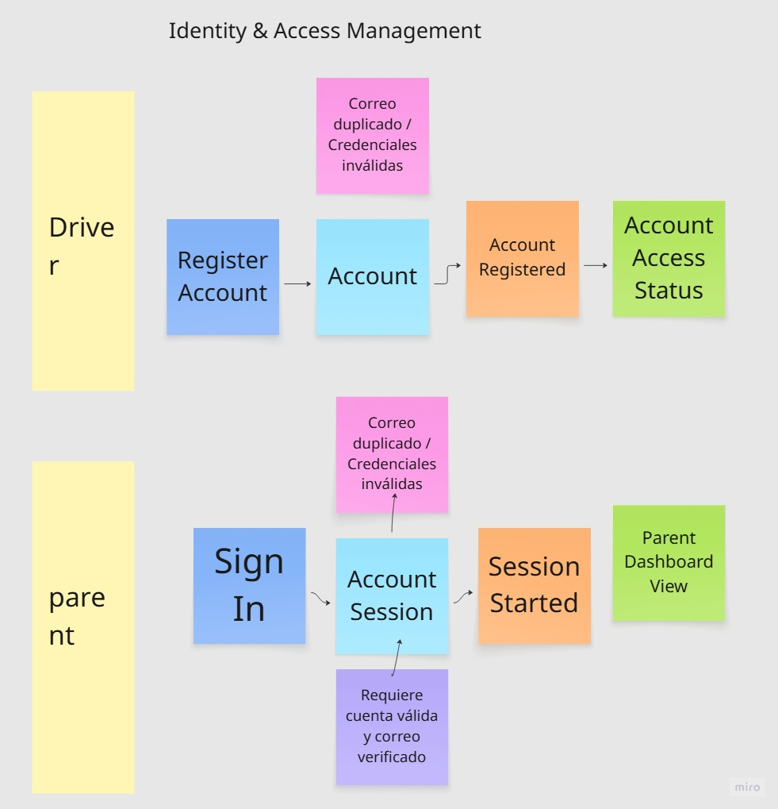

**Profiles & Relationship Management**

  

**Vehicle & Credential Management**

  

**Route & Trip Planning**

  

**Trip Execution & Monitoring**

  

**Incident & Delay Management**

  

**Notification Management**

  

**Subscriptions & Billing**

  

### 4.6.2. Software Architecture Context Diagram

El **Software Architecture Context Diagram** presenta a Rumbo como un único sistema de software y resume sus relaciones principales con las personas y servicios externos que participan en la solución. Esta vista permite comprender el límite general de la plataforma antes de detallar sus unidades de despliegue e implementación.

  

### 4.6.3. Software Architecture Container Diagrams

El **Container Diagram** describe la arquitectura objetivo de Rumbo a nivel de unidades de despliegue. Se distinguen el Landing Page, la Web Application desarrollada con Angular, el RESTful API previsto en Spring Boot y la capa de persistencia, además de las dependencias externas requeridas por la solución. Para Sprint 2, el Frontend Web Application trabaja con Angular y una fuente de datos simulada; la integración completa con el backend corresponde a los siguientes Sprints.

  

### 4.6.4. Software Architecture Components Diagrams

Los **Component Diagrams** descomponen el contenedor de aplicación en componentes asociados a los Bounded Contexts identificados para Rumbo. Cada diagrama muestra responsabilidades, servicios, controladores, repositorios y dependencias necesarias para mantener separadas las capacidades del dominio.

#### Identity & Access Management

Este diagrama representa los componentes responsables de cuentas, autenticación, autorización y recuperación de acceso. El contexto mantiene separadas las responsabilidades de identidad respecto de perfiles, vehículos y operaciones del servicio.

  

#### Profiles & Relationship Management

Este contexto concentra la gestión de perfiles de Parent, Driver y Student, junto con las relaciones de autorización que determinan quién puede consultar la información de cada estudiante.

  

#### Vehicle & Credential Management

El diagrama separa el registro y mantenimiento del vehículo de la gestión de credenciales declaradas por el Driver. Los componentes permiten conservar la información del vehículo y el estado de los documentos asociados sin mezclarla con la planificación de rutas.

  

#### Route & Trip Planning

Este diagrama representa los componentes encargados de rutas, paradas, secuencia de recorrido, asignaciones de estudiantes y planificación de viajes. El contexto prepara la información que posteriormente utiliza la ejecución del traslado.

  

#### Trip Execution & Monitoring

El contexto de ejecución coordina el inicio y desarrollo de un viaje, los eventos operativos y los estados de recojo y entrega. La información registrada alimenta la vista del viaje y su línea de tiempo.

  

#### Incident & Delay Management

Este diagrama concentra el registro y actualización de retrasos e incidencias ocurridos durante el servicio. Sus componentes mantienen el estado de cada evento y permiten comunicar los cambios relevantes al contexto de notificaciones.

  

#### Notification Management

El contexto de notificaciones administra la generación, persistencia, preferencias y distribución de avisos relacionados con eventos relevantes del traslado. Se mantiene separado de Incident & Delay Management para evitar mezclar el evento de negocio con su mecanismo de comunicación.

  

#### Subscriptions & Billing

Este diagrama representa la gestión del plan y de la suscripción del Driver dentro de la arquitectura objetivo. El contexto encapsula la información comercial para que no interfiera con las responsabilidades operativas de rutas y viajes.

  

## 4.7. Software Object-Oriented Design

El diseño orientado a objetos de Rumbo se organiza según los ocho Bounded Contexts establecidos en la sección 4.6. Los diagramas muestran las clases del dominio, sus atributos y operaciones, así como las asociaciones y multiplicidades que permiten modelar los requisitos del producto.

Cada Aggregate Root protege las reglas del agregado que administra; las entidades internas tienen identidad propia, mientras que los Value Objects expresan valores del dominio. Para referenciar una entidad administrada por otro Bounded Context se utilizan identificadores tipados como `DriverProfileId` o `StudentId`, sin duplicar las clases del contexto propietario. Las entidades pertenecientes al mismo contexto se relacionan mediante asociaciones UML directas.

### 4.7.1. Class Diagrams

Los siguientes diagramas siguen el orden de los ocho Bounded Contexts definidos para Rumbo. El modelo de clases sirve como referencia para los Database Diagrams de 4.8 y para el diseño de los Web Services; un aggregate no implica una única tabla ni requiere exponer un CRUD por cada entidad.

#### Identity & Access Management

En Identity & Access Management, `Account` actúa como Aggregate Root y agrupa sus `AccountToken`. Las credenciales de acceso se representan mediante los Value Objects `EmailAddress` y `PasswordHash`; la identidad y sus tokens se administran sin incorporar perfiles o información de rutas.

  

#### Profiles & Relationship Management

Profiles & Relationship Management distingue los agregados `Profile`, `Student`, `School`, `TutorStudentRelationship`, `ServiceEnrollment` y `DataDeletionRequest`. `PersonName` representa nombres y apellidos, mientras que `AccountId` conserva la referencia a la cuenta del contexto IAM. Las asociaciones internas expresan las relaciones y autorizaciones sobre estudiantes, sin duplicar las entidades del propio contexto como Value Objects de identificación.

  

#### Vehicle & Credential Management

Vehicle & Credential Management presenta `Vehicle` como Aggregate Root de sus `VehicleDocument`. `DriverCredential` mantiene su propio ciclo de vida y no pertenece al agregado del vehículo. `LicensePlate` encapsula la placa y `DriverProfileId` permite referirse al conductor administrado en otro contexto.

  

#### Route & Trip Planning

En Route & Trip Planning, `Route` es la raíz del agregado y contiene `RouteStop`, `RouteSchedule` y `RouteAssignment`. Sus operaciones permiten organizar las paradas y horarios, asignar estudiantes y publicar rutas. Los identificadores `DriverProfileId`, `VehicleId`, `StudentId` y `SchoolId` refieren a entidades externas; `GeoPoint` representa la ubicación de las paradas.

  

#### Trip Execution & Monitoring

El contexto Trip Execution & Monitoring modela `Trip` como Aggregate Root de `TripStop`, `TripPassenger`, `TripEvent` y `StudentAbsence`. El viaje conserva una instantánea de la ruta programada y registra hitos, pasajeros y ausencias. Las referencias a rutas, perfiles, estudiantes, colegios y vehículos se representan mediante identificadores tipados de otros contextos.

  

#### Incident & Delay Management

Incident & Delay Management separa los agregados `Incident` y `Delay`. Las confirmaciones de conocimiento (`IncidentAcknowledgement`) son entidades controladas por `Incident`; los retrasos conservan sus actualizaciones mediante una autorreferencia interna. Los Value Objects `TripId`, `StudentId` y `ProfileId` identifican recursos de otros contextos.

  

#### Notification Management

Notification Management administra los agregados `Notification`, `NotificationSettings`, `RecipientAuthorization` y `RecipientContact`. `SourceReference` expresa el origen polimórfico de un aviso, y los identificadores `TripId`, `StudentId` y `ProfileId` mantienen las referencias hacia otros contextos sin importar sus entidades.

  

#### Subscriptions & Billing

Subscriptions & Billing distingue el agregado `Plan` y el agregado `Subscription`, que contiene sus `SubscriptionPayment`. `Money` encapsula importe y moneda; `BillingPeriod` el periodo de cobro. `DriverProfileId` referencia el perfil del conductor desde el contexto correspondiente.

  

Este diseño distingue los límites de consistencia entre agregados y mantiene las referencias a otros contextos mediante Value Objects de identidad. La sección 4.8 presenta la persistencia relacional correspondiente; los contratos y las evidencias de ejecución de los servicios se documentan en el Capítulo V.

## 4.8. Database Design

El diseño de base de datos de Rumbo se presenta por Bounded Context, de acuerdo con la división del dominio descrita en la sección 4.6 y los Class Diagrams de la sección 4.7. En esta revisión se incorporaron ocho diagramas relacionales que detallan las tablas, sus atributos, los tipos de datos y las relaciones utilizadas para conservar la información de la plataforma.

El modelo emplea identificadores de tipo `UUID` y campos temporales para registrar cambios relevantes durante la operación. Las relaciones internas se representan mediante claves primarias y foráneas; cuando un registro hace referencia a información administrada por otro contexto, esa referencia también deberá respetar los límites de responsabilidad definidos en el diseño del dominio. Los diagramas orientan la persistencia de la solución, pero no sustituyen la definición de reglas de negocio ni de contratos REST.

### 4.8.1. Database Diagrams

#### Identity & Access Management

El modelo de identidad se concentra en `accounts` y `account_tokens`. La cuenta conserva el correo, el hash de la contraseña, el rol y el estado de verificación. Los tokens se relacionan con una cuenta y registran su tipo, vencimiento y utilización. Esta separación permite administrar los mecanismos de acceso sin mezclar sus datos con los perfiles de padres o conductores.

  

#### Profiles & Relationship Management

Este contexto reúne `profiles`, `students`, `schools`, `tutor_student_relationships`, `service_enrollments` y `data_deletion_requests`. Las relaciones entre tutores y estudiantes registran autorizaciones; las inscripciones vinculan al estudiante con el conductor y el servicio. La solicitud de eliminación de datos mantiene su propio estado de atención. Los perfiles se identifican de forma independiente de la información de autenticación.

  

#### Vehicle & Credential Management

La persistencia de vehículos se organiza en `vehicles`, `vehicle_documents` y `driver_credentials`. Los vehículos contienen datos de identificación, capacidad y estado; sus documentos registran tipo, vencimiento y verificación. Las credenciales del conductor se administran por separado, lo que permite comprobar tanto la documentación del vehículo como la habilitación de quien presta el servicio.

  

#### Route & Trip Planning

La planificación se apoya en `routes`, `route_stops`, `route_schedules` y `route_assignments`. Cada ruta identifica al conductor y al vehículo asociados, junto con su turno, dirección y estado. Las paradas conservan un orden y datos de ubicación; los horarios especifican los días y horas del servicio. Las asignaciones permiten relacionar estudiantes con paradas de una ruta determinada, separando el diseño del recorrido de la ejecución de un viaje.

  

#### Trip Execution & Monitoring

Este diagrama desarrolla la operación de los recorridos mediante `trips`, `trip_stops`, `trip_passengers`, `trip_events` y `student_absences`. El viaje conserva la fecha del servicio, los estados y los tiempos relevantes; las paradas y pasajeros permiten registrar recojos, entregas y ausencias. Los eventos dejan constancia de lo ocurrido durante el trayecto y de la persona que realizó el registro. De este modo, la información de ejecución queda diferenciada de la programación original de la ruta.

  

#### Incident & Delay Management

Las incidencias se registran en `incidents` con su categoría, descripción, estado y resolución. La tabla `incident_acknowledgements` conserva la confirmación de recepción por parte del tutor. Los retrasos se representan en `delays`, incluyendo su causa, tiempo estimado y la referencia a un retraso anterior cuando existe una actualización. Este modelo permite conservar el historial de situaciones operativas sin confundirlas con el envío de notificaciones.

  

#### Notification Management

El contexto de notificaciones incorpora `notifications`, `notification_settings`, `recipient_authorizations` y `recipient_contacts`. Cada notificación conserva su destinatario, origen, prioridad, contenido y estado de entrega o lectura. La configuración de preferencias permite distinguir los tipos de aviso que recibe el tutor, mientras que las autorizaciones y los datos de contacto contribuyen a dirigir las comunicaciones a sus destinatarios.

  

#### Subscriptions & Billing

El modelo comercial utiliza `plans`, `subscriptions` y `subscription_payments`. Los planes especifican precio, moneda, periodo de facturación y límite de vehículos. Cada suscripción vincula un conductor con un plan y conserva su estado y periodo vigente. Los pagos se registran por suscripción y periodo, con importe, estado y referencia de comprobante, lo que permite mantener separado el catálogo comercial del historial de cobros.

  

En conjunto, los ocho diagramas proporcionan una representación más concreta de la información que administra Rumbo y de las relaciones necesarias dentro de cada contexto. La implementación de Web Services toma estos modelos como referencia para sus entidades persistentes y repositorios, pero define las operaciones REST a partir de las User Stories y las reglas del dominio. La correspondencia entre recursos, operaciones, pruebas y endpoints se documenta en la sección 5.2.3.6 del Capítulo V.

Como criterio de implementación, las referencias entre contextos —por ejemplo, los identificadores de conductor, estudiante, vehículo o viaje— deberán revisarse al definir las restricciones de integridad y la forma de integración de los servicios. También se comprobarán las claves compuestas indicadas en algunos diagramas, los tipos temporales y las restricciones de unicidad antes de elaborar las migraciones de base de datos.
---

# Capítulo V: Product Implementation, Validation & Deployment

Este capítulo reúne la implementación, las pruebas y los despliegues de **Rumbo** por Sprint. En Sprint 2 se integró la primera versión de la Frontend Web Application con Angular 21.2, TypeScript y Angular Material, consumiendo Fake REST APIs. Para AV2 se prepara el Sprint 3, que debe incorporar el avance de Web Services propios, las nuevas versiones desplegadas y la validación con usuarios.

Se separan las decisiones de diseño, el trabajo realizado y las evidencias pendientes. El uso de MockAPI o JSON Server durante Sprint 2 no equivale a contar con servicios propios desarrollados con Spring Boot. Del mismo modo, una compilación o un workflow de publicación correcto no sustituye las pruebas de funcionamiento de la aplicación desde su URL pública. Los datos aún no confirmados quedan indicados como pendientes.

## 5.1. Software Configuration Management

### 5.1.1. Software Development Environment Configuration

Las herramientas utilizadas o previstas para el ciclo de vida de Rumbo son las siguientes:

| Tipo de actividad | Producto / herramienta | Uso en Rumbo | Tipo | Referencia |
|---|---|---|---|---|
| Project Management | Trello | Sprint Backlog, Tasks, estados y seguimiento del Sprint 2. | SaaS | https://trello.com |
| Requirements Management | GitHub Issues / Markdown | User Stories, criterios de aceptación y trazabilidad en el Project Report. | SaaS | https://github.com/AIpaca-OS |
| Product UX/UI Design | Figma | Wireframes, mock-ups y prototipos de la experiencia web. | SaaS | https://www.figma.com |
| Domain Modeling / Event Storming | Miro | Elaboración colaborativa del Design-Level Event Storming y refinamiento visual de Bounded Contexts. | SaaS | https://miro.com/app/board/uXjVHr48KA8=/?share_link_id=942564800097 |
| Source Code Management | Git / GitHub | Repositorios, ramas, commits, Pull Requests, revisión e integración. | Local / SaaS | https://git-scm.com / https://github.com/AIpaca-OS |
| Frontend IDE | WebStorm / Visual Studio Code | Desarrollo y revisión de Angular, TypeScript, HTML y CSS. | Local | https://www.jetbrains.com/webstorm/ / https://code.visualstudio.com |
| Frontend Framework | Angular 21.2 / Angular CLI 21.2 | Single Page Application y routing por Bounded Context. | Open Source | https://angular.dev |
| UI Components | Angular Material 21.2 | Componentes de interfaz basados en Material Design. | Open Source | https://material.angular.dev |
| Language / Tooling | TypeScript 5.9 / npm 11.19 | Programación, tipado y gestión de dependencias. | Open Source | https://www.typescriptlang.org / https://www.npmjs.com |
| i18n | ngx-translate 18 | Recursos de internacionalización del Frontend. | Open Source | https://github.com/ngx-translate/core |
| Fake REST API | MockAPI | Persistencia emulada remota para vehículos, rutas, perfiles y suscripciones. | SaaS | https://mockapi.io |
| Fake REST API local | json-server 0.17.4 | Datos locales de apoyo en `server/db.json`; la configuración publicada del Frontend consultada para esta revisión utiliza MockAPI para alertas e incidencias. | Open Source | https://www.npmjs.com/package/json-server |
| Frontend CI | GitHub Actions | Verificación automatizada de compilación del Frontend integrado. | SaaS | https://github.com/features/actions |
| Landing Deployment | GitHub Pages | Publicación de la Landing Page. | SaaS | https://pages.github.com |
| Backend (Sprint 3, previsto) | IntelliJ IDEA / Java / Spring Boot / Spring Data JPA | Implementación prevista de Web Services propios para AV2; aún no hay código del backend en las ramas revisadas. | Local / Open Source | https://spring.io/projects/spring-boot |
| API Documentation (Sprint 3, prevista) | OpenAPI / Swagger | Contratos y ejemplos HTTP de los Web Services que se desarrollen y prueben. | Open Standard / Open Source | https://www.openapis.org |
| Software Documentation | Markdown | Elaboración colaborativa del Project Report. | Open Standard | https://www.markdownguide.org |

El repositorio del Frontend confirma actualmente Angular 21.2.x, Angular Material 21.2.x, TypeScript 5.9.2, npm 11.19.0 y json-server 0.17.4. Por ello se elimina del Capítulo V la referencia anterior a Angular 18 como versión utilizada en TB1.

### 5.1.2. Source Code Management

La organización GitHub del equipo es **AIpaca-OS**. Los repositorios del producto son:

- **Project Report:** https://github.com/AIpaca-OS/project-report
- **Landing Page:** https://github.com/AIpaca-OS/landing-page
- **Frontend Web Application:** https://github.com/AIpaca-OS/frontend-web-application
- **Web Services:** https://github.com/AIpaca-OS/web-services

#### GitFlow aplicado

El flujo de integración adoptado es:

`feature/* → develop → main`

- `main`: rama estable destinada a versiones publicables.
- `develop`: rama de integración del trabajo del Sprint.
- `feature/*`: ramas de implementación por aspecto o Bounded Context.
- `fix/*`: ramas de integración/corrección cuando es necesario estabilizar el conjunto antes del merge.
- `release/*`: reservada para preparación de una release.
- `hotfix/*`: reservada para correcciones urgentes sobre una versión estable.

En el Frontend, la implementación real de TB1 se organizó en las siguientes ramas:

| Aspecto / Bounded Context | Feature branch | Responsable principal evidenciado |
|---|---|---|
| Vehicle & Credential Management | `feature/vehicle-credential-management` | Diana Pareja Caceres |
| Profiles & Relationship Management | `feature/profiles-and-relationship-management` | Alejandro Díaz Ramírez |
| Route & Trip Planning | `feature/route-trip-planning` | Leonardo Lino Quispe |
| Alerting & Incident Management | `feature/alerting-and-incident-management` | Alexandra Meza Soza |
| Subscriptions & Billing | `feature/subscriptions-and-billing` | Kevin Geronimo Puma |
| Integración TB1 | `fix/tb1-integration-complete` | Leonardo Lino Quispe |

Los Pull Requests #5, #6, #7 y #8 del repositorio Frontend fueron integrados en `develop`. El PR #7 consolidó los Bounded Contexts y correcciones compartidas sobre la línea de integración, mientras que el PR #8 preservó la trazabilidad de Route & Trip Planning.

#### Trazabilidad

La trazabilidad usada en este Sprint se documenta como:

**User Story → Work-items / Tasks → Feature Branch → Commits → Pull Request → develop**

No se crea una User Story para documentación. Las User Stories seleccionadas corresponden a funcionalidades de producto ya existentes en el Product Backlog y las Tasks representan trabajo técnico concreto.

#### Conventional Commits y Semantic Versioning

Los mensajes de commit utilizan, cuando corresponde, los prefijos `feat`, `fix`, `docs`, `refactor`, `test`, `style` y `chore`. Para releases se adopta Semantic Versioning con el formato `MAJOR.MINOR.PATCH`.

### 5.1.3. Source Code Style Guide & Conventions

Las convenciones se aplican con nomenclatura técnica en inglés.

#### HTML

- Uso de HTML semántico.
- Atributos `alt` para imágenes informativas.
- Atributos ARIA cuando el componente requiere información adicional de accesibilidad.
- Estructura y contenido separados de los estilos.
- Nombres de clases CSS en `kebab-case`.

#### CSS

- Selectores y clases descriptivos en inglés.
- Diseño responsive mediante breakpoints coherentes con la experiencia Desktop y Mobile.
- Evitar duplicación innecesaria de reglas.
- Mantener los estilos de cada vista dentro de su componente cuando corresponde al Frontend Angular.

#### TypeScript y Angular

- Clases y tipos en `PascalCase`.
- Variables, propiedades, funciones y métodos en `camelCase`.
- Constantes descriptivas y nombres en inglés.
- Bounded Contexts separados por responsabilidades de `domain`, `application`, `infrastructure` y `presentation`.
- Acceso HTTP encapsulado en clases de infraestructura y endpoints.
- Componentes y rutas organizados dentro del Bounded Context al que pertenecen.
- Uso de tipado explícito para entidades y respuestas relevantes.
- Uso de Angular Signals donde el contexto implementado requiere estado reactivo.
- Rutas de aplicación registradas mediante Angular Router y lazy loading cuando corresponde.

#### Gherkin

Los criterios de aceptación se redactan con escenarios comprobables usando la estructura **Given – When – Then**, sin introducir detalles de implementación en el requisito.

#### Java / Spring Boot

Para el Sprint en el que se implemente Web Services se utilizará Java con las convenciones indicadas por Google Java Style Guide y las prácticas de Spring Boot. Esta convención queda documentada desde TB1, pero no se presenta como implementación realizada en Sprint 2.

### 5.1.4. Software Deployment Configuration

#### Landing Page

La Landing Page se publica mediante GitHub Pages desde el repositorio `AIpaca-OS/landing-page`.

| Configuración | Valor |
|---|---|
| Repository | `AIpaca-OS/landing-page` |
| Branch publicada | `main` |
| Entry point | `index.html` |
| URL pública | https://aipaca-os.github.io/landing-page/ |

La Landing Page de Rumbo fue desplegada mediante el servicio GitHub Pages. Para ello, primero se desarrolló la página utilizando HTML, CSS y JavaScript, y posteriormente se publicó el código fuente en la rama principal (main) del repositorio de la Landing Page en la organización de AIpaca-OS.

  

Posteriormente, desde la sección Settings > Pages del repositorio, se configuró GitHub Pages para utilizar la opción Deploy from a branch, seleccionando la rama principal (main) y el directorio raíz (/root) como fuente de publicación. De esta manera, GitHub Pages pudo generar y publicar el sitio web a partir de los archivos almacenados en dicha rama.

  

 

#### Frontend Web Application

La versión integrada del Frontend se incorporó a `main` desde `develop` mediante el [PR #16](https://github.com/AIpaca-OS/frontend-web-application/pull/16), el 07/10/2026. La aplicación cuenta con un workflow de compilación y despliegue a GitHub Pages; su última ejecución revisada terminó correctamente.

| Configuración | Valor |
|---|---|
| Repository | `AIpaca-OS/frontend-web-application` |
| Branch publicada | `main` |
| Workflow | [Deploy Frontend to GitHub Pages](https://github.com/AIpaca-OS/frontend-web-application/actions/runs/37638793104) |
| URL de GitHub Pages | https://aipaca-os.github.io/frontend-web-application/ |

Al igual que la Landing Page, el Frontend Web Application de Rumbo fue desplegado mediante el servicio GitHub Pages. Para ello, primero se desarrolló el código fuente utilizando IntelliJ IDEA y se integraron los cambios realizados por los integrantes del equipo en el repositorio del Frontend Web Application, perteneciente a la organización AIpaca-OS. Una vez finalizada la implementación, los cambios fueron integrados en la rama principal (`main`) mediante un Pull Request desde la rama `develop`.

  

Posteriormente, se configuró GitHub Pages desde la sección Settings > Pages del repositorio, seleccionando GitHub Actions como fuente de publicación. Para ello, se utilizó un flujo de trabajo automatizado (*workflow*) denominado `Deploy Frontend to GitHub Pages`, encargado de ejecutar el proceso de despliegue de la aplicación. De esta manera, GitHub Actions permitió automatizar la publicación del Frontend Web Application en GitHub Pages, dejándolo disponible mediante una URL pública para su acceso.

  

  

#### Web Services

Se realizó el despliegue de los servicios backend de Rumbo utilizando la plataforma Render, mediante la cual se publicaron tanto la base de datos PostgreSQL como la aplicación backend encargada de proporcionar los Web Services para el consumo del frontend.

| Configuración | Valor |
|---|---|
| Repository | `AIpaca-OS/web-services` |
| Branch publicada | `main` |
| URL de Render | https://web-services-gjgh.onrender.com/swagger-ui/index.html#/ |

En primer lugar, se creó una instancia de base de datos PostgreSQL en Render, configurando los parámetros necesarios para su creación, como el nombre de la base de datos, el usuario, la región y las credenciales de acceso. Una vez completada la configuración, Render proporcionó los datos de conexión que permitirían establecer la comunicación con la base de datos desde la aplicación backend.

  

  

Posteriormente, se modificó la configuración del backend para reemplazar los parámetros de conexión locales por los correspondientes a la base de datos desplegada en Render. Para ello, se actualizaron los datos de conexión, incluyendo la URL y las credenciales de acceso, de modo que la aplicación pudiera conectarse correctamente al entorno remoto y mantener la persistencia de la información.

Finalmente, se desplegó la aplicación backend en Render, vinculándola con el repositorio de GitHub y configurando los parámetros necesarios para su compilación y ejecución. Una vez finalizado el proceso, se obtuvo una URL pública que permite acceder a los Web Services implementados y realizar solicitudes a los distintos endpoints de la API de Rumbo.

  

  

  

  

### Servicios Desplegados

  

  

## 5.2. Landing Page, Services & Applications Implementation

El avance se organiza por Sprints. El **Sprint 1** presenta el desarrollo de la Landing Page; **Sprint 2**, el Frontend Angular integrado con Fake REST APIs; y **Sprint 3**, el desarrollo completo del Frontend y parte del backend de la aplicación. 

### 5.2.1. Sprint 1

Sprint 1 se concentra únicamente en la **Landing Page**. La implementación actual de la Landing Page se traza contra las User Stories definidas en el Capítulo III del proyecto. De esta forma, cada bloque implementado queda asociado a una historia y se evita mantener funcionalidades sin trazabilidad.

#### 5.2.1.1. Sprint Planning 1

En esta sección se registran los principales acuerdos establecidos durante la reunión de Sprint Planning correspondiente al Sprint 1. En ella, se definió como objetivo del sprint desarrollar y publicar la primera versión de la Landing Page de la plataforma Rumbo, con la finalidad de presentar el producto de manera atractiva y clara a los tutores, padres de familia y conductores.

<table>
  <tbody>
    <tr><th>Sprint #</th><td>Sprint 1</td></tr>
    <tr><th colspan="2">Sprint Planning Background</th></tr>
    <tr><td colspan="2">Primera iteración de implementación del producto. El alcance se concentra en la Landing Page pública de Rumbo.</td></tr>
    <tr><th>Date</th><td>09/09/2026</td></tr>
    <tr><th>Time</th><td>15:00 - 17:30</td></tr>
    <tr><th>Location</th><td>Virtual, Google Meet</td></tr>
    <tr><th>Prepared By</th><td>Lino Quispe, Leonardo Miguel</td></tr>
    <tr><th>Attendees (to planning meeting)</th><td>Díaz Ramírez, Alejandro / Geronimo Puma, Kevin Joel / Lino Quispe, Leonardo Miguel / Meza Soza, Alexandra Yamile / Pareja Caceres, Diana</td></tr>
    <tr><th>Sprint 0 Review Summary</th><td><i>Siendo el primer sprint, este campo no es aplicable</i></td></tr>
    <tr><th>Sprint 0 Retrospective Summary</th><td><i>Siendo el primer sprint, este campo no es aplicable</i></td></tr>
    <tr><th colspan="2">Sprint Goal &amp; User Stories</th></tr>
    <tr><th>Sprint 1 Goal</th><td>Our focus is on publishing the first responsive Landing Page that clearly communicates Rumbo's value proposition and guides both target segments to their next action. We believe it delivers clear product understanding and a direct entry point to parents/tutors and school transport drivers. This will be confirmed when the five committed Landing Page User Stories satisfy their Acceptance Criteria and the site is publicly accessible on Desktop and Mobile Web Browser.</td></tr>
    <tr><th>Sprint 1 Velocity</th><td>8 Story Points</td></tr>
    <tr><th>Sum of Story Points</th><td>8 Story Points</td></tr>
  </tbody>
</table>

#### 5.2.1.2. Aspect Leaders and Collaborators

En esta sección se presenta la Leadership-and-Collaboration Matrix (LACX), la cual permite identificar, para cada aspecto del alcance del sprint, al integrante que asume el rol de Leader (L) y a aquellos que participan como Collaborators (C). Para el Sprint 1, se han definido los siguientes aspectos de trabajo:

- Project Report & Chapter V
- Research & Interviews
- Landing Page UX/UI
- Landing Page Development
- Requirements & Product Design
- Deployment & Evidence

 

<table>
  <thead>
    <tr>
      <th>Team Member (Last Name, First Name)</th>
      <th>GitHub Username</th>
      <th>Project Report / Chapter V Leader (L) / Collaborator (C)</th>
      <th>Research &amp; Interviews Leader (L) / Collaborator (C)</th>
      <th>Landing Page UX/UI Leader (L) / Collaborator (C)</th>
      <th>Landing Page Development Leader (L) / Collaborator (C)</th>
      <th>Requirements &amp; Product Design Leader (L) / Collaborator (C)</th>
      <th>Deployment &amp; Evidence Leader (L) / Collaborator (C)</th>
    </tr>
  </thead>
  <tbody>
    <tr><td>Díaz Ramírez, Alejandro</td><td>aleedr</td><td>C</td><td>C</td><td>L</td><td>C</td><td>C</td><td>—</td></tr>
    <tr><td>Geronimo Puma, Kevin Joel</td><td>qebim18</td><td>C</td><td>C</td><td>C</td><td>L</td><td>C</td><td>C</td></tr>
    <tr><td>Lino Quispe, Leonardo Miguel</td><td>linolw</td><td>L</td><td>C</td><td>—</td><td>—</td><td>C</td><td>L</td></tr>
    <tr><td>Meza Soza, Alexandra Yamile</td><td>AlexandraYMS</td><td>C</td><td>L</td><td>—</td><td>—</td><td>C</td><td>—</td></tr>
    <tr><td>Pareja Caceres, Diana</td><td>DianaParejaCaceres</td><td>C</td><td>C</td><td>—</td><td>—</td><td>L</td><td>—</td></tr>
  </tbody>
</table>

#### 5.2.1.3. Sprint Backlog 1

El Sprint Backlog 1 presenta las historias de usuario seleccionadas para el sprint y las tareas asociadas a cada una, detallando el trabajo necesario para alcanzar el Sprint Goal establecido durante el Sprint Planning.

**Sprint Board público:** https://trello.com/b/pZTeSjRE/rumbo-sprint-1

  

 

<table>
<thead>
<tr>
<th>Sprint #</th>
<th colspan="7">Sprint 1</th>
</tr>
<tr>
<th colspan="2">User Story</th>
<th colspan="6">Work-Item / Task</th>
</tr>
<tr>
<th>Story Id</th>
<th>Story Title</th>
<th>Task Id</th>
<th>Task Title</th>
<th>Task Description</th>
<th>Estimation (Hours)</th>
<th>Assigned To</th>
<th>Status (To-do / In-Process / To-Review / Done)</th>
</tr>
</thead>
<tbody>
<tr><td rowspan="4">US31</td><td rowspan="4">Conocer la propuesta de valor de Rumbo</td><td>T01</td><td>Implement hero section</td><td>Construir la sección Hero con propuesta de valor, contenido principal y CTA general de la Landing Page.</td><td>6</td><td>Kevin Geronimo</td><td>Done</td></tr>
<tr><td>T02</td><td>Implement service explanation</td><td>Construir la sección que explica el funcionamiento de Rumbo y los principales hitos del servicio.</td><td>6</td><td>Alejandro Díaz</td><td>Done</td></tr>
<tr><td>T03</td><td>Implement supporting content</td><td>Implementar indicadores, testimonios y contenido complementario que refuerza la propuesta de valor.</td><td>5</td><td>Alejandro Díaz</td><td>Done</td></tr>
<tr><td>T04</td><td>Implement responsive navigation</td><td>Implementar navegación desktop/mobile, menú responsive, accesibilidad básica y ajustes de visualización.</td><td>5</td><td>Kevin Geronimo</td><td>Done</td></tr>
<tr><td rowspan="4">US32</td><td rowspan="4">Identificar los beneficios de mi segmento e ingresar a Rumbo</td><td>T05</td><td>Structure segment benefits</td><td>Organizar el contenido para diferenciar beneficios de padres/tutores y conductores.</td><td>6</td><td>Alejandro Díaz</td><td>In-Process</td></tr>
<tr><td>T06</td><td>Implement segment benefit sections</td><td>Implementar visualmente las secciones de beneficios correspondientes a cada segmento.</td><td>5</td><td>Kevin Geronimo</td><td>In-Process</td></tr>
<tr><td>T07</td><td>Implement segment CTAs</td><td>Implementar acciones diferenciadas de ingreso o registro para padre/tutor y conductor.</td><td>5</td><td>Kevin Geronimo</td><td>To-do</td></tr>
<tr><td>T08</td><td>Connect CTAs to Web App</td><td>Enlazar los CTA de cada segmento con la vista correspondiente del Frontend Web Application cuando se encuentre disponible.</td><td>4</td><td>Alejandro Díaz</td><td>To-do</td></tr>
<tr><td rowspan="3">US33</td><td rowspan="3">Consultar el contenido en inglés o español</td><td>T09</td><td>Prepare English content</td><td>Preparar la versión en_US del contenido público manteniéndola como idioma predeterminado.</td><td>4</td><td>Kevin Geronimo</td><td>To-do</td></tr>
<tr><td>T10</td><td>Prepare Latin American Spanish content</td><td>Preparar la versión es_419 del contenido equivalente de la Landing Page.</td><td>4</td><td>Alejandro Díaz</td><td>To-do</td></tr>
<tr><td>T11</td><td>Implement language selection</td><td>Implementar selector de idioma y persistencia de la preferencia durante la sesión.</td><td>4</td><td>Kevin Geronimo</td><td>To-do</td></tr>
<tr><td rowspan="3">US34</td><td rowspan="3">Consultar los documentos legales del servicio</td><td>T12</td><td>Implement Terms of Service</td><td>Crear la vista o contenido navegable de Terms of Service.</td><td>4</td><td>Kevin Geronimo</td><td>To-do</td></tr>
<tr><td>T13</td><td>Implement Privacy Policy</td><td>Crear la vista o contenido navegable de Privacy Policy, incluyendo el tratamiento de datos relevante para Rumbo.</td><td>4</td><td>Alejandro Díaz</td><td>To-do</td></tr>
<tr><td>T14</td><td>Integrate legal navigation</td><td>Enlazar Terms of Service y Privacy Policy desde el footer y verificar su acceso desde la Landing Page.</td><td>4</td><td>Kevin Geronimo</td><td>To-do</td></tr>
<tr><td rowspan="5">US35</td><td rowspan="5">Resolver dudas antes de usar Rumbo</td><td>T15</td><td>Implement FAQ content</td><td>Construir la sección de preguntas frecuentes con contenido relacionado con ambos segmentos.</td><td>5</td><td>Alejandro Díaz</td><td>Done</td></tr>
<tr><td>T16</td><td>Implement FAQ interaction</td><td>Implementar el comportamiento de acordeón y su interacción mediante JavaScript.</td><td>4</td><td>Alejandro Díaz</td><td>Done</td></tr>
<tr><td>T17</td><td>Implement contact form UI</td><td>Construir el formulario público de contacto con sus campos obligatorios.</td><td>4</td><td>Kevin Geronimo</td><td>To-do</td></tr>
<tr><td>T18</td><td>Implement contact validation</td><td>Implementar validaciones de campos obligatorios y mensajes de error del formulario.</td><td>4</td><td>Kevin Geronimo</td><td>To-do</td></tr>
<tr><td>T19</td><td>Implement submission feedback</td><td>Implementar la confirmación visual del registro de una consulta válida.</td><td>4</td><td>Alejandro Díaz</td><td>To-do</td></tr>
<tr><td>N/A</td><td>General Sprint Constraint</td><td>S01</td><td>Publicar Landing Page</td><td>Publicar la Landing Page mediante GitHub Pages y verificar la URL pública.</td><td>3</td><td>Leonardo Lino / Kevin Geronimo</td><td>Done</td></tr>
<tr><td>N/A</td><td>General Sprint Constraint</td><td>S02</td><td>Registrar evidencias de Sprint 1</td><td>Registrar evidencias Desktop/Mobile, commits y deployment correspondientes al Sprint.</td><td>4</td><td>Leonardo Lino</td><td>In-Process</td></tr>
</tbody>
</table>

#### 5.2.1.4. Development Evidence for Sprint Review

En esta sección se presentan las evidencias del desarrollo realizado durante el Sprint 1, destacando los principales avances en la implementación de la Landing Page de Rumbo. Asimismo, se documentan los commits asociados al repositorio de la Landing Page, permitiendo identificar y verificar los cambios realizados en función del alcance establecido para el sprint.

| Repository | Branch | Commit Id | Commit Message | Commit Message Body | Committed on (Date) |
|---|---|---|---|---|---|
| `AIpaca-OS/landing-page` | `main` | `826939d` | Subir archivos de la landing page | Primera carga funcional de la Landing Page. | 15/09/2026 |
| `AIpaca-OS/landing-page` | `main` | `6efdfc3` | feat: redesign landing page | Rediseño de la experiencia visual. | 16/09/2026 |
| `AIpaca-OS/landing-page` | `main` | `a418118` | feat: implement javascript | Interacciones de navegación y comportamiento JavaScript. | 17/09/2026 |
| `AIpaca-OS/landing-page` | `feat/improve-landing-page` | `3a19190` | feat: add product showcase to landing page | Sección "Conoce Rumbo en acción", carrusel de pantallas y ajustes responsive. | 06/10/2026 |
| `AIpaca-OS/landing-page` | `main` | `ad4b4d2` | Merge pull request #1 from AIpaca-OS/feat/improve-landing-page | Integración de la mejora del Landing Page en main. | 06/10/2026 |

#### 5.2.1.5. Execution Evidence for Sprint Review

A continuación, se presenta la URL pública de la Landing Page desplegada, junto con capturas de pantalla que evidencian las secciones implementadas durante el Sprint 1. Estas evidencias permiten verificar el resultado de la ejecución y el cumplimiento del alcance establecido para el sprint.

**URL pública de la Landing Page:** https://aipaca-os.github.io/landing-page/

**URL pública del Repositorio de la Landing Page:** https://github.com/AIpaca-OS/landing-page

### Hero Section

  

### Sección de beneficios de Rumbo

  

### Sección de funciones de Rumbo

  

### Sección de opiniones de usuarios

  

### Sección de Preguntas y Respuesta frecuentes

  

#### 5.2.1.6. Services Documentation Evidence for Sprint Review

**El Sprint 1 no incluye Web Services. La Landing Page utiliza HTML, CSS y JavaScript y no requiere documentación OpenAPI para este alcance.**

#### 5.2.1.7. Software Deployment Evidence for Sprint Review

La Landing Page de Rumbo fue desplegada mediante el servicio GitHub Pages. Para ello, primero se desarrolló la página utilizando HTML, CSS y JavaScript, y posteriormente se publicó el código fuente en la rama principal (main) del repositorio de la Landing Page en la organización de AIpaca-OS.

  

Posteriormente, desde la sección Settings > Pages del repositorio, se configuró GitHub Pages para utilizar la opción Deploy from a branch, seleccionando la rama principal (main) y el directorio raíz (/root) como fuente de publicación. De esta manera, GitHub Pages pudo generar y publicar el sitio web a partir de los archivos almacenados en dicha rama.

  

  

### Landing Page desplegada públicamente en GitHub Pages

  

#### 5.2.1.8. Team Collaboration Insights during Sprint

La participación de cada integrante en las actividades de implementación del Sprint 1 se evidencia mediante las métricas de colaboración registradas en el repositorio de GitHub de la Landing Page. Para ello, se presentan los gráficos de Pulse, Contributors y Commits, los cuales permiten visualizar la actividad de desarrollo y los aportes realizados por cada miembro del equipo a lo largo del sprint.

- Commits: https://github.com/AIpaca-OS/landing-page/commits/main/
- Contributors: https://github.com/AIpaca-OS/landing-page/graphs/contributors
- Network: https://github.com/AIpaca-OS/landing-page/network
- Pull Request TB1 de mejora: https://github.com/AIpaca-OS/landing-page/pull/1

### Pulse Overview

  

### Contributors

  

### Commits

  

### 5.2.2. Sprint 2

El Sprint 2 corresponde a la primera versión integrada de la **Frontend Web Application**. El producto se implementa como SPA Angular, organizado por Bounded Contexts y con persistencia emulada. El Sprint no incorpora Web Services reales con Spring Boot.

#### 5.2.2.1. Sprint Planning 2

En esta sección se registra el objetivo establecido durante la reunión de Sprint Planning correspondiente al Sprint 2. En ella, se definió como objetivo del sprint desarrollar la primera versión integrada del Frontend Web Application mediante operaciones CRUD organizadas por Bounded Context y Fake REST APIs. Asimismo, se acordó ampliar la Landing Page mediante la incorporación de una nueva sección que permita presentar las funcionalidades de la aplicación web desarrollada y ofrecer a tutores, padres de familia y conductores una vista previa del producto.

<table>
<tbody>
<tr><th>Sprint #</th><td>Sprint 2</td></tr>
<tr><th colspan="2">Sprint Planning Background</th></tr>
<tr><td colspan="2">Construcción de la primera versión integrada del Frontend Web Application mediante operaciones CRUD por Bounded Context y Fake REST APIs.</td></tr>
<tr><th>Date</th><td>21/09/2026</td></tr>
<tr><th>Time</th><td>15:00 - 17:30</td></tr>
<tr><th>Location</th><td>Virtual, Google Meet</td></tr>
<tr><th>Prepared By</th><td>Pareja Caceres, Diana</td></tr>
<tr><th>Attendees (to planning meeting)</th><td>Díaz Ramírez, Alejandro / Geronimo Puma, Kevin Joel / Lino Quispe, Leonardo Miguel / Meza Soza, Alexandra Yamile / Pareja Caceres, Diana</td></tr>
<tr><th>Sprint 1 Review Summary</th><td>Durante el Sprint 1 se completó la implementación y publicación de la primera versión de la Landing Page de Rumbo, cumpliendo con el objetivo de presentar la propuesta de valor del producto y sus principales funcionalidades.</td></tr>
<tr><th>Sprint 1 Retrospective Summary</th><td>A partir de la experiencia del Sprint 1, se identificaron oportunidades de mejora relacionadas con la optimización de los tiempos de desarrollo y el fortalecimiento de la documentación del proyecto. Asimismo, se reconoció la necesidad de establecer un flujo de trabajo más organizado para la integración de cambios. Por ello, durante el Sprint 2 se adoptó el uso de ramas independientes (feature branches), la rama develop y Pull Requests, con el propósito de mejorar la colaboración, facilitar la revisión del código y mantener un mejor registro de los avances.</td></tr>
<tr><th colspan="2">Sprint Goal &amp; User Stories</th></tr>
<tr><th>Sprint 2 Goal</th><td>Our focus is on delivering the first integrated CRUD-based Frontend Web Application for Rumbo. We believe it delivers a usable operational workspace for the target users while validating the frontend architecture by Bounded Context. This will be confirmed when the committed CRUD views build successfully, navigate from the Angular application and persist data through the configured Fake REST APIs.</td></tr>
<tr><th>Sprint 2 Velocity</th><td>35 Story Points</td></tr>
<tr><th>Sum of Story Points</th><td>34 Story Points</td></tr>
</tbody>
</table>

#### 5.2.2.2. Aspect Leaders and Collaborators

En este sprint, los aspectos considerados en la Leadership-and-Collaboration Matrix (LACX) corresponden a los Bounded Contexts definidos con el **Design-Level Event Storming documentado en la sección 4.6.1** para el desarrollo de la plataforma Rumbo. De esta manera, cada integrante asumió la responsabilidad de liderar uno o más Bounded Contexts, considerando su complejidad y relevancia dentro de la solución. A continuación, se presentan los aspectos considerados para este sprint:

- Vehicle & Credential Management
- Profiles & Relationship Management
- Route & Trip Planning
- Alerting & Incident Management
- Subscriptions & Billing
- Notification Management
- Shared

<table>
<thead>
<tr>
<th>Team Member (Last Name, First Name)</th>
<th>GitHub Username</th>
<th>Vehicle &amp; Credential Leader (L) / Collaborator (C)</th>
<th>Profiles &amp; Relationship Leader (L) / Collaborator (C)</th>
<th>Routes &amp; Trip Planning Leader (L) / Collaborator (C)</th>
<th>Alerting &amp; Incident / Notification Management Leader (L) / Collaborator (C)</th>
<th>Subscriptions &amp; Billing Leader (L) / Collaborator (C)</th>
<th>Integration / Shared Leader (L) / Collaborator (C)</th>
</tr>
</thead>
<tbody>
<tr><td>Díaz Ramírez, Alejandro</td><td>aleedr</td><td>—</td><td>L</td><td>—</td><td>—</td><td>—</td><td>—</td></tr>
<tr><td>Geronimo Puma, Kevin Joel</td><td>qebim18</td><td>—</td><td>—</td><td>—</td><td>—</td><td>L</td><td>—</td></tr>
<tr><td>Lino Quispe, Leonardo Miguel</td><td>linolw</td><td>—</td><td>C</td><td>L</td><td>C</td><td>C</td><td>L</td></tr>
<tr><td>Meza Soza, Alexandra Yamile</td><td>AlexandraYMS</td><td>C</td><td>—</td><td>—</td><td>L</td><td>—</td><td>C</td></tr>
<tr><td>Pareja Caceres, Diana</td><td>DianaParejaCaceres</td><td>L</td><td>—</td><td>—</td><td>—</td><td>—</td><td>—</td></tr>
</tbody>
</table>

#### 5.2.2.3. Sprint Backlog 2

El Sprint Backlog 2 presenta las historias de usuario seleccionadas para el sprint y las tareas asociadas a cada una, detallando el trabajo necesario para alcanzar el Sprint Goal establecido durante el Sprint Planning.

**Sprint Board público:** https://trello.com/invite/b/6ac5acfc155988c2635f74d2/ATTI6e8a04c283a5e1798ad70c4374f9d214F5E58F46/rumbo-sprint-2

  

 

<table>
<thead>
<tr>
<th>Sprint #</th>
<th colspan="7">Sprint 2</th>
</tr>
<tr>
<th colspan="2">User Story</th>
<th colspan="6">Work-Item / Task</th>
</tr>
<tr>
<th>Story Id</th>
<th>Story Title</th>
<th>Task Id</th>
<th>Task Title</th>
<th>Task Description</th>
<th>Estimation (Hours)</th>
<th>Assigned To</th>
<th>Status (To-do / In-Process / To-Review / Done)</th>
</tr>
</thead>
  <tbody>
    <tr>
      <td rowspan="4">US02</td>
      <td rowspan="4">Registrar vehículo y credenciales del servicio</td>
      <td>T20</td>
      <td>Define Vehicle Domain and Schemas</td>
      <td>Definir entidad y contratos de Vehicle.</td>
      <td>5</td>
      <td>Diana Pareja</td>
      <td>Done</td>
    </tr>
    <tr>
      <td>T21</td>
      <td>Implement Vehicle HTTP Infrastructure</td>
      <td>Implementar infraestructura HTTP, assembler y endpoints.</td>
      <td>6</td>
      <td>Diana Pareja</td>
      <td>Done</td>
    </tr>
    <tr>
      <td>T22</td>
      <td>Implement Vehicle Reactive Store</td>
      <td>Implementar store reactivo con Angular Signals.</td>
      <td>5</td>
      <td>Diana Pareja</td>
      <td>Done</td>
    </tr>
    <tr>
      <td>T23</td>
      <td>Implement Vehicle List, Form and Routing</td>
      <td>Implementar lista, formulario y routing de Vehicle.</td>
      <td>7</td>
      <td>Diana Pareja</td>
      <td>Done</td>
    </tr>
    <tr>
      <td rowspan="2">US06</td>
      <td rowspan="2">Registrar estudiante y vincularse como tutor</td>
      <td>T24</td>
      <td>Implement Student and Profile Domain</td>
      <td>Implementar dominio y endpoints de estudiantes/perfiles.</td>
      <td>N/R</td>
      <td>Alejandro Díaz</td>
      <td>Done</td>
    </tr>
    <tr>
      <td>T25</td>
      <td>Implement Student List and Form</td>
      <td>Implementar lista y formulario de estudiantes e integración del contexto.</td>
      <td>N/R</td>
      <td>Alejandro Díaz</td>
      <td>Done</td>
    </tr>
    <tr>
      <td rowspan="2">US09</td>
      <td rowspan="2">Activar la suscripción del conductor</td>
      <td>T26</td>
      <td>Implement Plans and Subscriptions Models</td>
      <td>Implementar modelos y endpoints de Plans y Subscriptions en MockAPI.</td>
      <td>N/R</td>
      <td>Kevin Geronimo</td>
      <td>Done</td>
    </tr>
    <tr>
      <td>T27</td>
      <td>Implement Subscription Store and Views</td>
      <td>Implementar store, listado de planes, formulario y listado de suscripciones.</td>
      <td>N/R</td>
      <td>Kevin Geronimo</td>
      <td>Done</td>
    </tr>
    <tr>
      <td rowspan="3">US10</td>
      <td rowspan="3">Crear una ruta con sus paradas</td>
      <td>T28</td>
      <td>Define Route Model and MockAPI Infrastructure</td>
      <td>Definir modelo Route e infraestructura MockAPI.</td>
      <td>5</td>
      <td>Leonardo Lino</td>
      <td>Done</td>
    </tr>
    <tr>
      <td>T29</td>
      <td>Implement Route Reactive Store</td>
      <td>Implementar store reactivo y acceso a datos de rutas.</td>
      <td>6</td>
      <td>Leonardo Lino</td>
      <td>Done</td>
    </tr>
    <tr>
      <td>T30</td>
      <td>Implement Route List, Form and Routing</td>
      <td>Implementar Route List, Route Form y routing.</td>
      <td>6</td>
      <td>Leonardo Lino</td>
      <td>Done</td>
    </tr>
    <tr>
      <td rowspan="3">US24</td>
      <td rowspan="3">Registrar una incidencia</td>
      <td>T31</td>
      <td>Define Incident and Delay Entities</td>
      <td>Definir entidades y contratos de Incident / Delay.</td>
      <td>5</td>
      <td>Alexandra Meza</td>
      <td>Done</td>
    </tr>
    <tr>
      <td>T32</td>
      <td>Implement Incident API and Store</td>
      <td>Implementar API/store para incidencias y retrasos.</td>
      <td>5</td>
      <td>Alexandra Meza</td>
      <td>Done</td>
    </tr>
    <tr>
      <td>T33</td>
      <td>Implement Incident Forms and Quick Actions</td>
      <td>Implementar formularios y Quick Actions.</td>
      <td>6</td>
      <td>Alexandra Meza</td>
      <td>Done</td>
    </tr>
    <tr>
      <td rowspan="2">US29</td>
      <td rowspan="2">Configurar las preferencias de notificación</td>
      <td>T34</td>
      <td>Implement Notification Models and API</td>
      <td>Implementar modelos y API de Notifications / Settings.</td>
      <td>4</td>
      <td>Alexandra Meza</td>
      <td>Done</td>
    </tr>
    <tr>
      <td>T35</td>
      <td>Implement Notification Store and Dashboard</td>
      <td>Implementar store y dashboard de notificaciones.</td>
      <td>6</td>
      <td>Alexandra Meza</td>
      <td>Done</td>
    </tr>
    <tr>
      <td>N/A</td>
      <td>Integración general del Sprint</td>
      <td>T36</td>
      <td>Integrate Bounded Contexts and Configure CI</td>
      <td>Integrar Bounded Contexts, corregir routing/i18n/HttpClient y agregar CI de build.</td>
      <td>N/R</td>
      <td>Leonardo Lino</td>
      <td>Done</td>
    </tr>
  </tbody>
</table>

#### 5.2.2.4. Development Evidence for Sprint Review

En esta sección se presentan las evidencias del desarrollo realizado durante el Sprint 2, orientado principalmente a la implementación de la primera versión integrada del Frontend Web Application de la plataforma Rumbo. Asimismo, se documenta mediante commits el desarrollo de las Fake REST APIs, que permiten al frontend consumir y gestionar datos simulados mediante operaciones HTTP, mientras se encuentra pendiente la implementación del backend.

| Repository | Branch | Commit Id | Commit Message | Commit Message Body / alcance | Committed on (Date) |
|---|---|---|---|---|---|
| `AIpaca-OS/frontend-web-application` | `feature/vehicle-credential-management` | `2363ba3` | feat(vehicles): add vehicle domain entity with getters and setters | Entidad de dominio Vehicle. | 06/10/2026 |
| `AIpaca-OS/frontend-web-application` | `feature/vehicle-credential-management` | `9377ef3` | feat(vehicles): implement vehicles infrastructure with endpoint, assembler and response types | Infraestructura REST emulada. | 06/10/2026 |
| `AIpaca-OS/frontend-web-application` | `feature/vehicle-credential-management` | `838a86d` | feat(vehicles): add vehicle list, form components and child routing | CRUD UI y rutas del contexto. | 06/10/2026 |
| `AIpaca-OS/frontend-web-application` | `feature/vehicle-credential-management` | `8f7def8` | feat(vehicles): point vehicles endpoint to mockapi cloud service | Conexión del recurso Vehicles a MockAPI. | 06/10/2026 |
| `AIpaca-OS/frontend-web-application` | `feature/profiles-and-relationship-management` | `504e9f1` | feat: add profiles and relationship management endpoints | Endpoints del contexto. | 06/10/2026 |
| `AIpaca-OS/frontend-web-application` | `feature/profiles-and-relationship-management` | `8131857` | feat: add profiles and relationship management application | Integración de la aplicación del contexto. | 06/10/2026 |
| `AIpaca-OS/frontend-web-application` | `feature/subscriptions-and-billing` | `9d6dd7c` | feat: add subscriptions and billing CRUD with MockAPI | CRUD de planes y suscripciones conectado a MockAPI. | 06/10/2026 |
| `AIpaca-OS/frontend-web-application` | `feature/route-trip-planning` | `082e0cd` | feat(route-trip-planning): add domain and MockAPI infrastructure | Dominio e infraestructura de rutas. | 06/10/2026 |
| `AIpaca-OS/frontend-web-application` | `feature/route-trip-planning` | `c98c377` | feat(route-trip-planning): add reactive route store | Estado reactivo para rutas. | 06/10/2026 |
| `AIpaca-OS/frontend-web-application` | `feature/route-trip-planning` | `e9e46b8` | feat(route-trip-planning): add route CRUD views | Vistas CRUD de rutas. | 06/10/2026 |
| `AIpaca-OS/frontend-web-application` | `feature/alerting-and-incident-management` | `6b4e4f3` | feat(alerting): add alerting store and related components | Store y componentes de alertas. | 05/10/2026 |
| `AIpaca-OS/frontend-web-application` | `feature/alerting-and-incident-management` | `e14be45` | feat(incidents): add incidents and delays registration components | Formularios de incidencias y retrasos. | 06/10/2026 |
| `AIpaca-OS/frontend-web-application` | `develop` | `2522fe3` | merge: preserve feature branch history for TB1 integration | Preserva historial de Route & Trip Planning durante la integración. | 06/10/2026 |
| `AIpaca-OS/frontend-web-application` | `develop` | `fca70db` | merge: integrate TB1 frontend CRUD bounded contexts | Integración de CRUDs y correcciones compartidas. | 06/10/2026 |
| `AIpaca-OS/frontend-web-application` | `develop` | `27ce0a3` | feat(alerting): implement notification settings endpoint | Completa el endpoint de settings utilizado por Alerting. | 06/10/2026 |

#### 5.2.2.5. Execution Evidence for Sprint Review

A continuación, se presenta la URL pública del Frontend Web Application desplegado, junto con capturas de pantalla que evidencian las principales vistas implementadas durante el Sprint 2, organizadas según los Bounded Contexts de la plataforma Rumbo. Estas evidencias permiten visualizar la primera versión funcional de la aplicación y verificar los avances alcanzados durante el sprint.

**URL pública del Frontend Web Application:** https://aipaca-os.github.io/frontend-web-application

**URL pública del Repositorio del Frontend Web Application:** https://github.com/AIpaca-OS/frontend-web-application

### Vehicle & Credential Management

La siguiente evidencia muestra la vista implementada para la gestión de vehículos dentro del Frontend el cual incluye la visualización, creación y edición de vehículos.

  

  

  

### Profiles & Relationship Management

La siguiente evidencia muestra la vista implementada para la gestión de estudiantes dentro del Frontend el cual incluye el listado y el formulario de registro de estudiantes.

  

  

  

### Route & Trip Planning

La siguiente evidencia muestra la vista implementada para la gestión de rutas dentro del Frontend el cual incluye el listado y el formulario CRUD de rutas.

  

  

  

### Alerting & Incident Management

La siguiente evidencia corresponde a una vista operativa del contexto de alertas e incidencias implementado en el Frontend el cual incluye los formularios de registro de incidentes y retrasos.

  

  

  

### Notifications Management

La siguiente evidencia corresponde a una vista operativa para la gestión de notificaciones implementado en el Frontend el cual incluye dashboard de notificaciones y configuración.

  

### Subscriptions & Billing

La siguiente evidencia muestra la vista implementada para la gestión de suscripciones dentro del Frontend el cual incluye el formulario de suscripción y el listado de suscripciones.

  

  

Adicionalmente, se presenta la evidencia de la nueva sección incorporada en la Landing Page, cuya finalidad es mostrar una vista previa de las principales funcionalidades del Frontend Web Application.

**URL pública de la Landing Page:** https://aipaca-os.github.io/landing-page/

**URL pública del Repositorio de la Landing Page:** https://github.com/AIpaca-OS/landing-page

  

  

#### 5.2.2.6. Services Documentation Evidence for Sprint Review

Durante el Sprint 2 se implementaron **Fake REST APIs** utilizando **MockAPI** como herramienta para simular la persistencia de datos y los servicios del backend. Esta solución permitió publicar los diferentes endpoints REST y facilitar su consumo desde la aplicación web de Rumbo, posibilitando la integración y prueba de las operaciones de gestión de datos.

A continuación, se presenta la documentación de los endpoints implementados, detallando sus métodos HTTP, sintaxis de llamada, parámetros, ejemplos de solicitudes y respuestas, así como la descripción de las operaciones disponibles.

### Notifications

| Endpoint | Método HTTP | Acción implementada | Sintaxis de llamada | Parámetros | Ejemplo Request | Ejemplo Response | Explicación Response |
|---|---|---|---|---|--|--|---|
| `/api/v1/notifications` | POST | Crear una nueva notificación | `POST /api/v1/notifications` | Ninguno | `json {"type":"delay","priority":"high","title":"Route delay","message":"The vehicle is running late.","createdAt":"2026-09-22T08:30:00.000Z","readAt":"","read":false,"routeId":10,"studentId":25}` | `json {"id":1,"type":"delay","priority":"high","title":"Route delay","message":"The vehicle is running late.","createdAt":"2026-09-22T08:30:00.000Z","readAt":"","read":false,"routeId":10,"studentId":25}` | Crea una nueva notificación y devuelve la información registrada, incluyendo el identificador asignado. |
| `/api/v1/notifications/{id}` | GET | Obtener una notificación por ID | `GET /api/v1/notifications/{id}` | `id` | N/A (No requiere body) | `json {"id":1,"type":"delay","priority":"high","title":"Route delay","message":"The vehicle is running late.","createdAt":"2026-09-22T08:30:00.000Z","readAt":"","read":false,"routeId":10,"studentId":25}` | Devuelve la información detallada de una notificación específica. |
| `/api/v1/notifications` | GET | Obtener todas las notificaciones | `GET /api/v1/notifications` | Ninguno | N/A (No requiere body) | `json [{"id":1,"type":"delay","priority":"high","title":"Route delay","message":"The vehicle is running late.","createdAt":"2026-09-22T08:30:00.000Z","readAt":"","read":false,"routeId":10,"studentId":25}]` | Devuelve una colección con las notificaciones registradas en el servicio. |
| `/api/v1/notifications/{id}` | PUT | Actualizar una notificación existente | `PUT /api/v1/notifications/{id}` | `id` | `json {"id":1,"type":"delay","priority":"high","title":"Route delay","message":"The vehicle is running late.","createdAt":"2026-09-22T08:30:00.000Z","readAt":"2026-09-22T08:45:00.000Z","read":true,"routeId":10,"studentId":25}` | `json {"id":1,"type":"delay","priority":"high","title":"Route delay","message":"The vehicle is running late.","createdAt":"2026-09-22T08:30:00.000Z","readAt":"2026-09-22T08:45:00.000Z","read":true,"routeId":10,"studentId":25}` | Actualiza la información de una notificación específica y devuelve los datos modificados. |
| `/api/v1/notifications/{id}` | DELETE | Eliminar una notificación | `DELETE /api/v1/notifications/{id}` | `id` | N/A (No requiere body) | N/A (No devuelve body) | Elimina la notificación asociada al identificador especificado. |

### Delays

| Endpoint | Método HTTP | Acción implementada | Sintaxis de llamada | Parámetros | Ejemplo Request | Ejemplo Response | Explicación Response |
|---|---|---|---|---|---|---|---|
| `/api/v1/delays` | POST | Crear un nuevo retraso | `POST /api/v1/delays` | Ninguno | `json {"cause":"Traffic congestion","priority":"high","magnitude":"major","studentIds":[10,11],"createdAt":"2026-09-22T08:30:00.000Z"}` | `json {"id":1,"cause":"Traffic congestion","priority":"high","magnitude":"major","studentIds":[10,11],"createdAt":"2026-09-22T08:30:00.000Z"}` | Registra un nuevo retraso y devuelve la información creada, incluyendo su identificador. |
| `/api/v1/delays/{id}` | GET | Obtener un retraso por ID | `GET /api/v1/delays/{id}` | `id` | N/A (No requiere body) | `json {"id":1,"cause":"Traffic congestion","priority":"high","magnitude":"major","studentIds":[10,11],"createdAt":"2026-09-22T08:30:00.000Z"}` | Devuelve la información detallada de un retraso específico. |
| `/api/v1/delays` | GET | Obtener todos los retrasos | `GET /api/v1/delays` | Ninguno | N/A (No requiere body) | `json [{"id":1,"cause":"Traffic congestion","priority":"high","magnitude":"major","studentIds":[10,11],"createdAt":"2026-09-22T08:30:00.000Z"}]` | Devuelve una colección de los retrasos registrados en el servicio. |
| `/api/v1/delays/{id}` | PUT | Actualizar un retraso existente | `PUT /api/v1/delays/{id}` | `id` | `json {"id":1,"cause":"Road accident","priority":"high","magnitude":"major","studentIds":[10,11],"createdAt":"2026-09-22T08:30:00.000Z"}` | `json {"id":1,"cause":"Road accident","priority":"high","magnitude":"major","studentIds":[10,11],"createdAt":"2026-09-22T08:30:00.000Z"}` | Actualiza la información del retraso y devuelve los datos modificados. |
| `/api/v1/delays/{id}` | DELETE | Eliminar un retraso | `DELETE /api/v1/delays/{id}` | `id` | N/A (No requiere body) | N/A (No devuelve body) | Elimina el retraso asociado al identificador especificado. |

### Incidents

| Endpoint | Método HTTP | Acción implementada | Sintaxis de llamada | Parámetros | Ejemplo Request | Ejemplo Response | Explicación Response |
|---|---|---|---|---|---|---|---|
| `/api/v1/incidents` | POST | Crear una nueva incidencia | `POST /api/v1/incidents` | Ninguno | `json {"title":"Vehicle breakdown","message":"The vehicle stopped during the route.","priority":"high","studentIds":[10,11],"resolved":false,"resolvedAt":"","createdAt":"2026-09-22T08:30:00.000Z"}` | `json {"id":1,"title":"Vehicle breakdown","message":"The vehicle stopped during the route.","priority":"high","studentIds":[10,11],"resolved":false,"resolvedAt":"","createdAt":"2026-09-22T08:30:00.000Z"}` | Registra una nueva incidencia y devuelve la información creada, incluyendo su identificador. |
| `/api/v1/incidents/{id}` | GET | Obtener una incidencia por ID | `GET /api/v1/incidents/{id}` | `id` | N/A (No requiere body) | `json {"id":1,"title":"Vehicle breakdown","message":"The vehicle stopped during the route.","priority":"high","studentIds":[10,11],"resolved":false,"resolvedAt":"","createdAt":"2026-09-22T08:30:00.000Z"}` | Devuelve la información detallada de una incidencia específica. |
| `/api/v1/incidents` | GET | Obtener todas las incidencias | `GET /api/v1/incidents` | Ninguno | N/A (No requiere body) | `json [{"id":1,"title":"Vehicle breakdown","message":"The vehicle stopped during the route.","priority":"high","studentIds":[10,11],"resolved":false,"resolvedAt":"","createdAt":"2026-09-22T08:30:00.000Z"}]` | Devuelve una colección de las incidencias registradas en el servicio. |
| `/api/v1/incidents/{id}` | PUT | Actualizar una incidencia existente | `PUT /api/v1/incidents/{id}` | `id` | `json {"id":1,"title":"Vehicle breakdown","message":"The vehicle has been repaired.","priority":"high","studentIds":[10,11],"resolved":true,"resolvedAt":"2026-09-22T09:30:00.000Z","createdAt":"2026-09-22T08:30:00.000Z"}` | `json {"id":1,"title":"Vehicle breakdown","message":"The vehicle has been repaired.","priority":"high","studentIds":[10,11],"resolved":true,"resolvedAt":"2026-09-22T09:30:00.000Z","createdAt":"2026-09-22T08:30:00.000Z"}` | Actualiza la información de una incidencia y devuelve los datos modificados, incluyendo su estado de resolución. |
| `/api/v1/incidents/{id}` | DELETE | Eliminar una incidencia | `DELETE /api/v1/incidents/{id}` | `id` | N/A (No requiere body) | N/A (No devuelve body) | Elimina la incidencia asociada al identificador especificado. |

### Vehicles

| Endpoint | Método HTTP | Acción implementada | Sintaxis de llamada | Parámetros | Ejemplo Request | Ejemplo Response | Explicación Response |
|---|---|---|---|---|---|---|---|
| `/api/v1/vehicles` | POST | Registrar un vehículo | `POST /api/v1/vehicles` | Ninguno | `json {"brand":"Toyota","model":"Hiace","licensePlate":"ABC-123","capacity":15,"year":2022,"status":"active"}` | `json {"id":1,"brand":"Toyota","model":"Hiace","licensePlate":"ABC-123","capacity":15,"year":2022,"status":"active"}` | Registra un vehículo y devuelve la información creada, incluyendo su identificador. |
| `/api/v1/vehicles/{id}` | GET | Obtener un vehículo por ID | `GET /api/v1/vehicles/{id}` | `id` | N/A (No requiere body) | `json {"id":1,"brand":"Toyota","model":"Hiace","licensePlate":"ABC-123","capacity":15,"year":2022,"status":"active"}` | Devuelve la información detallada del vehículo solicitado. |
| `/api/v1/vehicles` | GET | Obtener todos los vehículos | `GET /api/v1/vehicles` | Ninguno | N/A (No requiere body) | `json [{"id":1,"brand":"Toyota","model":"Hiace","licensePlate":"ABC-123","capacity":15,"year":2022,"status":"active"}]` | Devuelve una colección de los vehículos registrados en el servicio. |
| `/api/v1/vehicles/{id}` | PUT | Actualizar un vehículo existente | `PUT /api/v1/vehicles/{id}` | `id` | `json {"id":1,"brand":"Toyota","model":"Hiace","licensePlate":"ABC-123","capacity":18,"year":2023,"status":"active"}` | `json {"id":1,"brand":"Toyota","model":"Hiace","licensePlate":"ABC-123","capacity":18,"year":2023,"status":"active"}` | Actualiza la información del vehículo y devuelve los datos modificados. |
| `/api/v1/vehicles/{id}` | DELETE | Eliminar un vehículo | `DELETE /api/v1/vehicles/{id}` | `id` | N/A (No requiere body) | N/A (No devuelve body) | Elimina el vehículo asociado al identificador especificado. |

### Plans

| Endpoint | Método HTTP | Acción implementada | Sintaxis de llamada | Parámetros | Ejemplo Request | Ejemplo Response | Explicación Response |
|---|---|---|---|---|---|---|---|
| `/api/v1/plans` | POST | Crear un nuevo plan | `POST /api/v1/plans` | Ninguno | `json {"name":"Premium","description":"Full access to platform services.","referencePrice":150,"active":true}` | `json {"id":1,"name":"Premium","description":"Full access to platform services.","referencePrice":150,"active":true}` | Registra un nuevo plan y devuelve la información creada, incluyendo su identificador. |
| `/api/v1/plans/{id}` | GET | Obtener un plan por ID | `GET /api/v1/plans/{id}` | `id` | N/A (No requiere body) | `json {"id":1,"name":"Premium","description":"Full access to platform services.","referencePrice":150,"active":true}` | Devuelve la información detallada de un plan específico. |
| `/api/v1/plans` | GET | Obtener todos los planes | `GET /api/v1/plans` | Ninguno | N/A (No requiere body) | `json [{"id":1,"name":"Premium","description":"Full access to platform services.","referencePrice":150,"active":true}]` | Devuelve una colección con los planes registrados en el servicio. |
| `/api/v1/plans/{id}` | PUT | Actualizar un plan existente | `PUT /api/v1/plans/{id}` | `id` | `json {"id":1,"name":"Basic","description":"Access to basic platform services.","referencePrice":100,"active":true}` | `json {"id":1,"name":"Basic","description":"Access to basic platform services.","referencePrice":100,"active":true}` | Actualiza la información de un plan específico y devuelve los datos modificados. |
| `/api/v1/plans/{id}` | DELETE | Eliminar un plan | `DELETE /api/v1/plans/{id}` | `id` | N/A (No requiere body) | N/A (No devuelve body) | Elimina el plan asociado al identificador especificado. |

### Suscriptions

| Endpoint | Método HTTP | Acción implementada | Sintaxis de llamada | Parámetros | Ejemplo Request | Ejemplo Response | Explicación Response |
|---|---|---|---|---|---|---|---|
| `/api/v1/subscriptions` | POST | Crear una nueva suscripción | `POST /api/v1/subscriptions` | Ninguno | `json {"driverId":"DRV-001","planId":"1","status":"active","startDate":"2026-09-22","paymentStatus":"paid","paymentAmount":150}` | `json {"id":1,"driverId":"DRV-001","planId":"1","status":"active","startDate":"2026-09-22","paymentStatus":"paid","paymentAmount":150}` | Registra una nueva suscripción y devuelve la información creada, incluyendo su identificador. |
| `/api/v1/subscriptions/{id}` | GET | Obtener una suscripción por ID | `GET /api/v1/subscriptions/{id}` | `id` | N/A (No requiere body) | `json {"id":1,"driverId":"DRV-001","planId":"1","status":"active","startDate":"2026-09-22","paymentStatus":"paid","paymentAmount":150}` | Devuelve la información detallada de una suscripción específica. |
| `/api/v1/subscriptions` | GET | Obtener todas las suscripciones | `GET /api/v1/subscriptions` | Ninguno | N/A (No requiere body) | `json [{"id":1,"driverId":"DRV-001","planId":"1","status":"active","startDate":"2026-09-22","paymentStatus":"paid","paymentAmount":150}]` | Devuelve una colección con las suscripciones registradas en el servicio. |
| `/api/v1/subscriptions/{id}` | PUT | Actualizar una suscripción existente | `PUT /api/v1/subscriptions/{id}` | `id` | `json {"id":1,"driverId":"DRV-001","planId":"1","status":"active","startDate":"2026-09-22","paymentStatus":"pending","paymentAmount":150}` | `json {"id":1,"driverId":"DRV-001","planId":"1","status":"active","startDate":"2026-09-22","paymentStatus":"pending","paymentAmount":150}` | Actualiza la información de una suscripción específica y devuelve los datos modificados. |
| `/api/v1/subscriptions/{id}` | DELETE | Eliminar una suscripción | `DELETE /api/v1/subscriptions/{id}` | `id` | N/A (No requiere body) | N/A (No devuelve body) | Elimina la suscripción asociada al identificador especificado. |

### Routes

| Endpoint | Método HTTP | Acción implementada | Sintaxis de llamada | Parámetros | Ejemplo Request | Ejemplo Response | Explicación Response |
|---|---|---|---|---|---|---|---|
| `/api/v1/routes` | POST | Crear una nueva ruta | `POST /api/v1/routes` | Ninguno | `json {"name":"Morning Route","code":"R-001","departureTime":"07:00","status":"active","stopsCount":12}` | `json {"id":1,"name":"Morning Route","code":"R-001","departureTime":"07:00","status":"active","stopsCount":12}` | Registra una nueva ruta y devuelve la información creada, incluyendo su identificador. |
| `/api/v1/routes/{id}` | GET | Obtener una ruta por ID | `GET /api/v1/routes/{id}` | `id` | N/A (No requiere body) | `json {"id":1,"name":"Morning Route","code":"R-001","departureTime":"07:00","status":"active","stopsCount":12}` | Devuelve la información detallada de una ruta específica. |
| `/api/v1/routes` | GET | Obtener todas las rutas | `GET /api/v1/routes` | Ninguno | N/A (No requiere body) | `json [{"id":1,"name":"Morning Route","code":"R-001","departureTime":"07:00","status":"active","stopsCount":12}]` | Devuelve una colección con las rutas registradas en el servicio. |
| `/api/v1/routes/{id}` | PUT | Actualizar una ruta existente | `PUT /api/v1/routes/{id}` | `id` | `json {"id":1,"name":"Updated Morning Route","code":"R-001","departureTime":"07:15","status":"active","stopsCount":14}` | `json {"id":1,"name":"Updated Morning Route","code":"R-001","departureTime":"07:15","status":"active","stopsCount":14}` | Actualiza la información de una ruta específica y devuelve los datos modificados. |
| `/api/v1/routes/{id}` | DELETE | Eliminar una ruta | `DELETE /api/v1/routes/{id}` | `id` | N/A (No requiere body) | N/A (No devuelve body) | Elimina la ruta asociada al identificador especificado. |

### Deletion Requests

| Endpoint | Método HTTP | Acción implementada | Sintaxis de llamada | Parámetros | Ejemplo Request | Ejemplo Response | Explicación Response |
|---|---|---|---|---|---|---|---|
| `/api/v1/data-deletion-requests` | POST | Crear una solicitud de eliminación de datos | `POST /api/v1/data-deletion-requests` | Ninguno | `json {"studentId":25,"requestedByTutorId":10,"status":"PENDING","requestedAt":"2026-09-22T08:30:00.000Z","resolvedAt":null}` | `json {"id":1,"studentId":25,"requestedByTutorId":10,"status":"PENDING","requestedAt":"2026-09-22T08:30:00.000Z","resolvedAt":null}` | Registra una nueva solicitud de eliminación de datos personales de un estudiante y devuelve la información creada, incluyendo su identificador. |
| `/api/v1/data-deletion-requests/{id}` | GET | Obtener una solicitud por ID | `GET /api/v1/data-deletion-requests/{id}` | `id` | N/A (No requiere body) | `json {"id":1,"studentId":25,"requestedByTutorId":10,"status":"PENDING","requestedAt":"2026-09-22T08:30:00.000Z","resolvedAt":null}` | Devuelve la información detallada de una solicitud de eliminación específica. |
| `/api/v1/data-deletion-requests` | GET | Obtener todas las solicitudes de eliminación | `GET /api/v1/data-deletion-requests` | Ninguno | N/A (No requiere body) | `json [{"id":1,"studentId":25,"requestedByTutorId":10,"status":"PENDING","requestedAt":"2026-09-22T08:30:00.000Z","resolvedAt":null}]` | Devuelve una colección de las solicitudes de eliminación registradas en el servicio. |
| `/api/v1/data-deletion-requests/{id}` | PUT | Actualizar una solicitud de eliminación | `PUT /api/v1/data-deletion-requests/{id}` | `id` | `json {"id":1,"studentId":25,"requestedByTutorId":10,"status":"APPROVED","requestedAt":"2026-09-22T08:30:00.000Z","resolvedAt":"2026-09-23T10:00:00.000Z"}` | `json {"id":1,"studentId":25,"requestedByTutorId":10,"status":"APPROVED","requestedAt":"2026-09-22T08:30:00.000Z","resolvedAt":"2026-09-23T10:00:00.000Z"}` | Actualiza el estado de una solicitud y devuelve los datos modificados, incluyendo la fecha de resolución. |
| `/api/v1/data-deletion-requests/{id}` | DELETE | Eliminar una solicitud de eliminación | `DELETE /api/v1/data-deletion-requests/{id}` | `id` | N/A (No requiere body) | N/A (No devuelve body) | Elimina la solicitud de eliminación asociada al identificador especificado. |

### Profiles

| Endpoint | Método HTTP | Acción implementada | Sintaxis de llamada | Parámetros | Ejemplo Request | Ejemplo Response | Explicación Response |
|---|---|---|---|---|---|---|---|
| `/api/v1/profiles` | POST | Crear un perfil de tutor o conductor | `POST /api/v1/profiles` | Ninguno | `json {"accountId":101,"firstName":"Carlos","lastName":"Ramirez","phoneNumber":"987654321","profileType":"DRIVER"}` | `json {"id":1,"accountId":101,"firstName":"Carlos","lastName":"Ramirez","phoneNumber":"987654321","profileType":"DRIVER"}` | Registra un nuevo perfil y devuelve la información creada, incluyendo su identificador y tipo de perfil. |
| `/api/v1/profiles/{id}` | GET | Obtener un perfil por ID | `GET /api/v1/profiles/{id}` | `id` | N/A (No requiere body) | `json {"id":1,"accountId":101,"firstName":"Carlos","lastName":"Ramirez","phoneNumber":"987654321","profileType":"DRIVER"}` | Devuelve la información detallada del perfil solicitado, que puede corresponder a un tutor o conductor. |
| `/api/v1/profiles` | GET | Obtener todos los perfiles | `GET /api/v1/profiles` | Ninguno | N/A (No requiere body) | `json [{"id":1,"accountId":101,"firstName":"Carlos","lastName":"Ramirez","phoneNumber":"987654321","profileType":"DRIVER"},{"id":2,"accountId":102,"firstName":"Ana","lastName":"Torres","phoneNumber":"987654321","profileType":"TUTOR"}]` | Devuelve una colección de perfiles registrados, incluyendo tutores y conductores. |
| `/api/v1/profiles/{id}` | PUT | Actualizar un perfil existente | `PUT /api/v1/profiles/{id}` | `id` | `json {"id":1,"accountId":101,"firstName":"Carlos","lastName":"Ramirez","phoneNumber":"999888777","profileType":"DRIVER"}` | `json {"id":1,"accountId":101,"firstName":"Carlos","lastName":"Ramirez","phoneNumber":"999888777","profileType":"DRIVER"}` | Actualiza la información del perfil y devuelve los datos modificados. |
| `/api/v1/profiles/{id}` | DELETE | Eliminar un perfil | `DELETE /api/v1/profiles/{id}` | `id` | N/A (No requiere body) | N/A (No devuelve body) | Elimina el perfil asociado al identificador especificado. |

### Students

| Endpoint | Método HTTP | Acción implementada | Sintaxis de llamada | Parámetros | Ejemplo Request | Ejemplo Response | Explicación Response |
|---|---|---|---|---|---|---|---|
| `/api/v1/students` | POST | Registrar un estudiante | `POST /api/v1/students` | Ninguno | `json {"firstName":"Lucia","lastName":"Perez","birthDate":"2015-04-12","schoolName":"Colegio San Martin","status":"ACTIVE"}` | `json {"id":"1","firstName":"Lucia","lastName":"Perez","birthDate":"2015-04-12","schoolName":"Colegio San Martin","status":"ACTIVE"}` | Registra un nuevo estudiante y devuelve la información creada, incluyendo su identificador. |
| `/api/v1/students/{id}` | GET | Obtener un estudiante por ID | `GET /api/v1/students/{id}` | `id` | N/A (No requiere body) | `json {"id":"1","firstName":"Lucia","lastName":"Perez","birthDate":"2015-04-12","schoolName":"Colegio San Martin","status":"ACTIVE"}` | Devuelve la información detallada del estudiante solicitado. |
| `/api/v1/students` | GET | Obtener todos los estudiantes | `GET /api/v1/students` | Ninguno | N/A (No requiere body) | `json [{"id":"1","firstName":"Lucia","lastName":"Perez","birthDate":"2015-04-12","schoolName":"Colegio San Martin","status":"ACTIVE"}]` | Devuelve una colección con los estudiantes registrados en el servicio. |
| `/api/v1/students/{id}` | PUT | Actualizar un estudiante existente | `PUT /api/v1/students/{id}` | `id` | `json {"id":"1","firstName":"Lucia","lastName":"Perez","birthDate":"2015-04-12","schoolName":"Colegio San Martin","status":"INACTIVE"}` | `json {"id":"1","firstName":"Lucia","lastName":"Perez","birthDate":"2015-04-12","schoolName":"Colegio San Martin","status":"INACTIVE"}` | Actualiza la información del estudiante y devuelve los datos modificados, incluyendo su estado. |
| `/api/v1/students/{id}` | DELETE | Eliminar un estudiante | `DELETE /api/v1/students/{id}` | `id` | N/A (No requiere body) | N/A (No devuelve body) | Elimina el estudiante asociado al identificador especificado. |

### Relationships

| Endpoint | Método HTTP | Acción implementada | Sintaxis de llamada | Parámetros | Ejemplo Request | Ejemplo Response | Explicación Response |
|---|---|---|---|---|---|---|---|
| `/api/v1/tutor-student-relationships` | POST | Crear una relación entre tutor y estudiante | `POST /api/v1/tutor-student-relationships` | Ninguno | `json {"tutorId":10,"studentId":25,"relationshipType":"MOTHER","authorizationStatus":"AUTHORIZED","authorizedAt":"2026-09-22T08:30:00.000Z","revokedAt":null}` | `json {"id":1,"tutorId":10,"studentId":25,"relationshipType":"MOTHER","authorizationStatus":"AUTHORIZED","authorizedAt":"2026-09-22T08:30:00.000Z","revokedAt":null}` | Registra una nueva relación entre un tutor y un estudiante, incluyendo el tipo de parentesco y el estado de autorización. |
| `/api/v1/tutor-student-relationships/{id}` | GET | Obtener una relación por ID | `GET /api/v1/tutor-student-relationships/{id}` | `id` | N/A (No requiere body) | `json {"id":1,"tutorId":10,"studentId":25,"relationshipType":"MOTHER","authorizationStatus":"AUTHORIZED","authorizedAt":"2026-09-22T08:30:00.000Z","revokedAt":null}` | Devuelve la información detallada de una relación específica entre tutor y estudiante. |
| `/api/v1/tutor-student-relationships` | GET | Obtener todas las relaciones | `GET /api/v1/tutor-student-relationships` | Ninguno | N/A (No requiere body) | `json [{"id":1,"tutorId":10,"studentId":25,"relationshipType":"MOTHER","authorizationStatus":"AUTHORIZED","authorizedAt":"2026-09-22T08:30:00.000Z","revokedAt":null}]` | Devuelve una colección con las relaciones entre tutores y estudiantes registradas en el servicio. |
| `/api/v1/tutor-student-relationships/{id}` | PUT | Actualizar una relación existente | `PUT /api/v1/tutor-student-relationships/{id}` | `id` | `json {"id":1,"tutorId":10,"studentId":25,"relationshipType":"MOTHER","authorizationStatus":"REVOKED","authorizedAt":"2026-09-22T08:30:00.000Z","revokedAt":"2026-09-23T10:00:00.000Z"}` | `json {"id":1,"tutorId":10,"studentId":25,"relationshipType":"MOTHER","authorizationStatus":"REVOKED","authorizedAt":"2026-09-22T08:30:00.000Z","revokedAt":"2026-09-23T10:00:00.000Z"}` | Actualiza la información de la relación y devuelve los datos modificados, incluyendo el estado de autorización y la fecha de revocación. |
| `/api/v1/tutor-student-relationships/{id}` | DELETE | Eliminar una relación | `DELETE /api/v1/tutor-student-relationships/{id}` | `id` | N/A (No requiere body) | N/A (No devuelve body) | Elimina la relación asociada al identificador especificado. |

#### 5.2.2.7. Software Deployment Evidence for Sprint Review

Al igual que la Landing Page, el Frontend Web Application de Rumbo fue desplegado mediante el servicio GitHub Pages. Para ello, primero se desarrolló el código fuente utilizando IntelliJ IDEA y se integraron los cambios realizados por los integrantes del equipo en el repositorio del Frontend Web Application, perteneciente a la organización AIpaca-OS. Una vez finalizada la implementación, los cambios fueron integrados en la rama principal (`main`) mediante un Pull Request desde la rama `develop`.

  

Posteriormente, se configuró GitHub Pages desde la sección Settings > Pages del repositorio, seleccionando GitHub Actions como fuente de publicación. Para ello, se utilizó un flujo de trabajo automatizado (*workflow*) denominado `Deploy Frontend to GitHub Pages`, encargado de ejecutar el proceso de despliegue de la aplicación. De esta manera, GitHub Actions permitió automatizar la publicación del Frontend Web Application en GitHub Pages, dejándolo disponible mediante una URL pública para su acceso.

  

  

#### 5.2.2.8. Team Collaboration Insights during Sprint

La colaboración durante el Sprint 2 se evidencia mediante las métricas de actividad registradas en el repositorio de GitHub del Frontend Web Application de Rumbo. Estas permiten identificar las contribuciones realizadas por cada integrante del equipo y visualizar el desarrollo de los distintos Bounded Contexts a través de los commits asociados a los cambios implementados. Para ello, se presentan el resumen de actividad de Pulse, Contributors y el Network Graph del repositorio.

- Commits: https://github.com/AIpaca-OS/frontend-web-application/commits/develop
- Contributors: https://github.com/AIpaca-OS/frontend-web-application/graphs/contributors
- Network: https://github.com/AIpaca-OS/frontend-web-application/network
- Pull Requests: https://github.com/AIpaca-OS/frontend-web-application/pulls?q=is%3Apr+is%3Aclosed

### Pulse Overview

La siguiente captura muestra el resumen de actividad reciente del repositorio durante el periodo de trabajo del Sprint.

  

### Contributors

  

  

### Network Graph

Las siguientes capturas muestran el Network Graph utilizado como evidencia de la creación de ramas, evolución de commits e integración del trabajo del equipo durante el Sprint.

    
    
    
    
    
  

Además, se presentan las métricas de GitHub correspondientes a la implementación de la nueva sección de la Landing Page. En este caso, los registros de actividad muestran únicamente las contribuciones del usuario `qebim`, debido a que la implementación de esta sección, destinada a presentar visualmente las principales vistas del Frontend Web Application, tuvo un alcance reducido y requirió una cantidad limitada de cambios en el código.

### Pulse Overview

  

### Contributors

  

### 5.2.3. Sprint 3

En el Sprint 3 de Rumbo toma como punto de partida el Frontend Angular integrado durante el Sprint 2 y los ocho modelos de persistencia presentados en el Capítulo IV. El alcance de esta iteración contempla la evolución de los tres componentes principales del producto: la Landing Page, la Frontend Web Application y los RESTful Web Services desarrollados con Java y Spring Boot. En este sentido, el trabajo se centrará en completar el desarrollo de la aplicación web de Rumbo y avanzar en la implementación de su backend, fortaleciendo la integración entre ambos componentes.

#### 5.2.3.1. Sprint Planning 3

En esta sección se registra el objetivo establecido durante la reunión de Sprint Planning correspondiente al Sprint 3. Durante dicha reunión, se definió como objetivo completar el desarrollo de la Frontend Web Application de Rumbo, priorizando los módulos de planificación de rutas, gestión de estudiantes, subscripciones y notificaciones, así como avanzar en la implementación de una parte del backend. Asimismo, se acordó incorporar dos nuevas secciones en la Landing Page, destinadas a presentar los videos About-the-Product y About-the-Team. De esta manera, se busca que los potenciales usuarios puedan conocer mejor la plataforma, sus funcionalidades y al equipo responsable de su desarrollo.

<table>
  <tbody>
    <tr><th>Sprint #</th><td>Sprint 3</td></tr>
    <tr><th colspan="2">Sprint Planning Background</th></tr>
    <tr><td colspan="2">Integración progresiva de la aplicación web con Web Services propios, incorporación de nuevas versiones de los productos públicos y validación del uso de Rumbo.</td></tr>
    <tr><th>Date</th><td>4/11/2026</td></tr>
    <tr><th>Time</th><td>15:00 - 17:00</td></tr>
    <tr><th>Location</th><td>Virtual, Google Meet</td></tr>
    <tr><th>Prepared By</th><td>Lino Quispe, Leonardo Miguel</td></tr>
    <tr><th>Attendees (to planning meeting)</th><td>Díaz Ramírez, Alejandro / Geronimo Puma, Kevin Joel / Lino Quispe, Leonardo Miguel / Meza Soza, Alexandra Yamile</td></tr>
    <tr><th>Sprint 2 Review Summary</th><td>Durante el Sprint 2 se realizó la primera integración de los módulos CRUD del Frontend Angular con las Fake REST APIs, permitiendo gestionar los recursos de los distintos Bounded Contexts. Además, se desplegó la primera versión de la aplicación web de Rumbo.</td></tr>
    <tr><th>Sprint 2 Retrospective Summary</th><td>Después del desarrollo del Sprint 2 se identificó la necesidad de mejorar la organización del equipo y la planificación del desarrollo del proyecto. Debido a que algunas actividades se realizaron con poco margen de tiempo, fue necesario optimizar los recursos disponibles, lo que llevó a reducir el alcance de ciertos aspectos, como la documentación, el diseño visual de la plataforma y algunas funcionalidades. Como medida de mejora, se propuso iniciar las actividades con mayor anticipación y distribuir la carga de trabajo de manera más eficiente, asegurando que todos los aspectos planificados reciban la atención necesaria.</td></tr>
    <tr><th colspan="2">Sprint Goal &amp; User Stories</th></tr>
    <tr><th>Sprint 3 Goal</th><td>Our focus is on enabling school transport drivers to configure routes with ordered stops, schedules, and student assignments through the web application and RESTful services. We believe this will provide persistent route configuration and facilitate its verification through documented service contracts and acceptance scenarios. This will be confirmed when the committed User Stories satisfy their Acceptance Criteria and the expected functionality is demonstrated during Sprint Review 3 for milestone.</td></tr>
    <tr><th>Sprint 3 Velocity</th><td>35 Story Points</td></tr>
    <tr><th>Sum of Story Points</th><td>52 Story Points</td></tr>
  </tbody>
</table>

#### 5.2.3.2. Aspect Leaders and Collaborators

La matriz LACX refleja la distribución de responsabilidades establecida para el Sprint 3. En esta iteración, los aspectos considerados corresponden principalmente a los Bounded Context definidos para la plataforma Rumbo, con excepción de **Vehicle & Credential**, cuya gestión quedó reducida a referencias esenciales de **Routes &amp; Trip Planning** debido a la salida de uno de los integrantes del equipo. Asimismo, se incorporan otros aspectos complementarios necesarios para el cumplimiento de los objetivos del Sprint. A continuación, se presentan los aspectos considerados y los responsables asignados a cada uno.

<table>
<thead>
<tr>
<th>Team Member (Last Name, First Name)</th>
<th>GitHub Username</th>
<th>Routes &amp; Trip Planning Leader (L) / Collaborator (C)</th>
<th>Students Leader (L) / Collaborator (C)</th>
<th>Billing Leader (L) / Collaborator (C)</th>
<th>Notifications Leader (L) / Collaborator (C)</th>
</tr>
</thead>
<tbody>
<tr><td>Díaz Ramírez, Alejandro</td><td>aleedr</td><td>—</td><td>L</td><td>—</td><td>—</td></tr>
<tr><td>Geronimo Puma, Kevin Joel</td><td>qebim18</td><td>—</td><td>—</td><td>L</td><td>—</td></tr>
<tr><td>Lino Quispe, Leonardo Miguel</td><td>linolw</td><td>L</td><td>—</td><td>—</td><td>—</td></tr>
<tr><td>Meza Soza, Alexandra Yamile</td><td>AlexandraYMS</td><td>—</td><td>—</td><td>—</td><td>L</td></tr>
</tbody>
</table>

#### 5.2.3.3. Sprint Backlog 3

El Sprint Backlog 3 presenta las historias de usuario seleccionadas para el sprint y las tareas asociadas a cada una, detallando el trabajo necesario para alcanzar el Sprint Goal establecido durante el Sprint Planning.

**Sprint Board público:** https://aipaca.atlassian.net/jira/software/projects/RMO/boards/2/backlog

  

 

<table>
<thead>
<tr><th>Sprint #</th><th colspan="7">Sprint 3</th></tr>
<tr><th colspan="2">User Story</th><th colspan="6">Work-Item / Task</th></tr>
<tr>
<th>Story Id</th><th>Story Title</th><th>Task Id</th><th>Task Title</th><th>Task Description</th><th>Estimation (Hours)</th><th>Assigned To</th><th>Status (To-do / In-Process / To-Review / Done)</th>
</tr>
</thead>
<tbody>
<tr><td rowspan="2">US-21</td><td rowspan="2">Definir el horario de la ruta</td><td>T01</td><td>Define Route Schedule Structure</td><td>Definir la estructura de datos necesaria para almacenar los horarios de las rutas.</td><td>2</td><td>Leonardo Lino</td><td>Done</td></tr>
<tr><td>T02</td><td>Implement Route Schedule Configuration</td><td>Implementar la funcionalidad para registrar y configurar los horarios de las rutas.</td><td>3</td><td>Leonardo Lino</td><td>Done</td></tr>

<tr><td rowspan="2">US-22</td><td rowspan="2">Asignar estudiantes a una ruta</td><td>T03</td><td>Implement Student Assignment Logic</td><td>Implementar la lógica para asociar estudiantes con sus respectivas rutas.</td><td>3</td><td>Leonardo Lino</td><td>Done</td></tr>
<tr><td>T04</td><td>Validate Route Assignments</td><td>Implementar validaciones para verificar la correcta asignación de estudiantes a las rutas.</td><td>2</td><td>Leonardo Lino</td><td>Done</td></tr>

<tr><td rowspan="2">US-28</td><td rowspan="2">Endpoints del RESTful API para Route & Trip Planning</td><td>T05</td><td>Implement Route Management Endpoints</td><td>Desarrollar endpoints RESTful para crear, consultar y actualizar rutas.</td><td>3</td><td>Leonardo Lino</td><td>Done</td></tr>
<tr><td>T06</td><td>Implement Trip Planning Endpoints</td><td>Desarrollar endpoints RESTful para gestionar las operaciones de planificación de viajes.</td><td>3</td><td>Leonardo Lino</td><td>Done</td></tr>

<tr><td rowspan="2">US-23</td><td rowspan="2">Publicar una ruta</td><td>T07</td><td>Implement Route Publishing Service</td><td>Implementar el servicio encargado de publicar las rutas previamente configuradas.</td><td>2</td><td>Leonardo Lino</td><td>Done</td></tr>
<tr><td>T08</td><td>Implement Route Publishing Endpoint</td><td>Crear el endpoint que permita publicar rutas y actualizar su estado.</td><td>2</td><td>Leonardo Lino</td><td>Done</td></tr>

<tr><td rowspan="2">US-24</td><td rowspan="2">Modificar una ruta publicada</td><td>T09</td><td>Implement Route Update Service</td><td>Desarrollar el servicio para modificar la información de las rutas publicadas.</td><td>3</td><td>Leonardo Lino</td><td>In-Process</td></tr>
<tr><td>T10</td><td>Implement Route Update Validations</td><td>Implementar validaciones para garantizar la consistencia de los datos al modificar una ruta.</td><td>2</td><td>Leonardo Lino</td><td>In-Process</td></tr>

<tr><td rowspan="2">US-38</td><td rowspan="2">Reportar la ausencia del estudiante</td><td>T11</td><td>Implement Student Absence Registration</td><td>Implementar la funcionalidad para registrar las ausencias de los estudiantes.</td><td>3</td><td>Leonardo Lino</td><td>In-Process</td></tr>
<tr><td>T12</td><td>Implement Absence Management</td><td>Gestionar la información de las ausencias y asociarla con los estudiantes correspondientes.</td><td>2</td><td>Leonardo Lino</td><td>In-Process</td></tr>

<tr><td rowspan="2">US-26</td><td rowspan="2">Programar el viaje de la jornada</td><td>T13</td><td>Implement Daily Trip Creation</td><td>Desarrollar la funcionalidad para crear viajes diarios a partir de las rutas configuradas.</td><td>3</td><td>Leonardo Lino</td><td>Done</td></tr>
<tr><td>T14</td><td>Implement Trip Scheduling Validations</td><td>Implementar validaciones para verificar los horarios y la información de los viajes programados.</td><td>2</td><td>Leonardo Lino</td><td>Done</td></tr>

<tr><td rowspan="2">US-27</td><td rowspan="2">Cancelar un viaje</td><td>T15</td><td>Implement Trip Cancellation Service</td><td>Desarrollar el servicio encargado de cancelar los viajes programados.</td><td>2</td><td>Leonardo Lino</td><td>In-Process</td></tr>
<tr><td>T16</td><td>Implement Trip Status Updates</td><td>Actualizar el estado de los viajes y validar las condiciones necesarias para su cancelación.</td><td>2</td><td>Leonardo Lino</td><td>In-Process</td></tr>

<tr><td rowspan="2">US-14</td><td rowspan="2">Registrar estudiante y vincularse como tutor</td><td>T17</td><td>Implement Student Registration</td><td>Desarrollar la funcionalidad para registrar nuevos estudiantes en la plataforma.</td><td>3</td><td>Alejandro Díaz</td><td>Done</td></tr>
<tr><td>T18</td><td>Implement Tutor-Student Relationship</td><td>Implementar la funcionalidad para vincular estudiantes con sus respectivos tutores.</td><td>2</td><td>Alejandro Díaz</td><td>Done</td></tr>

<tr><td rowspan="2">US-51</td><td rowspan="2">Habilitar el acceso de un asistente</td><td>T19</td><td>Implement Assistant Registration</td><td>Desarrollar la funcionalidad para registrar asistentes en la plataforma.</td><td>2</td><td>Alejandro Díaz</td><td>In-Process</td></tr>
<tr><td>T20</td><td>Implement Assistant Access Permissions</td><td>Configurar y validar los permisos de acceso de los asistentes.</td><td>3</td><td>Alejandro Díaz</td><td>In-Process</td></tr>

<tr><td rowspan="2">US-36</td><td rowspan="2">Endpoints del RESTful API para Profiles & Relationship Management</td><td>T21</td><td>Implement Profile Management Endpoints</td><td>Desarrollar endpoints RESTful para consultar y actualizar los perfiles de usuario.</td><td>3</td><td>Alejandro Díaz</td><td>Done</td></tr>
<tr><td>T22</td><td>Implement Relationship Management Endpoints</td><td>Desarrollar endpoints RESTful para gestionar las relaciones entre usuarios.</td><td>3</td><td>Alejandro Díaz</td><td>Done</td></tr>

<tr><td rowspan="2">US-58</td><td rowspan="2">Endpoints del RESTful API para Subscriptions & Billing</td><td>T23</td><td>Implement Subscription Management Endpoints</td><td>Desarrollar endpoints RESTful para la creación y gestión de suscripciones.</td><td>3</td><td>Kevin Geronimo</td><td>In-Process</td></tr>
<tr><td>T24</td><td>Implement Billing Management Endpoints</td><td>Desarrollar endpoints RESTful para gestionar las operaciones de facturación y pagos.</td><td>3</td><td>Kevin Geronimo</td><td>In-Process</td></tr>

<tr><td rowspan="2">US-18</td><td rowspan="2">Activar la suscripción del conductor</td><td>T25</td><td>Implement Driver Subscription Activation</td><td>Desarrollar el servicio para activar la suscripción de un conductor.</td><td>3</td><td>Kevin Geronimo</td><td>In-Process</td></tr>
<tr><td>T26</td><td>Implement Subscription Status Validation</td><td>Implementar validaciones del estado de las suscripciones y sus condiciones de activación.</td><td>2</td><td>Kevin Geronimo</td><td>In-Process</td></tr>

<tr><td rowspan="2">US-08</td><td rowspan="2">Conocer la propuesta de valor de Rumbo</td><td>T27</td><td>Design Value Proposition Section</td><td>Estructurar la sección de la Landing Page destinada a presentar la propuesta de valor de Rumbo.</td><td>1</td><td>Kevin Geronimo</td><td>Done</td></tr>
<tr><td>T28</td><td>Implement Value Proposition Content</td><td>Implementar visualmente el contenido que describe los principales beneficios de Rumbo.</td><td>1</td><td>Kevin Geronimo</td><td>Done</td></tr>

<tr><td rowspan="2">US-10</td><td rowspan="2">Consultar el contenido en inglés o español</td><td>T29</td><td>Implement Language Selection Component</td><td>Desarrollar el componente de interfaz para seleccionar el idioma de la plataforma.</td><td>1</td><td>Kevin Geronimo</td><td>Done</td></tr>
<tr><td>T30</td><td>Configure English and Spanish Translations</td><td>Configurar e integrar las traducciones del contenido en inglés y español.</td><td>2</td><td>Kevin Geronimo</td><td>Done</td></tr>

<tr><td rowspan="2">US-09</td><td rowspan="2">Identificar los beneficios de mi segmento e ingresar a Rumbo</td><td>T31</td><td>Implement Audience Segmentation Section</td><td>Desarrollar la sección de la Landing Page que presenta los beneficios para cada segmento objetivo.</td><td>2</td><td>Kevin Geronimo</td><td>Done</td></tr>
<tr><td>T32</td><td>Implement Platform Access Links</td><td>Implementar enlaces de navegación que permitan a los usuarios acceder a la plataforma.</td><td>1</td><td>Kevin Geronimo</td><td>Done</td></tr>

<tr><td rowspan="2">US-11</td><td rowspan="2">Consultar los documentos legales del servicio</td><td>T33</td><td>Implement Legal Documents Section</td><td>Desarrollar la sección destinada a mostrar la documentación legal del servicio.</td><td>1</td><td>Kevin Geronimo</td><td>To-do</td></tr>
<tr><td>T34</td><td>Integrate Legal Document Links</td><td>Configurar los enlaces para acceder a los documentos legales correspondientes.</td><td>1</td><td>Kevin Geronimo</td><td>To-do</td></tr>

<tr><td rowspan="2">US-12</td><td rowspan="2">Resolver dudas antes de usar Rumbo</td><td>T35</td><td>Design Frequently Asked Questions Section</td><td>Estructurar la sección de preguntas frecuentes de acuerdo con las dudas comunes de los usuarios.</td><td>1</td><td>Kevin Geronimo</td><td>In-Process</td></tr>
<tr><td>T36</td><td>Implement FAQ Content and Interactions</td><td>Implementar las preguntas, respuestas y elementos de interacción de la sección de preguntas frecuentes.</td><td>2</td><td>Kevin Geronimo</td><td>In-Process</td></tr>

<tr><td rowspan="2">US-19</td><td rowspan="2">Consultar la información declarada del conductor</td><td>T37</td><td>Implement Driver Information Retrieval</td><td>Desarrollar la funcionalidad para recuperar la información declarada del conductor.</td><td>2</td><td>Alejandro Díaz</td><td>In-Process</td></tr>
<tr><td>T38</td><td>Implement Driver Information Display</td><td>Implementar la visualización de la información del conductor en la interfaz correspondiente.</td><td>2</td><td>Alejandro Díaz</td><td>In-Process</td></tr>

<tr><td rowspan="2">US-30</td><td rowspan="2">Resolver una incidencia</td><td>T39</td><td>Implement Incident Resolution Logic</td><td>Desarrollar la funcionalidad para gestionar y actualizar las incidencias reportadas.</td><td>3</td><td>Alexandra Meza</td><td>To-do</td></tr>
<tr><td>T40</td><td>Implement Incident Status Tracking</td><td>Implementar el seguimiento de los estados de las incidencias durante su proceso de resolución.</td><td>2</td><td>Alexandra Meza</td><td>To-do</td></tr>

<tr><td rowspan="2">US-29</td><td rowspan="2">Registrar un retraso</td><td>T41</td><td>Implement Delay Registration</td><td>Desarrollar la funcionalidad para registrar los retrasos del servicio de transporte.</td><td>2</td><td>Alexandra Meza</td><td>To-do</td></tr>
<tr><td>T42</td><td>Implement Delay Information Management</td><td>Gestionar los detalles de los retrasos y asociarlos con la ruta o viaje correspondiente.</td><td>2</td><td>Alexandra Meza</td><td>To-do</td></tr>

<tr><td rowspan="2">US-16</td><td rowspan="2">Registrar una incidencia</td><td>T43</td><td>Implement Incident Registration</td><td>Desarrollar la funcionalidad para registrar incidencias dentro de la plataforma.</td><td>3</td><td>Alexandra Meza</td><td>To-do</td></tr>
<tr><td>T44</td><td>Implement Incident Data Validation</td><td>Implementar validaciones de la información de las incidencias antes de su registro.</td><td>2</td><td>Alexandra Meza</td><td>To-do</td></tr>

<tr><td rowspan="2">US-20</td><td rowspan="2">Endpoints del RESTful API para Vehicle & Credential Management</td><td>T45</td><td>Implement Vehicle Management Endpoints</td><td>Desarrollar endpoints RESTful para el registro y la gestión de vehículos.</td><td>3</td><td>Alejandro Díaz</td><td>To-do</td></tr>
<tr><td>T46</td><td>Implement Credential Management Endpoints</td><td>Desarrollar endpoints RESTful para gestionar las credenciales de vehículos y usuarios.</td><td>3</td><td>Alejandro Díaz</td><td>To-do</td></tr>

<tr><td rowspan="2">US-39</td><td rowspan="2">Registrar los hitos de una parada</td><td>T47</td><td>Implement Stop Milestone Registration</td><td>Desarrollar la funcionalidad para registrar los hitos asociados a las paradas de una ruta.</td><td>3</td><td>Leonardo Lino</td><td>To-do</td></tr>
<tr><td>T48</td><td>Implement Stop Milestone Tracking</td><td>Implementar el seguimiento y actualización de los hitos registrados en cada parada.</td><td>3</td><td>Leonardo Lino</td><td>To-do</td></tr>

<tr><td rowspan="2">US-17</td><td rowspan="2">Configurar las preferencias de notificación</td><td>T49</td><td>Implement Notification Preferences Management</td><td>Desarrollar la funcionalidad para configurar y gestionar las preferencias de notificación de los usuarios.</td><td>2</td><td>Alexandra Meza</td><td>To-do</td></tr>
<tr><td>T50</td><td>Implement Notification Preference Validation</td><td>Implementar validaciones y aplicar las preferencias de notificación configuradas por los usuarios.</td><td>2</td><td>Alexandra Meza</td><td>To-do</td></tr>

<tr><td rowspan="2">US-15</td><td rowspan="2">Crear una ruta con sus paradas</td><td>T51</td><td>Define Route Model and MockAPI Infrastructure</td><td>Definir el modelo Route y configurar la infraestructura necesaria para gestionar las rutas mediante MockAPI.</td><td>5</td><td>Leonardo Lino</td><td>Done</td></tr>
<tr><td>T52</td><td>Implement Route Store, List and Form</td><td>Implementar el store de rutas, el listado, el formulario de registro y la navegación correspondiente.</td><td>12</td><td>Leonardo Lino</td><td>Done</td></tr>
</tbody>
</table>

#### 5.2.3.4. Development Evidence for Sprint Review

En esta sección se presentan las evidencias del desarrollo realizado durante el Sprint 3, cuyo objetivo principal fue completar la versión final del frontend web application de la plataforma Rumbo y desarrollar el 40 % de los web services que consumirá. Asimismo, se documenta, mediante commits, el desarrollo de todos los componentes correspondientes al sprint, incluyendo los cambios realizados en los distintos repositorios: Landing Page, frontend web application y web services.

## Repositorio Landing Page

| Repository             | Branch                   | Commit Id | Commit Message                                                         | Commit Message Body / alcance                                                                                  | Committed on (Date) |
| ---------------------- | ------------------------ | --------- | ---------------------------------------------------------------------- | -------------------------------------------------------------------------------------------------------------- | ------------------- |
| AIpaca-OS/landing-page | main                     | `ae22d70` | Merge pull request #6 from AIpaca-OS/fix/remove-team-member            | Integra los cambios de la rama `fix/remove-team-member` mediante el Pull Request #6.                           | 13/11/2026          |
| AIpaca-OS/landing-page | fix/remove-team-member   | `67346c2` | Merge remote-tracking branch 'origin/main' into fix/remove-team-member | Sincroniza la rama `fix/remove-team-member` con los últimos cambios de `main`.                                 | 13/11/2026          |
| AIpaca-OS/landing-page | fix/remove-team-member   | `77b1623` | feat: embed about-the-product video in landing page                    | Incorpora el video de presentación del producto en la landing page.                                            | 13/11/2026          |
| AIpaca-OS/landing-page | main                     | `713f5b`  | Merge pull request #5 from AIpaca-OS/fix/remove-team-member            | Integra los cambios de la rama `fix/remove-team-member` mediante el Pull Request #5.                           | 12/11/2026          |
| AIpaca-OS/landing-page | fix/remove-team-member   | `dc2b8da` | Merge remote-tracking branch 'origin/main' into fix/remove-team-member | Sincroniza la rama `fix/remove-team-member` con los últimos cambios de `main`.                                 | 12/11/2026          |
| AIpaca-OS/landing-page | fix/remove-team-member   | `14787aa` | fix: remove team member from another course                            | Corrige la sección del equipo eliminando a un integrante que pertenecía a otro curso.                          | 12/11/2026          |
| AIpaca-OS/landing-page | main                     | `a8f895e` | Merge pull request #4 from AIpaca-OS/feature/about-team-video          | Integra los cambios de la rama `feature/about-team-video` mediante el Pull Request #4.                         | 12/11/2026          |
| AIpaca-OS/landing-page | feature/about-team-video | `aeb6bdb` | feat: embed about-the-team video in landing page                       | Incorpora el video de presentación del equipo en la landing page.                                              | 12/11/2026          |
| AIpaca-OS/landing-page | main                     | `0de67c5` | Merge pull request #3 from AIpaca-OS/feature/video-sections            | Integra los cambios de la rama `feature/video-sections` mediante el Pull Request #3.                           | 06/11/2026          |
| AIpaca-OS/landing-page | feature/video-sections   | `d233a18` | feat: add product and team video sections with i18n                    | Agrega las secciones de videos del producto y del equipo, incluyendo soporte para internacionalización (i18n). | 06/11/2026          |

## Repositorio Frontend Web Application

| Repository                         | Branch                                | Commit Id | Commit Message                                                                                                   | Commit Message Body / alcance                                                                                                        | Committed on (Date) |
| ---------------------------------- | ------------------------------------- | --------- | ---------------------------------------------------------------------------------------------------------------- | ------------------------------------------------------------------------------------------------------------------------------------ | ------------------- |
| AIpaca-OS/frontend-web-application | develop                               | `8205bc4` | Merge pull request #31 from AIpaca-OS/develop                                                                    | Integra los cambios recientes de desarrollo.                                                                                         | 13/11/2026          |
| AIpaca-OS/frontend-web-application | develop                               | `0f45cab` | feat: add ApiError class for handling HTTP errors with context                                                   | Incorpora una clase ApiError para gestionar errores HTTP con información contextual.                                                 | 13/11/2026          |
| AIpaca-OS/frontend-web-application | develop                               | `8582028` | refactor: replace develop content with refactored structure                                                      | Reemplaza el contenido de desarrollo por una estructura refactorizada.                                                               | 13/11/2026          |
| AIpaca-OS/frontend-web-application | feature/vehicle-credential-management | `58bb090` | Merge pull request #26 from AIpaca-OS/feature/vehicle-credential-management                                      | Integra los cambios de gestión de vehículos y credenciales.                                                                          | 13/11/2026          |
| AIpaca-OS/frontend-web-application | develop                               | `eb526da` | merge(develop): sync vehicle bounded with preview session contract                                               | Sincroniza el bounded context de vehículos con el contrato de sesión de vista previa.                                                | 13/11/2026          |
| AIpaca-OS/frontend-web-application | feature/app-foundation                | `8422d0e` | Merge pull request #28 from AIpaca-OS/feature/app-foundation                                                     | Integra la estructura base de la aplicación frontend.                                                                                | 13/11/2026          |
| AIpaca-OS/frontend-web-application | feature/subscriptions-and-billing     | `178d9d0` | Merge pull request #29 from AIpaca-OS/feature/subscriptions-and-billing                                          | Integra los cambios del módulo de suscripciones y facturación.                                                                       | 13/11/2026          |
| AIpaca-OS/frontend-web-application | develop                               | `edc6bb3` | merge(develop): preserve shared foundation and add local-only preview profile contract                           | Conserva la estructura compartida e incorpora un contrato de perfiles para la vista previa local.                                    | 13/11/2026          |
| AIpaca-OS/frontend-web-application | develop                               | `868b7cc` | merge(develop): integrate tested Billing demo only, preserve other bounded contexts                              | Integra la demostración de facturación probada sin modificar los demás bounded contexts.                                             | 13/11/2026          |
| AIpaca-OS/frontend-web-application | develop                               | `0e845b7` | merge(develop): resolve vehicle context conflicts preserving current backend adapter                             | Resuelve conflictos del contexto de vehículos conservando el adaptador actual del backend.                                           | 13/11/2026          |
| AIpaca-OS/frontend-web-application | feature/subscriptions-and-billing     | `c350d64` | Merge pull request #25 from AIpaca-OS/feature/subscriptions-and-billing                                          | Integra los cambios del módulo de suscripciones y facturación.                                                                       | 13/11/2026          |
| AIpaca-OS/frontend-web-application | main                                  | `d200a25` | merge(main): preserve deployed Angular app and integrate isolated Billing demo                                   | Conserva la aplicación Angular desplegada e integra la demostración aislada de facturación.                                          | 13/11/2026          |
| AIpaca-OS/frontend-web-application | feature/subscriptions-and-billing     | `d9bfa99` | feat(billing): persist isolated browser demo subscriptions using Render API                                      | Implementa la persistencia de suscripciones de la demostración mediante la API de Render.                                            | 13/11/2026          |
| AIpaca-OS/frontend-web-application | feature/subscriptions-and-billing     | `1c35b34` | Merge pull request #24 from AIpaca-OS/feature/subscriptions-and-billing                                          | Integra los cambios del módulo de suscripciones y facturación.                                                                       | 13/11/2026          |
| AIpaca-OS/frontend-web-application | main                                  | `eb7d33c` | merge(main): retain production deployment and integrate Spring Billing views                                     | Conserva el despliegue de producción e integra las vistas de facturación de Spring.                                                  | 13/11/2026          |
| AIpaca-OS/frontend-web-application | feature/subscriptions-and-billing     | `8c51af9` | Merge pull request #23 from AIpaca-OS/feature/subscriptions-and-billing                                          | Integra los cambios del módulo de suscripciones y facturación.                                                                       | 13/11/2026          |
| AIpaca-OS/frontend-web-application | feature/subscriptions-and-billing     | `62aa633` | fix(billing): show plan management to drivers while keeping public catalog read-only                             | Permite a los conductores gestionar sus planes y mantiene el catálogo público en modo de solo lectura.                               | 13/11/2026          |
| AIpaca-OS/frontend-web-application | feature/subscriptions-and-billing     | `b8e5451` | fix(billing): use deployed Spring Boot API in production and local development                                   | Configura el uso de la API Spring Boot desplegada en producción y desarrollo local.                                                  | 13/11/2026          |
| AIpaca-OS/frontend-web-application | feature/subscriptions-and-billing     | `2a117e1` | feat(billing): connect subscription management to Spring Boot API                                                | Conecta la gestión de suscripciones con la API Spring Boot.                                                                          | 13/11/2026          |
| AIpaca-OS/frontend-web-application | feature/vehicles                      | `f5a5205` | feat(vehicles): integrate vehicle management frontend                                                            | Integra la interfaz frontend para la gestión de vehículos.                                                                           | 13/11/2026          |
| AIpaca-OS/frontend-web-application | feature/app-foundation                | `3f8e49`  | refactor(shared): integrate frontend application foundation                                                      | Integra la estructura base compartida de la aplicación frontend.                                                                     | 13/11/2026          |
| AIpaca-OS/frontend-web-application | develop                               | `fb9c259` | fix(pages): connect the public plans catalog to Render (#21)                                                     | Conecta el catálogo público de planes con el servicio desplegado en Render.                                                          | 11/11/2026          |
| AIpaca-OS/frontend-web-application | develop                               | `9f8ffd0` | docs(setup): explain repeatable Windows build and local/remote REST usage                                        | Documenta la compilación reproducible en Windows y el consumo de servicios REST locales y remotos.                                   | 11/11/2026          |
| AIpaca-OS/frontend-web-application | develop                               | `d420c79` | fix(alerting): avoid accessing instance before super constructor                                                 | Corrige el acceso a la instancia antes de ejecutar el constructor de la clase padre.                                                 | 11/11/2026          |
| AIpaca-OS/frontend-web-application | develop                               | `c3c6e00` | fix(alerting): use same backend notification contract in both Angular builds                                     | Unifica el contrato de notificaciones del backend en ambas compilaciones de Angular.                                                 | 11/11/2026          |
| AIpaca-OS/frontend-web-application | develop                               | `ab00bea` | fix(profiles): use backend adapter consistently instead of production MockAPI                                    | Estandariza el uso del adaptador del backend en lugar de MockAPI en producción.                                                      | 11/11/2026          |
| AIpaca-OS/frontend-web-application | develop                               | `832740d` | fix(billing): stop switching production builds back to MockAPI                                                   | Evita que las compilaciones de producción vuelvan a utilizar MockAPI.                                                                | 11/11/2026          |
| AIpaca-OS/frontend-web-application | develop                               | `32216fb` | chore(frontend): remove duplicated JSON proxy after unifying ng serve                                            | Elimina el proxy JSON duplicado tras unificar el comando ng serve.                                                                   | 11/11/2026          |
| AIpaca-OS/frontend-web-application | develop                               | `9924d22` | ci(frontend): build and test main as well as develop                                                             | Actualiza la integración continua para compilar y probar las ramas main y develop.                                                   | 11/11/2026          |
| AIpaca-OS/frontend-web-application | develop                               | `2e1ab6d` | fix(frontend): make npm start and ng serve use same proxy                                                        | Unifica la configuración del proxy utilizada por npm start y ng serve.                                                               | 11/11/2026          |
| AIpaca-OS/frontend-web-application | develop                               | `edde81f` | fix(frontend): use one development proxy for all Spring REST endpoints                                           | Centraliza el proxy de desarrollo para todos los endpoints REST de Spring.                                                           | 11/11/2026          |
| AIpaca-OS/frontend-web-application | main                                  | `18ff617` | release(av2): merge Angular develop into main                                                                    | Integra los cambios de desarrollo de Angular en main para preparar la versión.                                                       | 10/11/2026          |
| AIpaca-OS/frontend-web-application | feature/subscriptions-and-billing     | `10b19cd` | feat(billing): connect catalog and display subscription validity                                                 | Conecta el catálogo de planes y muestra la vigencia de las suscripciones.                                                            | 10/11/2026          |
| AIpaca-OS/frontend-web-application | develop                               | `0ab827f` | fix(routes): show driver pending enrollments and accept students directly in stops wizard                        | Muestra las solicitudes pendientes del conductor y permite aceptar estudiantes desde el asistente de paradas.                        | 10/11/2026          |
| AIpaca-OS/frontend-web-application | develop                               | `b44dd19` | fix(profiles): make tutor-to-driver transport requests explicit from student list and show pending student names | Hace explícitas las solicitudes de transporte de tutores y muestra los nombres de estudiantes pendientes.                            | 10/11/2026          |
| AIpaca-OS/frontend-web-application | develop                               | `d16e67a` | fix(routes): allow published route edits while preserving vehicle, student assignments and trip snapshots        | Permite editar rutas publicadas conservando el vehículo, las asignaciones y las instantáneas de los viajes.                          | 10/11/2026          |
| AIpaca-OS/frontend-web-application | develop                               | `ce18e63` | fix(profiles): select real schools from PostgreSQL catalog, remove hardcoded placeholder                         | Obtiene instituciones educativas del catálogo PostgreSQL y elimina los valores de ejemplo codificados.                               | 10/11/2026          |
| AIpaca-OS/frontend-web-application | develop                               | `68bb6d2` | test(alerting): align route notice contract with guardian-targeted endpoint                                      | Ajusta las pruebas del contrato de avisos de ruta al endpoint dirigido a tutores.                                                    | 10/11/2026          |
| AIpaca-OS/frontend-web-application | develop                               | `e064d79` | feat(alerting): display only tutor-authorized route, arrival, delay and incident notices                         | Muestra únicamente avisos de rutas, llegadas, retrasos e incidencias autorizados para el tutor.                                      | 10/11/2026          |
| AIpaca-OS/frontend-web-application | develop                               | `f5b3b3b` | feat(frontend): connect parent route tracking and driver trip/arrival controls                                   | Conecta el seguimiento de rutas de los padres con los controles de viaje y llegada del conductor.                                    | 10/11/2026          |
| AIpaca-OS/frontend-web-application | develop                               | `d8afc6a` | fix(navigation): restore parent student management and driver enrollments, remove misleading demo UI             | Restaura la gestión de estudiantes de los tutores y las inscripciones de conductores, eliminando elementos de demostración confusos. | 10/11/2026          |
| AIpaca-OS/frontend-web-application | develop                               | `9c16d00` | fix(profiles): resolve environment path for tutor list demo CTA                                                  | Corrige la ruta del entorno utilizada por la acción de demostración de la lista de tutores.                                          | 10/11/2026          |
| AIpaca-OS/frontend-web-application | develop                               | `4877680` | fix(profiles): make tutor-to-driver enrollment action discoverable in student list                               | Mejora la visibilidad de la acción para solicitar la inscripción de un estudiante con un conductor.                                  | 10/11/2026          |
| AIpaca-OS/frontend-web-application | develop                               | `7a4472a` | feat(profiles): connect tutor requests, driver approval and Routes student selector in develop                   | Conecta las solicitudes de tutores, la aprobación del conductor y el selector de estudiantes de Routes.                              | 10/11/2026          |
| AIpaca-OS/frontend-web-application | develop                               | `be11282` | fix(profiles): navigate only after backend saves student or tutor relationship                                   | Controla la navegación para que ocurra después de guardar los datos en el backend.                                                   | 10/11/2026          |
| AIpaca-OS/frontend-web-application | develop                               | `4a14a65` | fix(profiles): navigate only after backend saves student or tutor relationship                                   | Ajusta la navegación para esperar la persistencia de los datos en el backend.                                                        | 10/11/2026          |
| AIpaca-OS/frontend-web-application | develop                               | `a58d343` | fix(profiles): avoid retrying registration POSTs and await persisted student/relationship responses              | Evita repetir solicitudes POST y espera las respuestas persistidas del estudiante y sus relaciones.                                  | 10/11/2026          |
| AIpaca-OS/frontend-web-application | develop                               | `af5a59f` | test(profiles): verify Angular student CRUD REST contract and privacy guard                                      | Verifica el contrato REST CRUD de estudiantes en Angular y las restricciones de privacidad.                                          | 10/11/2026          |
| AIpaca-OS/frontend-web-application | develop                               | `3aba986` | fix(profiles): correct environment import in tutor student form                                                  | Corrige la importación del entorno en el formulario de estudiantes del tutor.                                                        | 10/11/2026          |
| AIpaca-OS/frontend-web-application | develop                               | `8d0f3ba` | fix(dev): proxy to IPv4 loopback matching restricted local Spring profile                                        | Ajusta el proxy para utilizar IPv4 loopback según la configuración local de Spring.                                                  | 10/11/2026          |
| AIpaca-OS/frontend-web-application | develop                               | `e3bdd01` | fix(profiles): correct RxJS relationship collection typing and operators                                         | Corrige los tipos y operadores RxJS utilizados para las colecciones de relaciones.                                                   | 10/11/2026          |
| AIpaca-OS/frontend-web-application | develop                               | `8e50f4f` | fix(profiles): use tutor-nested routes and local demo school selection                                           | Implementa rutas anidadas por tutor y selección local de instituciones educativas para la demostración.                              | 10/11/2026          |
| AIpaca-OS/frontend-web-application | develop                               | `a095992` | fix(profiles): use tutor-nested routes and local demo school selection                                           | Ajusta las rutas anidadas por tutor y la selección local de instituciones educativas.                                                | 10/11/2026          |
| AIpaca-OS/frontend-web-application | develop                               | `9181547` | fix(profiles): use tutor-nested routes and local demo school selection                                           | Continúa los ajustes de navegación y selección de instituciones educativas.                                                          | 10/11/2026          |
| AIpaca-OS/frontend-web-application | develop                               | `75af?46` | fix(profiles): use tutor-nested routes and local demo school selection                                           | Actualiza la implementación de rutas anidadas y selección de instituciones educativas.                                               | 10/11/2026          |
| AIpaca-OS/frontend-web-application | develop                               | `ae5e170` | feat(profiles): use Spring REST API in local demo and preserve MockAPI production preview                        | Utiliza la API REST de Spring en la demostración local y conserva MockAPI para la vista previa de producción.                        | 10/11/2026          |
| AIpaca-OS/frontend-web-application | develop                               | `5dab5cc` | feat(profiles): add local-only Angular Profiles contract adapter and demo role interceptor                       | Agrega un adaptador local del contrato de perfiles de Angular y un interceptor de roles para la demostración.                        | 10/11/2026          |
| AIpaca-OS/frontend-web-application | develop                               | `c170b9c` | test(alerting): verify driver incident and delay request contract                                                | Verifica el contrato de solicitudes de incidencias y retrasos del conductor.                                                         | 10/11/2026          |
| AIpaca-OS/frontend-web-application | develop                               | `8941350` | feat(alerting): show local delay/incident reporter on driver notifications page only                             | Muestra el formulario local para reportar retrasos e incidencias únicamente en la página de notificaciones del conductor.            | 10/11/2026          |

## Repositorio Web Services

| Repository             | Branch | Commit Id | Commit Message                                                                                                                                     | Commit Message Body / alcance                                                                                               | Committed on (Date) |
| ---------------------- | ------ | --------- | -------------------------------------------------------------------------------------------------------------------------------------------------- | --------------------------------------------------------------------------------------------------------------------------- | ------------------- |
| AIpaca-OS/web-services | main   | `a6c4b50` | fix(billing): enable CORS for billing demo, plans, and subscriptions controllers                                                                   | Habilita CORS para los controladores de demostración, planes y suscripciones.                                               | 13/11/2026          |
| AIpaca-OS/web-services | main   | `c50f037` | feat(openapi): add production server configuration to OpenApiConfiguration                                                                         | Agrega la configuración del servidor de producción en OpenAPI.                                                              | 13/11/2026          |
| AIpaca-OS/web-services | main   | `cae0c46` | Merge pull request #22 from AIpaca-OS/develop                                                                                                      | Integra los cambios de la rama develop en main.                                                                             | 12/11/2026          |
| AIpaca-OS/web-services | main   | `632019b` | feat(openapi): add OpenApiConfiguration for Swagger UI integration                                                                                 | Incorpora la configuración OpenAPI para integrar Swagger UI.                                                                | 12/11/2026          |
| AIpaca-OS/web-services | main   | `88a3def` | feat(docker): add Dockerfile and .dockerignore for application containerization                                                                    | Añade los archivos necesarios para contenerizar la aplicación.                                                              | 12/11/2026          |
| AIpaca-OS/web-services | main   | `aab8ee1` | fix: make JPA ddl-auto configuration environment variable dependent                                                                                | Permite configurar ddl-auto de JPA mediante variables de entorno.                                                           | 12/11/2026          |
| AIpaca-OS/web-services | main   | `f73eb56` | Merge pull request #21 from AIpaca-OS/develop                                                                                                      | Integra los cambios de develop en main.                                                                                     | 12/11/2026          |
| AIpaca-OS/web-services | main   | `b70d38c` | fix: update application server port to 8080 in dev and prod configurations                                                                         | Actualiza el puerto del servidor en las configuraciones de desarrollo y producción.                                         | 12/11/2026          |
| AIpaca-OS/web-services | main   | `b0fc31d` | test: remove commented-out tests from PlatformPersistenceMappingTests                                                                              | Elimina pruebas comentadas de la suite de persistencia de plataforma.                                                       | 12/11/2026          |
| AIpaca-OS/web-services | main   | `8132f23` | feat(incidents): integrate incidents and delays bounded context                                                                                    | Integra el bounded context de gestión de incidencias y retrasos.                                                            | 12/11/2026          |
| AIpaca-OS/web-services | main   | `53d919c` | feat(notifications): integrate notifications bounded context                                                                                       | Integra el bounded context de notificaciones.                                                                               | 12/11/2026          |
| AIpaca-OS/web-services | main   | `cfff8bd` | test: add unit tests for route command and persistence services                                                                                    | Incorpora pruebas unitarias para los servicios de comandos y persistencia de rutas.                                         | 12/11/2026          |
| AIpaca-OS/web-services | main   | `6466077` | feat(routes): implement vehicles bounding context to the new project structure                                                                     | Adapta la implementación del contexto de vehículos a la nueva estructura del proyecto.                                      | 12/11/2026          |
| AIpaca-OS/web-services | main   | `f1d8589` | feat(routes): implement trips bounding context to the new project structure                                                                        | Adapta la implementación del contexto de viajes a la nueva estructura del proyecto.                                         | 12/11/2026          |
| AIpaca-OS/web-services | main   | `45ee850` | feat(routes): implement routes bounding context to the new project structure                                                                       | Adapta la implementación del contexto de rutas a la nueva estructura del proyecto.                                          | 12/11/2026          |
| AIpaca-OS/web-services | main   | `ad5f80b` | Delete docs directory                                                                                                                              | Elimina el directorio de documentación del repositorio.                                                                     | 12/11/2026          |
| AIpaca-OS/web-services | main   | `42ad0d3` | refactor(tests): enhance application properties file check and update table name assertions                                                        | Mejora las verificaciones de configuración y las aserciones de nombres de tablas.                                           | 12/11/2026          |
| AIpaca-OS/web-services | main   | `1c04843` | fix(incident): remove mistakenly added incident and delay files                                                                                    | Elimina archivos de incidencias y retrasos agregados incorrectamente.                                                       | 12/11/2026          |
| AIpaca-OS/web-services | main   | `a394c20` | Merge pull request #12 from AIpaca-OS/feature/alerting-incident-management                                                                         | Integra los cambios de gestión de alertas e incidencias.                                                                    | 12/11/2026          |
| AIpaca-OS/web-services | main   | `0e14314` | Merge pull request #20 from AIpaca-OS/feature/subscriptions-and-billing                                                                            | Integra los cambios del módulo de suscripciones y facturación.                                                              | 12/11/2026          |
| AIpaca-OS/web-services | main   | `43f8272` | Delete src/main/java/com/aipaca/rumbo/tutorjourneys directory                                                                                      | Elimina el directorio del antiguo contexto tutorjourneys.                                                                   | 12/11/2026          |
| AIpaca-OS/web-services | main   | `cb61287` | fix(billing): protect private billing endpoints in restructured platform                                                                           | Protege los endpoints privados de facturación en la nueva estructura de plataforma.                                         | 12/11/2026          |
| AIpaca-OS/web-services | main   | `34578d7` | merge(develop): restore only Billing bounded context and its Java tests                                                                            | Recupera el bounded context de Billing y sus pruebas Java.                                                                  | 12/11/2026          |
| AIpaca-OS/web-services | main   | `1b4db81` | refactor(structure)!: reorganize project structure to facilitate new bounding context intergation                                                  | Reorganiza la estructura del proyecto para facilitar la integración de bounded contexts.                                    | 12/11/2026          |
| AIpaca-OS/web-services | main   | `93c7acd` | Merge remote-tracking branch 'origin/develop' into develop                                                                                         | Sincroniza la rama develop con su versión remota.                                                                           | 12/11/2026          |
| AIpaca-OS/web-services | main   | `3f5f58d` | refactor(structure)!: clean up code structure to improve bounding contexts integration                                                             | Refactoriza la estructura del código para facilitar la integración de contextos.                                            | 12/11/2026          |
| AIpaca-OS/web-services | main   | `884dae3` | Merge pull request #16 from AIpaca-OS/feature/routes                                                                                               | Integra los cambios de la funcionalidad de rutas.                                                                           | 12/11/2026          |
| AIpaca-OS/web-services | main   | `b59d674` | feat: Delete docs directory                                                                                                                        | Elimina el directorio de documentación.                                                                                     | 12/11/2026          |
| AIpaca-OS/web-services | main   | `7499746` | fix(routes): distinct Spring bean names for migrated bounded contexts                                                                              | Diferencia los nombres de beans de Spring para los contextos migrados.                                                      | 12/11/2026          |
| AIpaca-OS/web-services | main   | `e1380ae` | merge(develop): integrate route/trip bounded with staged REST activation                                                                           | Integra los contextos de rutas y viajes con activación progresiva de servicios REST.                                        | 12/11/2026          |
| AIpaca-OS/web-services | main   | `554a7d0` | Merge pull request #17 from AIpaca-OS/feature/backend-foundation                                                                                   | Integra la base de infraestructura del backend.                                                                             | 12/11/2026          |
| AIpaca-OS/web-services | main   | `a612eba` | test(shared): verify migrated bounded contexts during incremental AV2 integration                                                                  | Verifica los bounded contexts migrados durante la integración incremental de AV2.                                           | 12/11/2026          |
| AIpaca-OS/web-services | main   | `05c9f1a` | Merge pull request #18 from AIpaca-OS/feature/subscriptions-and-billing                                                                            | Integra los cambios de suscripciones y facturación.                                                                         | 12/11/2026          |
| AIpaca-OS/web-services | main   | `0818c3f` | merge(develop): integrate tested Billing demo only, preserve other bounded contexts                                                                | Integra la demostración de Billing probada y conserva los demás contextos.                                                  | 12/11/2026          |
| AIpaca-OS/web-services | main   | `81ee60b` | merge(develop): reconcile shared foundation, gate parallel Vehicles API                                                                            | Reconcilia la infraestructura compartida y controla la integración de la API de vehículos.                                  | 12/11/2026          |
| AIpaca-OS/web-services | main   | `2fb72fa` | Merge pull request #15 from AIpaca-OS/feature/subscriptions-and-billing                                                                            | Integra los cambios de suscripciones y facturación.                                                                         | 12/11/2026          |
| AIpaca-OS/web-services | main   | `681ac0f` | fix(billing): preserve existing preview access filter test constructor                                                                             | Conserva el constructor de pruebas del filtro de acceso de vista previa.                                                    | 12/11/2026          |
| AIpaca-OS/web-services | main   | `15baf09` | merge(main): layer isolated Billing demo on deployed backend without altering other modules                                                        | Integra la demostración aislada de Billing sobre el backend desplegado sin alterar otros módulos.                           | 12/11/2026          |
| AIpaca-OS/web-services | main   | `9e2114a` | feat(billing): isolated signed-session public demo backed by PostgreSQL                                                                            | Implementa una demostración pública aislada con sesión firmada y persistencia en PostgreSQL.                                | 12/11/2026          |
| AIpaca-OS/web-services | main   | `e3f2509` | Merge pull request #14 from AIpaca-OS/feature/subscriptions-and-billing                                                                            | Integra cambios del módulo de suscripciones y facturación.                                                                  | 12/11/2026          |
| AIpaca-OS/web-services | main   | `42d228c` | Merge pull request #13 from AIpaca-OS/feature/subscriptions-and-billing                                                                            | Integra cambios del módulo de suscripciones y facturación.                                                                  | 12/11/2026          |
| AIpaca-OS/web-services | main   | `4e3818b` | fix(billing): support one-month terms for imported AV2 catalog plans                                                                               | Admite periodos de un mes para los planes importados del catálogo AV2.                                                      | 12/11/2026          |
| AIpaca-OS/web-services | main   | `927fa4f` | feat(billing): implement subscription lifecycle management                                                                                         | Implementa el ciclo de vida de las suscripciones.                                                                           | 12/11/2026          |
| AIpaca-OS/web-services | main   | `0afe313` | feat(alerting): Add Incident and Delays Bounded context and components                                                                             | Incorpora el bounded context y los componentes de incidencias y retrasos.                                                   | 12/11/2026          |
| AIpaca-OS/web-services | main   | `a8171e5` | feat(routes): integrate routes and trip planning with notifications                                                                                | Integra las rutas y la planificación de viajes con las notificaciones.                                                      | 12/11/2026          |
| AIpaca-OS/web-services | main   | `14da8f9` | feat(vehicles): integrate vehicle credential management                                                                                            | Integra la gestión de vehículos y credenciales.                                                                             | 12/11/2026          |
| AIpaca-OS/web-services | main   | `0bfc1e0` | refactor(shared): integrate shared contracts and platform architecture                                                                             | Integra contratos compartidos y arquitectura de plataforma.                                                                 | 12/11/2026          |
| AIpaca-OS/web-services | main   | `f20249d` | feat(billing): import the existing Rumbo catalog to PostgreSQL (#11)                                                                               | Importa el catálogo existente de Rumbo a PostgreSQL.                                                                        | 12/11/2026          |
| AIpaca-OS/web-services | main   | `7b4fb67` | docs(setup): add concise team build and PostgreSQL environment commands                                                                            | Documenta los comandos de compilación y configuración del entorno PostgreSQL.                                               | 11/11/2026          |
| AIpaca-OS/web-services | main   | `78a978f` | fix(backend): allow documented demo and preview headers for configured frontend origins                                                            | Permite encabezados de demostración y vista previa para los orígenes frontend configurados.                                 | 11/11/2026          |
| AIpaca-OS/web-services | main   | `689d296` | fix(backend): align default dev PostgreSQL settings with shared application                                                                        | Alinea la configuración predeterminada de PostgreSQL con la aplicación compartida.                                          | 11/11/2026          |
| AIpaca-OS/web-services | main   | `81afa4c` | ci(deploy): verify main branch using Render managed PostgreSQL URI                                                                                 | Verifica la rama main utilizando la URI de PostgreSQL administrada por Render.                                              | 11/11/2026          |
| AIpaca-OS/web-services | main   | `4d1b19c` | fix(deploy): allow Render DB connection when explicit JDBC URL is empty                                                                            | Corrige la conexión a la base de datos de Render cuando la URL JDBC está vacía.                                             | 11/11/2026          |
| AIpaca-OS/web-services | main   | `8fdc5e5` | test(deploy): verify Render PostgreSQL URI conversion                                                                                              | Verifica la conversión de la URI de PostgreSQL de Render.                                                                   | 11/11/2026          |
| AIpaca-OS/web-services | main   | `46c5fd6` | fix(deploy): read resolved datasource credentials in production profile                                                                            | Obtiene las credenciales resueltas del datasource en producción.                                                            | 11/11/2026          |
| AIpaca-OS/web-services | main   | `dc2f076` | fix(deploy): configure Render PostgreSQL before Spring starts                                                                                      | Configura PostgreSQL de Render antes del inicio de Spring.                                                                  | 11/11/2026          |
| AIpaca-OS/web-services | main   | `506bdc7` | fix(deploy): adapt Render Postgres connection URI to Spring JDBC                                                                                   | Adapta la URI de conexión de Render al formato de Spring JDBC.                                                              | 11/11/2026          |
| AIpaca-OS/web-services | main   | `5874303` | fix(deploy): use Render Postgres supported connectionString reference                                                                              | Utiliza la referencia connectionString compatible con Render PostgreSQL.                                                    | 11/11/2026          |
| AIpaca-OS/web-services | main   | `69000d4` | fix(deploy): target main branch for Render blueprint and auto-deploy on commit                                                                     | Configura Render para desplegar desde main automáticamente al detectar commits.                                             | 11/11/2026          |
| AIpaca-OS/web-services | main   | `f280d0d` | refactor: simplify descriptions in API tags for data deletion, profiles, and students controllers                                                  | Simplifica las descripciones de etiquetas API para controladores de perfiles, estudiantes y eliminación de datos.           | 11/11/2026          |
| AIpaca-OS/web-services | main   | `569b520` | release(av2): merge Spring Boot develop into main                                                                                                  | Integra los cambios de Spring Boot develop en main para AV2.                                                                | 11/11/2026          |
| AIpaca-OS/web-services | main   | `093f3cd` | docs(api): expose temporary Render preview key in Swagger Authorize                                                                                | Expone la clave temporal de vista previa de Render en Swagger Authorize.                                                    | 11/11/2026          |
| AIpaca-OS/web-services | main   | `f09c2ee` | test(deploy): smoke-test prod profile PostgreSQL health and preview authorization                                                                  | Prueba la salud de PostgreSQL en producción y la autorización de vista previa.                                              | 11/11/2026          |
| AIpaca-OS/web-services | main   | `86e98d3` | security(deploy): restrict Render PostgreSQL to private networking                                                                                 | Restringe PostgreSQL de Render a la red privada.                                                                            | 11/11/2026          |
| AIpaca-OS/web-services | main   | `e20f67e` | ci(deploy): verify the Java 27 Render Docker image builds                                                                                          | Verifica la compilación de la imagen Docker de Render con Java 27.                                                          | 11/11/2026          |
| AIpaca-OS/web-services | main   | `df223b4` | test(deploy): verify production access gate permits health and denies private APIs                                                                 | Verifica que el acceso público permita health y bloquee las API privadas.                                                   | 11/11/2026          |
| AIpaca-OS/web-services | main   | `75fdcda` | security(deploy): guard private REST endpoints in public preview until IAM is available                                                            | Protege los endpoints REST privados durante la vista previa pública hasta disponer de IAM.                                  | 11/11/2026          |
| AIpaca-OS/web-services | main   | `3f4c98f` | chore(deploy): bind Render managed Postgres and health endpoint                                                                                    | Vincula PostgreSQL administrado por Render y el endpoint de salud.                                                          | 11/11/2026          |
| AIpaca-OS/web-services | main   | `6f64933` | chore(deploy): expose Spring Boot Actuator health for Render                                                                                       | Expone el endpoint de salud de Spring Boot Actuator para Render.                                                            | 11/11/2026          |
| AIpaca-OS/web-services | main   | `566daa5` | chore(deploy): add Render Docker build and preview infrastructure blueprint                                                                        | Agrega la configuración de infraestructura de Render para Docker y vista previa.                                            | 11/11/2026          |
| AIpaca-OS/web-services | main   | `30226eb` | chore(deploy): add Render Docker build and preview infrastructure blueprint                                                                        | Añade la configuración de compilación Docker y despliegue de vista previa en Render.                                        | 11/11/2026          |
| AIpaca-OS/web-services | main   | `6f3a69a` | chore(deploy): add Render Docker build and preview infrastructure blueprint                                                                        | Ajusta la configuración de infraestructura de despliegue en Render.                                                         | 11/11/2026          |
| AIpaca-OS/web-services | main   | `4258576` | fix(profiles): show driver names for explicitly requested transport before acceptance                                                              | Muestra los nombres de conductores para solicitudes explícitas de transporte antes de su aceptación.                        | 11/11/2026          |
| AIpaca-OS/web-services | main   | `284e279` | fix(profiles): present driver service catalog without placeholder demonstration copy                                                               | Presenta el catálogo de servicios de conductores sin textos de demostración.                                                | 11/11/2026          |
| AIpaca-OS/web-services | main   | `a63422e` | fix(security): return 401/403 instead of 500 for unauthorized tutor and driver operations                                                          | Corrige las respuestas de autorización para devolver 401/403 en lugar de 500.                                               | 11/11/2026          |
| AIpaca-OS/web-services | main   | `e023880` | test(e2e): close JSON publication payload before asserting guardian journey                                                                        | Corrige el payload JSON de publicación utilizado en las pruebas del recorrido del tutor.                                    | 11/11/2026          |
| AIpaca-OS/web-services | main   | `6adcd76` | test(e2e): verify parent-to-driver enrollment, route and confirmed arrival by HTTP                                                                 | Verifica por HTTP la inscripción entre tutor y conductor, las rutas y la llegada confirmada.                                | 11/11/2026          |
| AIpaca-OS/web-services | main   | `7d96dcf` | feat(alerting): forward driver route delay and incident notices to assigned guardians                                                              | Envía avisos de retrasos e incidencias de rutas a los tutores asignados.                                                    | 11/11/2026          |
| AIpaca-OS/web-services | main   | `71109a7` | feat(trips): explicit per-student driver arrival confirmation and guardian notification                                                            | Implementa la confirmación individual de llegada y la notificación al tutor.                                                | 11/11/2026          |
| AIpaca-OS/web-services | main   | `8e7c2b6` | feat(trips): connect tutor published routes, per-student trip progress and lifecycle notifications                                                 | Conecta las rutas publicadas con el progreso individual del viaje y las notificaciones de su ciclo de vida.                 | 11/11/2026          |
| AIpaca-OS/web-services | main   | `21a9d9d` | merge(config): integrate Alejandro's dev/prod profiles safely, preserve loopback demo and Java 27                                                  | Integra las configuraciones de desarrollo y producción conservando la demostración local y Java 27.                         | 11/11/2026          |
| AIpaca-OS/web-services | main   | `c288b2f` | feat: update application properties for environment-specific configurations                                                                        | Actualiza las propiedades de aplicación según el entorno.                                                                   | 11/11/2026          |
| AIpaca-OS/web-services | main   | `cff35a8` | test(profiles): verify student appears in Routes only after HTTP enrollment approval                                                               | Verifica que el estudiante aparezca en Routes tras la aprobación de la inscripción.                                         | 11/11/2026          |
| AIpaca-OS/web-services | main   | `2045b9c` | feat(profiles): expose fictitious driver enrollment option only in loopback demo                                                                   | Habilita una opción ficticia de inscripción con conductores solo en la demostración local.                                  | 11/11/2026          |
| AIpaca-OS/web-services | main   | `334d15c` | test(integration): HTTP smoke tests for real local Profiles, Schools and Routes endpoints                                                          | Añade pruebas HTTP para los endpoints locales de perfiles, colegios y rutas.                                                | 11/11/2026          |
| AIpaca-OS/web-services | main   | `091ac64` | test(integration): verify local student registration, accepted enrollment and Routes eligibility with PostgreSQL                                   | Verifica el registro de estudiantes, las inscripciones aceptadas y su elegibilidad en Routes con PostgreSQL.                | 11/11/2026          |
| AIpaca-OS/web-services | main   | `e6e6408` | merge: integrate Profiles REST, local-only demo identities and Routes eligibility into develop                                                     | Integra Profiles REST, identidades de demostración locales y elegibilidad de estudiantes en Routes.                         | 11/11/2026          |
| AIpaca-OS/web-services | main   | `11898ff` | fix(profiles): disambiguate domain Profile and Spring profile annotation                                                                           | Evita conflictos entre el modelo Profile y las anotaciones de Spring.                                                       | 11/11/2026          |
| AIpaca-OS/web-services | main   | `614eee3` | feat(profiles): seed fictitious tutor, driver and school only for opt-in loopback demo                                                             | Incorpora datos ficticios de tutor, conductor y colegio solo para la demostración local.                                    | 11/11/2026          |
| AIpaca-OS/web-services | main   | `f32a082` | fix(profiles): resolve Profile annotation vs domain type import collision                                                                          | Corrige conflictos de importación entre Profile y el tipo de dominio.                                                       | 11/11/2026          |
| AIpaca-OS/web-services | main   | `22364d3` | feat(profiles): connect local-only demo actor and Routes student eligibility; keep production fail-closed                                          | Conecta el actor de demostración local con la elegibilidad de estudiantes y mantiene la protección en producción.           | 11/11/2026          |
| AIpaca-OS/web-services | main   | `9020604` | test(routes): reject duplicate publication of a route                                                                                              | Añade pruebas para impedir la publicación duplicada de rutas.                                                               | 11/11/2026          |
| AIpaca-OS/web-services | main   | `0520eb8` | fix(routes): prevent duplicate publication events and notifications                                                                                | Evita la emisión duplicada de eventos y notificaciones al publicar rutas.                                                   | 11/11/2026          |
| AIpaca-OS/web-services | main   | `cb4a76b` | test(alerting): add idempotent generic notification for local UI validation                                                                        | Añade una notificación genérica idempotente para validar la interfaz local.                                                 | 11/11/2026          |
| AIpaca-OS/web-services | main   | `26d7fac` | integrate(profiles): reconcile complete Profiles domain, services and REST with Java 27 (IAM deferred)                                             | Integra el dominio, servicios y REST de Profiles con Java 27; IAM queda diferido.                                           | 11/11/2026          |
| AIpaca-OS/web-services | main   | `1dda9fe` | fix(routes): retain simple constructor for unit tests when event bus is absent                                                                     | Mantiene un constructor simple para pruebas unitarias sin event bus.                                                        | 11/11/2026          |
| AIpaca-OS/web-services | main   | `c22e53c` | test(alerting): verify demo incident and delay guardrails                                                                                          | Verifica las restricciones de demostración para incidencias y retrasos.                                                     | 11/11/2026          |
| AIpaca-OS/web-services | main   | `046bce8` | feat(alerting): expose published-route delay and incident demo endpoint                                                                            | Expone un endpoint de demostración para reportar retrasos e incidencias de rutas publicadas.                                | 11/11/2026          |
| AIpaca-OS/web-services | main   | `d9b8960` | feat: implement SchoolQueryService for querying school data                                                                                        | Implementa SchoolQueryService para consultar información de instituciones educativas.                                       | 11/11/2026          |
| AIpaca-OS/web-services | main   | `480aff4` | feat(alerting): create generic local-demo notice after a route is published                                                                        | Genera una notificación genérica local después de publicar una ruta.                                                        | 11/11/2026          |
| AIpaca-OS/web-services | main   | `3ef0f75` | feat(routes): emit route-published event after verified publication                                                                                | Emite un evento de ruta publicada después de verificar su publicación.                                                      | 11/11/2026          |
| AIpaca-OS/web-services | main   | `d78d3e8` | feat(routes): define route published integration event without private data                                                                        | Define el evento de integración de publicación de ruta sin incluir datos privados.                                          | 11/11/2026          |
| AIpaca-OS/web-services | main   | `f710a00` | test(billing): provide idempotent local-only demo plan catalog                                                                                     | Añade un catálogo de planes idempotente para la demostración local.                                                         | 11/11/2026          |
| AIpaca-OS/web-services | main   | `a49bd08` | fix(database): grant local PostgreSQL application access to domain tables                                                                          | Otorga acceso a las tablas de dominio a la aplicación PostgreSQL local.                                                     | 11/11/2026          |
| AIpaca-OS/web-services | main   | `42447d3` | test(vehicles): validate pending registration duplicate plate and route association                                                                | Valida registros pendientes, placas duplicadas y asociación de vehículos con rutas.                                         | 11/11/2026          |
| AIpaca-OS/web-services | main   | `9fd318a` | test(vehicles): validate pending registration duplicate plate and route association                                                                | Amplía las pruebas de registro pendiente, duplicidad de placas y asociación con rutas.                                      | 11/11/2026          |
| AIpaca-OS/web-services | main   | `31fb4e0` | feat(vehicles): implement local REST CRUD with PostgreSQL and route deletion guard                                                                 | Implementa operaciones CRUD REST de vehículos con PostgreSQL y protección ante eliminación de vehículos asociados.          | 11/11/2026          |
| AIpaca-OS/web-services | main   | `6a6ef02` | feat(vehicles): implement local REST CRUD with PostgreSQL and route deletion guard                                                                 | Completa ajustes de las operaciones CRUD de vehículos y restricciones de eliminación.                                       | 11/11/2026          |
| AIpaca-OS/web-services | main   | `9c2451f` | feat(vehicles): prevent deleting a vehicle referenced by Routes                                                                                    | Impide eliminar vehículos que estén asociados a rutas.                                                                      | 11/11/2026          |
| AIpaca-OS/web-services | main   | `041c596` | feat(vehicles): add minimal persistent vehicle model and schema                                                                                    | Añade el modelo persistente y esquema básico de vehículos.                                                                  | 11/11/2026          |
| AIpaca-OS/web-services | main   | `0f6e129` | feat(vehicles): add minimal persistent vehicle model and schema                                                                                    | Ajusta el modelo persistente y el esquema de vehículos.                                                                     | 11/11/2026          |
| AIpaca-OS/web-services | main   | `92dab5d` | feat(vehicles): add minimal persistent vehicle model and schema                                                                                    | Completa la implementación del modelo y esquema de vehículos.                                                               | 11/11/2026          |
| AIpaca-OS/web-services | main   | `ebbfb9a` | feat: add domain events                                                                                                                            | Incorpora eventos de dominio para la comunicación entre componentes.                                                        | 11/11/2026          |
| AIpaca-OS/web-services | main   | `7908d3f` | refactor: remove unused Tutor-Student relationship classes and related tests                                                                       | Elimina clases y pruebas no utilizadas de relaciones entre tutores y estudiantes.                                           | 11/11/2026          |
| AIpaca-OS/web-services | main   | `65b5622` | refactor: update import paths for ProfilesAuthorization and remove unused event publisher in command service tests                                 | Actualiza las importaciones de autorización y elimina un publicador de eventos no utilizado en pruebas.                     | 11/11/2026          |
| AIpaca-OS/web-services | main   | `a2ed272` | feat: add persistence mapping and assembler tests for Data Deletion Requests, Service Enrollments, and Tutor-Student Relationships                 | Añade pruebas de persistencia y ensambladores para solicitudes de eliminación, inscripciones y relaciones tutor-estudiante. | 11/11/2026          |
| AIpaca-OS/web-services | main   | `b66b26d` | feat: add resource assemblers for Data Deletion Requests, Profiles, Schools, Service Enrollments, Students, and Tutor-Student Relationships        | Implementa ensambladores de recursos para perfiles, colegios, estudiantes y relaciones.                                     | 11/11/2026          |
| AIpaca-OS/web-services | main   | `28d7cdb` | feat: add resource classes for profiles, students, and deletion requests with validation constraints                                               | Añade recursos y restricciones de validación para perfiles, estudiantes y solicitudes de eliminación.                       | 11/11/2026          |
| AIpaca-OS/web-services | main   | `1773b45` | feat: implement controllers for Data Deletion Requests, Profiles, Schools, Service Enrollments, and Students with authorization and error handling | Implementa controladores REST con autorización y manejo de errores.                                                         | 11/11/2026          |
| AIpaca-OS/web-services | main   | `0d211ea` | feat: add ProfilesOperationSupport and ProfilesResults classes for profile and student lookups and error handling                                  | Añade clases de soporte y resultados para consultas de perfiles y estudiantes.                                              | 11/11/2026          |
| AIpaca-OS/web-services | main   | `ec05b77` | feat: implement access control classes for Profiles and Students, including authorization and exception handling                                   | Implementa clases de control de acceso, autorización y manejo de excepciones para perfiles y estudiantes.                   | 11/11/2026          |
| AIpaca-OS/web-services | main   | `3687df1` | feat: update import paths for ProfilesAuthorization and related exceptions in command service implementations                                      | Actualiza importaciones de autorización y excepciones en servicios de comandos.                                             | 11/11/2026          |
| AIpaca-OS/web-services | main   | `1c8de9f` | feat: update import paths for access-related classes in query service implementations                                                              | Actualiza las importaciones de clases de acceso en servicios de consulta.                                                   | 11/11/2026          |
| AIpaca-OS/web-services | main   | `6db08eb` | feat: implement command services for Data Deletion Requests, Profiles, Service Enrollments, and Students                                           | Implementa servicios de comandos para perfiles, estudiantes, inscripciones y solicitudes de eliminación.                    | 11/11/2026          |
| AIpaca-OS/web-services | main   | `3f11788` | feat: implement query services for Data Deletion Requests, Profiles, Schools, Service Enrollments, and Students                                    | Implementa servicios de consulta para perfiles, colegios, estudiantes e inscripciones.                                      | 11/11/2026          |
| AIpaca-OS/web-services | main   | `20e212d` | feat: add CQRS command services for Data Deletion Requests, Profiles, Service Enrollments, and Students                                            | Añade servicios de comandos CQRS para los contextos indicados.                                                              | 11/11/2026          |
| AIpaca-OS/web-services | main   | `c2039ba` | feat: add CQRS query services for Data Deletion Requests, Profiles, Schools, Service Enrollments, and Students                                     | Añade servicios de consulta CQRS para los contextos indicados.                                                              | 11/11/2026          |
| AIpaca-OS/web-services | main   | `4cde8c2` | feat: refine TutorStudentRelationship persistence layer by removing student ID and updating entity mapping                                         | Refina la persistencia de relaciones tutor-estudiante y actualiza el mapeo de entidades.                                    | 11/11/2026          |
| AIpaca-OS/web-services | main   | `cc77799` | feat: enhance Student persistence layer with tutor relationships and versioning support                                                            | Mejora la persistencia de estudiantes con relaciones de tutores y soporte de versionado.                                    | 11/11/2026          |
| AIpaca-OS/web-services | main   | `5bf85f8` | feat: implement persistence layer for service enrollments with assembler and repository                                                            | Implementa la persistencia de inscripciones con ensamblador y repositorio.                                                  | 11/11/2026          |
| AIpaca-OS/web-services | main   | `8d9f7ed` | feat: implement Data Deletion Request persistence layer with assembler and repository                                                              | Implementa la persistencia de solicitudes de eliminación con ensamblador y repositorio.                                     | 11/11/2026          |
| AIpaca-OS/web-services | main   | `05d824d` | feat: update StudentRepository interface to include methods for retrieving students by tutor profile ID and clarify repository documentation       | Actualiza StudentRepository para consultar estudiantes por perfil de tutor.                                                 | 11/11/2026          |
| AIpaca-OS/web-services | main   | `d53a2c9` | feat: add cancellation support for service enrollments and enhance validation logic                                                                | Añade cancelación de inscripciones y mejora las validaciones.                                                               | 11/11/2026          |
| AIpaca-OS/web-services | main   | `c58d395` | feat: add commands for canceling service enrollment and revoking tutor-student relationships with validation                                       | Añade comandos para cancelar inscripciones y revocar relaciones tutor-estudiante.                                           | 11/11/2026          |
| AIpaca-OS/web-services | main   | `dd36f8c` | feat: rename query for active tutor-student relationships and add new query for listing students by driver ID                                      | Actualiza consultas de relaciones activas y añade consulta de estudiantes por conductor.                                    | 11/11/2026          |
| AIpaca-OS/web-services | main   | `520b618` | chore(notifications): add PostgreSQL schema for generic local-demo notices                                                                         | Añade el esquema PostgreSQL para notificaciones genéricas de demostración local.                                            | 11/11/2026          |
| AIpaca-OS/web-services | main   | `061a67c` | merge: integrate general Notifications API on Java 27 after CI                                                                                     | Integra la API general de notificaciones tras superar la integración continua.                                              | 11/11/2026          |
| AIpaca-OS/web-services | main   | `9d11e9a` | fix(notifications): restore original enums and command files in merged module                                                                      | Restaura enumeraciones y archivos de comandos del módulo de notificaciones.                                                 | 11/11/2026          |
| AIpaca-OS/web-services | main   | `30f2158` | feat(notifications): complete CRUD for generic demo notices                                                                                        | Completa las operaciones CRUD de notificaciones genéricas de demostración.                                                  | 11/11/2026          |
| AIpaca-OS/web-services | main   | `e157e8d` | feat(notifications): support deleting generic demo notices                                                                                         | Añade la eliminación de notificaciones genéricas de demostración.                                                           | 11/11/2026          |

#### 5.2.3.5. Execution Evidence for Sprint Review

En este apartado se mostrarán las capturas que evidencian todo lo desarrollado durante el Sprint 3, incluyendo las modificaciones realizadas en la Landing Page, la aplicación web frontend y el backend, junto con los enlaces de despliegue correspondientes a cada uno de estos componentes.

En primer lugar, se presentan las nuevas secciones implementadas en la Landing Page, donde se exhiben los videos **About-the-Product**, que presenta la plataforma final a los usuarios, y **About-the-Team**, que ofrece un breve resumen del camino recorrido durante el desarrollo de Rumbo, acompañado de los testimonios de cada uno de los integrantes de la startup.

**URL pública de la Landing Page:** https://aipaca-os.github.io/landing-page

**URL pública del Repositorio de la Landing Page:** https://github.com/AIpaca-OS/landing-page

### Sección About-the-Product

  

### Sección About-the-Team

  

 

En segundo lugar, se presentan las capturas de las nuevas interfaces de la aplicación web frontend de Rumbo, donde principalmente se organizaron las vistas en dos plataformas diferenciadas: una para conductores y otra para tutores. Asimismo, se realizaron modificaciones en las interfaces con el propósito de mejorar su apariencia y ofrecer una experiencia más atractiva para los usuarios.

**URL pública del Frontend Web Application:** https://aipaca-os.github.io/frontend-web-application

**URL pública del Repositorio del Frontend Web Application:** https://github.com/AIpaca-OS/frontend-web-application

### Login temporal

**Para entrar solo ingrese 1 como ID en cualquiera de los apartados**

  

### Rumbo: Conductores

#### Inicio

  

#### Estudiantes

  

#### Vehicles

  

  

  

#### Rutas

  

  

  

  

  

#### Notificaciones

  

#### Plan y facturación

  

  

  

#### Configuración

  

### Rumbo: Tutores

#### Inicio

  

#### Viaje Actual

  

#### Notificaciones

  

#### Estudiantes

  

  

  

  

#### Configuración

  

 

Por último, se presenta Swagger, donde se documentan todos los endpoints implementados durante este sprint. Estos ya se encuentran integrados con el frontend y permiten realizar la persistencia de los datos de la plataforma.

**URL pública de los Web Services:** https://web-services-gjgh.onrender.com/swagger-ui/index.html#/

**URL pública del Repositorio de los Web Services:** https://github.com/AIpaca-OS/web-services

  

### Plans

  

### Service Enrollments

  

### Incidents

  

### Trips

  

### Vehicles

  

### Data Deletion Requests

  

### Profiles

  

### Subscriptions

  

### Routes

  

### Delays

  

### Notifications

  

### Students

  

#### 5.2.3.6. Services Documentation Evidence for Sprint Review

Dado que durante el Sprint 3 se desplegó el backend de Rumbo mediante Web Services para permitir el consumo de sus funcionalidades desde el frontend y garantizar la persistencia de los datos, en esta sección se documentan todos los endpoints implementados, incluyendo sus sintaxis de llamada, parámetros, ejemplos de solicitudes y demás detalles necesarios para su utilización.

### Plans

  

 
 

<table style="width:100%;border-collapse:collapse;table-layout:fixed;font-size:9px;">
  <thead>
    <tr>
      <th style="width:15%;">Endpoint</th>
      <th style="width:6%;">Método HTTP</th>
      <th style="width:12%;">Acción implementada</th>
      <th style="width:12%;">Sintaxis de llamada</th>
      <th style="width:10%;">Parámetros</th>
      <th style="width:13%;">Ejemplo Request</th>
      <th style="width:18%;">Ejemplo Response</th>
      <th style="width:14%;">Explicación Response</th>
    </tr>
  </thead>
  <tbody>
    <tr>
      <td><code>/api/v1/plans</code></td>
      <td>GET</td>
      <td>Obtener todos los planes</td>
      <td><code>GET /api/v1/plans</code></td>
      <td>Ninguno</td>
      <td>N/A (No requiere body)</td>
      <td><code>{"id":1,"name":"Basic Plan","description":"Plan básico","referencePrice":99.90,"currency":"PEN","billingPeriodMonths":1,"vehicleLimit":2,"active":true}</code></td>
      <td>Devuelve una colección con los planes de suscripción registrados, incluyendo sus precios y condiciones comerciales.</td>
    </tr>
    <tr>
      <td><code>/api/v1/plans</code></td>
      <td>POST</td>
      <td>Crear un plan</td>
      <td><code>POST /api/v1/plans</code></td>
      <td>Ninguno</td>
      <td><code>{"name":"Basic Plan","description":"Plan básico","referencePrice":99.90,"currency":"PEN","billingPeriodMonths":1,"vehicleLimit":2,"active":true}</code></td>
      <td><code>{"id":1,"name":"Basic Plan","description":"Plan básico","referencePrice":99.90,"currency":"PEN","billingPeriodMonths":1,"vehicleLimit":2,"active":true}</code></td>
      <td>Registra un nuevo plan de suscripción y devuelve sus datos comerciales junto con el identificador asignado.</td>
    </tr>
    <tr>
      <td><code>/api/v1/plans/{planId}</code></td>
      <td>GET</td>
      <td>Obtener un plan por ID</td>
      <td><code>GET /api/v1/plans/1</code></td>
      <td>Path: planId</td>
      <td>N/A (No requiere body)</td>
      <td><code>{"id":1,"name":"Basic Plan","description":"Plan básico","referencePrice":99.90,"currency":"PEN","billingPeriodMonths":1,"vehicleLimit":2,"active":true}</code></td>
      <td>Devuelve la información de un plan específico, identificado mediante el parámetro planId de la ruta.</td>
    </tr>
  </tbody>
</table>

### Service Enrollments

  

 
 

<table style="width:100%;border-collapse:collapse;table-layout:fixed;font-size:9px;">
  <thead>
    <tr>
      <th style="width:15%;">Endpoint</th>
      <th style="width:6%;">Método HTTP</th>
      <th style="width:12%;">Acción implementada</th>
      <th style="width:12%;">Sintaxis de llamada</th>
      <th style="width:10%;">Parámetros</th>
      <th style="width:13%;">Ejemplo Request</th>
      <th style="width:18%;">Ejemplo Response</th>
      <th style="width:14%;">Explicación Response</th>
    </tr>
  </thead>
  <tbody>
    <tr>
      <td><code>/api/v1/service-enrollments</td>
      <td>POST</td>
      <td>Solicitar una matrícula de servicio</td>
      <td><code>POST /api/v1/service-enrollments</code></td>
      <td>Ninguno</td>
      <td><code>{"studentId":1,"driverProfileId":2,"requestedByProfileId":3}</code></td>
      <td><code>{"id":1,"studentId":1,"driverProfileId":2,"requestedByProfileId":3,"status":"PENDING","requestedAt":"2026-11-12T08:00:00","acceptedAt":null,"cancelledAt":null,"endedAt":null}</code></td>
      <td>Registra una solicitud de matrícula entre un estudiante y un conductor. Devuelve la información de la solicitud, su estado inicial y la fecha de registro.</td>
    </tr>
    <tr>
      <td><code>/api/v1/service-enrollments/{enrollmentId}/end</code></td>
      <td>POST</td>
      <td>Finalizar una matrícula de servicio</td>
      <td><code>POST /api/v1/service-enrollments/1/end</code></td>
      <td>Path: enrollmentId</td>
      <td>N/A (No requiere body)</td>
      <td><code>{"id":1,"studentId":1,"driverProfileId":2,"requestedByProfileId":3,"status":"ENDED","requestedAt":"2026-11-12T08:00:00","acceptedAt":"2026-11-12T08:15:00","cancelledAt":null,"endedAt":"2026-11-12T18:00:00"}</code></td>
      <td>Finaliza la matrícula identificada y devuelve su información actualizada, incluyendo el estado y la fecha de finalización.</td>
    </tr>
    <tr>
      <td><code>/api/v1/service-enrollments/{enrollmentId}/cancel</code></td>
      <td>POST</td>
      <td>Cancelar una matrícula de servicio</td>
      <td><code>POST /api/v1/service-enrollments/1/cancel</code></td>
      <td>Path: enrollmentId</td>
      <td>N/A (No requiere body)</td>
      <td><code>{"id":1,"studentId":1,"driverProfileId":2,"requestedByProfileId":3,"status":"CANCELLED","requestedAt":"2026-11-12T08:00:00","acceptedAt":null,"cancelledAt":"2026-11-12T09:00:00","endedAt":null}</code></td>
      <td>Cancela la matrícula especificada y devuelve sus datos actualizados, reflejando el estado de cancelación y la fecha correspondiente.</td>
    </tr>
    <tr>
      <td><code>/api/v1/service-enrollments/{enrollmentId}/accept</code></td>
      <td>POST</td>
      <td>Aceptar una matrícula de servicio</td>
      <td><code>POST /api/v1/service-enrollments/1/accept</code></td>
      <td>Path: enrollmentId</td>
      <td>N/A (No requiere body)</td>
      <td><code>{"id":1,"studentId":1,"driverProfileId":2,"requestedByProfileId":3,"status":"ACCEPTED","requestedAt":"2026-11-12T08:00:00","acceptedAt":"2026-11-12T08:15:00","cancelledAt":null,"endedAt":null}</code></td>
      <td>Acepta la solicitud de matrícula identificada y devuelve la información actualizada, incluyendo el nuevo estado y la fecha de aceptación.</td>
    </tr>
    <tr>
      <td><code>/api/v1/service-enrollments/{enrollmentId}</code></td>
      <td>GET</td>
      <td>Obtener una matrícula por ID</td>
      <td><code>GET /api/v1/service-enrollments/1</code></td>
      <td>Path: enrollmentId</td>
      <td>N/A (No requiere body)</td>
      <td><code>{"id":1,"studentId":1,"driverProfileId":2,"requestedByProfileId":3,"status":"ACCEPTED","requestedAt":"2026-11-12T08:00:00","acceptedAt":"2026-11-12T08:15:00","cancelledAt":null,"endedAt":null}</code></td>
      <td>Devuelve los datos de una matrícula específica mediante su identificador, incluyendo los perfiles involucrados, su estado y las fechas asociadas.</td>
    </tr>
    <tr>
      <td><code>/api/v1/service-enrollments/students/{studentId}</code></td>
      <td>GET</td>
      <td>Obtener matrículas por estudiante</td>
      <td><code>GET /api/v1/service-enrollments/students/1</code></td>
      <td>Path: studentId</td>
      <td>N/A (No requiere body)</td>
      <td><code>[{"id":1,"studentId":1,"driverProfileId":2,"requestedByProfileId":3,"status":"ACCEPTED","requestedAt":"2026-11-12T08:00:00","acceptedAt":"2026-11-12T08:15:00","cancelledAt":null,"endedAt":null}]</code></td>
      <td>Devuelve una colección de matrículas asociadas al estudiante indicado, mostrando los conductores vinculados, los estados y las fechas de cada solicitud.</td>
    </tr>
    <tr>
      <td><code>/api/v1/service-enrollments/drivers/{driverProfileId}</code></td>
      <td>GET</td>
      <td>Obtener matrículas por conductor</td>
      <td><code>GET /api/v1/service-enrollments/drivers/2</code></td>
      <td>Path: driverProfileId</td>
      <td>N/A (No requiere body)</td>
      <td><code>[{"id":1,"studentId":1,"driverProfileId":2,"requestedByProfileId":3,"status":"ACCEPTED","requestedAt":"2026-11-12T08:00:00","acceptedAt":"2026-11-12T08:15:00","cancelledAt":null,"endedAt":null}]</code></td>
      <td>Devuelve una colección de matrículas relacionadas con el conductor especificado, incluyendo los estudiantes vinculados y el estado de cada matrícula.</td>
    </tr>
    <tr>
      <td><code>/api/v1/service-enrollments/drivers/{driverProfileId}/students</code></td>
      <td>GET</td>
      <td>Obtener estudiantes por conductor</td>
      <td><code>GET /api/v1/service-enrollments/drivers/2/students</code></td>
      <td>Path: driverProfileId</td>
      <td>N/A (No requiere body)</td>
      <td><code>[{"id":1,"studentId":1,"driverProfileId":2,"requestedByProfileId":3,"status":"ACCEPTED","requestedAt":"2026-11-12T08:00:00","acceptedAt":"2026-11-12T08:15:00","cancelledAt":null,"endedAt":null}]</code></td>
      <td>Devuelve la información de las matrículas de los estudiantes asociados al conductor indicado.</td>
    </tr>
  </tbody>
</table>

### Incidents

  

 
 

<table style="width:100%;border-collapse:collapse;table-layout:fixed;font-size:9px;">
  <thead>
    <tr>
      <th style="width:11%;">Endpoint</th>
      <th style="width:6%;">Método HTTP</th>
      <th style="width:12%;">Acción implementada</th>
      <th style="width:12%;">Sintaxis de llamada</th>
      <th style="width:10%;">Parámetros</th>
      <th style="width:15%;">Ejemplo Request</th>
      <th style="width:19%;">Ejemplo Response</th>
      <th style="width:15%;">Explicación Response</th>
    </tr>
  </thead>
  <tbody>
    <tr>
      <td><code>/api/v1/incidents/{incidentId}</td>
      <td>GET</td>
      <td>Obtener una incidencia por ID</td>
      <td><code>GET /api/v1/incidents/{incidentId}</code></td>
      <td><code>incidentId</code> (path)</td>
      <td>N/A (No requiere body)</td>
      <td><code>{"id":1,"tripId":1,"reportedByProfileId":2,"studentId":1,"category":"MECHANICAL_FAILURE","description":"Falla en el motor, esperando auxilio mecánico","status":"OPEN","resolution":null,"reportedAt":"2026-11-13T03:04:06.174Z","resolvedAt":null,"acknowledgements":[]}</code></td>
      <td>Devuelve los datos de una incidencia específica, incluyendo el viaje asociado, el usuario que la reportó, el estudiante, su categoría, descripción, estado y confirmaciones de recepción.</td>
    </tr>
    <tr>
      <td><code>/api/v1/incidents/{incidentId}</code></td>
      <td>PUT</td>
      <td>Actualizar una incidencia</td>
      <td><code>PUT /api/v1/incidents/{incidentId}</code></td>
      <td><code>incidentId</code> (path), <code>category</code> y <code>description</code> (body)</td>
      <td><code>{"category":"MECHANICAL_FAILURE","description":"El auxilio mecánico llega en 20 minutos"}</code></td>
      <td><code>{"id":1,"tripId":1,"reportedByProfileId":2,"studentId":1,"category":"MECHANICAL_FAILURE","description":"El auxilio mecánico llega en 20 minutos","status":"OPEN","resolution":null,"reportedAt":"2026-11-13T03:04:06.174Z","resolvedAt":null,"acknowledgements":[]}</code></td>
      <td>Devuelve la incidencia actualizada con la nueva categoría y descripción, conservando el resto de sus datos.</td>
    </tr>
    <tr>
      <td><code>/api/v1/incidents</code></td>
      <td>GET</td>
      <td>Obtener incidencias por viaje</td>
      <td><code>GET /api/v1/incidents?tripId={tripId}</code></td>
      <td><code>tripId</code> (query)</td>
      <td>N/A (No requiere body)</td>
      <td><code>[{"id":1,"tripId":1,"reportedByProfileId":2,"studentId":1,"category":"MECHANICAL_FAILURE","description":"Falla en el motor, esperando auxilio mecánico","status":"OPEN","resolution":null,"reportedAt":"2026-11-13T03:04:06.174Z","resolvedAt":null,"acknowledgements":[]}]</code></td>
      <td>Devuelve una lista de incidencias asociadas al viaje indicado mediante su identificador.</td>
    </tr>
    <tr>
      <td><code>/api/v1/incidents</code></td>
      <td>POST</td>
      <td>Reportar una incidencia</td>
      <td><code>POST /api/v1/incidents</code></td>
      <td><code>tripId</code>, <code>reportedByProfileId</code>, <code>studentId</code>, <code>category</code> y <code>description</code> (body)</td>
      <td><code>{"tripId":1,"reportedByProfileId":2,"studentId":1,"category":"MECHANICAL_FAILURE","description":"Falla en el motor, esperando auxilio mecánico"}</code></td>
      <td><code>{"id":1,"tripId":1,"reportedByProfileId":2,"studentId":1,"category":"MECHANICAL_FAILURE","description":"Falla en el motor, esperando auxilio mecánico","status":"OPEN","resolution":null,"reportedAt":"2026-11-13T03:04:06.174Z","resolvedAt":null,"acknowledgements":[]}</code></td>
      <td>Devuelve la incidencia registrada, incluyendo su identificador, datos del reporte, estado inicial y fecha de creación.</td>
    </tr>
    <tr>
      <td><code>/api/v1/incidents/{incidentId}/acknowledgements</code></td>
      <td>POST</td>
      <td>Confirmar recepción de una incidencia</td>
      <td><code>POST /api/v1/incidents/{incidentId}/acknowledgements</code></td>
      <td><code>incidentId</code> (path), <code>tutorProfileId</code> (body)</td>
      <td><code>{"tutorProfileId":1}</code></td>
      <td><code>{"id":1,"tutorProfileId":1,"acknowledgedAt":"2026-11-13T03:04:06.174Z"}</code></td>
      <td>Devuelve la confirmación de recepción registrada, incluyendo su identificador, el tutor que confirmó y la fecha de confirmación.</td>
    </tr>
    <tr>
      <td><code>/api/v1/incidents/{incidentId}/resolve</code></td>
      <td>PATCH</td>
      <td>Resolver una incidencia</td>
      <td><code>PATCH /api/v1/incidents/{incidentId}/resolve</code></td>
      <td><code>incidentId</code> (path), <code>resolution</code> (body)</td>
      <td><code>{"resolution":"Se cambió de vehículo y el viaje continúa"}</code></td>
      <td><code>{"id":1,"tripId":1,"reportedByProfileId":2,"studentId":1,"category":"MECHANICAL_FAILURE","description":"Falla en el motor, esperando auxilio mecánico","status":"OPEN","resolution":"string","reportedAt":"2026-11-13T03:04:06.174Z","resolvedAt":"2026-11-13T03:04:06.174Z","acknowledgements":[{"id":1,"tutorProfileId":1,"acknowledgedAt":"2026-11-13T03:04:06.174Z"}]}</code></td>
      <td>Devuelve la incidencia con su información general, la resolución registrada, la fecha de resolución y las confirmaciones de recepción asociadas.</td>
    </tr>
  </tbody>
</table>

### Trips

  

 
 

<table style="width:100%;border-collapse:collapse;table-layout:fixed;font-size:9px;">
  <thead>
    <tr>
      <th style="width:15%;">Endpoint</th>
      <th style="width:6%;">Método HTTP</th>
      <th style="width:12%;">Acción implementada</th>
      <th style="width:12%;">Sintaxis de llamada</th>
      <th style="width:10%;">Parámetros</th>
      <th style="width:13%;">Ejemplo Request</th>
      <th style="width:18%;">Ejemplo Response</th>
      <th style="width:14%;">Explicación Response</th>
    </tr>
  </thead>
  <tbody>
    <tr>
      <td><code>/api/v1/trips</code></td>
      <td>GET</td>
      <td>Obtener viajes por ruta o conductor</td>
      <td><code>/api/v1/trips?routeId={routeId}&amp;driverProfileId={driverProfileId}</code></td>
      <td><code>routeId</code> y <code>driverProfileId</code> (query)</td>
      <td>N/A (No requiere body)</td>
      <td><code>[{"id":1,"routeId":1,"driverProfileId":2,"vehicleId":1,"serviceDate":"2026-11-16","shift":"MORNING","status":"SCHEDULED","cancelReason":null,"students":[{"studentId":5,"stopId":1,"stopPosition":1,"stopAddress":"Av. Primavera 123","absent":false,"stopServed":false,"arrived":false}]}]</code></td>
      <td>Devuelve una lista de viajes filtrados por los identificadores de ruta y conductor proporcionados, incluyendo los datos generales y los estudiantes asignados.</td>
    </tr>
    <tr>
      <td><code>/api/v1/trips</code></td>
      <td>POST</td>
      <td>Planificar un viaje</td>
      <td><code>/api/v1/trips</code></td>
      <td><code>routeId</code>, <code>driverProfileId</code>, <code>vehicleId</code>, <code>date</code>, <code>shift</code> y <code>passengers</code> (body)</td>
      <td><code>{"routeId":1,"driverProfileId":2,"vehicleId":1,"date":"2026-11-16","shift":"MORNING","passengers":[{"studentId":5,"stopId":1,"stopPosition":1,"stopAddress":"Av. Primavera 123"}]}</code></td>
      <td><code>{"id":1,"routeId":1,"driverProfileId":2,"vehicleId":1,"serviceDate":"2026-11-16","shift":"MORNING","status":"SCHEDULED","cancelReason":null,"students":[{"studentId":5,"stopId":1,"stopPosition":1,"stopAddress":"Av. Primavera 123","absent":false,"stopServed":false,"arrived":false}]}</code></td>
      <td>Devuelve el viaje planificado con la información de la ruta, conductor, vehículo, fecha, turno y estudiantes asignados a sus respectivas paradas.</td>
    </tr>
    <tr>
      <td><code>/api/v1/trips/{tripId}/absences</code></td>
      <td>POST</td>
      <td>Reportar ausencia de un estudiante</td>
      <td><code>/api/v1/trips/{tripId}/absences</code></td>
      <td><code>tripId</code> (path), <code>studentId</code> (body)</td>
      <td><code>{"studentId":1}</code></td>
      <td><code>{"id":1,"routeId":1,"driverProfileId":2,"vehicleId":1,"serviceDate":"2026-11-16","shift":"MORNING","status":"SCHEDULED","cancelReason":null,"students":[{"studentId":1,"stopId":1,"stopPosition":1,"stopAddress":"Av. Primavera 123","absent":true,"stopServed":false,"arrived":false}]}</code></td>
      <td>Devuelve el viaje actualizado, reflejando la ausencia reportada para el estudiante correspondiente.</td>
    </tr>
    <tr>
      <td><code>/api/v1/trips/{tripId}/stops/{stopId}/served</code></td>
      <td>PATCH</td>
      <td>Marcar una parada como atendida</td>
      <td><code>/api/v1/trips/{tripId}/stops/{stopId}/served</code></td>
      <td><code>tripId</code> y <code>stopId</code> (path)</td>
      <td>N/A (No requiere body)</td>
      <td><code>{"id":1,"routeId":1,"driverProfileId":2,"vehicleId":1,"serviceDate":"2026-11-16","shift":"MORNING","status":"IN_PROGRESS","cancelReason":null,"students":[{"studentId":5,"stopId":1,"stopPosition":1,"stopAddress":"Av. Primavera 123","absent":false,"stopServed":true,"arrived":false}]}</code></td>
      <td>Devuelve el viaje actualizado, indicando que la parada seleccionada ha sido atendida por el conductor.</td>
    </tr>
    <tr>
      <td><code>/api/v1/trips/{tripId}/start</code></td>
      <td>PATCH</td>
      <td>Iniciar un viaje</td>
      <td><code>/api/v1/trips/{tripId}/start</code></td>
      <td><code>tripId</code> (path)</td>
      <td>N/A (No requiere body)</td>
      <td><code>{"id":1,"routeId":1,"driverProfileId":2,"vehicleId":1,"serviceDate":"2026-11-16","shift":"MORNING","status":"IN_PROGRESS","cancelReason":null,"students":[{"studentId":5,"stopId":1,"stopPosition":1,"stopAddress":"Av. Primavera 123","absent":false,"stopServed":false,"arrived":false}]}</code></td>
      <td>Devuelve el viaje actualizado después de iniciar su ejecución, reflejando el nuevo estado del viaje.</td>
    </tr>
    <tr>
      <td><code>/api/v1/trips/{tripId}/passengers/{studentId}/arrived</code></td>
      <td>PATCH</td>
      <td>Confirmar llegada de un estudiante</td>
      <td><code>/api/v1/trips/{tripId}/passengers/{studentId}/arrived</code></td>
      <td><code>tripId</code> y <code>studentId</code> (path)</td>
      <td>N/A (No requiere body)</td>
      <td><code>{"id":1,"routeId":1,"driverProfileId":2,"vehicleId":1,"serviceDate":"2026-11-16","shift":"MORNING","status":"IN_PROGRESS","cancelReason":null,"students":[{"studentId":5,"stopId":1,"stopPosition":1,"stopAddress":"Av. Primavera 123","absent":false,"stopServed":true,"arrived":true}]}</code></td>
      <td>Devuelve el viaje actualizado, indicando que el conductor confirmó la llegada del estudiante seleccionado.</td>
    </tr>
    <tr>
      <td><code>/api/v1/trips/{tripId}/complete</code></td>
      <td>PATCH</td>
      <td>Completar un viaje</td>
      <td><code>/api/v1/trips/{tripId}/complete</code></td>
      <td><code>tripId</code> (path)</td>
      <td>N/A (No requiere body)</td>
      <td><code>{"id":1,"routeId":1,"driverProfileId":2,"vehicleId":1,"serviceDate":"2026-11-16","shift":"MORNING","status":"COMPLETED","cancelReason":null,"students":[{"studentId":5,"stopId":1,"stopPosition":1,"stopAddress":"Av. Primavera 123","absent":false,"stopServed":true,"arrived":true}]}</code></td>
      <td>Devuelve el viaje actualizado después de completar su ejecución, reflejando el estado final y la información de sus estudiantes.</td>
    </tr>
    <tr>
      <td><code>/api/v1/trips/{tripId}/cancel</code></td>
      <td>PATCH</td>
      <td>Cancelar un viaje</td>
      <td><code>/api/v1/trips/{tripId}/cancel</code></td>
      <td><code>tripId</code> (path), <code>reason</code> (body)</td>
      <td><code>{"reason":"Mechanical issue"}</code></td>
      <td><code>{"id":1,"routeId":1,"driverProfileId":2,"vehicleId":1,"serviceDate":"2026-11-16","shift":"MORNING","status":"CANCELLED","cancelReason":"Mechanical issue","students":[{"studentId":5,"stopId":1,"stopPosition":1,"stopAddress":"Av. Primavera 123","absent":false,"stopServed":false,"arrived":false}]}</code></td>
      <td>Devuelve el viaje actualizado como cancelado, incluyendo el motivo proporcionado y la información de los estudiantes asignados.</td>
    </tr>
    <tr>
      <td><code>/api/v1/trips/{tripId}</code></td>
      <td>GET</td>
      <td>Obtener un viaje por ID</td>
      <td><code>/api/v1/trips/{tripId}</code></td>
      <td><code>tripId</code> (path)</td>
      <td>N/A (No requiere body)</td>
      <td><code>{"id":1,"routeId":1,"driverProfileId":2,"vehicleId":1,"serviceDate":"2026-11-16","shift":"MORNING","status":"SCHEDULED","cancelReason":null,"students":[{"studentId":5,"stopId":1,"stopPosition":1,"stopAddress":"Av. Primavera 123","absent":false,"stopServed":false,"arrived":false}]}</code></td>
      <td>Devuelve la información detallada de un viaje específico, incluyendo sus datos generales y la lista ordenada de estudiantes asignados.</td>
    </tr>
  </tbody>
</table>

### Vehicles

  

 
 

<table style="width:100%;border-collapse:collapse;table-layout:fixed;font-size:9px;">
  <thead>
    <tr>
      <th style="width:15%;">Endpoint</th>
      <th style="width:6%;">Método HTTP</th>
      <th style="width:12%;">Acción implementada</th>
      <th style="width:12%;">Sintaxis de llamada</th>
      <th style="width:10%;">Parámetros</th>
      <th style="width:13%;">Ejemplo Request</th>
      <th style="width:18%;">Ejemplo Response</th>
      <th style="width:14%;">Explicación Response</th>
    </tr>
  </thead>
  <tbody>
    <tr>
      <td><code>/api/v1/vehicles/{vehicleId}</code></td>
      <td>GET</td>
      <td>Obtener vehículo por ID</td>
      <td><code>/api/v1/vehicles/{vehicleId}</code></td>
      <td><code>vehicleId</code> (path)</td>
      <td>N/A (No requiere body)</td>
      <td><code>{"id":1,"driverProfileId":2,"brand":"Toyota","model":"Hiace","licensePlate":"ABC-123","capacity":15,"year":2022,"status":"PENDING_VERIFICATION"}</code></td>
      <td>Devuelve la información de un vehículo específico, incluyendo su conductor propietario, marca, modelo, placa, capacidad, año y estado de verificación.</td>
    </tr>
    <tr>
      <td><code>/api/v1/vehicles/{vehicleId}</code></td>
      <td>PUT</td>
      <td>Actualizar vehículo</td>
      <td><code>/api/v1/vehicles/{vehicleId}</code></td>
      <td><code>vehicleId</code> (path), <code>brand</code>, <code>model</code>, <code>licensePlate</code>, <code>capacity</code> y <code>year</code> (body)</td>
      <td><code>{"brand":"Toyota","model":"Hiace","licensePlate":"ABC-123","capacity":15,"year":2022}</code></td>
      <td><code>{"id":1,"driverProfileId":2,"brand":"Toyota","model":"Hiace","licensePlate":"ABC-123","capacity":15,"year":2022,"status":"PENDING_VERIFICATION"}</code></td>
      <td>Devuelve la información del vehículo después de actualizar sus características, conservando su identificador, conductor propietario y estado de verificación.</td>
    </tr>
    <tr>
      <td><code>/api/v1/vehicles/{vehicleId}</code></td>
      <td>DELETE</td>
      <td>Eliminar vehículo</td>
      <td><code>/api/v1/vehicles/{vehicleId}</code></td>
      <td><code>vehicleId</code> (path)</td>
      <td>N/A (No requiere body)</td>
      <td>N/A (No devuelve contenido)</td>
      <td>Elimina el vehículo identificado mediante el parámetro proporcionado. No retorna contenido en la respuesta.</td>
    </tr>
    <tr>
      <td><code>/api/v1/vehicles</code></td>
      <td>GET</td>
      <td>Obtener vehículos</td>
      <td><code>/api/v1/vehicles</code></td>
      <td>Ninguno</td>
      <td>N/A (No requiere body)</td>
      <td><code>[{"id":1,"driverProfileId":2,"brand":"Toyota","model":"Hiace","licensePlate":"ABC-123","capacity":15,"year":2022,"status":"PENDING_VERIFICATION"}]</code></td>
      <td>Devuelve una lista de vehículos registrados en la plataforma, incluyendo sus características y estado de verificación.</td>
    </tr>
    <tr>
      <td><code>/api/v1/vehicles</code></td>
      <td>POST</td>
      <td>Registrar un vehículo</td>
      <td><code>/api/v1/vehicles</code></td>
      <td><code>driverProfileId</code>, <code>brand</code>, <code>model</code>, <code>licensePlate</code>, <code>capacity</code> y <code>year</code> (body)</td>
      <td><code>{"driverProfileId":2,"brand":"Toyota","model":"Hiace","licensePlate":"ABC-123","capacity":15,"year":2022}</code></td>
      <td><code>{"id":1,"driverProfileId":2,"brand":"Toyota","model":"Hiace","licensePlate":"ABC-123","capacity":15,"year":2022,"status":"PENDING_VERIFICATION"}</code></td>
      <td>Devuelve los datos del vehículo registrado, incluyendo su identificador generado y su estado inicial de verificación.</td>
    </tr>
  </tbody>
</table>

### Data Deletion Requests

  

 
 

<table style="width:100%;border-collapse:collapse;table-layout:fixed;font-size:9px;">
  <thead>
    <tr>
      <th style="width:15%;">Endpoint</th>
      <th style="width:6%;">Método HTTP</th>
      <th style="width:12%;">Acción implementada</th>
      <th style="width:12%;">Sintaxis de llamada</th>
      <th style="width:10%;">Parámetros</th>
      <th style="width:13%;">Ejemplo Request</th>
      <th style="width:18%;">Ejemplo Response</th>
      <th style="width:14%;">Explicación Response</th>
    </tr>
  </thead>
  <tbody>
    <tr>
      <td><code>/api/v1/data-deletion-requests</code></td>
      <td>POST</td>
      <td>Solicitar eliminación de datos</td>
      <td><code>/api/v1/data-deletion-requests</code></td>
      <td><code>studentId</code> y <code>requestedByProfileId</code> (body)</td>
      <td><code>{"studentId":1,"requestedByProfileId":1}</code></td>
      <td><code>{"id":1,"studentId":1,"requestedByProfileId":1,"status":"PENDING","requestedAt":"2026-11-13T03:04:06.174Z","resolvedAt":null,"resolutionNote":null}</code></td>
      <td>Devuelve la solicitud de eliminación de datos registrada, incluyendo el estudiante, el solicitante, su estado inicial y la fecha de creación.</td>
    </tr>
    <tr>
      <td><code>/api/v1/data-deletion-requests/{requestId}/reject</code></td>
      <td>POST</td>
      <td>Rechazar solicitud</td>
      <td><code>/api/v1/data-deletion-requests/{requestId}/reject</code></td>
      <td><code>requestId</code> (path), <code>resolutionNote</code> (body)</td>
      <td><code>{"resolutionNote":"Request reviewed"}</code></td>
      <td><code>{"id":1,"studentId":1,"requestedByProfileId":1,"status":"REJECTED","requestedAt":"2026-11-13T03:04:06.174Z","resolvedAt":"2026-11-13T04:04:06.174Z","resolutionNote":"Request reviewed"}</code></td>
      <td>Devuelve la solicitud actualizada como rechazada, incluyendo la nota de resolución y la fecha en que fue atendida.</td>
    </tr>
    <tr>
      <td><code>/api/v1/data-deletion-requests/{requestId}/approve</code></td>
      <td>POST</td>
      <td>Aprobar solicitud</td>
      <td><code>/api/v1/data-deletion-requests/{requestId}/approve</code></td>
      <td><code>requestId</code> (path), <code>resolutionNote</code> (body)</td>
      <td><code>{"resolutionNote":"Request reviewed"}</code></td>
      <td><code>{"id":1,"studentId":1,"requestedByProfileId":1,"status":"APPROVED","requestedAt":"2026-11-13T03:04:06.174Z","resolvedAt":"2026-11-13T04:04:06.174Z","resolutionNote":"Request reviewed"}</code></td>
      <td>Devuelve la solicitud actualizada como aprobada, incluyendo la nota de resolución y la fecha en que fue atendida.</td>
    </tr>
    <tr>
      <td><code>/api/v1/data-deletion-requests/{requestId}</code></td>
      <td>GET</td>
      <td>Obtener solicitud por ID</td>
      <td><code>/api/v1/data-deletion-requests/{requestId}</code></td>
      <td><code>requestId</code> (path)</td>
      <td>N/A (No requiere body)</td>
      <td><code>{"id":1,"studentId":1,"requestedByProfileId":1,"status":"PENDING","requestedAt":"2026-11-13T03:04:06.174Z","resolvedAt":null,"resolutionNote":null}</code></td>
      <td>Devuelve la información detallada de una solicitud específica, incluyendo el estudiante, el solicitante, el estado y los datos de resolución.</td>
    </tr>
    <tr>
      <td><code>/api/v1/data-deletion-requests/by-requester/{requestedByProfileId}</code></td>
      <td>GET</td>
      <td>Obtener solicitudes por solicitante</td>
      <td><code>/api/v1/data-deletion-requests/by-requester/{requestedByProfileId}</code></td>
      <td><code>requestedByProfileId</code> (path)</td>
      <td>N/A (No requiere body)</td>
      <td><code>[{"id":1,"studentId":1,"requestedByProfileId":1,"status":"PENDING","requestedAt":"2026-11-13T03:04:06.174Z","resolvedAt":null,"resolutionNote":null}]</code></td>
      <td>Devuelve una lista de solicitudes de eliminación de datos realizadas por el perfil indicado, incluyendo sus estados y fechas correspondientes.</td>
    </tr>
  </tbody>
</table>

### Profiles

  

 
 

<table style="width:100%;border-collapse:collapse;table-layout:fixed;font-size:9px;">
  <thead>
    <tr>
      <th style="width:15%;">Endpoint</th>
      <th style="width:6%;">Método HTTP</th>
      <th style="width:12%;">Acción implementada</th>
      <th style="width:12%;">Sintaxis de llamada</th>
      <th style="width:10%;">Parámetros</th>
      <th style="width:13%;">Ejemplo Request</th>
      <th style="width:18%;">Ejemplo Response</th>
      <th style="width:14%;">Explicación Response</th>
    </tr>
  </thead>
  <tbody>
    <tr>
      <td><code>/api/v1/profiles</code></td>
      <td>POST</td>
      <td>Crear perfil</td>
      <td><code>/api/v1/profiles</code></td>
      <td><code>accountId</code>, <code>profileType</code>, <code>firstName</code>, <code>lastName</code> y <code>phoneNumber</code> (body)</td>
      <td><code>{"accountId":1,"profileType":"TUTOR","firstName":"Ana","lastName":"Pérez","phoneNumber":"987654321"}</code></td>
      <td><code>{"id":1,"accountId":1,"profileType":"TUTOR","firstName":"Ana","lastName":"Pérez","phoneNumber":"987654321"}</code></td>
      <td>Devuelve la información del perfil creado, incluyendo su identificador, la cuenta asociada, el tipo de perfil y los datos personales y de contacto.</td>
    </tr>
    <tr>
      <td><code>/api/v1/profiles/{profileId}/contact</code></td>
      <td>PATCH</td>
      <td>Actualizar contacto del perfil</td>
      <td><code>/api/v1/profiles/{profileId}/contact</code></td>
      <td><code>profileId</code> (path), <code>phoneNumber</code> (body)</td>
      <td><code>{"phoneNumber":"987654321"}</code></td>
      <td><code>{"id":1,"accountId":1,"profileType":"TUTOR","firstName":"Ana","lastName":"Pérez","phoneNumber":"987654321"}</code></td>
      <td>Devuelve la información del perfil con el número telefónico actualizado, manteniendo los demás datos asociados.</td>
    </tr>
    <tr>
      <td><code>/api/v1/profiles/{profileId}</code></td>
      <td>GET</td>
      <td>Obtener perfil por ID</td>
      <td><code>/api/v1/profiles/{profileId}</code></td>
      <td><code>profileId</code> (path)</td>
      <td>N/A (No requiere body)</td>
      <td><code>{"id":1,"accountId":1,"profileType":"TUTOR","firstName":"Ana","lastName":"Pérez","phoneNumber":"987654321"}</code></td>
      <td>Devuelve la información detallada del perfil correspondiente al identificador proporcionado, incluyendo sus datos personales, tipo de perfil y contacto.</td>
    </tr>
    <tr>
      <td><code>/api/v1/profiles/by-account/{accountId}</code></td>
      <td>GET</td>
      <td>Obtener perfil por ID de cuenta</td>
      <td><code>/api/v1/profiles/by-account/{accountId}</code></td>
      <td><code>accountId</code> (path)</td>
      <td>N/A (No requiere body)</td>
      <td><code>{"id":1,"accountId":1,"profileType":"TUTOR","firstName":"Ana","lastName":"Pérez","phoneNumber":"987654321"}</code></td>
      <td>Devuelve la información del perfil asociado al identificador de cuenta especificado, incluyendo sus datos personales y de contacto.</td>
    </tr>
  </tbody>
</table>

### Subscriptions

  

 
 

<table style="width:100%;border-collapse:collapse;table-layout:fixed;font-size:9px;">
  <thead>
    <tr>
      <th style="width:15%;">Endpoint</th>
      <th style="width:6%;">Método HTTP</th>
      <th style="width:12%;">Acción implementada</th>
      <th style="width:12%;">Sintaxis de llamada</th>
      <th style="width:10%;">Parámetros</th>
      <th style="width:13%;">Ejemplo Request</th>
      <th style="width:18%;">Ejemplo Response</th>
      <th style="width:14%;">Explicación Response</th>
    </tr>
  </thead>
  <tbody>
    <tr>
      <td><code>/api/v1/subscriptions</code></td>
      <td>GET</td>
      <td>Obtener suscripciones por ID de conductor</td>
      <td><code>/api/v1/subscriptions?driverId={driverId}</code></td>
      <td><code>driverId</code> (query)</td>
      <td>N/A (No requiere body)</td>
      <td><code>[{"id":1,"driverId":1,"planId":1,"status":"ACTIVE","startDate":"2026-11-12","endDate":"2026-12-12","active":true,"vehicleLimit":2}]</code></td>
      <td>Devuelve una lista de suscripciones asociadas al conductor indicado, incluyendo el plan contratado, estado, fechas de vigencia y límite de vehículos.</td>
    </tr>
    <tr>
      <td><code>/api/v1/subscriptions</code></td>
      <td>POST</td>
      <td>Activar suscripción del conductor</td>
      <td><code>/api/v1/subscriptions</code></td>
      <td><code>driverId</code> y <code>planId</code> (body)</td>
      <td><code>{"driverId":1,"planId":1}</code></td>
      <td><code>{"id":1,"driverId":1,"planId":1,"status":"ACTIVE","startDate":"2026-11-12","endDate":"2026-12-12","active":true,"vehicleLimit":2}</code></td>
      <td>Devuelve la información de la suscripción activada, incluyendo su identificador, conductor, plan asociado, estado, periodo de vigencia y límite de vehículos.</td>
    </tr>
    <tr>
      <td><code>/api/v1/subscriptions/{subscriptionId}/status</code></td>
      <td>PATCH</td>
      <td>Pausar o reanudar suscripción</td>
      <td><code>/api/v1/subscriptions/{subscriptionId}/status</code></td>
      <td><code>subscriptionId</code> (path), <code>driverId</code> y <code>status</code> (body).</td>
      <td><code>{"driverId":1,"status":"SUSPENDED"}</code></td>
      <td>N/A (No devuelve contenido).</td>
      <td>Actualiza el estado de la suscripción del conductor. Los estados permitidos son <code>PENDING</code>, <code>ACTIVE</code>, <code>SUSPENDED</code>, <code>EXPIRED</code> y <code>CANCELLED</code>. No devuelve contenido en la respuesta.</td>
    </tr>
    <tr>
      <td><code>/api/v1/subscriptions/{subscriptionId}/plan</code></td>
      <td>PATCH</td>
      <td>Cambiar plan de suscripción</td>
      <td><code>/api/v1/subscriptions/{subscriptionId}/plan</code></td>
      <td><code>subscriptionId</code> (path), <code>driverId</code> y <code>planId</code> (body).</td>
      <td><code>{"driverId":1,"planId":2}</code></td>
      <td>N/A (No devuelve contenido).</td>
      <td>Actualiza el plan asociado a la suscripción activa del conductor. No devuelve contenido en la respuesta.</td>
    </tr>
    <tr>
      <td><code>/api/v1/subscriptions/{subscriptionId}/cancel</code></td>
      <td>PATCH</td>
      <td>Cancelar suscripción activa</td>
      <td><code>/api/v1/subscriptions/{subscriptionId}/cancel</code></td>
      <td><code>subscriptionId</code> (path), <code>driverId</code> (body).</td>
      <td><code>{"driverId":1}</code></td>
      <td>N/A (No devuelve contenido).</td>
      <td>Realiza la cancelación de la suscripción activa del conductor. No devuelve contenido en la respuesta.</td>
    </tr>
  </tbody>
</table>

### Routes

  

 
 

<table style="width:100%;border-collapse:collapse;table-layout:fixed;font-size:9px;">
  <thead>
    <tr>
      <th style="width:11%;">Endpoint</th>
      <th style="width:6%;">Método HTTP</th>
      <th style="width:12%;">Acción implementada</th>
      <th style="width:12%;">Sintaxis de llamada</th>
      <th style="width:10%;">Parámetros</th>
      <th style="width:15%;">Ejemplo Request</th>
      <th style="width:19%;">Ejemplo Response</th>
      <th style="width:15%;">Explicación Response</th>
    </tr>
  </thead>
  <tbody>
    <tr>
      <td><code>/api/v1/routes/{routeId}</code></td>
      <td>GET</td>
      <td>Obtener ruta por ID</td>
      <td><code>GET /api/v1/routes/{routeId}</code></td>
      <td><code>routeId</code>: ID de la ruta</td>
      <td>N/A (No requiere body)</td>
      <td><code>RouteResponse</code></td>
      <td>Devuelve la información de la ruta solicitada, incluyendo sus paradas, estudiantes asignados y programación semanal.</td>
    </tr>
    <tr>
      <td><code>/api/v1/routes/{routeId}</code></td>
      <td>PUT</td>
      <td>Actualizar ruta</td>
      <td><code>PUT /api/v1/routes/{routeId}</code></td>
      <td><code>routeId</code>: ID de la ruta</td>
      <td><code>{"name":"Ruta Surco actualizada","shift":"MORNING","vehicleId":1,"stops":[{"id":1,"address":"Av. Primavera 123"},{"address":"Jr. Las Flores 456"}],"schedule":[],"scheduleConfirmed":false}</code></td>
      <td><code>RouteResponse</code></td>
      <td>Devuelve la información actualizada de la ruta, incluyendo sus paradas y programación.</td>
    </tr>
    <tr>
      <td><code>/api/v1/routes/{routeId}</code></td>
      <td>DELETE</td>
      <td>Eliminar una ruta</td>
      <td><code>DELETE /api/v1/routes/{routeId}</code></td>
      <td><code>routeId</code>: ID de la ruta</td>
      <td>N/A (No requiere body)</td>
      <td>N/A (No devuelve contenido)</td>
      <td>Elimina la ruta indicada mediante su identificador.</td>
    </tr>
    <tr>
      <td><code>/api/v1/routes/{routeId}/schedule</code></td>
      <td>PUT</td>
      <td>Configurar programación semanal</td>
      <td><code>PUT /api/v1/routes/{routeId}/schedule</code></td>
      <td><code>routeId</code>: ID de la ruta</td>
      <td><code>{"schedule":[{"dayOfWeek":"MONDAY","departureTime":"07:00"}],"confirm":true}</code></td>
      <td><code>RouteResponse</code></td>
      <td>Devuelve la información de la ruta con la programación semanal actualizada y el estado de confirmación correspondiente.</td>
    </tr>
    <tr>
      <td><code>/api/v1/routes/{routeId}/assignments</code></td>
      <td>GET</td>
      <td>Obtener asignaciones de una ruta</td>
      <td><code>GET /api/v1/routes/{routeId}/assignments</code></td>
      <td><code>routeId</code>: ID de la ruta</td>
      <td>N/A (No requiere body)</td>
      <td><code>[{"id":1,"stopId":1,"studentId":1}]</code></td>
      <td>Devuelve las asignaciones de estudiantes a las paradas de la ruta mediante una colección de objetos RouteAssignmentResponse.</td>
    </tr>
    <tr>
      <td><code>/api/v1/routes/{routeId}/assignments</code></td>
      <td>PUT</td>
      <td>Sincronizar asignaciones de una ruta</td>
      <td><code>PUT /api/v1/routes/{routeId}/assignments</code></td>
      <td><code>routeId</code>: ID de la ruta</td>
      <td><code>[{"studentId":1,"stopId":1}]</code></td>
      <td><code>RouteResponse</code></td>
      <td>Actualiza las asignaciones de estudiantes a las paradas de la ruta y devuelve la información actualizada de esta.</td>
    </tr>
    <tr>
      <td><code>/api/v1/routes/{routeId}/assignments</code></td>
      <td>POST</td>
      <td>Asignar estudiante a una ruta</td>
      <td><code>POST /api/v1/routes/{routeId}/assignments</code></td>
      <td><code>routeId</code>: ID de la ruta</td>
      <td><code>{"studentId":1,"stopId":1}</code></td>
      <td><code>{"id":1,"stopId":1,"studentId":1}</code></td>
      <td>Devuelve la asignación creada, identificando al estudiante y la parada a la que fue asociado.</td>
    </tr>
    <tr>
      <td><code>/api/v1/routes</code></td>
      <td>GET</td>
      <td>Obtener rutas por conductor</td>
      <td><code>GET /api/v1/routes?driverProfileId={driverProfileId}</code></td>
      <td><code>driverProfileId</code>: ID del perfil del conductor</td>
      <td>N/A (No requiere body)</td>
      <td><code>[RouteResponse]</code></td>
      <td>Devuelve una colección con las rutas asociadas al perfil del conductor indicado.</td>
    </tr>
    <tr>
      <td><code>/api/v1/routes</code></td>
      <td>POST</td>
      <td>Crear una nueva ruta</td>
      <td><code>POST /api/v1/routes</code></td>
      <td>Ninguno</td>
      <td><code>{"driverProfileId":2,"name":"Ruta Surco","shift":"MORNING","vehicleId":1,"stops":[{"address":"Av. Primavera 123"}],"schedule":[{"dayOfWeek":"MONDAY","departureTime":"07:00"}],"scheduleConfirmed":true}</code></td>
      <td><code>RouteResponse</code></td>
      <td>Devuelve la ruta creada, incluyendo su identificador, conductor, paradas, programación y demás información registrada.</td>
    </tr>
    <tr>
      <td><code>/api/v1/routes/{routeId}/status</code></td>
      <td>PATCH</td>
      <td>Publicar una ruta</td>
      <td><code>PATCH /api/v1/routes/{routeId}/status</code></td>
      <td><code>routeId</code>: ID de la ruta</td>
      <td><code>{"status":"PUBLISHED"}</code></td>
      <td><code>RouteResponse</code></td>
      <td>Devuelve la información de la ruta con su estado actualizado a PUBLISHED, indicando que ha sido publicada.</td>
    </tr>
    <tr>
      <td><code>/api/v1/routes/eligible-students</code></td>
      <td>GET</td>
      <td>Obtener estudiantes elegibles</td>
      <td><code>GET /api/v1/routes/eligible-students</code></td>
      <td>N/A</td>
      <td>N/A (No requiere body)</td>
      <td>No implementado</td>
      <td>Endpoint pendiente de integración. Actualmente no cuenta con una respuesta funcional implementada.</td>
    </tr>
  </tbody>
</table>

### Delays

  

 
 

<table style="width:100%;border-collapse:collapse;table-layout:fixed;font-size:9px;">
  <thead>
    <tr>
      <th style="width:15%;">Endpoint</th>
      <th style="width:6%;">Método HTTP</th>
      <th style="width:12%;">Acción implementada</th>
      <th style="width:12%;">Sintaxis de llamada</th>
      <th style="width:10%;">Parámetros</th>
      <th style="width:13%;">Ejemplo Request</th>
      <th style="width:18%;">Ejemplo Response</th>
      <th style="width:14%;">Explicación Response</th>
    </tr>
  </thead>
  <tbody>
    <tr>
      <td><code>/api/v1/delays</code></td>
      <td>GET</td>
      <td>Obtener retrasos por viaje</td>
      <td><code>/api/v1/delays?tripId={tripId}</code></td>
      <td><code>tripId</code> (query)</td>
      <td>N/A (No requiere body)</td>
      <td><code>[{"id":1,"tripId":1,"reportedByProfileId":2,"cause":"Tráfico intenso en la avenida principal","estimatedMinutes":15,"status":"ACTIVE","previousDelayId":null,"reportedAt":"2026-11-13T03:04:06.174Z"}]</code></td>
      <td>Devuelve una lista de retrasos asociados al viaje indicado, incluyendo la causa, tiempo estimado, estado, identificador del retraso anterior y fecha de registro.</td>
    </tr>
    <tr>
      <td><code>/api/v1/delays</code></td>
      <td>POST</td>
      <td>Reportar retraso</td>
      <td><code>/api/v1/delays</code></td>
      <td><code>tripId</code>, <code>reportedByProfileId</code>, <code>cause</code> y <code>estimatedMinutes</code> (body)</td>
      <td><code>{"tripId":1,"reportedByProfileId":2,"cause":"Tráfico intenso en la avenida principal","estimatedMinutes":15}</code></td>
      <td><code>{"id":1,"tripId":1,"reportedByProfileId":2,"cause":"Tráfico intenso en la avenida principal","estimatedMinutes":15,"status":"ACTIVE","previousDelayId":null,"reportedAt":"2026-11-13T03:04:06.174Z"}</code></td>
      <td>Devuelve la información del retraso registrado, incluyendo el viaje asociado, el perfil que lo reportó, la causa, el tiempo estimado, su estado y la fecha de registro.</td>
    </tr>
    <tr>
      <td><code>/api/v1/delays/{delayId}/updates</code></td>
      <td>POST</td>
      <td>Actualizar retraso</td>
      <td><code>/api/v1/delays/{delayId}/updates</code></td>
      <td><code>delayId</code> (path), <code>reportedByProfileId</code>, <code>cause</code> y <code>estimatedMinutes</code> (body)</td>
      <td><code>{"reportedByProfileId":2,"cause":"Tráfico intenso en la avenida principal","estimatedMinutes":25}</code></td>
      <td><code>{"id":2,"tripId":1,"reportedByProfileId":2,"cause":"Tráfico intenso en la avenida principal","estimatedMinutes":25,"status":"ACTIVE","previousDelayId":1,"reportedAt":"2026-11-13T03:30:06.174Z"}</code></td>
      <td>Devuelve la información del nuevo registro de retraso actualizado, incluyendo su relación con el retraso anterior mediante <code>previousDelayId</code>. El registro anterior puede pasar al estado <code>SUPERSEDED</code>.</td>
    </tr>
    <tr>
      <td><code>/api/v1/delays/{delayId}</code></td>
      <td>GET</td>
      <td>Obtener retraso por ID</td>
      <td><code>/api/v1/delays/{delayId}</code></td>
      <td><code>delayId</code> (path)</td>
      <td>N/A (No requiere body)</td>
      <td><code>{"id":1,"tripId":1,"reportedByProfileId":2,"cause":"Tráfico intenso en la avenida principal","estimatedMinutes":15,"status":"ACTIVE","previousDelayId":null,"reportedAt":"2026-11-13T03:04:06.174Z"}</code></td>
      <td>Devuelve la información detallada del retraso correspondiente al identificador proporcionado, incluyendo su causa, tiempo estimado, estado y fecha de registro.</td>
    </tr>
  </tbody>
</table>

### Notifications

  

 
 

<table style="width:100%;border-collapse:collapse;table-layout:fixed;font-size:9px;">
  <thead>
    <tr>
      <th style="width:15%;">Endpoint</th>
      <th style="width:6%;">Método HTTP</th>
      <th style="width:12%;">Acción implementada</th>
      <th style="width:12%;">Sintaxis de llamada</th>
      <th style="width:10%;">Parámetros</th>
      <th style="width:13%;">Ejemplo Request</th>
      <th style="width:18%;">Ejemplo Response</th>
      <th style="width:14%;">Explicación Response</th>
    </tr>
  </thead>
  <tbody>
    <tr>
      <td><code>/api/v1/notifications</code></td>
      <td>GET</td>
      <td>Obtener notificaciones</td>
      <td><code>/api/v1/notifications</code></td>
      <td>Por confirmar (Parámetros de consulta no proporcionados).</td>
      <td>N/A (No requiere body)</td>
      <td><code>[{"id":1,"category":"GENERAL","type":"INFO","priority":"REGULAR","title":"Ruta publicada","message":"La ruta ya está disponible.","createdAt":"2026-11-13T03:04:06.174Z","readAt":null,"read":false,"routeId":1,"tripId":null,"studentId":null,"recipientProfileId":null,"journeyEvent":null}]</code></td>
      <td>Devuelve una lista de notificaciones con su categoría, tipo, prioridad, contenido, fecha de creación, estado de lectura y datos relacionados.</td>
    </tr>
    <tr>
      <td><code>/api/v1/notifications</code></td>
      <td>POST</td>
      <td>Crear notificación</td>
      <td><code>/api/v1/notifications</code></td>
      <td><code>type</code>, <code>priority</code>, <code>title</code>, <code>message</code>, <code>routeId</code>, <code>studentId</code> y <code>recipientProfileId</code> (body).</td>
      <td><code>{"type":"INFO","priority":"REGULAR","title":"Ruta publicada","message":"La ruta ya está disponible.","routeId":1,"studentId":null,"recipientProfileId":null}</code></td>
      <td><code>{"id":1,"category":"GENERAL","type":"INFO","priority":"REGULAR","title":"Ruta publicada","message":"La ruta ya está disponible.","createdAt":"2026-11-13T03:04:06.174Z","readAt":null,"read":false,"routeId":1,"tripId":null,"studentId":null,"recipientProfileId":null,"journeyEvent":null}</code></td>
      <td>Devuelve la notificación creada, incluyendo su identificador, categoría, tipo, prioridad, contenido, fecha de creación y estado de lectura.</td>
    </tr>
    <tr>
      <td><code>/api/v1/notifications/student-journeys</code></td>
      <td>POST</td>
      <td>Notificar acontecimiento del viaje de un estudiante</td>
      <td><code>/api/v1/notifications/student-journeys</code></td>
      <td><code>studentId</code>, <code>routeId</code>, <code>tripId</code>, <code>journeyEvent</code>, <code>title</code>, <code>message</code> y <code>recipientProfileId</code> (body).</td>
      <td><code>{"studentId":1,"routeId":1,"tripId":1,"journeyEvent":"TRIP_STARTED","title":"Viaje iniciado","message":"El conductor marcó el inicio del recorrido.","recipientProfileId":1}</code></td>
      <td><code>{"id":2,"category":"STUDENT_JOURNEY","type":"INFO","priority":"REGULAR","title":"Viaje iniciado","message":"El conductor marcó el inicio del recorrido.","createdAt":"2026-11-13T03:04:06.174Z","readAt":null,"read":false,"routeId":1,"tripId":1,"studentId":1,"recipientProfileId":1,"journeyEvent":"TRIP_STARTED"}</code></td>
      <td>Devuelve la notificación generada para informar a los tutores sobre un acontecimiento del viaje del estudiante, incluyendo los identificadores relacionados y el evento ocurrido.</td>
    </tr>
    <tr>
      <td><code>/api/v1/notifications/{notificationId}/read</code></td>
      <td>PATCH</td>
      <td>Marcar notificación como leída</td>
      <td><code>/api/v1/notifications/{notificationId}/read</code></td>
      <td><code>notificationId</code> (path).</td>
      <td>N/A (No requiere body)</td>
      <td><code>{"id":1,"category":"GENERAL","type":"INFO","priority":"REGULAR","title":"Ruta publicada","message":"La ruta ya está disponible.","createdAt":"2026-11-13T03:04:06.174Z","readAt":"2026-11-13T04:04:06.174Z","read":true,"routeId":1,"tripId":null,"studentId":null,"recipientProfileId":null,"journeyEvent":null}</code></td>
      <td>Devuelve la notificación actualizada como leída, incluyendo la fecha en que fue marcada y conservando su información original.</td>
    </tr>
    <tr>
      <td><code>/api/v1/notifications/{notificationId}</code></td>
      <td>GET</td>
      <td>Obtener notificación por ID</td>
      <td><code>/api/v1/notifications/{notificationId}</code></td>
      <td><code>notificationId</code> (path).</td>
      <td>N/A (No requiere body)</td>
      <td><code>{"id":1,"category":"GENERAL","type":"INFO","priority":"REGULAR","title":"Ruta publicada","message":"La ruta ya está disponible.","createdAt":"2026-11-13T03:04:06.174Z","readAt":null,"read":false,"routeId":1,"tripId":null,"studentId":null,"recipientProfileId":null,"journeyEvent":null}</code></td>
      <td>Devuelve la información detallada de la notificación correspondiente al identificador proporcionado, incluyendo su contenido, estado de lectura y datos relacionados.</td>
    </tr>
    <tr>
      <td><code>/api/v1/notifications/{notificationId}</code></td>
      <td>DELETE</td>
      <td>Eliminar notificación</td>
      <td><code>/api/v1/notifications/{notificationId}</code></td>
      <td><code>notificationId</code> (path).</td>
      <td>N/A (No requiere body)</td>
      <td>N/A (No devuelve contenido).</td>
      <td>Elimina la notificación correspondiente al identificador proporcionado. La operación no devuelve contenido en la respuesta.</td>
    </tr>
  </tbody>
</table>

### Students

  

 
 

<table style="width:100%;border-collapse:collapse;table-layout:fixed;font-size:9px;">
  <thead>
    <tr>
      <th style="width:15%;">Endpoint</th>
      <th style="width:6%;">Método HTTP</th>
      <th style="width:12%;">Acción implementada</th>
      <th style="width:12%;">Sintaxis de llamada</th>
      <th style="width:10%;">Parámetros</th>
      <th style="width:13%;">Ejemplo Request</th>
      <th style="width:18%;">Ejemplo Response</th>
      <th style="width:14%;">Explicación Response</th>
    </tr>
  </thead>
  <tbody>
    <tr>
      <td>/api/v1/students/{studentId}</td>
      <td>GET</td>
      <td>Obtener estudiante por ID</td>
      <td><code>GET /api/v1/students/1</code></td>
      <td>Path: studentId</td>
      <td>N/A (No requiere body)</td>
      <td><code>{"id":1,"firstName":"Lucía","lastName":"Pérez","birthDate":"2016-05-03","status":"ACTIVE","anonymizedAt":null}</code></td>
      <td>Devuelve la información del estudiante solicitado, incluyendo sus datos personales y su estado actual.</td>
    </tr>
    <tr>
      <td>/api/v1/students/{studentId}</td>
      <td>PUT</td>
      <td>Actualizar información del estudiante</td>
      <td><code>PUT /api/v1/students/1</code></td>
      <td>Path: studentId</td>
      <td><code>{"firstName":"Lucía","lastName":"Pérez","birthDate":"2016-05-03"}</code></td>
      <td><code>{"id":1,"firstName":"Lucía","lastName":"Pérez","birthDate":"2016-05-03","status":"ACTIVE","anonymizedAt":null}</code></td>
      <td>Devuelve los datos actualizados del estudiante, incluyendo su identificador y estado.</td>
    </tr>
    <tr>
      <td>/api/v1/students</td>
      <td>GET</td>
      <td>Obtener estudiantes por tutor</td>
      <td><code>GET /api/v1/students?tutorProfileId=1</code></td>
      <td>Query: tutorProfileId</td>
      <td>N/A (No requiere body)</td>
      <td><code>[{"id":1,"firstName":"Lucía","lastName":"Pérez","birthDate":"2016-05-03","status":"ACTIVE","anonymizedAt":null}]</code></td>
      <td>Devuelve una lista con los estudiantes asociados al perfil del tutor indicado.</td>
    </tr>
    <tr>
      <td>/api/v1/students</td>
      <td>POST</td>
      <td>Registrar un nuevo estudiante</td>
      <td><code>POST /api/v1/students</code></td>
      <td>Ninguno</td>
      <td><code>{"tutorProfileId":1,"firstName":"Lucía","lastName":"Pérez","birthDate":"2016-05-03","relationshipType":"MOTHER"}</code></td>
      <td><code>{"id":1,"firstName":"Lucía","lastName":"Pérez","birthDate":"2016-05-03","status":"ACTIVE","anonymizedAt":null}</code></td>
      <td>Devuelve la información del estudiante registrado, incluyendo el identificador generado y su estado.</td>
    </tr>
    <tr>
      <td>/api/v1/students/{studentId}/tutors</td>
      <td>GET</td>
      <td>Obtener tutores del estudiante</td>
      <td><code>GET /api/v1/students/1/tutors</code></td>
      <td>Path: studentId</td>
      <td>N/A (No requiere body)</td>
      <td><code>[{"id":1,"tutorProfileId":2,"authorizedByProfileId":1,"relationshipType":"FATHER","authorizationStatus":"AUTHORIZED","authorizedAt":"2026-11-12T10:00:00Z","revokedAt":null}]</code></td>
      <td>Devuelve una lista de las relaciones de autorización entre el estudiante y sus tutores, incluyendo el tipo de parentesco y el estado de autorización.</td>
    </tr>
    <tr>
      <td>/api/v1/students/{studentId}/tutors</td>
      <td>POST</td>
      <td>Autorizar un tutor</td>
      <td><code>POST /api/v1/students/1/tutors</code></td>
      <td>Path: studentId</td>
      <td><code>{"tutorProfileId":2,"authorizedByProfileId":1,"relationshipType":"FATHER"}</code></td>
      <td><code>{"id":1,"firstName":"Lucía","lastName":"Pérez","birthDate":"2016-05-03","status":"ACTIVE","anonymizedAt":null}</code></td>
      <td>Devuelve la información del estudiante al que se le ha asociado el tutor autorizado.</td>
    </tr>
    <tr>
      <td>/api/v1/students/{studentId}/tutors/{tutorId}/revoke</td>
      <td>POST</td>
      <td>Revocar autorización de tutor</td>
      <td><code>POST /api/v1/students/1/tutors/2/revoke</code></td>
      <td>Path: studentId, tutorId</td>
      <td>N/A (No requiere body)</td>
      <td><code>{"id":1,"tutorProfileId":2,"authorizedByProfileId":1,"relationshipType":"FATHER","authorizationStatus":"REVOKED","authorizedAt":"2026-11-12T10:00:00Z","revokedAt":"2026-11-12T11:00:00Z"}</code></td>
      <td>Devuelve la relación de autorización actualizada, indicando que el acceso del tutor fue revocado y registrando la fecha correspondiente.</td>
    </tr>
  </tbody>
</table>

#### 5.2.3.7. Software Deployment Evidence for Sprint Review

Se realizó el despliegue de los servicios backend de Rumbo utilizando la plataforma Render, mediante la cual se publicaron tanto la base de datos PostgreSQL como la aplicación backend encargada de proporcionar los Web Services para el consumo del frontend.

En primer lugar, se creó una instancia de base de datos PostgreSQL en Render, configurando los parámetros necesarios para su creación, como el nombre de la base de datos, el usuario, la región y las credenciales de acceso. Una vez completada la configuración, Render proporcionó los datos de conexión que permitirían establecer la comunicación con la base de datos desde la aplicación backend.

  

  

Posteriormente, se modificó la configuración del backend para reemplazar los parámetros de conexión locales por los correspondientes a la base de datos desplegada en Render. Para ello, se actualizaron los datos de conexión, incluyendo la URL y las credenciales de acceso, de modo que la aplicación pudiera conectarse correctamente al entorno remoto y mantener la persistencia de la información.

Finalmente, se desplegó la aplicación backend en Render, vinculándola con el repositorio de GitHub y configurando los parámetros necesarios para su compilación y ejecución. Una vez finalizado el proceso, se obtuvo una URL pública que permite acceder a los Web Services implementados y realizar solicitudes a los distintos endpoints de la API de Rumbo.

  

  

  

  

### Servicios Desplegados

  

  

#### 5.2.3.8. Team Collaboration Insights during Sprint

La colaboración durante el Sprint 3 se evidencia mediante las métricas de actividad registradas en los repositorios de GitHub correspondientes al Landing Page, Frontend Web Application y Web Services de Rumbo. Estas métricas permiten identificar las contribuciones realizadas por cada integrante del equipo y visualizar el avance en el desarrollo de los distintos Bounded Contexts, tanto en el frontend como en el backend, a través de los commits asociados a los cambios implementados. 

A continuación, se presenta un resumen de estas métricas junto con las capturas correspondientes.

**Frontend Web Application**

El repositorio Frontend Web Application contiene la implementación de la plataforma utilizando Angular. Las siguientes capturas muestran el resumen de actividad, los colaboradores y la red de ramas del repositorio.

**Resumen de actividad (Pulse)**

  

**Colaboradores (Contributors)**

  

**Gráfico de red (Network Graph)**

  

 

Referencias del repositorio:

- [Frontend Web Application - Commits (develop)](https://github.com/AIpaca-OS/frontend-web-application/commits/develop)
- [Frontend Web Application - Pull Requests](https://github.com/AIpaca-OS/frontend-web-application/pulls)

 

**Web Services**

El repositorio Web Services contiene la implementación del backend utilizando Spring Boot. Las siguientes evidencias presentan la actividad de desarrollo, la distribución de contribuciones entre los integrantes y la estructura de ramas del repositorio.

**Resumen de actividad (Pulse)**

  

**Colaboradores (Contributors)**

  

**Gráfico de red (Network Graph)**

  

 

Referencias del repositorio:

- [Web Services - Commits (develop)](https://github.com/AIpaca-OS/web-services/commits/develop)
- [Web Services - Pull Requests](https://github.com/AIpaca-OS/web-services/pulls)

 

**Landing Page**

El repositorio Landing Page complementa la aplicación principal mediante la presentación del producto a sus usuarios objetivo. A continuación, se incluye la evidencia disponible sobre las contribuciones de los integrantes.

**Colaboradores (Contributors)**

  

Referencias del repositorio:
- [Landing Page - Commits (main)](https://github.com/AIpaca-OS/landing-page/commits/main)
- [Landing Page - Pull Requests](https://github.com/AIpaca-OS/landing-page/pulls)

**Análisis de la colaboración**

Las evidencias de GitHub Insights ofrecen diferentes perspectivas sobre la actividad de desarrollo del equipo. Pulse resume la actividad del repositorio durante un periodo determinado, Contributors identifica las contribuciones asociadas a las cuentas de GitHub y Network Graph permite visualizar la relación entre las ramas y los commits.

Estas visualizaciones deben interpretarse conjuntamente con el historial de commits, los Pull Requests y los registros de Jira. En particular, Network Graph representa el historial del repositorio y las relaciones entre sus ramas, mientras que el historial de commits permite identificar los cambios realizados durante el periodo correspondiente al Sprint 3.

El proceso de desarrollo colaborativo involucró trabajo paralelo en los repositorios de frontend y backend, lo que requirió coordinación en los contratos de API, las dependencias entre los bounded contexts y la integración mediante Pull Requests. Asimismo, la revisión de estas contribuciones permitió destacar la importancia de mantener configuraciones consistentes y validar los cambios antes de incorporarlos a las ramas compartidas de desarrollo.

## 5.3. Validation Interviews

La validación de Rumbo se estructura alrededor de los segmentos definidos en el Needfinding: padres o tutores y conductores de movilidad escolar. Las sesiones contemplan la interacción directa con los User Flows de la aplicación web. Las tareas se presentan a través de situaciones de uso, sin guiar al entrevistado hacia una secuencia específica de botones.

### 5.3.1. Diseño de Entrevistas

La sesión inicia con una breve presentación del objetivo de la entrevista y una presentación del entrevistado, que incluye sus nombres y apellidos, edad y distrito de residencia. Después, se le presenta el Landing Page de Rumbo y se le permite interactuar con él.

A continuación, se pasa al Frontend, donde se presenta la plataforma al entrevistado y se le pide que interactúe con ella, guiándolo para que explore determinadas pantallas y funcionalidades, como registrar una ruta, revisar la ubicación de su hijo, enviar una notificación, entre otras.

Finalmente, después de completar la interacción con la plataforma, se le plantean las preguntas finales correspondientes a su segmento objetivo.

### Preguntas de cierre

#### Padres 

1. ¿Cuál fue tu primera impresión al ingresar a la plataforma Rumbo?
2. ¿Qué opinas del diseño y la organización de las diferentes secciones de la plataforma?
3. ¿Te resultó fácil navegar por la plataforma y encontrar la información que necesitabas? ¿Por qué?
4. ¿Consideras que la información relacionada con la movilidad de tu hijo se presenta de manera clara y comprensible?
5.	¿Hubo alguna funcionalidad o sección que te resultara confusa o difícil de utilizar?
6.	¿Consideras que las notificaciones y los avisos proporcionados por la plataforma serían útiles para mantenerte informado sobre la movilidad?
7.	¿Qué funcionalidades o características adicionales te gustaría que se implementaran en Rumbo?
8. Después de utilizar la plataforma, ¿estarías dispuesto(a) a utilizarla para realizar el seguimiento de la movilidad escolar de tu hijo? ¿Por qué?

#### Conductores

1.	¿Cuál fue tu primera impresión al ingresar a la plataforma Rumbo?
2.	¿Qué opinas del diseño y la organización de las diferentes secciones de la plataforma?
3.	¿Te resultó fácil navegar por la plataforma y encontrar las opciones que necesitabas? ¿Por qué?
4.	¿Consideras que la información de tus rutas y estudiantes se presenta de manera clara y organizada?
5.	¿Hubo alguna funcionalidad o sección que te resultara confusa o difícil de utilizar?
6. ¿Qué funcionalidades de la plataforma te parecieron más útiles para gestionar tu servicio de movilidad?
7.	¿Consideras que las opciones para registrar incidencias y comunicar retrasos serían útiles durante tus recorridos?
8.	¿Qué funcionalidades o características adicionales te gustaría que se implementaran en Rumbo?
9.	Después de utilizar la plataforma, ¿estarías dispuesto(a) a utilizarla para gestionar tu servicio de movilidad escolar? ¿Por qué?

### 5.3.2. Registro de Entrevistas

A continuación, se registran todas las entrevistas de validación realizadas a ambos segmentos objetivos, incluyendo los datos relevantes de cada una, como el nombre del entrevistado, edad, distrito de residencia, duración del video, tiempo de inicio, entre otros. Además, se incluye un breve resumen de los puntos más importantes identificados durante cada entrevista.

#### Entrevista 1 — Gabriela Salazar

* **Edad:** 32 años.
* **Ocupación / segmento:** Padre / Tutor.
* **Distrito:** Miraflores.
* **Duración:** 07:19.
* **Timing de inicio:** 00:00.
* **Video:** [Ver video](https://upcedupe-my.sharepoint.com/:v:/g/personal/u202422589_upc_edu_pe/IQD1AXwvDziBQJNjfqVNiPQWAeYMA26BAQOBC1tyKe_D9nw?nav=eyJyZWZlcnJhbEluZm8iOnsicmVmZXJyYWxBcHBQbGF0Zm9ybSI6IldlYiIsInJlZmVycmFsTW9kZSI6InZpZXciLCJyZWZlcnJhbEFwcFBsYXRmb3JtIjoiV2ViIiwicmVmZXJyYWxNb2RlIjoidmlldyIsInJlZmVycmFsVmlldyI6IlNoYXJlRGlhbG9nLUxpbmsiLCJyZWZlcnJhbEFwcCI6IlN0cmVhbVdlYkFwcCJ9fQ%3D%3D&e=VWo0MB).

**Resumen:** Gabriela Salazar tiene 32 años y pertenece al segmento de padres/tutores. Durante la entrevista se abordaron sus experiencias relacionadas con el transporte escolar de su sobrino de 8 años, especialmente los problemas ocasionados por retrasos mecánicos que no son comunicados oportunamente. Asimismo, destacó la importancia de evitar que el conductor manipule el celular mientras conduce, indicando que debería utilizarlo únicamente cuando se encuentre estacionado. Entre las funcionalidades de mayor interés se encuentra el rastreo en vivo de la movilidad. Respecto a la disposición de pago, considera viable un rango de S/ 15 a S/ 25 mensuales, siempre que pueda acceder previamente a un periodo de prueba gratuito.

#### Entrevista 2 — Alejandro Choquehuanca

* **Edad:** 34 años.
* **Ocupación / segmento:** Padre / Tutor.
* **Distrito:** Surco.
* **Duración:** 05:10.
* **Timing de inicio:** 00:00.
* **Video:** [Ver video](https://upcedupe-my.sharepoint.com/:v:/g/personal/u202422589_upc_edu_pe/IQCneF6uJQneSbuVfMMPEvfKAdcXTo1sHeUy-SGF28JiP3g?nav=eyJyZWZlcnJhbEluZm8iOnsicmVmZXJyYWxBcHBQbGF0Zm9ybSI6IldlYiIsInJlZmVycmFsTW9kZSI6InZpZXciLCJyZWZlcnJhbFZpZXciOiJTaGFyZURpYWxvZy1MaW5rIiwicmVmZXJyYWxBcHAiOiJTdHJlYW1XZWJBcHAifX0%3D&e=f5sdCh).

**Resumen:** Alejandro tiene 34 años y pertenece al segmento de padres/tutores. Durante la entrevista se abordaron sus principales preocupaciones como padre de un niño de 6 años que utiliza transporte escolar en Surco. Entre sus preocupaciones se encuentra la distracción del conductor ocasionada por las llamadas de otros padres durante el trayecto. También manifestó interés en contar con un mapa en tiempo real que permita conocer la ubicación de la movilidad y reducir el tiempo de espera en la calle. Asimismo, considera importante recibir alertas cuando el estudiante ingresa al colegio y contar con mecanismos de verificación de la situación legal del conductor. Respecto a la disposición de pago, considera viable una suscripción mensual de S/ 15 a S/ 25.

#### Entrevista 3 — Eduardo Osorio

* **Edad:** 34 años.
* **Ocupación / segmento:** Padre / Tutor.
* **Distrito:** Magdalena.
* **Duración:** 03:26.
* **Timing de inicio:** 00:00.
* **Video:** [Ver video](https://upcedupe-my.sharepoint.com/:v:/g/personal/u202422589_upc_edu_pe/IQDjMXK3n4smQaWYxZ2qTvKkAShiPN2nP5lMf1iIen8ONyA?nav=eyJyZWZlcnJhbEluZm8iOnsicmVmZXJyYWxBcHBQbGF0Zm9ybSI6IldlYiIsInJlZmVycmFsTW9kZSI6IlNoYXJlRGlhbG9nLUxpbmsiLCJyZWZlcnJhbEFwcCI6IlN0cmVhbVdlYkFwcCJ9fQ%3D%3D&e=HlhpOR).

**Resumen:** Eduardo tiene 34 años y pertenece al segmento de padres/tutores. Durante la entrevista se abordaron sus principales preocupaciones respecto al transporte escolar de su hijo de 4 años, quien se encuentra en inicial. Entre sus principales problemas se encuentra la ansiedad generada por la falta de visibilidad del trayecto, especialmente cuando ocurren averías imprevistas durante el recorrido. Manifestó interés en recibir alertas automáticas relacionadas con el abordaje del menor, incluyendo la confirmación de que viaje con el cinturón de seguridad puesto y que sea entregado correctamente a la profesora. Asimismo, considera valioso contar con información que le permita evitar la espera en la vereda. Respecto a la disposición de pago, acepta un rango de S/ 15 a S/ 25 mensuales.

#### Entrevista 4 — Gabriel Alexandro Sosa Guevara

- **Edad:** 20 años.
- **Ocupación / segmento:** Conductor de movilidad escolar.
- **Experiencia en el rubro:** 2 años.
- **Distrito:** Los Olivos.
- **Duración:** 09:51.
- **Timing de inicio:** 00:00.
- **Video:** [Conductor 1.mp4](https://upcedupe-my.sharepoint.com/:v:/g/personal/u202422298_upc_edu_pe/IQC8MugJp8RuRYBv6-JB1JqxAa7zKfdSDfWOW6lMscwFzxg?nav=eyJyZWZlcnJhbEluZm8iOnsicmVmZXJyYWxBcHBQbGF0Zm9ybSI6IldlYiIsInJlZmVycmFsTW9kZSI6InZpZXciLCJyZWZlcnJhbFZpZXciOiJNeUZpbGVzTGlua0NvcHkifX0&e=MUf4ft).

**Resumen:** Gabriel cuenta con 2 años de experiencia realizando transporte escolar. Utiliza diariamente su teléfono para trabajar y principalmente usa WhatsApp para comunicarse con las familias y Google Maps para organizar sus rutas. Comenta que uno de los problemas que presenta es tener la información fragmentada en distintos chats, lo que hace poco práctico buscar entre conversaciones para verificar si un estudiante será recogido o consultar la dirección de un punto de llegada alternativo. Además, menciona que es repetitivo responder diariamente las preguntas de los padres sobre cuánto falta para que llegue su hijo, si la movilidad se encuentra cerca o si el estudiante se encuentra bien, ya que esto puede distraerlo mientras conduce. También considera que, en caso de utilizar una aplicación, esta debería ser fácil y rápida de utilizar para no quitarle tiempo durante la conducción. Entre las funcionalidades que considera útiles se encuentran una lista de alumnos, el orden de recojo y la posibilidad de registrar rápidamente cuándo recoge o entrega a un estudiante. Asimismo, le gustaría que los padres puedan visualizar el estado de la ruta y su ubicación para mantenerse informados sin necesidad de comunicarse constantemente con él.

#### Entrevista 5 — Brayan Solorzano Pineda

- **Edad:** 25 años.
- **Ocupación / segmento:** Conductor de movilidad escolar.
- **Experiencia en el rubro:** 5 años.
- **Distrito:** Pueblo Libre.
- **Duración:** 09:05.
- **Timing de inicio:** 00:00.
- **Video:** [Conductor 2.mp4](https://upcedupe-my.sharepoint.com/:v:/g/personal/u202422298_upc_edu_pe/IQDViGOQ_7GOQYDKI1MqVAXNAacWQv3o8bRMqBJbKkhsKp8?nav=eyJyZWZlcnJhbEluZm8iOnsicmVmZXJyYWxBcHBQbGF0Zm9ybSI6IldlYiIsInJlZmVycmFsTW9kZSI6InZpZXciLCJyZWZlcnJhbFZpZXciOiJNeUZpbGVzTGlua0NvcHkifX0&e=6tRx0m).

**Resumen:** Brayan cuenta con 5 años de experiencia en el rubro. Comenzó trabajando en transporte personal, pero luego se trasladó al rubro del transporte escolar. Utiliza un grupo de WhatsApp para enviar avisos a los padres; sin embargo, los tutores prefieren escribirle por privado. Además, utiliza Waze para evitar el tráfico y el calendario de su teléfono para recordar horarios especiales. Ha tenido problemas para recordar cambios en las rutas debido a modificaciones en el recojo de un alumno, especialmente porque varios padres le escriben. Diariamente, los padres también le preguntan si ya se encuentra cerca o si los niños ya llegaron a la escuela, lo cual considera repetitivo. Comenta que durante la conducción no utilizaría una aplicación. Sin embargo, le sería útil contar con un registro del inicio del recorrido, la hora de recojo de cada alumno y la hora de llegada a la escuela. También considera útil registrar cuando un alumno no será recogido. En general, considera que una aplicación debería ayudarlo a organizar los cambios y permitir que los padres puedan seguir la ruta sin necesidad de preguntarle constantemente. No utilizaría una aplicación que lo obligue a realizar muchas acciones manualmente o que tenga un costo muy elevado. Como característica adicional, le gustaría que pudiera utilizarse en zonas donde existe poca señal.

#### Entrevista 6 — Vilma Hoyos Martinez

- **Edad:** 56 años.
- **Ocupación / segmento:** Conductor de movilidad escolar.
- **Experiencia en el rubro:** 25 años.
- **Distrito:** San Miguel.
- **Duración:** 18:14.
- **Timing de inicio:** 00:06.
- **Video:** [Conductor 3.mp4](https://upcedupe-my.sharepoint.com/:v:/g/personal/u20241b451_upc_edu_pe/IQAarNiMmGEZT73ZVhSkpNMNAVFqyptTBINEQvTJU6AW7BY?nav=eyJyZWZlcnJhbEluZm8iOnsicmVmZXJyYWxBcHAiOiJTdHJlYW1XZWJBcHAiLCJyZWZlcnJhbFZpZXciOiJTaGFyZURpYWxvZy1MaW5rIiwicmVmZXJyYWxBcHBQbGF0Zm9ybSI6IldlYiIsInJlZmVycmFsTW9kZSI6InZpZXcifX0%3D&e=asjxgo).

**Resumen:** Vilma cuenta con 25 años de experiencia en el rubro de la movilidad escolar. Empezó llevando a estudiantes del colegio San Toribio, en el Rímac, hace 10 años y actualmente está a cargo de 26 niños en San Miguel, a quienes lleva a los colegios Claretiano y Los Rosales. La señora Vilma cuenta con un ayudante, quien utiliza la aplicación WhatsApp para comunicarse con las familias, coordinar horarios, llamar para avisar que deben bajar, informar si el niño asistirá, si necesita esperar y compartir su ubicación en tiempo real. Ha presentado problemas con la puntualidad de los niños y con la coordinación con los padres respecto a si los niños serán recogidos o no. Comenta que tiene conocimientos casi nulos en tecnología. Los padres le han recomendado utilizar algunas aplicaciones para poder realizar un mejor seguimiento del recorrido de sus hijos, pero menciona que no sabe cómo utilizarlas y, por ese motivo, no las implementa.

### 5.3.3. Evaluaciones según heurísticas

Los resultados de cada sesión se examinan con el formato **UX Heuristics & Principles Evaluation**, que contempla usabilidad, diseño inclusivo y arquitectura de información. Los problemas se documentan con referencia a la tarea y sesión, una captura que muestre el comportamiento observado, la heurística afectada y una recomendación concreta.

La escala de severidad indicada por el enunciado comprende cuatro niveles: **1, superficial; 2, menor; 3, mayor; 4, muy grave**. La calificación se sustenta en la frecuencia y el impacto de la dificultad para el usuario.

## 5.4. Video About-the-Product

El video About-the-Product presenta la propuesta de Rumbo a los visitantes y usuarios de la plataforma. Su narrativa parte de la necesidad de comunicación durante el traslado escolar, explica los beneficios para padres y conductores y muestra escenas de interacción con las principales funciones del producto. El mensaje, la identidad visual y el tono se mantienen alineados con el Landing Page.

**URL del video About-the-Team publicado en YouTube:** https://www.youtube.com/watch?v=myYY6wuao8E

  

 
 

# Conclusiones

## Conclusiones y recomendaciones

El cierre de TB1 documentó la integración del Frontend en Angular, el rediseño de la Landing Page y el refinamiento del modelo de dominio en ocho Bounded Contexts. Estas evidencias se mantienen como antecedentes del trabajo de AV2, sin confundir el consumo de Fake REST APIs con la implementación del backend propio.

La primera etapa de Rumbo permitió delimitar dos segmentos de usuarios con necesidades distintas pero conectadas: los padres y tutores requieren información comprensible sobre el traslado escolar, mientras que los conductores necesitan organizar sus rutas y comunicar eventos relevantes del servicio. La propuesta del producto se articula alrededor de esa comunicación y de la trazabilidad del recorrido.

El Frontend Angular de Sprint 2 consolidó módulos de gestión por Bounded Context y su integración con Fake REST APIs. Para AV2, el diseño de persistencia de la plataforma se precisó mediante ocho Database Diagrams que separan información de identidad, perfiles, vehículos, planificación, ejecución, incidencias, notificaciones y facturación. Esa separación sirve como referencia para el backend propio y ayuda a evitar que las operaciones de un contexto dependan innecesariamente de las tablas de otro.

La implementación de Web Services se contrasta con los contratos y las operaciones HTTP documentadas en Sprint 3. Las validaciones con usuarios aportan una segunda fuente de evaluación, centrada en la comprensión de las tareas y la facilidad de uso, complementaria a las pruebas técnicas. Las recomendaciones de evolución del producto deberán sustentarse en las observaciones recogidas y en el funcionamiento de las versiones publicadas, de acuerdo con los objetivos e hipótesis de Lean UX definidos para Rumbo.

**Avances adicionales del Sprint 3, corte del 10/11/2026.** El equipo logró incorporar a la rama de desarrollo del backend los contextos de Routes, Billing, Profiles y Notifications mediante PRs públicos. La implementación de Routes incluye configuración de rutas, horarios, paradas ordenadas y contratos para asignar estudiantes y publicar recorridos; el frontend de Angular de Routes también se fusionó a `develop`. Billing ya presenta servicios de planes y suscripciones, mientras Profiles ofrece controladores de estudiantes y relaciones, y el backend dispone de recursos condicionados para vehículos y notificaciones en demostración local.

**Limitaciones y decisiones de mejora.** La integración exige homogeneizar contratos entre Routes y Profiles, ejecutar pruebas sobre la versión conjunta con Java 27, distinguir los recursos simulados de los productivos y sustituir las fuentes MockAPI por REST cuando la seguridad y los contratos estén listos. El login visual por rol de Angular no equivale a autenticación IAM; de momento no se acredita la consulta segura de datos privados de estudiantes en producción. Tampoco existen evidencias verificadas del backend desplegado en Render ni de los videos y las entrevistas definitivas. Estos son compromisos pendientes, no logros atribuidos.

Desde la coordinación del equipo, se ha mantenido el registro de responsables en Jira y se han documentado dependencias técnicas en PRs. Para el siguiente ciclo se recomienda cerrar primero el escenario completo **tutor registra estudiante → conductor autorizado selecciona vehículo y estudiante → publica ruta → se ejecuta viaje → tutor consulta estado y notificación**, y usarlo como prueba de aceptación trazable entre frontend, API y PostgreSQL.

## Video About-the-Team

El video About-the-Team presenta el proceso de trabajo de AIpaca desde la perspectiva de sus integrantes. Reúne escenas de coordinación, revisión de artefactos, desarrollo y demostración de la aplicación, junto con una retrospectiva del equipo. Los testimonios individuales relacionan las responsabilidades asumidas, las dificultades técnicas y los aprendizajes con el Student Outcome 3, referido a la comunicación efectiva para diferentes audiencias.

**URL del video About-the-Product publicado en YouTube:** https://www.youtube.com/watch?v=RQ0Z-Gsg2tA

| Sección                   | Timing          |
| ------------------------- | --------------- |
| Testimonio Alexandra Meza | `00:00 - 02:24` |
| Testimonio Kevin Geronimo | `02:25 - 04:50` |
| Testimonio Alejandro Diaz | `04:51 - 06:44` |
| Testimonio Leonardo Lino  | `06:45 - 08:38` |

 

  

 
 

# Bibliografía

[1] Autoridad de Transporte Urbano para Lima y Callao. (2026, 10 de enero). *Vacaciones útiles seguras: ATU exhorta a padres de familia a usar movilidades escolares autorizadas*.

[2] TomTom. (2026). *TomTom Traffic Index 2025: Lima, Peru*.

[3] Observatorio Nacional de Seguridad Vial. (2026). *Estadísticas de siniestralidad vial 2025*.

[4] Instituto Nacional de Estadística e Informática. (2026, 26 de marzo). *El 98,4% de los hogares de Lima Metropolitana contó con telefonía móvil durante el cuarto trimestre de 2025*.

[5] Elitech. (2026). *School Bus Tracker* (Versión 2.4) [Software]. https://schoolbustrackerapp.com/

[6] Logrit Dynamics SAS. (2025). *Bus esCool* (Versión 6.5.2) [Aplicación móvil]. App Store. https://apps.apple.com/pe/app/bus-escool/id1020568046

[7] Meta Platforms. (2026). *WhatsApp Messenger* (Versión 2.26) [Aplicación móvil]. Google Play Store. https://play.google.com/store/apps/details?id=com.whatsapp

- Comparabien. (2025, 22 de abril). [¿Cuánto se gana en movilidad escolar? Guía para emprendedores](https://comparabien.com.pe/blog-consejos/cuanto-gana-movilidad-escolar-guia-emprendedores).
- El Comercio. (2026, 26 de febrero). [Lima en el top 5 de ciudades con peor tráfico a nivel mundial](https://elcomercio.pe/lima/sucesos/lima-en-el-top-5-de-ciudades-con-peor-trafico-a-nivel-mundial-mas-de-8-dias-al-ano-atrapados-en-el-trafico-vehicular-tomtom-traffic-index-ultimas-noticia/).
- Energiminas. (2026, 7 de agosto). [Lima sigue siendo una de las ciudades latinoamericanas con menor velocidad de circulación](https://energiminas.com/2026/08/07/lima-sigue-siendo-una-de-las-ciudades-latinoamericanas-con-menor-velocidad-de-circulacion/).
- Escobedo, C. (2024). [Se publica el nuevo reglamento de protección de datos personales en Perú](https://iapp.org/news/a/se-publica-el-nuevo-reglamento-de-protecci-n-de-datos-personales-en-per-/). International Association of Privacy Professionals.
- Expreso. (2026, 1 de junio). [WhatsApp y Yape lideran el uso digital en Perú, según Erestel 2025](https://www.expreso.com.pe/actualidad/whatsapp-y-yape-lideran-el-uso-digital-en-peru-segun-erestel-2025-noticia/1291271).
- Gothelf, J., & Seiden, J. *Lean UX: Designing Great Products with Agile Teams*.
- Infobae. (2026, 10 de enero). [Movilidad escolar para el inicio de clases 2026: así puedes identificar vehículos autorizados por la ATU](https://www.infobae.com/peru/2026/01/10/movilidad-escolar-para-el-inicio-de-clases-2026-asi-puedes-identificar-vehiculos-autorizados-por-la-atu/).

- Angular: https://angular.dev/
- Angular Material: https://material.angular.dev/
- Spring Boot: https://spring.io/projects/spring-boot
- Spring Data JPA: https://spring.io/projects/spring-data-jpa
- OpenAPI: https://www.openapis.org/

---

# Anexos

## Evidencias visuales incorporadas para Sprint 3

Los siguientes archivos **ya están en este repositorio** y se incorporaron como figuras en las secciones 5.2.3.5 y 5.2.3.6. Se preservan los registros locales históricos de pruebas de Routes en `assets/chapter5/routes-av2-evidence/` y las capturas aportadas por los integrantes de entregas anteriores.

| Archivo de evidencia | Contenido observado | Sección |
|---|---|---|
| [Swagger-1.png](./assets/chapter5/Swagger-1.png) | Descripción de Rumbo API y Service Enrollments | 5.2.3.6 |
| [Swagger-2.png](./assets/chapter5/Swagger-2.png) | Rutas, horarios, asignaciones, suscripciones y avisos del conductor | 5.2.3.6 |
| [Swagger-3.png](./assets/chapter5/Swagger-3.png) | Vehículos, estudiantes, consultas de tutor y planes | 5.2.3.6 |
| [Swagger-4.png](./assets/chapter5/Swagger-4.png) | Profiles, Notifications, Data Deletion Requests y Trips | 5.2.3.6 |
| [Swagger-5.png](./assets/chapter5/Swagger-5.png) | Schools y esquemas de recursos REST | 5.2.3.6 |
| [pgAdmin-1.png](./assets/chapter5/pgAdmin-1.png) | Consulta de la tabla `rp_routes` en PostgreSQL 17 local | 5.2.3.5 |

**Límite de evidencia:** no se incluyen capturas de Render, Postman, validaciones de usuarios o videos porque no forman parte de los archivos entregados para esta actualización. Los enlaces de los repositorios y los PRs de GitHub conservan su valor como evidencia trazable de desarrollo, pero no sustituyen pruebas de ejecución.

## Enlaces del proyecto
- https://github.com/AIpaca-OS/project-report
- https://github.com/AIpaca-OS/landing-page
- https://github.com/AIpaca-OS/frontend-web-application
- https://github.com/AIpaca-OS/web-services

